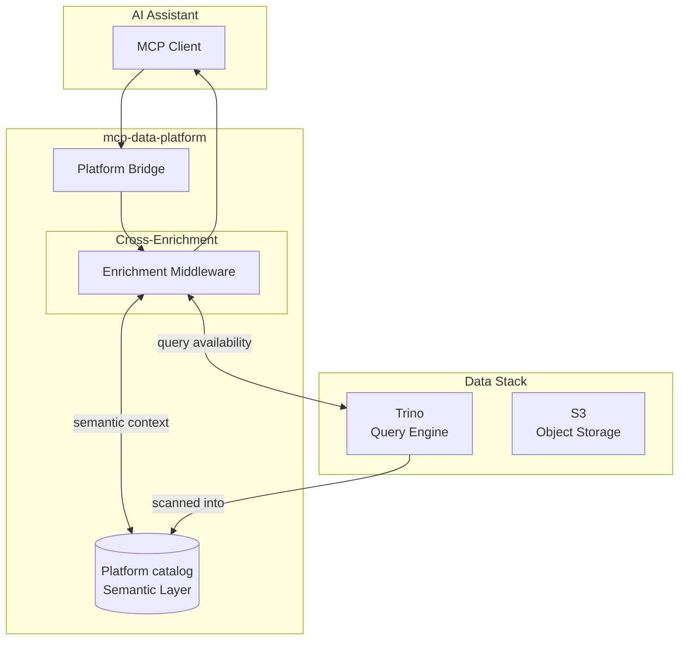

# The Data Stack: Catalog + Trino + S3

Modern data platforms need three things:

1. **Meaning** - What does the data represent?
2. **Access** - How do I query it?
3. **Storage** - Where does it live?

mcp-data-platform keeps its own catalog for meaning, uses Trino for access, and S3 for storage. Cross-enrichment wires them together so responses from one include context from the others.

This page explains the stack cross-enrichment composes, and why each piece was chosen. It is not a list of prerequisites: a deployment can attach Trino and S3 or neither. [Deployment Shapes](../server/deployment-shapes.md) covers what you get in each case.

---

## The Platform Catalog: The Semantic Layer

### What is it?

The [platform catalog](../server/catalog.md) is a data catalog the platform keeps in its own PostgreSQL. It records the datasets every connection can see, their columns, the glossary, tags, domains and data products, and the curation written on each: descriptions, owners, tags, glossary terms, properties, curated queries, incidents and context documents, with lineage recorded as data moves.

It stores the business context that turns raw schemas into something people can understand.

### Why a built-in catalog?

**Problem it solves**: Data exists everywhere, but understanding what it means requires tribal knowledge.

- Column `cid` in one system is `customer_id` in another
- PII columns aren't labeled, so compliance is a nightmare
- New team members spend weeks learning what data exists and what it means

**Why built in**:

| Capability | Benefit |
|------------|---------|
| Scanned from the connections | Every Trino, API and GraphQL connection is cataloged without an ingestion job |
| Curated where the work happens | People edit it in the portal; agents write approved knowledge to it with `apply_knowledge` |
| Versioned curation | Every change records who made it and what it replaced, and rolls back |
| Connection-scoped | A dataset belongs to the connection that sees it, so persona connection rules govern who reads it |
| Lineage from the platform's own work | SQL writes, managed-script runs and table registrations record edges |
| No extra service | It lives in the database the platform already needs |

**For AI assistants**: Without a catalog, an AI sees columns and types. With it, it sees what the data means, who owns it, and whether it has an open incident.

---

## Trino: Universal SQL Access

### What is Trino?

[Trino](https://trino.io/) (formerly PrestoSQL, from Facebook) is a distributed SQL query engine. It runs SQL queries against data where it lives, without moving it first. It uses massively parallel processing for analytical workloads.

### Why Trino for Query Execution?

**Problem it solves**: Data is scattered across dozens of systems. Each has its own query language, connection method, and quirks.

**Trino connects to everything**:

- **Relational databases**: PostgreSQL, MySQL, Oracle, SQL Server
- **Data warehouses**: Snowflake, BigQuery, Redshift
- **NoSQL**: Elasticsearch, MongoDB, Cassandra, Redis
- **Data lakes**: S3, HDFS, Delta Lake, Iceberg, Hudi
- **And more**: Kafka, Google Sheets, Prometheus

**One SQL dialect, every data source**:

```sql
-- Query across PostgreSQL, Elasticsearch, and S3 in one statement
SELECT
    p.customer_name,
    e.search_score,
    s.purchase_history
FROM postgresql.sales.customers p
JOIN elasticsearch.logs.searches e ON p.id = e.customer_id
JOIN hive.datalake.purchases s ON p.id = s.customer_id
```

**Why Trino specifically**:

| Capability | Benefit |
|------------|---------|
| Battle-tested at scale | Meta, Netflix, Uber, LinkedIn |
| Active community | Enterprise support via Starburst |
| Optimized for OLAP | Analytical queries, not OLTP |
| Cost-based optimizer | Efficient query plans |
| Standard ANSI SQL | No proprietary syntax |
| Federated queries | No data movement required |

**For AI assistants**: Trino gives AI one tool to query everything. The AI doesn't need to know whether data is in PostgreSQL, Elasticsearch, or a data lake. It's all SQL.

---

## S3: The Universal Data Lake

### What is S3?

Amazon S3 (or any S3-compatible service like SeaweedFS) is object storage. It stores files, images, JSON, Parquet, CSV, logs, and ML models. Most data lakes are built on S3 or something compatible with its API.

### Why S3 for Data Platform Access?

**Problem it solves**: Not all data is structured. Not all data is in databases. Data platforms must handle:

- **Structured data**: Tables, rows, columns (covered by Trino)
- **Semi-structured data**: JSON, XML, Avro, Parquet files
- **Unstructured data**: PDFs, images, documents, logs

**S3 as the data lake foundation**:

| Capability | Benefit |
|------------|---------|
| Infinite scale | Petabytes at low cost |
| Any file format | Parquet, ORC, JSON, CSV, images |
| Direct querying | Trino reads S3 via Hive, Iceberg, Delta |
| Object versioning | Track changes over time |
| S3-compatible | AWS, SeaweedFS, Ceph, DigitalOcean Spaces |

**For AI assistants**: S3 tools let AI find files, confirm they exist, read contents, and understand what's in the data lake.

---

## MCP Gateway: Third-Party MCP Integration

### What is the MCP Gateway?

The platform also acts as an **MCP client** against arbitrary upstream
MCP servers and re-exposes their tools through its own MCP server. A
third-party MCP — Salesforce Hosted MCP, a vendor's REST-wrapped MCP,
an internal team's tool collection — becomes available to AI assistants
under the platform's existing auth, persona, and audit envelope, with
no code changes on the client side.

### Why a Gateway?

Composing third-party MCPs directly with the customer's data has three
distinct values:

1. **Proximity** — tools from external systems land next to warehouse
   data and the catalog, so an AI working in one session can
   reason across vendor APIs and the customer's own data without
   switching contexts or credentials.
2. **Central control** — one auth flow, one persona model, one audit
   log. Whether the AI calls a Trino query or a remote vendor's MCP
   tool, the governance surface is identical.
3. **Configurable cross-enrichment** — declarative rules join proxied
   tool responses with warehouse / catalog context (e.g., a vendor's
   "get customer" tool can be enriched with the matching row from
   `mart.customers` automatically).

### How it surfaces

Tools from a gateway connection appear as `<connection>__<remote_tool>`
in `tools/list` (e.g., `vendor__send_email`). Persona globs work the
same way they do for native tools (`vendor__*`, `*_send_*`). Audit
rows have `toolkit_kind=mcp` and `connection=<connection_name>`.

### How operators use it

Connections are created and authenticated in the admin portal — no
YAML, no restarts. Authentication options include `none`, `bearer`,
`api_key`, and `oauth` (with both `client_credentials` and
`authorization_code` + PKCE grants). For `authorization_code` flows,
encrypted refresh tokens persist in `gateway_oauth_tokens` so cron
jobs and scheduled prompts run untouched after a one-time browser
sign-in.

See [Gateway Toolkit](../server/gateway.md) for the full reference.

---

## How They Work Together

### What each component lacks

| Component | Answers | Limitation Alone |
|-----------|---------|------------------|
| **Catalog** | "What does this mean?" | Can't query the data |
| **Trino** | "What's in this table?" | Doesn't know business context |
| **S3** | "What files exist?" | Just storage, no meaning |

### Cross-enrichment fills the gaps

**Trino to catalog**:

- Query a table → Get schema + description + owners + tags + glossary terms + open incidents
- No extra calls. One request. Complete context.

**Catalog to Trino**:

- Read a dataset from the catalog → See whether it is queryable, on which connection, and roughly how many rows it holds

### Use Case: Complete Data Discovery

```
User: "Find customer data I can analyze"

Without mcp-data-platform:
1. Search a catalog → find datasets
2. For each dataset, check if it's queryable
3. For each queryable one, find the Trino connection
4. Cross-reference ownership
→ Multiple tools, multiple calls, context assembly required

With mcp-data-platform:
1. search → matching datasets
2. fetch the one that fits → its curation, lineage, and where to query it
→ Two calls. Complete picture.
```

### Built for analytics

This stack is designed for **OLAP** (Online Analytical Processing):

- **S3**: Stores petabytes of historical data at low cost
- **Trino**: Runs analytical queries across that data
- **Catalog**: Adds business context to query results

Common use cases:

- Data discovery and exploration
- Business intelligence and reporting
- Data mining and pattern analysis
- ML feature engineering
- Compliance and data governance

---

## When to Use Each Component

| Scenario | Primary Component | Supporting Context |
|----------|-------------------|-------------------|
| "What customer tables exist?" | `search` over the catalog | Trino availability on `fetch` |
| "Query last month's orders" | Trino query | Catalog enrichment |
| "Find raw clickstream files" | S3 list | - |
| "Who owns this dataset?" | Catalog | - |
| "Where does this table come from?" | Catalog lineage | - |
| "Join data across systems" | Trino federation | Catalog context |

---

## Architecture: How They Connect



The platform acts as a bridge, intercepting requests and responses to add context from complementary services. Your AI assistant sees a unified view without knowing the complexity underneath.

---

## Without This Stack

Trino and S3 are optional. With neither configured, the platform starts normally on PostgreSQL alone: the API and MCP gateways, the knowledge layer, the memory layer, the portal, the catalog of the API and GraphQL connections, and `search`/`fetch` over all of them.

What it gives up is the warehouse: there is no table to query and so no query to enrich.

See [Deployment Shapes](../server/deployment-shapes.md) for the configuration and the full list of what each shape includes.

---

## Next Steps

<div class="grid cards" markdown>

-   :material-swap-horizontal: **See Cross-Enrichment in Action**

    ---

    Detailed examples of how Trino and the catalog enrich each other's responses.

    [:octicons-arrow-right-24: Cross-enrichment overview](../cross-enrichment/overview.md)

-   :material-server: **Deploy the Server**

    ---

    Configure the platform with your Trino and S3 instances.

    [:octicons-arrow-right-24: Server guide](../server/overview.md)

</div>
