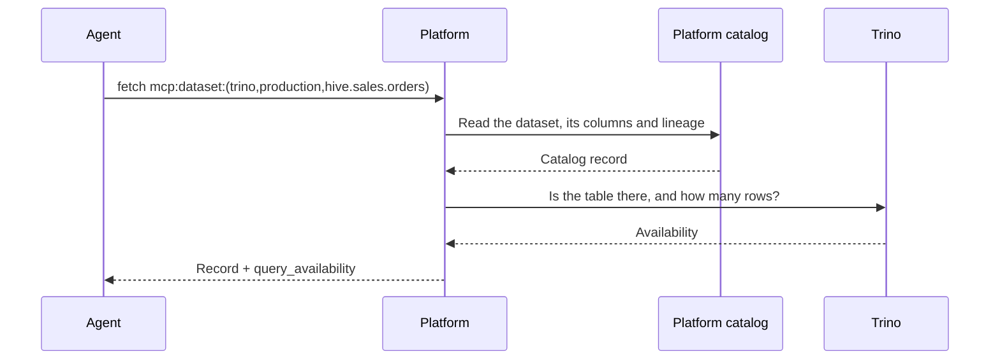

# Catalog to Trino Enrichment

A dataset read from the platform catalog says whether it can be queried, and
where. `fetch` on a table or view's `mcp:dataset:` reference returns the
catalog record with a `query_availability` block, so the one catalog read an
agent makes before writing SQL already names the table to query and the
connection that reaches it.

## What Gets Enriched

| Read | Enrichment |
|------|------------|
| `fetch mcp:dataset:(trino,<connection>,<catalog>.<schema>.<table>)` | `query_availability`: whether the table is queryable, its query table, its connection, and its estimated row count |

API and GraphQL operations are datasets too, but no query engine reads them,
so their records carry no `query_availability`.

## Example

**Tool call:** `fetch` with `ref: "mcp:dataset:(trino,production,hive.sales.orders)"`

The record carries the dataset, its columns and their curation, its lineage
within three hops either way, and:

```json
{
  "query_availability": {
    "available": true,
    "query_table": "hive.sales.orders",
    "connection": "production",
    "estimated_rows": 1500000
  }
}
```

A table the query engine cannot reach comes back with `available: false` and
the reason in `error`, which is what the reader needs to know before writing
a query.

## How It Works



The availability lookup is bounded by a short timeout; a lookup that fails or
runs out of time leaves the block off rather than failing the read.

## Table Resolution

A catalog dataset is keyed by the connection that sees it and the path that
connection uses, so a Trino dataset's reference already names the table:
`mcp:dataset:(trino,production,hive.sales.orders)` is `hive.sales.orders` on
the `production` connection. No mapping between catalog names and Trino names
is configured or needed.

## Configuration

```yaml
query:
  provider: trino
  instance: production    # The Trino connection availability is checked on
```

## Row Count Estimates

`estimated_rows` comes from Trino's table statistics. A table with no
statistics has none; run `ANALYZE` on it in Trino to collect them.

## Troubleshooting

**A table reads as not queryable when it should be:**

1. Verify the Trino table exists with the expected name.
2. Check that the query provider names the right connection.
3. Ensure the connection's Trino user may see the table.

## Next Steps

- [Trino to Catalog](trino-catalog.md) - The reverse direction
- [Platform Catalog](../server/catalog.md) - What the catalog holds and how it is curated
