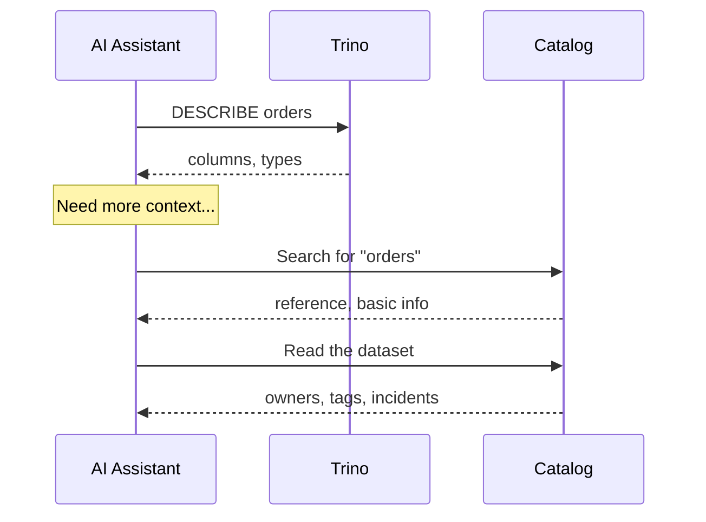
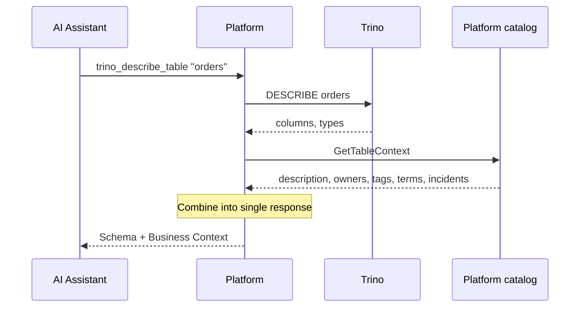
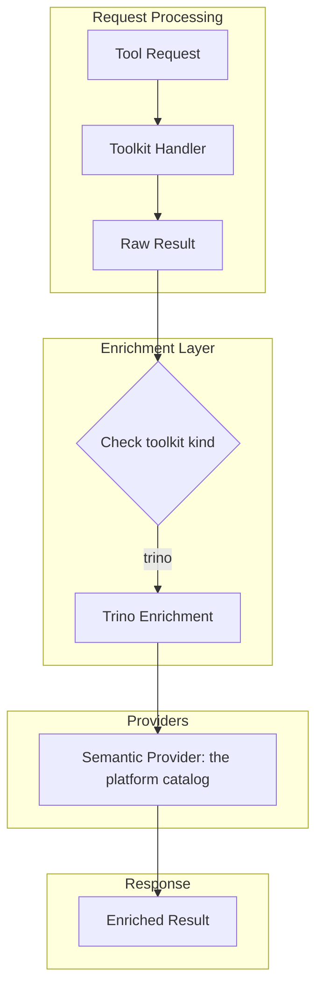
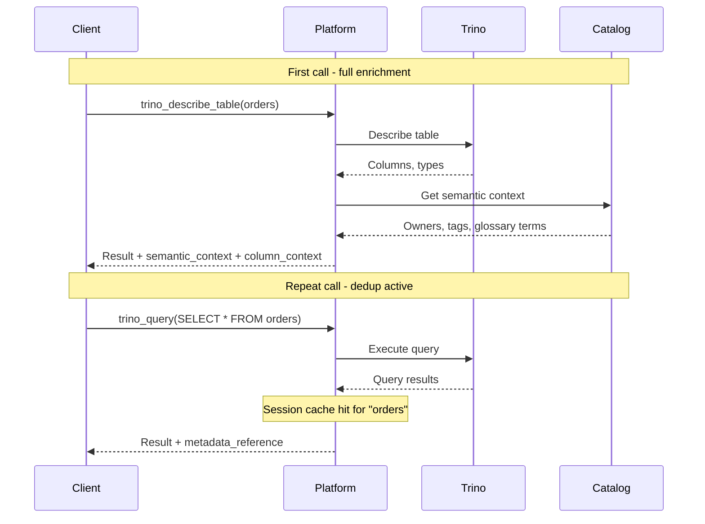

# Cross-Enrichment

Cross-enrichment is the key differentiator of mcp-data-platform. It automatically attaches context from other services to tool responses, without additional calls from the AI assistant. The context comes from the platform's own [catalog](../server/catalog.md), which every connection is scanned into and which people and agents curate.

---

## The Problem It Solves

Without cross-enrichment, understanding a single table requires multiple round-trips:



Several calls to understand one table. Each call adds latency and requires the AI to remember to ask.

---

## With Cross-Enrichment

The same workflow becomes a single call:



**One call.** Complete context.

---

## How It Works

The enrichment middleware intercepts tool responses and adds relevant context:



The reverse direction needs no middleware: `fetch` on a catalog dataset asks the
query provider whether the table is queryable and carries the answer on the
record. See [Catalog to Trino](catalog-trino.md).

### Enrichment Flow by Toolkit

| Toolkit | Provider Used | Context Added |
|---------|---------------|---------------|
| **Trino** | Semantic (the platform catalog) | Description, owners, tags, domain, glossary terms, properties, incidents, column curation |
| **S3** | Semantic (the platform catalog) | Matching catalog datasets for the bucket and prefix |
| **Catalog reads** (`fetch`) | Query (Trino) | Query availability: the table to query, its connection, estimated rows |

---

## What Gets Injected

### Semantic Context (Trino to Catalog)

When you query or describe a Trino table, the response includes:

```json
{
  "semantic_context": {
    "urn": "mcp:dataset:(trino,production,hive.sales.orders)",
    "description": "Customer orders with line items and payment information",
    "owners": [
      {"urn": "data-platform@example.com", "type": "user", "name": "data-platform@example.com", "email": "data-platform@example.com"}
    ],
    "tags": ["pii", "financial", "tier-1"],
    "domain": {"urn": "mcp:domain:4f1c", "name": "Sales"},
    "glossary_terms": [{"urn": "mcp:glossary_term:9a2e", "name": "Order"}],
    "custom_properties": {
      "data_retention_days": "365"
    },
    "active_incidents": 1,
    "incidents": [{"id": "inc-7", "title": "Late partition for 2024-06-02", "state": "active"}]
  },
  "column_context": {
    "customer_id": {
      "description": "Reference to customer record",
      "tags": ["pii"],
      "is_pii": true,
      "is_sensitive": true
    },
    "total_amount": {
      "description": "Order total including tax",
      "tags": ["financial"]
    }
  }
}
```

### Query Availability (Catalog to Trino)

`fetch` on a table's catalog reference carries whether it can be queried:

```json
{
  "query_availability": {
    "available": true,
    "query_table": "hive.sales.orders",
    "connection": "production",
    "estimated_rows": 1500000
  }
}
```

### Knowledge Pages (entity to knowledge)

When a tool result names entities, the response also carries the canonical
knowledge pages that document those entities, so an agent sees the business and
domain knowledge about what it just fetched. The entity references are read from the
result, the reverse lookup finds the pages that reference them, and a bounded
`knowledge_pages` block is appended (capped so a widely documented entity does not
balloon the response):

```json
{
  "urn": "mcp:dataset:(trino,production,iceberg.retail.daily_sales)",
  "knowledge_pages": [
    {"id": "kp_5cdde7bb", "slug": "retail-sales-vocabulary", "title": "Retail Sales Vocabulary"}
  ]
}
```

The same reverse lookup surfaces in two more agent-facing places:

- **`search(entity_urns=[...])`** returns the knowledge pages that reference each
  entity (datasets and connections), merged with the text-relevance results.
- **`list_connections`** carries, per connection, a `knowledge_page_count` and a
  bounded sample of the pages that document it. Where the kind has the notion it
  also carries `read_only`, answered identically for a connection this replica
  serves and one another replica saved, so writability is visible before a call
  rather than only in the refusal of one. `read_only: false` is not scoped to
  the connection's declared catalog, schema or bucket: those are defaults, not
  boundaries. See [Authorization](../concepts/authorization.md#what-the-boundary-enforces).

---

## Configuration

Cross-enrichment is on by default wherever the platform has a database: the
platform catalog is the semantic provider, and Trino enrichment defaults to
on.

```yaml
enrichment:
  trino_semantic_enrichment: true   # Trino results get catalog context (default)
  unwrap_json: true                 # Auto-unwrap single-row VARCHAR-of-JSON (default)
  column_context_filtering: true    # Only include SQL-referenced columns (default)

# The query provider answers "is this dataset queryable, and where" on a fetched dataset
query:
  provider: trino
  instance: production  # Must match a configured Trino connection
```

`semantic.provider: noop` turns the semantic layer off. Setting either
enrichment flag to `false` turns that path off.

---

## Failure Handling

Enrichment is designed to fail gracefully. A catalog lookup that fails is
logged and the tool result is returned without `semantic_context`; the query
itself succeeds. A table the catalog holds no dataset for adds nothing, and a
dataset with little curation adds little. With `semantic_fallback: true`, a
missed lookup offers the closest catalog datasets as suggested matches.

---

## Performance Considerations

### Latency Impact

Enrichment adds a catalog read per enriched table, read from the platform's own
PostgreSQL.

---

## Session Metadata Deduplication

### The Problem

When Trino enrichment is enabled, every tool call targeting a table receives ~2KB of semantic metadata (owners, tags, columns, glossary terms). In a typical AI session querying the same table 5-10 times, this repeats 10-20KB of identical metadata, consuming LLM context tokens with no new information.

### How It Works

Session dedup tracks which tables have been enriched per client session. On the first call, full metadata is sent. On repeat calls within the TTL, reduced content is sent based on the configured mode.



### Dedup Modes

| Mode | First Call | Repeat Calls | Use Case |
|------|-----------|--------------|----------|
| `reference` (default) | Full `semantic_context` + `column_context` | `metadata_reference` with table names and a note | Most scenarios - minimal tokens, LLM can refer back |
| `summary` | Full | Table-level `semantic_context` only, no column details | When LLM needs a reminder of table-level context |
| `none` | Full | No enrichment appended | Maximum token savings |

#### Mode: `reference` (default)

Repeat calls return a compact reference:

```json
{
  "metadata_reference": {
    "tables": ["hive.sales.orders"],
    "note": "Full semantic metadata was provided earlier in this session. Refer to previous responses for column descriptions, tags, owners, and glossary terms."
  }
}
```

#### Mode: `summary`

Repeat calls return table-level context without column details:

```json
{
  "semantic_context": {
    "description": "Customer orders with line items",
    "owners": [{"name": "Data Team", "type": "group"}],
    "tags": ["pii", "financial"],
    "domain": {"name": "Sales"}
  },
  "note": "Summary only. Full column metadata was provided earlier in this session."
}
```

#### Mode: `none`

Repeat calls return the raw tool result with no enrichment appended.

### Configuration

```yaml
enrichment:
  trino_semantic_enrichment: true
  column_context_filtering: true    # Only include SQL-referenced columns (default)
  session_dedup:
    enabled: true          # Default: true
    mode: reference        # reference (default), summary, none
    entry_ttl: 5m          # Defaults to semantic.cache.ttl
    session_timeout: 30m   # Defaults to server.streamable.session_timeout
```

| Field | Type | Default | Description |
|-------|------|---------|-------------|
| `enabled` | bool | `true` | Whether session dedup is active |
| `mode` | string | `reference` | What to send for repeat queries: `reference`, `summary`, `none` |
| `entry_ttl` | duration | semantic cache TTL | How long a table is considered "already sent" |
| `session_timeout` | duration | streamable session timeout | Idle time before a session's dedup state is cleaned up |

### Behavior Notes

- **Enabled by default**: Session dedup activates automatically when `trino_semantic_enrichment: true`. Set `session_dedup.enabled: false` to disable.
- **Trino-only**: Dedup applies to Trino tool calls, the ones enrichment adds context to.
- **In-memory state**: Session state is stored in memory and lost on restart. This is by design - after restart, the LLM gets fresh metadata.
- **Session isolation**: Each client session has independent dedup state. Two sessions querying the same table both get full metadata on their first call.
- **TTL defaults**: `entry_ttl` defaults to the semantic cache TTL (typically 5m). `session_timeout` defaults to the streamable HTTP session timeout (typically 30m).
- **SQL parsing**: The dedup logic extracts table names from SQL queries, so `SELECT * FROM orders JOIN products` correctly tracks both tables independently.

---

## Debugging Enrichment

### Enable Debug Logging

```bash
export LOG_LEVEL=debug
mcp-data-platform --config platform.yaml
```

### Check the Catalog Holds the Table

A table is enriched from the catalog dataset on its connection. Check that the
connection has been scanned (**Admin > Catalog > Scans**), and read the dataset
directly:

```
fetch mcp:dataset:(trino,<connection>,<catalog>.<schema>.<table>)
```

A not-found means the scan has not seen the table, or the catalog settings
exclude it.

---

## Related: Gateway Cross-Enrichment Rules

The [MCP gateway toolkit](../server/gateway.md) extends the
cross-enrichment pattern to **third-party MCP responses**. Where the
in-process enrichment above is hard-coded for native toolkits
(Trino and S3 against the catalog), the gateway exposes a **declarative rule
engine** that lets operators configure, per proxied tool, how the
response is augmented with warehouse / catalog context — without
writing Go.

Conceptually the same pattern (one source's response is enriched with
another's) but with three differences:

| | Native cross-enrichment | Gateway cross-enrichment rules |
|---|---|---|
| Configured by | Platform code | Operator, in the admin portal |
| Trigger | Hard-coded per toolkit | JSONB predicate (`always`, `response_contains`) |
| Source | The platform catalog | Catalog `get_dataset` / `get_definition`, Trino `query` |
| Bindings | Compile-time | JSONPath against `$.args`, `$.response`, `$.user` |
| Scope | All native tool calls | Per-rule, attached to a proxied tool name |

See [Cross-Enrichment Rules](../server/gateway.md#cross-enrichment-rules)
for the rule schema, dry-run preview, and failure semantics.

## Next Steps

- [Trino to Catalog Enrichment](trino-catalog.md) - Deep dive into Trino enrichment
- [Catalog to Trino Enrichment](catalog-trino.md) - Query availability on catalog reads
- [Examples Gallery](../examples/index.md) - Real-world configurations
