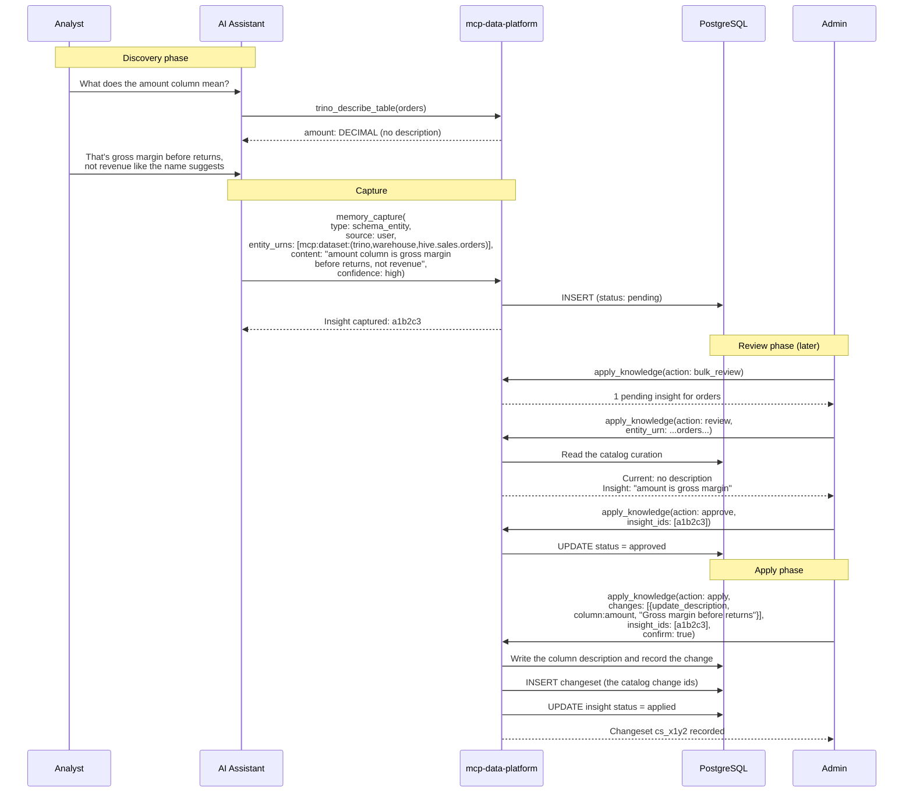

# Governance Workflow

Knowledge capture turns catalog metadata into something that evolves with use. Instead of metadata being a static artifact maintained by a central team, it improves continuously as domain experts share what they know during their normal work. This is active metadata management: the catalog gets better every time someone uses it.

This page covers the admin-side workflow for reviewing captured insights and writing approved changes to the [platform catalog](../server/catalog.md).

## The Review Process

All captured insights start with status `pending`. Admins review them through the `apply_knowledge` tool or the [Admin REST API](admin-api.md).


The portal carries the same queue under **Knowledge > Insights > Review
queue**: pending count and the age of the oldest item above the list, then
every insight with who captured it, its category, its confidence, and its
status.

### Bulk Review

Get an overview of all pending insights:

```json
{"action": "bulk_review"}
```

Response:

```json
{
  "total_pending": 7,
  "by_entity": [
    {
      "entity_urn": "urn:li:dataset:(urn:li:dataPlatform:trino,hive.sales.orders,PROD)",
      "count": 3,
      "categories": ["correction", "business_context"],
      "latest_at": "2025-01-15T14:30:00Z"
    },
    {
      "entity_urn": "urn:li:dataset:(urn:li:dataPlatform:trino,hive.finance.revenue,PROD)",
      "count": 4,
      "categories": ["data_quality", "usage_guidance", "enhancement"],
      "latest_at": "2025-01-15T16:45:00Z"
    }
  ],
  "by_category": {
    "correction": 2,
    "business_context": 1,
    "data_quality": 2,
    "usage_guidance": 1,
    "enhancement": 1
  },
  "by_confidence": {
    "high": 3,
    "medium": 4
  },
  "oldest_pending_at": "2025-01-15T14:30:00Z",
  "oldest_pending_age_days": 94,
  "pending_over_30d": 2,
  "note": "Counts are pending insights only (the global review queue). by_entity counts an insight once per entity URN it carries and omits insights that have no entity URN, so it does not sum to total_pending. Pass itemize:true to enumerate every pending insight (with id, captured_by and sink_class)."
}
```

The counts label their own scope: `total_pending` is the size of the global pending queue, while `by_entity` counts a multi-entity insight once per URN and omits entity-agnostic insights, so it does not sum to `total_pending`.

### Review-Queue Staleness

The knowledge flywheel only turns if humans work the queue, so `bulk_review` also reports how stale the pending queue is (present on both the counts and `itemize` paths, omitted when the queue is empty):

- `oldest_pending_at` / `oldest_pending_age_days`: the age of the oldest pending insight, so a long-unreviewed queue is visible at a glance.
- `pending_over_30d`: the count of pending insights aged 30 or more days (the accumulating review debt). The portal's per-row age badge flags a row stale at the same 30-day mark, so the count and the badge agree.

An agent can use these to nudge a reviewer (for example, "6 insights are pending review, the oldest is 94 days old"). The same rollup appears in `platform_info` under `features.knowledge_apply.review_queue` for any caller who can reach `apply_knowledge`. In the admin portal, the review queue view badges each pending insight by age and can be sorted oldest-first (`order=oldest` on the insights API) to work the stalest debt first.

All of the above surface staleness to whoever looks. For the operator who does not, a scheduled check emails a review-queue digest when the pending queue crosses a configured threshold (pending count, oldest age, or both), with a deep link into the review queue and a cooldown so a persistently stale queue does not alert every interval. It is configured in **Admin > Settings** and delivered through the notification substrate; see [Review queue alerts](../server/notifications.md#review-queue-alerts).

### Enumerate the Review Queue

`bulk_review` returns counts only. To list the pending insights themselves (the relevance-ranked `search` tool cannot enumerate the queue completely), pass `itemize: true`. The list is paginated by `offset`/`limit` (default 20, max 100) and carries `next_offset` while more remain:

```json
{"action": "bulk_review", "itemize": true, "limit": 50}
```

Each returned insight is the full record, including its `insight_text` body so a review pass can read every insight without a per-insight `fetch`, plus `id`, `captured_by` (the author), `session_id`, `persona`, `sink_class`, `category`, `confidence`, `status`, `entity_urns`, `related_columns`, and `created_at`. The `suggested_actions` array is replaced by `suggested_actions_count` to keep the listing bounded (`fetch mcp:insight:<id>` for the full actions). An entity-agnostic insight (one with no `entity_urns`, invisible to per-entity review) is still enumerable here. Page through by passing the previous response's `next_offset` as the next `offset`.

Each part of the response is bounded so it stays under the tool output limit even for a large queue: the insights window is byte-budgeted (when the budget is reached the page returns fewer than `limit` insights and sets `page_size_capped: true`), and `by_entity` is capped to the busiest entities (`by_entity_truncated: true` flags the cut; each insight still carries its full `entity_urns`). Treat `page_size_capped` as a normal "more remain" signal and continue paging with `next_offset`.

### Review by Entity

Drill into a specific entity to see its pending insights alongside its current catalog curation:

```json
{
  "action": "review",
  "entity_urn": "urn:li:dataset:(urn:li:dataPlatform:trino,hive.sales.orders,PROD)"
}
```

Response includes:

- Current catalog curation (description, tags, glossary terms, owners)
- All insights for this entity with their categories, text, confidence, and suggested actions

This side-by-side view helps admins assess whether an insight adds value compared to what's already in the catalog.

### Observed Warehouse State

Some claims are about entities the platform can query itself, and those are exactly the claims worth checking before promotion: a record count is settled by one query, and once the gate certifies it, every identity downstream inherits its standing.

So the review path shows the reviewer what it can see. When a pending insight's entity URN resolves through the configured query provider to an available table, the admin insights endpoints and the portal review drawer carry the observation beside the claim: what the entity is queryable as, which connection it lives on, and the rows it currently estimates. When the claim states a number that the table disagrees with, the item carries an advisory conflict marker naming both numbers.

The marker is advisory in the strict sense: it changes what a reviewer sees, never what a reviewer may do. Estimates are estimates, the number in a claim may be about something else entirely, and promotion is never refused mechanically.

Row counts require `enrichment.estimate_row_counts` ([Configuration](../server/configuration.md)), which is off by default because `COUNT(*)` can scan a whole table. With it off, the observation still states that the entity exists and is queryable — which is the larger half of the question — and claims no count.

A deployment with no query provider, an entity URN that does not resolve, a table reported unavailable, and an insight already decided all carry no observation at all: the payload and the drawer are exactly what they were. See the [Admin REST API](admin-api.md#observed-warehouse-state) for the field shape and the [Admin Portal guide](../portal/admin-knowledge.md#observed-warehouse-state) for the review surface.


When the claim states a number the table disagrees with, the item carries
the advisory conflict marker naming both:


With `enrichment.estimate_row_counts` off, the observation still states that
the entity exists and is queryable, and claims no count:


### Approve or Reject

Transition insight statuses with optional review notes:

```json
{
  "action": "approve",
  "insight_ids": ["a1b2c3d4e5f6", "f6e5d4c3b2a1"],
  "review_notes": "Verified with data engineering team"
}
```

```json
{
  "action": "reject",
  "insight_ids": ["deadbeef1234"],
  "review_notes": "Already documented in the column description"
}
```

Response:

```json
{
  "action": "approve",
  "updated": 2,
  "total": 2
}
```

If any IDs are invalid or the status transition is not allowed, those are reported in an `errors` array without blocking the valid ones.

## Synthesizing Changes

Once insights are approved, the `synthesize` action gathers them and builds structured change proposals:

```json
{
  "action": "synthesize",
  "entity_urn": "urn:li:dataset:(urn:li:dataPlatform:trino,hive.sales.orders,PROD)"
}
```

Response:

```json
{
  "entity_urn": "urn:li:dataset:(urn:li:dataPlatform:trino,hive.sales.orders,PROD)",
  "current_metadata": {
    "description": "Order records",
    "tags": ["financial"],
    "glossary_terms": [],
    "owners": ["Data Platform Team"]
  },
  "approved_insights": [
    {
      "id": "a1b2c3d4e5f6",
      "category": "correction",
      "insight_text": "The amount column represents gross margin before returns, not revenue.",
      "suggested_actions": [
        {"action_type": "update_description", "target": "entity", "detail": "Order records with gross margin amounts (before returns)"}
      ]
    }
  ],
  "proposed_changes": [
    {
      "change_type": "update_description",
      "target": "entity",
      "current_value": "Order records",
      "suggested_value": "Order records with gross margin amounts (before returns)",
      "source_insight_ids": ["a1b2c3d4e5f6"]
    }
  ]
}
```

The synthesis output shows current values alongside proposed changes, so admins can see exactly what will change. The `source_insight_ids` field traces each change back to the insight that proposed it.

## Applying Changes

The `apply` action writes changes to the platform catalog and records a changeset. `entity_urn` is the catalog reference of the dataset, column or definition; a DataHub dataset URN is read as the catalog dataset with the same path, on the first connection that catalogs it.

```json
{
  "action": "apply",
  "entity_urn": "mcp:dataset:(trino,warehouse,hive.sales.orders)",
  "changes": [
    {
      "change_type": "update_description",
      "target": "",
      "detail": "Order records with gross margin amounts (before returns)"
    },
    {
      "change_type": "add_tag",
      "target": "",
      "detail": "gross-margin"
    },
    {
      "change_type": "update_description",
      "target": "column:amount",
      "detail": "Gross margin before returns, not revenue."
    }
  ],
  "insight_ids": ["a1b2c3d4e5f6"],
  "confirm": true
}
```

When `require_confirmation` is enabled in configuration and `confirm` is not `true`, the tool returns a confirmation prompt instead of applying:

```json
{
  "confirmation_required": true,
  "entity_urn": "mcp:dataset:(trino,warehouse,hive.sales.orders)",
  "changes_count": 3,
  "message": "Set confirm: true to apply these changes."
}
```

The changes of one apply are written in one transaction, checked against what the apply read: when another writer changed one of those aspects in between, the apply reads and plans again (up to three times), so two applies to one entity at once both land. A change that cannot be applied (an incident id the dataset does not have, a column it does not have, a link with no URL) writes nothing, including the changes listed before it, and the error names the change.

### Supported Change Types

A dataset and its columns carry every kind of curation; curated queries, incidents and context documents are dataset-only; a glossary term, glossary node, domain, data product or tag carries a description, owners, custom properties and documentation links. `update_description`, `add_tag`, `remove_tag` and `add_glossary_term` take `target: "column:<name>"` to address a column of the dataset.

| Change Type | Description | Target Field | Detail Field |
|-------------|-------------|--------------|--------------|
| `update_description` | Set the description | `column:<name>` or empty | Description text |
| `add_tag` / `remove_tag` | Add or remove a tag | `column:<name>` or empty | Tag name (`mcp:tag:` and `urn:li:tag:` prefixes are read as the name) |
| `add_glossary_term` | Attach a glossary term; a name the catalog does not hold creates the term | `column:<name>` or empty | Term reference or name |
| `flag_quality_issue` | Add the `QualityIssue` tag and, on a dataset with a detail, open a `Data quality issue` incident carrying it (one per open detail) | (ignored) | Issue description |
| `add_documentation` | Add a documentation link (one per URL) | URL | Link description |
| `add_curated_query` | Keep a statement as a curated query on the dataset (one per name) | (ignored) | Query name. Also requires `query_sql`, and optionally `query_description` |
| `set_structured_property` / `remove_structured_property` | Set or remove a structured property | Property name | Value or JSON array |
| `raise_incident` / `resolve_incident` | Open an incident, or resolve one by id | Title / incident id | Description / resolution message |
| `add_context_document` / `update_context_document` / `remove_context_document` | Keep a document about the dataset | Title / document id | Content (`query_sql` a new title, `query_description` the category) |
| `set_custom_property` / `remove_custom_property` | Set or remove a custom property | Key | Value |
| `delete_tag` | Take the tag `entity_urn` names (`mcp:tag:<name>`) off every dataset and column carrying it | (ignored) | (ignored) |

### Apply Response

```json
{
  "changeset_id": "cs_x1y2z3a4b5c6",
  "entity_urn": "mcp:dataset:(trino,warehouse,hive.sales.orders)",
  "changes_applied": 3,
  "catalog_changes": 3,
  "insights_marked_applied": 1,
  "revertible": true,
  "resulting_state": {
    "description": "Order records with gross margin amounts (before returns)",
    "tags": ["gross-margin"],
    "glossary_terms": [],
    "owners": []
  },
  "message": "Changes written to the platform catalog. Roll back with action=rollback changeset_id=cs_x1y2z3a4b5c6."
}
```

Source insights move to `applied` status with a reference to the changeset. `catalog_changes` counts the aspects written; several changes to one aspect of one entity (two tags) are one write. `resulting_state` is a fresh read of the entity's description, tags, glossary terms and owners. `created_ids` lists what the apply created: the id of each incident and context document, which a later `resolve_incident` or `update_context_document` names, and the reference of each glossary term it created.

`revertible` is `true` for every catalog changeset except one that created a prompt, which a rollback does not delete.

## Changeset Tracking

Every `apply` action creates a changeset record in the `knowledge_changesets` table:

| Field | Description |
|-------|-------------|
| `id` | Unique changeset identifier |
| `target_urn` | The catalog reference of the entity the apply named |
| `change_type` | Summary of change types applied (or `multiple`) |
| `previous_value` | The entity's description, tags, glossary terms and owners before the apply |
| `new_value` | The changes that were applied, and `catalog_changes`: the ids of the catalog changes the apply wrote |
| `source_insight_ids` | Insights that produced this changeset |
| `applied_by` | User who applied the changes |
| `rolled_back` | Whether this changeset has been reverted |
| `rolled_back_by` | Who reverted the changes |
| `rolled_back_at` | When the changes were reverted |

The catalog keeps every write of every aspect with the value it replaced (see [Curation](../server/catalog.md#curation)), so a rollback restores exactly what each recorded change replaced, whatever its type.

## Discovering Changesets

Use the `list_changesets` action to find an entity's changesets without already holding their ids (for example, before a rollback):

```json
{ "action": "list_changesets", "entity_urn": "mcp:dataset:(trino,warehouse,hive.sales.orders)" }
```

A DataHub dataset URN finds the changesets recorded under the catalog reference it is read as. Each entry returns `changeset_id`, `created_at`, `applied_by`, `change_type`, `source_insight_ids`, the current `rolled_back` status, and the same `revertible` boolean (plus `unrevertible_change_types` when `false`) the apply response carries.

## Rollback

A changeset can be rolled back through either the `apply_knowledge` MCP tool or the [Admin REST API](admin-api.md). Both paths use the same revert engine.

```json
{ "action": "rollback", "changeset_id": "cs_x1y2z3a4b5c6", "confirm": true }
```

```bash
curl -X POST \
  https://mcp.example.com/api/v1/admin/knowledge/changesets/cs_x1y2z3a4b5c6/rollback \
  -H "Authorization: Bearer $ADMIN_TOKEN"
```

Rollback restores every aspect the changeset wrote to the value it replaced, in one transaction, and records each restore as a change of its own. It undoes every change type: descriptions, tags, glossary terms, documentation links, curated queries, properties, incidents, context documents, a `delete_tag` across every entity it touched, and a `bulk_untag`.

The rollback also returns the changeset's source insights to the review queue as `pending` (listed in the response's `insights_returned_to_review`) and records the rollback as its own auditable tool call referencing the original `changeset_id`.

Returning them is the point: reverting an application usually means the promotion went to the wrong destination, cited the wrong entity, or was worded badly, not that the underlying fact is worthless. A returned insight keeps its `applied_by`, `applied_at` and `changeset_ref` and carries a `review_notes` line naming the rolled-back changeset, so the reviewer who sees it next knows what was already tried. It is counted and itemized by `bulk_review` like any other pending insight, and it can be edited, approved and applied again, or rejected. `reject` remains the way to discard an insight permanently. An insight that is not in the `applied` state is left untouched, so rolling a changeset back twice never resurrects an insight that has since been decided.

**When rollback is refused, and nothing is reverted:**

- The changeset has already been rolled back.
- An aspect it wrote has been written again since, by any writer. Reverting would discard that newer write, so the rollback names it (the aspect, the entity, who wrote it and when); roll that change back first, or restore the desired state with a fresh apply.
- It created a prompt, which a rollback does not delete.
- It was applied to DataHub before the platform catalog replaced it, so its writes are not in the catalog's history. Restore the desired state with a fresh apply.

## Complete Workflow Example

An analyst discovers that the `amount` column in the orders table represents gross margin, not revenue. Here's how that knowledge flows through the system:



The next time anyone queries this table, the enriched response includes the corrected description.

## Next Steps

- [Admin API](admin-api.md) -- REST endpoints for managing insights and changesets
- [Knowledge Overview](overview.md) -- feature overview, categories, configuration
- [Audit Logging](../server/audit.md) -- all knowledge tool calls are audit logged
