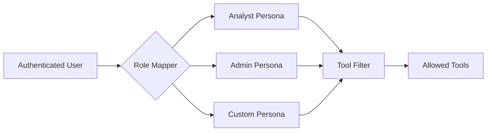

# Personas Overview

Personas provide role-based access control for MCP tools. Each persona defines which tools a user can access and can include custom prompts and hints for the AI assistant.

## What Is a Persona?

A persona is a named configuration that includes:

- **Display Name** - Human-readable identifier
- **Roles** - Which authenticated roles map to this persona
- **Tool Rules** - Allow and deny patterns for tool access
- **Connection Rules** - Allow and deny patterns for which toolkit connections the persona may reach, deny-by-default
- **API Routes** - Per-(connection, method, path) rules narrowing HTTP API gateway connections further
- **Context Overrides** - Per-persona customization of platform description and agent instructions

The connection rules carry the platform's authorization design: access is scoped at the connection rather than at the end user. [Authorization: the connection is the boundary](../concepts/authorization.md) states why, what that enforces, and what it does not.

## How Personas Work



1. User authenticates (OIDC or API key)
2. Roles are extracted from credentials
3. Role mapper finds the matching persona
4. Tool filter applies allow/deny rules
5. Only permitted tools are available

## Configuration

Define personas in your configuration:


A persona is defined in the YAML below or in the portal under **Admin >
Personas**, and the two produce the same persona. The editor previews what the
patterns admit as they are typed, counting the tools, connections and API
endpoints each decision allows and denies.


```yaml
personas:
  analyst:
    display_name: "Data Analyst"
    description: "Read-only access to query and explore data"
    roles: ["analyst", "data_user"]
    tools:
      allow: ["*"]
      deny:
        - "*_delete_*"
    connections:
      allow: ["*"]
    context:
      description_prefix: "You are helping a data analyst explore data."

  admin:
    display_name: "Administrator"
    description: "Full access to all tools"
    roles: ["admin", "platform_admin"]
    tools:
      allow: ["*"]
      deny: []
    connections:
      allow: ["*"]

  viewer:
    display_name: "Viewer"
    description: "Read-only access, no queries"
    roles: ["viewer", "guest"]
    tools:
      allow:
        - "platform_info"
        - "search"
        - "fetch"
        - "s3_list"
      deny:
        - "trino_query"
        - "trino_execute"
        - "s3_object"       # content, metadata and links are one tool
    connections:
      allow: ["*"]
```

Prefer `allow: ["*"]` with a targeted `deny`, as `analyst` does above. An
enumerated allow-list has to name every tool the persona will ever hold, so it
silently loses each tool a later upgrade adds — the persona keeps working, just
with less of the platform than the operator thinks it has. Enumerate only when
the persona is deliberately confined to a short, fixed list, as `viewer` is.

## Some tools are a unit

A few tools produce work that only another tool can consume. Granting one
without the other is a configuration error, not a tightening — the persona can
start something it can never finish:

| Granted | Also required | Because |
|---------|---------------|---------|
| `search` | `fetch` | `search` returns navigational pointers carrying a `reference`; `fetch` is the only tool that dereferences one. Without it the persona discovers that an answer exists and can never read it, and cannot follow a knowledge page's outbound references at all. |
| `memory_capture` | `search` | `search` is the retrieval front door for captured memory. Without it the persona writes knowledge that nobody, including itself, can retrieve. |
| `apply_knowledge` | `search` | The review workflow's documented first step is to discover what is already known before applying it. |

The server evaluates these pairs against the tools it actually registered — at
startup for every persona, and again on each persona write through the admin
API — and logs a warning naming the persona, the missing tool, and the fix:

```text
level=WARN msg="persona grants a capability it cannot complete"
  persona=analyst granted=search missing=fetch
  why="search returns navigational pointers carrying a reference and fetch is the
       only tool that dereferences one, so this persona can discover that an answer
       exists and never read it, ..."
  remedy="add \"fetch\" to persona \"analyst\"'s tools.allow, or remove the
          tools.deny pattern that withholds it"
```

It is a warning, not a gate: a restricted persona may be exactly what you
intended, and startup continues either way. A deployment that never registered
the missing tool is never warned about it.

The warning exists because the failure is otherwise invisible. The agent
instructions the platform hands out name a tool only when the caller can reach
it, so a persona missing `fetch` is simply never told that reading a result in
full is possible. Nothing errors. The only other symptom is an `unauthorized`
audit row, and only if an agent guesses the tool name unprompted.

!!! warning "The search-first gate needs `search`"

    `trino_query` and `trino_execute` are refused until `search` has been called
    in the session (see
    [Search-First Gate Configuration](../server/configuration.md#search-first-gate-configuration)).
    A persona granted query tools but not `search` cannot open that gate and is
    refused permanently. Grant `search` and `fetch` to every persona that
    queries, or turn the gate off with `workflow.require_search: false`.

## No persona means no access

Personas are the access boundary, not a set of preferences applied after the
fact. A caller whose roles match no persona is *unmapped*, and an unmapped
caller reaches nothing:

- MCP tool calls resolve to the built-in deny-all persona and are refused.
- The portal answers `403` with a branded page telling the person which account
  was refused and to ask an administrator for access.
- The managed-resources API refuses the request.

There is no fallback persona. Granting someone access means granting them a role
one of your personas lists — authenticating is not enough. An identity provider
will happily issue a token to every account in the directory; those accounts
have no roles you granted, so they map to no persona and get in nowhere.

!!! warning "`default_persona` was removed"

    Earlier releases accepted `personas.default_persona`, which assigned that
    persona to every caller whose roles matched nothing — including accounts
    with no claims at all. A config that still sets it is refused at startup
    with an error naming the key. Remove it and list the roles you actually
    want to grant on the personas themselves.

### Anonymous and no-auth deployments

A deployment running with `auth.allow_anonymous: true`, or with no
authenticators configured at all, gives its callers the role `anonymous`. Open
access is therefore something a persona opts into by name:

```yaml
auth:
  allow_anonymous: true

personas:
  developer:
    display_name: "Developer"
    roles: ["admin", "anonymous"]   # anonymous callers land here
    tools:
      allow: ["*"]
    connections:
      allow: ["*"]
```

Without a persona listing `anonymous`, an unidentified caller maps to no persona
and reaches nothing — the same rule as everyone else.

## Built-in Personas

The platform includes two built-in personas that can be overridden:

**Default Persona:**
```yaml
personas:
  default:
    display_name: "Default User (No Access)"
    roles: []
    tools:
      allow: []
      deny: ["*"]
    connections: {}   # deny-by-default: no connection is reachable
```

The built-in default persona is **deny-all**, not allow-all: a user who
matches no configured persona gets no tools. This is fail-closed by design —
unmatched users must be explicitly granted access through a persona rather
than falling back to broad permissions. Define explicit personas (with
matching `roles`) for every group of users you want to grant tool access to.

**Admin Persona:**
```yaml
personas:
  admin:
    display_name: "Administrator"
    roles: ["admin"]
    tools:
      allow: ["*"]
      deny: []
    connections:
      allow: ["*"]
    priority: 100
```

The built-in admin persona also grants `connections.allow: ["*"]`. Since
connections are deny-by-default (see below), an admin override that omits
the `connections` block would reach zero connections despite having
`tools.allow: ["*"]`.

## Persona Priority

When a user has roles matching multiple personas, priority determines which one is used:

```yaml
personas:
  analyst:
    roles: ["analyst"]
    priority: 10

  senior_analyst:
    roles: ["analyst", "senior"]
    priority: 20    # Higher priority wins

  admin:
    roles: ["admin"]
    priority: 100   # Admin always wins if user has admin role
```

A user with roles `["analyst", "senior"]` gets the `senior_analyst` persona (higher priority).

Resolution is one rule wherever a persona is read: the MCP tools, the portal, the admin API and managed resources all resolve the same persona (#2228). A role named in `personas.role_mapping.oidc_to_persona` selects its persona first; otherwise the highest priority among the personas the roles match wins, and two personas of equal priority resolve to the one whose name sorts first, on every request.

An administrator is a user whose roles resolve to the admin persona (`admin.persona`). That is the one rule every surface applies: a user whose roles also match a higher-priority persona resolves to that persona and is not an administrator anywhere, and a role named `admin` or `platform-admin` grants nothing on its own.

## Context Overrides

Personas can include context overrides that customize the platform description and agent instructions returned by the `platform_info` tool:

```yaml
analyst:
  context:
    description_prefix: |
      You are helping a data analyst. Focus on:
      - Data exploration and analysis
      - SQL best practices
      - Statistical insights

    agent_instructions_suffix: |
      When writing SQL:
      - Use meaningful aliases
      - Add comments for complex logic
      - Limit results to avoid overwhelming output
      Always explain query results in business terms.
```

### Override Fields

| Field | Effect |
|-------|--------|
| `description_prefix` | Prepended to the platform description |
| `description_override` | Replaces the platform description entirely |
| `agent_instructions_suffix` | Appended to the platform agent instructions |
| `agent_instructions_override` | Replaces the platform agent instructions entirely |

Override fields (`description_override`, `agent_instructions_override`) take precedence over prefix/suffix fields. If both a prefix and an override are set, only the override is used.

## Service Accounts

An automated caller, such as an integration that signs in with an API key and calls `api_invoke_endpoint` once per upstream record, should have a persona of its own marked as a service account:

```yaml
integration:
  display_name: "CRM integration"
  roles: ["crm-sync"]
  service_account: true
```

| Field | Type | Default | Effect |
|-------|------|---------|--------|
| `service_account` | bool | `false` | The persona's calls are audited but not added to the call catalog (Calls), and the records it wrote before it was marked are removed by the catalog's next sweep. |

The portal's persona editor shows the same setting as the **Automated caller** account type in its Identity section (#2257). A persona is for internal people, external people or an automated caller, one of the three: `service_account` and `external` are never both set, and the admin API refuses a persona that sets both. The editor adds "Also excluded by configuration" when `calls.exclude_personas` names the persona too. It changes nothing about what the persona may call: access is decided by its tool, connection and API route rules as before. See [Excluding an automated caller](../server/configuration.md#excluding-an-automated-caller).

## Portal permissions

A persona's `portal` block sets what its people may do in the portal, one setting per area (#2225). The navigation shows only what the persona has, and every route of an area answers `403` naming the area when the level does not allow the request. Administrators have every area, whatever their persona says. The block governs the portal only: what an agent may call is still decided by `tools:`, `connections:` and `api_routes:`.

```yaml
client:
  display_name: "Client"
  roles: ["client"]
  portal:
    assets: shared
    resources: shared
    knowledge: none
    catalog: none
    apis: none
    automations: false
    memory: false
  allow_sharing: false
```

| Area | Levels | What each allows |
|------|--------|------------------|
| `assets` | `shared`, `own` | `shared` reads and works on the assets and collections shared with the person, and creates none (`POST /api/v1/portal/assets`, `POST /api/v1/portal/collections` and a copy answer `403`); `own` creates and owns them too. |
| `resources` | `none`, `shared`, `own`, `persona` | `none` refuses every `/api/v1/resources` route; `shared` reads the person's own folder, their persona's folder and Global and uploads nothing; `own` uploads to the person's own folder, which administrators see, and opens no persona folder; `persona` is the person's own folder, their persona's folder and Global, as before the setting existed. |
| `knowledge` | `none`, `read`, `write` | Knowledge pages: `read` lists and opens them, `write` creates, edits and removes them. |
| `catalog` | `none`, `read`, `write` | The portal catalog: `read` browses it, `write` curates it. |
| `apis` | `none`, `browse` | The API browser (`/api/v1/apis`), still filtered by the persona's connections and API routes. |
| `scratch_tables` | `none`, `list`, `register` | The scratch-table routes and the Scratch Tables page (#2257): `list` lists the tables registered on the persona's connections (`GET /api/v1/tables`, `GET /api/v1/table-connections`, a file's or asset's `GET .../tables`), `register` also registers and unregisters a table over a file. Registering over a resource also needs a `resources` level above `none`. The tables are still on the persona's connections, and SQL through `trino_execute` is a tool. |
| `feedback` | `true`, `false` | Threads, comments, the feedback inbox and sign-off. |
| `prompts` | `true`, `false` | The prompt library. |
| `automations` | `true`, `false` | Managed scripts in the portal. |
| `search` | `true`, `false` | The portal's unified search. |
| `memory` | `true`, `false` | Memory and insights. |
| `download` | `true`, `false` | PDF export: the Export PDF action and the PDF routes (`GET /api/v1/portal/assets/{id}/pdf`, `GET /api/v1/resources/{id}/pdf` and their versions), which answer `403` when it is off. The editor calls it **PDF export**. Downloading a file reads the same bytes viewing does, so it is not governed by this. |
| `history` | `true`, `false` | Earlier versions (#2290): `true` lets the persona's people read the earlier versions of an asset shared with them as viewer; `false`, the default, shows a viewer the current version only, with no history, and `GET /api/v1/portal/assets/{id}/versions`, an earlier version's content, a signed URL for one and `manage_asset` `list_versions` and `diff` answer `403`. The asset's owner, anyone it is shared with as editor (by a direct share or a collection's) and administrators always read its history; a person of an external persona is held to viewer, so for them the setting alone decides. The editor calls it **Earlier versions**. |
| `external_files` | `none`, `view`, `manage` | External files (#2290): every external person's own folder. `view` lists the folders (`GET /api/v1/resources/external-folders`, the **External files** folder of the Resources page) and opens the files in them; `manage` also renames them, adds versions, moves, deletes and shares them, and uploads into the folders. Default `none`; an external persona always has `none`, and administrators have `manage`. |
| `uploads` | `true`, `false` | An external persona only: its people may upload files to their own folder (#2258, #2290). Default `false`. Saving it on an internal persona is refused. |

An area the block leaves unset, and every area of a persona with no block, resolves to what the persona reached before the setting existed: `assets: own`, `resources: persona`, `apis: browse`, `scratch_tables: register`, `external_files: none`, `history: false` and every other switch on; `knowledge: write` when the persona's tools include `apply_knowledge` and `read` otherwise; `catalog: write` when they include `apply_knowledge` and `fetch`, `read` with `fetch` alone, `none` without it. `GET /api/v1/portal/me` reports the caller's block with every area resolved.

The portal's persona editor shows the block in its **Portal access** section, and saving there writes every area. `GET /api/v1/admin/personas/{name}` returns the block as stored in `portal`, the block the persona's people get in `effective_portal`, and the areas External lowered in `capped_by_external`, so saving an external persona leaves its stored levels where they were.

The portal levels govern the portal only. A persona's MCP resources, MCP prompts and the memory tools are not governed by `resources`, `prompts` or `memory`; `memory_manage` lists the memory of every person of the persona, preferences included. `hide_automations: true`, the setting `portal.automations` replaced (#2109), is still read as `automations: false` when the block does not set `automations`.

## Sharing

Sharing what they own, with a person or to a notification channel, is a persona permission (#2241). It is allowed unless a persona withholds it:

```yaml
contractor:
  display_name: "Contractor"
  roles: ["contractor"]
  allow_sharing: false
```

| Field | Type | Default | Effect |
|-------|------|---------|--------|
| `allow_sharing` | bool | `true` | `false` takes the Share action off assets, collections, prompts and files in the portal, and refuses every share-creating route (`POST .../shares`, `POST /api/v1/portal/assets/{id}/channel-shares`, `POST /api/v1/resources/{id}/channel-shares`), approving a request for access (which writes a share), and the channel list (`GET /api/v1/portal/channels`) with `403`. `manage_asset action=share`, an export's `create_public_link`, and `notify action=publish` with `access` `signed_in` or `public` are refused the same way. |

The portal's persona editor shows the setting as the **Sharing** checkbox in its Portal access section. `GET /api/v1/portal/me` reports it as `sharing`. It is read from the persona the caller resolves to, and administrators can always share. Connection scoping still applies to a persona that can share: it is offered only the channels on connections it reaches.

## External personas

A persona marked `external: true` is for people outside the organization (#2290). An external person is an account in the organization's identity provider like any other, given a role there; the role resolves to an external persona, and the mark is what tells them apart from employees. A deployment can have many external personas, typically one per client organization, each with one or more people:

```yaml
client-a:
  display_name: "Client A"
  roles: ["client-a"]
  external: true
  portal:
    feedback: true
    download: false
    uploads: true
client-b:
  display_name: "Client B"
  roles: ["client-b"]
  external: true
```

Whatever the rest of the persona says, an external persona:

- is denied every MCP tool, so an external person has no agent access, `search` and `fetch` included;
- has `assets: shared`, `resources: shared` (or `none`), `knowledge`, `catalog`, `apis`, `scratch_tables` and `external_files` at `none`, and `search`, `prompts`, `automations` and `memory` off. `feedback`, `download`, `history` and `uploads` stay as the block sets them;
- reads its people's own folders and nothing else in Resources: no persona folder and no Global (#2257, #2290);
- opens the assets, collections and files shared with its people, one by one or with the persona, as a viewer, whatever permission the share carries;
- cannot share, has no API keys, no people directory and no mentions, reaches no admin route and no authenticated endpoint (`/endpoints/`);
- reaches only these portal routes under `/api/v1/portal/`: `me`, `assets`, `collections`, `shared-with-me`, `shared-collections`, `threads`, `worklist`, `feedback`, `notification-prefs` and `notifications`. Every other one, a route added later included, answers `403`.

On a thread, an external person sees and writes only threads shared with them (#2227), is not mentioned in an internal thread, and is not notified of one.

Sharing with an external persona reaches every person whose role resolves to it, and only them. Anyone who can share may address a share to any persona (#2290); naming one grants nothing to anyone outside it. The share dialog, Admin > Users and the audit drawer mark each external person and persona **External**: `GET /api/v1/portal/users` reports `external` on each person, `GET /api/v1/portal/share-personas` on each persona, and `GET /api/v1/admin/users` reports each person's `persona` and `external`.

The administrator persona is never external: the admin API refuses saving it so with `400`, a configuration file that marks it so is refused at startup, and one written to the store directly is still not an administrator anywhere (the admin API, the MCP tools, stored secrets, managed resources, script runs). Every surface asks the persona registry's one administrator rule rather than comparing a persona's name.

The portal's persona editor shows the setting as the **External people** account type in its Identity section, and the persona's access summary lists how many people it has.

### Uploads by external people

An external persona with `uploads: true` lets its people send files: a person of the persona uploads through `POST /api/v1/resources` to their own folder, and an upload to any other folder answers `403`. The upload is shared with no one on arrival. The people who see it are those whose persona has [External files](#portal-permissions) at `view` or `manage`, and administrators, under the **External files** folder of the Resources page, one folder per external person named for them and their persona. The deployment's `resources.managed.max_upload_bytes` and content-type detection apply as to every upload. Without `uploads`, `POST /api/v1/resources` answers `403`.

The `share_personas` and `share_emails` lists #2258 named under `uploads` are gone. Migration 000219 reads a persona stored with them as `uploads: true`. A configuration file that still names them under `uploads` is logged as an unrecognized key (`config_validation_warnings_total{code="unrecognized_keys"}`) and its persona's uploads are off until the file says `uploads: true`; with `config.strict: true` the platform refuses to start.

## What a persona reaches

`POST /api/v1/admin/personas/effective-access` evaluates a persona, saved or not, the way every request is evaluated (#2257). Its body is the persona as the create route takes it, and the answer reports:

- the tools its people can call and on which connections: a tool allowed by a pattern is not callable when every connection it reaches is denied;
- the connections, with any scratch catalog each carries and the notification channels that deliver through it;
- the API operations `api_invoke_endpoint` may call, and for each one that cannot be called, whether its connection, the tool, or External stops it;
- the scratch tables: on each scratch connection it reaches, whether it can list and register, whether it can drop any registered table through SQL (`trino_execute` on a connection whose Trino user holds every privilege on the scratch catalog), how many tables are registered there, and the connections through which `trino_query` reads every registered table when their Trino user reads the scratch catalog;
- the portal block as stored and as External leaves it, sharing, and the resource folders its people read;
- who gets it: its roles, the roles `personas.role_mapping` assigns it, the other personas listing one of its roles, and the role that writes its folder (`persona-admin:<name>`);
- the grants other objects hold that name it: stored secrets (and how many secrets name no persona, which every persona may use), script run grants, scripts whose latest version was saved with roles that resolve to it (a run carries those roles, so editing the persona changes what they can do), persona-scoped prompts, shares to it, webhook sources writing to its folder, the authenticated endpoints whose callers name it (`persona:<name>`), external accounts, and API keys whose roles resolve to it;
- the endpoints no persona governs: the authenticated endpoints whose callers are `*`, which every authenticated caller of an internal persona calls, and the public and bot_check endpoints, which anyone calls.

The portal's persona editor shows the answer as its **Access summary**, recomputed as the page changes. `DELETE /api/v1/admin/personas/{name}` answers `409` with the same references while any remain, and deletes with `?confirm=true`: a persona created later under the name would inherit them.

A person's persona folder and persona-scoped prompts follow role overlap, not the persona the person resolves to: anyone holding one of a persona's roles reads its folder and prompts, whichever persona wins. The editor warns when another persona lists the same role.

## Sharing with a persona

A share can be addressed to a persona instead of a person (#2089). Everyone who resolves to that persona when they open the item opens it, so a person who joins the persona afterwards gains it and one who leaves loses it, with no change to the share. In the share dialog a persona is a group: typing its name in **Add people or groups** lists it under **Groups** with how many people it reaches now (#2291), counted as its members are notified; anyone who can share may share with any persona (#2290). Each current member is notified by their own notification preferences, and the share is listed once on the item under **People with access**, by the persona's name and its size. `GET /api/v1/portal/share-personas` answers each persona's `member_count`. `POST .../shares` takes `shared_with_persona` in place of `shared_with_email`, and a share naming both is refused.

## Connection Access Control

Personas can restrict which toolkit connections a user may access. The boundary applies to both halves of using the platform: a tool call must pass the tool pattern check and the connection check, and the discovery surfaces show only the connections a persona is granted.

```yaml
personas:
  analyst:
    display_name: "Data Analyst"
    roles: ["analyst"]
    tools:
      allow: ["*"]
    connections:
      allow: ["prod-*"]
      deny: ["prod-admin-*"]

  admin:
    display_name: "Administrator"
    roles: ["admin"]
    tools:
      allow: ["*"]
    connections:
      allow: ["*"]   # required: connections are deny-by-default
```

### The connection is the authorization boundary

This is the platform's authorization design, not a filter layered on top of one. A connection is a named binding to one downstream system under one credential, and several connections may front the *same* system under *different* credentials at different permission levels. That is the intended shape: a read-only Trino account and a write-capable one on the same cluster become two connections, and personas are granted one or both. The API gateway uses the same split heavily, with `api_routes` narrowing a connection further by method and path.

What follows from that:

- **The permission level a caller gets is the permission level of the credential bound to the connection they were granted.** Tighten access by adding a connection with a narrower downstream account, not by adding a role that lands on the same connection.
- **The platform does not impersonate the caller downstream.** There is no per-user token exchange and no session-user propagation; everyone granted a connection acts as that connection's credential. Warehouse row policies and column masks that key off the end user therefore do not follow a caller through the platform. Expressing per-person policy means one connection per distinct policy outcome.
- **Per-user attribution comes from the audit trail.** With audit enabled, each tool call records `user_id`, `user_email`, `persona`, and the connection it targeted, so the platform can answer who ran what, as which persona, through which connection, even though the downstream system sees only the service account. Audit needs a database and can be switched off, so a deployment relying on connection-scoping should keep it on.

[Authorization: the connection is the boundary](../concepts/authorization.md) covers the rationale, the trade against per-user identity passthrough, and when to reach for another connection instead of another role.

### How Connection Filtering Works

1. When a tool call arrives, the middleware identifies which toolkit connection the tool belongs to
2. The user's persona connection rules are evaluated: deny patterns are checked first, then allow patterns
3. If the connection is denied (or not allowed), the tool call is rejected

Discovery evaluates the same rules against the same persona, so what a caller can find and what a caller can call cannot disagree.

Connections are **deny-by-default**, mirroring the tool axis: a persona reaches a connection only when a `connections.allow` pattern matches its name. If the `connections` block is omitted or `allow` is empty, the persona is granted **no** connections, so every tool call that targets a connection is denied. Grant each persona exactly the connections it needs (the admin persona typically uses `allow: ["*"]`).

The name a pattern matches is the name a call binds the connection by, which `list_connections` reports as `connection`: the `instances:` key, or the `connection_name` an S3 instance sets in its place. See [Connection Names](../server/multi-provider.md#connection-names).

### What Discovery Shows

The same rules narrow what a persona can see, not only what it can call:

- **`search`** omits catalog datasets, connections, and API endpoints that belong to a connection the persona is not granted. A catalog dataset belongs to the connection its reference names, and is shown only when the persona reaches that connection.
- **`fetch`** returns `found: false` for a reference behind a connection the persona is not granted, so a citation cannot read around what search omitted.
- **`list_connections`** enumerates only the granted connections.
- The **portal search** applies the same boundary; it shares one router with the `search` tool.

Nothing is dropped silently. Each surface reports what it removed: `search` adds a `withheld` count per source in its coverage block plus a `withheld_notice` naming the persona and the remedy, `list_connections` returns `withheld` and `notice`, and the portal search UI renders the same message above the results. An agent that reads a shortened result set with no explanation concludes the data does not exist and re-derives it; the count turns that into "present, but not yours to see."

This is a metadata boundary. It hides names, descriptions, and inventory across connections; the data behind them was already gated at `tools/call`.

### Pattern Syntax

Connection patterns use the same wildcard syntax as tool patterns:

- `*` matches any sequence of characters
- `prod-*` matches `prod-trino`, `prod-s3`, etc.
- `*-readonly` matches `trino-readonly`, `s3-readonly`, etc.

## API Endpoint Rules

A persona that reaches an `api` connection can call every operation that connection exposes. `api_routes` narrows that to specific HTTP methods and paths, which is how one API is split into read-only and read-write access without two connections and two credentials.

The same rules govern a `graphql` connection, because a GraphQL operation carries the same three coordinates: the method is the operation kind (`QUERY` or `MUTATION`) and the path is the dotted operation id with dots as slashes (`/masterData/product/query`). See [Governing a GraphQL connection](#governing-a-graphql-connection) below.

```yaml
personas:
  analyst:
    display_name: "Data Analyst"
    roles: ["analyst"]
    tools:
      allow: ["*"]
    connections:
      allow: ["crm-*"]
    api_routes:
      - connection: "crm-*"
        methods: ["GET", "HEAD"]
      - connection: "crm-*"
        methods: ["DELETE"]
        paths: ["/v1/orders/{id}"]
        action: deny
```

Each entry has four fields:

| Field | Meaning |
|-------|---------|
| `connection` | Glob matched against the connection name. Required. |
| `methods` | HTTP method globs. Omitted or empty matches any method. Written uppercase; the portal uppercases what you type, because inbound methods are uppercased before matching and the comparison is case-sensitive. |
| `paths` | Path globs. Omitted or empty matches any path. |
| `action` | `allow` (the default) or `deny`. |

Evaluation, against one `(connection, method, path)`:

1. Entries whose `connection` glob does not match are skipped.
2. Among the rest, a matching `deny` entry refuses the call.
3. Otherwise a matching `allow` entry is required.
4. **If no entry names the connection at all, the check is a no-op** and the connection-level grant is the sole gate. A persona written before `api_routes` existed behaves exactly as it did.

Step 4 is why `api_routes` is a narrowing and not a second grant: adding a rule for one connection does not close the others.

### Paths are matched in both forms

A path glob is matched against the path the call reaches (`/v1/orders/42`) **and** the catalog path the operation declares (`/v1/orders/{id}`). Naming the declared path is the precise way to govern one operation: `paths: ["/v1/orders/{id}"]` covers every call that operation serves and touches no other operation. A glob such as `/v1/orders/*` is a different rule, and it also matches sibling operations at that depth, `/v1/orders/summary` among them.

Globs use the same wildcard syntax as tool and connection patterns, where `*` does not cross a `/`. A path glob therefore governs one segment: `/v1/orders/*` matches `/v1/orders/42` but not `/v1/orders/42/items`. There is no recursive form — `**` is two stars and stops at a separator exactly as one does — so covering a subtree means one rule per depth, or a rule on the connection with no `paths` at all.

### The rules are the same in the portal

`api_routes` is part of a persona wherever the persona is defined. **Settings > Personas > Permissions > API endpoints** lists the API connections and, under each, the operations its catalog declares, showing the persona's current decision on each one and the rule that produced it. Selecting an operation to allow or deny writes an entry naming that operation's own method and declared path, so a rule written in the portal and one written in YAML are the same rule.

A rule written as a glob is shown as the glob it was typed as and is not rewritten when the persona is saved. Use the rule editor directly for a pattern no indexed operation corresponds to, such as a path prefix on a connection whose spec has not been loaded yet.

**Settings > Personas > Test access** answers a `(connection, method, path)` question against the saved persona and returns the rule that decided it.


### Governing a GraphQL connection

A `graphql` connection is governed by the same entries. Its method is the operation kind and its path is the dotted operation id with dots as slashes, so the coordinates `graphql_discover` reports on an operation (`kind`, `path`) are exactly what a rule names.

A read-only persona on a GraphQL connection is one entry — an allow naming the QUERY method:

```yaml
    api_routes:
      - connection: "erp"
        methods: ["QUERY"]
```

An allow, not a deny, for the reason step 3 gives: once any entry names a connection a matching allow is required, so a mutation is refused by matching none, while a deny on its own would close the connection to every method rather than to mutations. Adding the deny beside it states the intent and is what the refusal names.

Naming no `paths` is what makes the entry cover every operation. A path glob would not: `*` does not cross a `/` and there is no recursive form, so a glob covers one depth. Name paths to scope further, one rule per depth as everywhere else:

```yaml
    api_routes:
      - connection: "erp"
        methods: ["QUERY"]
        paths: ["/masterData/product/*"]
```

A document is reduced to the operations it invokes rather than to its root fields, so `{ masterData { product { read(_id: "1") { _id } } } }` is authorized as `QUERY /masterData/product/read` and a rule can name an entity's verb rather than only a whole package. Aliases are resolved to the underlying field name and fragments are expanded, so a denied operation cannot be reached by renaming it or hiding it in a fragment. Every operation a document invokes must pass: a mixed document is refused when any one of them is denied, rather than being sent with the denied part stripped.

A connection-level `read_only: true` refuses mutations for every persona, which is what an operator sets once when an endpoint is mounted for reporting rather than writing the same deny entry into every persona.

### What this does not do

`api_routes` does not make an API connection deny-by-default. A connection no rule names stays fully reachable by any persona granted that connection, which is the connection boundary doing its job. To hide a subset of an API from a persona entirely, either write an `allow` rule for the operations it should reach (which makes everything else on that connection unreachable, per step 3) or bind the narrower access to its own connection.

## Knowledge Tool Access

The knowledge capture tools follow the same allow/deny patterns. Control who can capture insights and who can apply them:

```yaml
personas:
  analyst:
    display_name: "Data Analyst"
    roles: ["analyst"]
    tools:
      allow: ["*"]                # includes search, fetch, memory_capture
      deny:
        - "apply_knowledge"       # Cannot apply changes
    connections:
      allow: ["*"]

  admin:
    display_name: "Administrator"
    roles: ["admin"]
    tools:
      allow: ["*"]                # Full access including apply_knowledge
    connections:
      allow: ["*"]

  etl_service:
    display_name: "ETL Service"
    roles: ["service"]
    tools:
      allow:
        - "platform_info"
        - "search"                # required: the search-first gate refuses
        - "fetch"                 #   trino_query until search has been called
        - "trino_*"
      deny:
        - "memory_capture"        # Automated processes should not capture
        - "apply_knowledge"
    connections:
      allow: ["*"]
```

`etl_service` shows the enumerated form done correctly: it withholds the
knowledge-write tools, which is a narrowing, while keeping `search` and `fetch`,
without which it could not run a query at all.

See [Knowledge Capture](../knowledge/overview.md) for the full feature documentation.

## Example: Data Mesh Personas

```yaml
personas:
  sales_analyst:
    display_name: "Sales Domain Analyst"
    roles: ["sales_team"]
    tools:
      allow: ["*"]
      deny: []
    connections:
      allow: ["*"]
    context:
      description_prefix: |
        You are helping a sales analyst.
        Focus on: revenue metrics, customer data, order patterns.
      agent_instructions_suffix: "Query the hive.sales schema for sales data."

  marketing_analyst:
    display_name: "Marketing Domain Analyst"
    roles: ["marketing_team"]
    tools:
      allow: ["*"]
      deny: []
    connections:
      allow: ["*"]
    context:
      description_prefix: |
        You are helping a marketing analyst.
        Focus on: campaign metrics, customer segments, attribution.
      agent_instructions_suffix: "Query the hive.marketing schema for marketing data."
```

## Next Steps

- [Tool Filtering](tool-filtering.md) - Allow/deny pattern syntax
- [Role Mapping](role-mapping.md) - Map OIDC roles to personas
