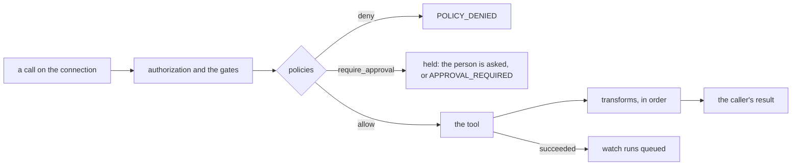

# Tool-call handlers

A tool-call handler is a managed script an administrator binds to a connection,
so that it runs for other people's calls on that connection (#2436, #2634,
#2635, #2437). There are three kinds, beside the [handlers](handlers.md) that
start a script (endpoint, schedule, webhook):

| Kind | Runs | The script defines | What it does |
|---|---|---|---|
| `policy` | Before each matched call, inline | `decide(call)` | Lets the call run, refuses it, or holds it for someone's approval |
| `transform` | After each matched call, inline, in the order an administrator sets | `transform(call, result)` | Changes what the caller gets: a tool's result, an export's file, a script's read of an application database |
| `watch` | After each matched call that succeeded, queued | `main()`, reading `run.call` | Runs the script once for the call, never delaying it |

Only administrators add, change, turn on or off, or delete a tool-call handler,
and only administrators approve the version one runs. The script's owner, when
not an administrator, reads it on the script's page and changes nothing.

## Which calls it sees

The match is data the platform checks, never script:

- **connection**: a connection's name, or a glob (`billing-*`).
- **operations**: catalog operation ids (`addSubscribers`), tool names
  (`trino_query`), or `METHOD path` patterns (`POST /lists/*`, `PUT *`), each a
  glob; none matches every call on the connection. At most 50.
- **who**: personas, people by address, or everyone; at most 200. A handler only
  ever sees calls the caller's persona already allows: authorization runs first.
- **conditions**: equality on a path parameter, a body field (a dotted path) or
  a query parameter, so a handler on one record does not run for every call on
  its operation; at most 10.

Each replica keeps the enabled handlers in memory, read again on the
`call_handlers` notification a change sends, so a call on a connection no
handler names costs one lookup and nothing else: no database read and no script.

A script's application database statements bind straight to a pool and never
cross the `tools/call` chain, so the handlers are asked there too, on every path
a script has: `platform.query`, `platform.execute`, `platform.batch` (each
statement on its own SQL), everything inside `platform.transaction`,
`query_iter`, `copy_in`, `copy_out` and `platform.maintain`. A statement in a
transaction is matched under the operation the same statement has outside one:
`appdb.query` (`platform.query`, `tx.query`, `query_iter`), `appdb.execute`,
`appdb.batch`, `appdb.copy_in`, `appdb.copy_out` and `appdb.maintain`. Nobody can
be asked mid-run, so a statement a policy holds is refused, naming what holds it.

## The version it runs, and whose roles

A tool-call handler runs the highest version of its script approved for
handlers, with the roles of the administrator who approved it, recorded at the
decision. An administrator's save of the script approves the version it saved
(recorded as self-approved); anyone else's save files a request administrators
decide under **Approvals**, and the approved version keeps running meanwhile. A
script nobody has approved runs nothing.

Its own tool calls go through the same chain as a person's, under those roles,
and are not evaluated by tool-call handlers. A policy or transform is read-only:
a write it attempts is refused and the run fails. Each has a time limit
(`timeout_ms`, default 2000, at most 60000).

## Policy

`decide(call)` returns one of:

- `platform.allow()`: the call may run.
- `platform.deny(reason)`: the call is refused, the caller told `reason`.
- `platform.require_approval(approvers, summary)`: the call waits for one of
  `approvers` (addresses or persona names; none, or `"administrators"`, is an
  administrator), the approver reading `summary` beside the platform's own
  rendering of the call.

`call` carries the tool, connection, operation, method, path, path parameters,
query, the arguments as the caller sent them (a stored secret's
`{{secret:<name>}}` placeholder, never its value), the body read as the value it
holds whether sent as an object or a string of JSON, the item count, whether it
writes, the caller, the persona and the time.

- **Combining**: a deny beats a require-approval beats an allow; the approvals
  several policies ask for are merged into one request naming each.
- **Fails closed**: an error or a timeout holds the call for an administrator
  (`on_failure: hold`, the default), or refuses it (`deny`).
- **Writes**: POST, PUT, PATCH and DELETE are writes; `writes` overrides an
  operation (`{"getReport": true}`).
- **Items**: `items_path` names the body field whose length is the item count; a
  call with none carries one item.
- **Counting**: `platform.count(key, window, add=1)` adds this call under `key`
  and returns the total over `window` (`"90s"`, `"1h"`, `"7d"`, at most 31
  days), shared by every replica. Counts are the handler's own, and a call the
  handlers did not let run is not counted against anyone.
- **Messages**: `platform.notify` in a policy or transform queues the message (at
  most 5 per call) and the platform sends it once the call has been answered,
  held or refused, as the handler's run identity. A test or the test panel sends
  nothing.

The built-in examples `policy-rate-limit` and `policy-business-hours` are worked
policies with typed parameters (`manage_script help`).

## Transform

`transform(call, result)` returns the result the caller gets. Transforms on a
connection run in the order an administrator sets, each under its time limit.
They apply wherever the rows or the body reach the caller:

- a tool's result in the `tools/call` chain, before the result layers (budget,
  call reference, enrichment) see it;
- each page `api_export` writes, `trino_export`'s rows and `graphql_export`'s
  data, so a file holds what the caller may see;
- a script's reads of an application database: `platform.query`, a query in
  `platform.transaction`, each result of `platform.batch`, and every page
  `query_iter` reads. `copy_out` writes the database's own bytes, which no
  transform reads, so it is refused for a run a transform covers.

**Protected columns.** A transform names the columns (SQL) or JSON paths (API,
GraphQL) it protects: `catalog.schema.table.column` on Trino,
`schema.table.column` on an application database, `body.card.number` for a
body. For a caller it covers, a SQL statement may select a protected column as
it is; one that uses it anywhere else (an expression, a function argument,
`WHERE`, `JOIN`, `GROUP BY`, `ORDER BY`, `HAVING`, a rename, `DISTINCT`, a set
operation other than `UNION ALL`, a positional reference) is refused with
`PROTECTED_COLUMN`, naming the column and the handler, and so is a statement
that writes to the table. Names are followed through aliases, subqueries, CTEs
and views: a Trino view through its catalog's `information_schema.views`, an
application database view or materialized view through `pg_catalog`. A
statement the platform cannot read is refused when it names a protected column.

**Fails closed.** An error or a timeout fails the call or the export, naming the
handler (`on_failure: fail`, the default). A handler may return the original
result instead (`original`); one that protects a column cannot.

A transform reads with administrator authority, so what it adds can show a
caller data their persona cannot read. That is its purpose, and the reason only
administrators add one.

## Watch

After a matched call succeeds, the platform queues one run of the watch's
script, which reads the call as `run.call` (None in a draft or a test). The call
is never delayed: the runs are written on their own. A failed call queues
nothing. At most 100 runs of one watch wait at once; past that a call is
recorded as a skipped run (`skipped_backlog`). A watch's runs hold another
person's call, so their inputs, prints and recordings are administrators' only,
and they are not recorded for replay.

## Held calls and Approvals

A call a policy holds is answered by asking the person, where the client can be
asked, what the policy limits, who can approve, and for a reason:

- a 2026-07-28 client gets an input request (`resultType: "input_required"`,
  id `approval_request`) and retries with the answer;
- an older client that declares elicitation is asked during the call, which only
  a stateful deployment can do;
- otherwise the call answers `APPROVAL_REQUIRED` with the same sentence, and the
  agent offers `manage_approval submit` with `kind` `call`, the tool, its
  arguments, `calls` and a reason.

Accepting files the request (`approval_filed`) and returns its id; declining
files nothing (`user_declined`); no answer files nothing and the call is audited
`input_required` (`prompt_unanswered`). The request holds the call frozen as the
caller sent it (secret placeholders, never values), the platform's rendering of
it, the policies that held it with what each said, and the approvers. Its
arguments cannot be changed through any surface, and are deleted when it is
decided.

An approval is an **allowance**: that many more calls of the operation, by the
requester, on the connection, until a deadline (24 hours when the approver sets
none, at most 90 days, at most what was asked, at most 10,000). Each matching
call spends one; past the deadline, or once spent, the policy decides again. A
requester who lost the connection's grant is refused before any policy runs. A
call request is decided by the approvers its policies named or an administrator,
never by its requester unless an administrator (recorded as self-approved).
Approvers are told once at submission and the requester at the decision.

The **Approvals queue alert** (Admin > Settings > Approvals,
`GET`/`PUT /api/v1/admin/settings/approval-queue-alert`) emails its recipients
and channels when requests wait past a count or an age (2 days by default), at
most once per cooldown, as the knowledge review-queue alert does.

## Run records

A tool-call handler's run that succeeds is recorded on the call's audit row
(`audit_logs.handlers`: each handler, its kind, outcome and time). One that
fails keeps what the script was given and printed for 7 days
(`call_handler_failures`), administrators' only.

## The commands

`manage_script` `handler_set` with `kind` `policy`, `transform` or `watch` and
`connection`, `operations`, `personas`, `users`, `conditions` (`in` `path`,
`body` or `query`, `name`, `equals`), `args`, `timeout_ms`, `on_failure`,
`items_path`, `writes`, `protected` and `order`; a change sends only what it
changes. `approve: true` approves the script's latest version for handlers as
the administrator. `handler_get` adds the latest failures for an administrator.

`handler_test` is the test panel for an agent: every handler on `connection`
that would match a call (`tool`, `arguments`, `as_user` or `as_persona`, `at`,
and a `result` for a transform to change) in order, what each said, the ones
that do not apply, and the outcome, without calling the upstream and without
spending a counter or an allowance. A handler's own reads do run.

`manage_approval` `submit` with `kind` `call` files a held call; `list` takes
`kind` (`call`, `handler_version`, `form`, `site`) and `purpose`; `decide` on a
call request takes `calls` and `until` (RFC 3339).

## In the portal

- A connection's page has a **Handlers** section for administrators: its
  policies, its transforms in order (moved up and down there), and its watches,
  each with its script and the version it runs, who it applies to, what it
  matches, On or Off and its last 24 hours (matched, held, denied, errors, p50
  and p99). **Add handler** chooses the kind and the script; **Test a call** is
  the test panel.
- A script's **Handlers** section lists its policies, transforms and watches
  beside its other handlers. A newer version waiting for approval is said above
  them, with **Approve version N** for an administrator. Opening one shows what
  it matches, its version and, for an administrator, Edit, Turn on or off and
  its failures.
- **Approvals** filters by type (Calls, Handler versions, Forms, Sites). A held
  call shows the platform's reading of it, what held it, who decides, and the
  requester's calls of the operation in the last 24 hours (when, how many items,
  whether each ran, ran on an allowance, failed, was held or was refused); an
  approver grants calls until a time.
- **Admin > Automations > Handlers** filters by the three types too, a row's
  target its connection and what it matches.

## Routes

| Route | Does |
|---|---|
| `GET /api/v1/portal/connections/{connection}/handlers` | Every tool-call handler on the connection: policies, transforms in order, watches, each with `stats` for the last 24 hours |
| `POST /api/v1/portal/connections/{connection}/handlers/test` | The test panel: `tool`, `arguments`, `as_user` or `as_persona`, `at`, `result` |
| `PUT /api/v1/portal/connections/{connection}/handlers/order` | The order transforms run in: `ids`, first to last |
| `GET /api/v1/portal/handlers/{id}/failures` | A tool-call handler's newest failures |
| `GET /api/v1/portal/approvals/{id}/calls` | A held call's requester's calls of its operation in the last 24 hours, never their arguments |

Every route but the last is an administrator's; the last answers whoever may
read the request. Adding, changing, enabling and deleting go through the
[handler routes](handlers.md#routes) with the kind's settings.

## Tables

Migration `000248` adds `call_handlers` (with a `pg_notify` trigger),
`call_handler_counts` and `call_handler_failures`; `audit_logs.handlers`;
`script_runs.call`, `run_as` and `call_handler_id` with the `watch` trigger;
the call request's columns on `approval_requests`, its subject `call` and the
purposes `call_allowance` and `call_handler`; and the three kinds in the
`script_handlers` view.
