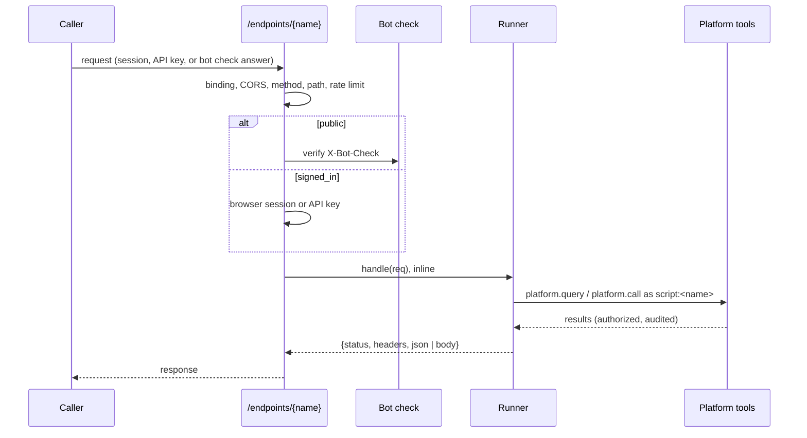

# Endpoints

An endpoint is a managed script bound to an HTTP route. A request to
`/endpoints/{name}/...` runs the script's `handle(req)` on the replica that
received it and answers with what the handler returns. An endpoint answers
HTTP with platform data: a lookup a partner system calls, a feed an automated
client pulls with an API key, a page that sends a form.



## Binding a script

Binding a script to an endpoint is an administrator's. The script's owner and
everyone else are refused, on every surface. A persona that can be granted the
permission comes in a later release.

With `manage_script`:

```json
{"command": "endpoint_set", "name": "order-lookup", "owner_email": "jane@example.com",
 "endpoint": "orders", "methods": ["GET"], "path": "/{id}", "auth_mode": "signed_in",
 "timeout_seconds": 10}
```

`endpoint_list` reads a script's binding and its recent failed requests, or
lists every binding the caller's scripts have, up to `limit` (at most 200),
with `total`, and a `note` naming how many were left out when the list was cut. `endpoint_enable` and
`endpoint_disable` turn an endpoint on and off without touching the script; a
disabled endpoint answers 404. A script run may read a binding but not set
or turn one on or off.

On the portal, the script's page under Automations shows the binding, and an
administrator binds, changes and turns it on and off there. The routes are
`GET|PUT /api/v1/portal/scripts/{id}/endpoint` and
`POST /api/v1/portal/scripts/{id}/endpoint/enable|disable`.

A binding holds:

| Field | Default | Meaning |
|---|---|---|
| `endpoint` | (required) | The name, `/endpoints/{name}`; lowercase letters, digits, hyphens and underscores, unique across the deployment |
| `methods` | `GET` | The HTTP methods answered; HEAD is answered wherever GET is |
| `path` | empty | The template under the name: `/{id}` takes one segment the handler reads as `req["params"]["id"]` |
| `auth_mode` | (required) | `signed_in` or `public` |
| `open_reads` | false | On a public endpoint, GET and HEAD need no bot check |
| `timeout_seconds` | 10 (at most 60) | How long one request may run |
| `max_memory_bytes` | 64 MiB | The memory one request may hold, measured as a run's is |
| `max_body_bytes` | 1 MiB (at most 10 MiB) | The largest request body |
| `allowed_origins` | none | Browser origins a cross-origin request may come from |
| `rate_limit` | 600 | The endpoint's requests a minute on each replica |
| `caller_rate_limit` | 120 | One signed-in caller's requests a minute on each replica |

A script can be bound only when it defines `handle(req)`, and a save of a bound
script whose source no longer defines it is refused, naming the endpoint. A
library cannot be bound. A script with `handle` and no `main()` is a script,
not a library.

## The handler

```python
def handle(req):
    """Looks one order up."""
    rows = platform.query(
        "SELECT status FROM orders WHERE id = :id",
        params = {"id": req["params"]["id"]},
    )
    if not rows["rows"]:
        return {"status": 404, "json": {"error": "no such order"}}
    return {"json": rows["rows"][0]}
```

`req` is a frozen dict:

| Key | Value |
|---|---|
| `method` | The HTTP method |
| `path` | The request path |
| `params` | The path template's values |
| `query` | Each query parameter's first value |
| `headers` | The request headers, names lower-cased, joined with `, `. `Authorization`, `Cookie`, `X-API-Key` and `Proxy-Authorization` are left out: they are the caller's credentials, and `caller` is who the platform found them to be |
| `body` | The body, as bytes |
| `json` | The body parsed when its content type is JSON, else None. A body that says it is JSON and is not is answered 400 before the script runs |
| `form` | Each field's first value when the body is `application/x-www-form-urlencoded`, else None |
| `caller` | On a `signed_in` endpoint, `{"user_id", "email", "auth_type"}` of the session or API key; None on a public one. It never comes from the request body |

The handler returns a dict: `status` (200 to 599, default 200), `headers` (names
to strings) and one of `json` (any value) or `body` (a string or bytes). A
handler may not set `Set-Cookie`, `Content-Length`, `Transfer-Encoding`,
`Connection`, `Content-Security-Policy`, `X-Content-Type-Options`,
`X-Frame-Options` or any `Access-Control-*` header. Every answer carries
`Content-Security-Policy: default-src 'none'; sandbox` and
`X-Content-Type-Options: nosniff`, so whatever a handler returns renders as an
opaque document that runs no script against the platform's origin, and
`Cache-Control: no-store` unless the handler sets its own.

`platform.export` and `platform.publish_data` fail in a handler: a request
answers with what `handle` returns.

A draft (`run_draft`) runs `main()`, so a handler is drafted with a `main()`
that calls it with a request built by hand, which is also how its recording
gets the answers to the platform calls it makes:

```python
def handle(req):
    """Looks one order up."""
    rows = platform.query(
        "SELECT status FROM orders WHERE id = :id",
        params = {"id": req["params"]["id"]},
    )
    return {"json": rows["rows"][0]}

def main():
    """Drafts one request."""
    platform.result(handle({
        "method": "GET",
        "path": "/endpoints/orders/42",
        "params": {"id": "42"},
        "caller": None,
    }))

def test_handle():
    """Answers order 42."""
    testing.replay("<the draft's run id>")
    main()
    assert.eq(testing.outputs().result["json"]["status"], "shipped")
```

A save runs the tests as it does for any script.

## Identity and authority

A request runs as the script's own principal, `script:<name>`, presenting the
roles the current version's author held when they saved it, exactly as a
scheduled run does (see [Managed Scripts security](security.md)). Every platform
call the handler makes goes through the in-memory MCP session a run uses, so the
persona filter authorizes it, the rate limiter counts it and the audit log
records it under the script principal, with the request's session id.

Each request writes one audit row of its own: source `endpoint`, event kind
`endpoint_request`, tool name `endpoint:<name>`, and in its parameters the
endpoint, script, version, method, status, auth mode and the caller. No
`script_runs` row is written.

## Auth modes

**signed_in** answers a browser session or an API key (`Authorization: Bearer`
or `X-API-Key`). A GET handler should change nothing: a browser sends its
session with a GET another site navigates it to, as it does for any page. An anonymous request is answered 401. A browser session's
write (POST, PUT, PATCH, DELETE) carries its CSRF token, as every portal write
does; a session refused its token is answered 403. A caller past their own
`caller_rate_limit` is answered 429 while other callers are still answered.

**public** answers anyone who passes the deployment's bot check, carried in the
`X-Bot-Check` header. A request without one, or with one refused (altered,
expired, issued for another endpoint, or already used), is answered 403. With
`open_reads`, GET and HEAD need no check.

## Bot checks

The bot check is configured under Admin > Settings > Bot check, the
`platform_settings` section `bot_check`
(`GET|PUT /api/v1/admin/settings/bot-check`).

| Provider | What it is |
|---|---|
| `pow` (default) | The platform's own proof-of-work challenge. It calls no third party |
| `turnstile` | Cloudflare Turnstile, verified on the server |
| `hcaptcha` | hCaptcha, verified on the server |
| `none` | No check. A public endpoint is refused, and cannot be bound, until `allow_public_without_check` is set |

A page fetches a challenge and answers it with the platform's script:

```html
<script src="/botcheck/solver.js"></script>
<script>
  const answer = await PlatformBotCheck.answer("contact");
  await fetch("/endpoints/contact", {
    method: "POST",
    headers: {"Content-Type": "application/json", [PlatformBotCheck.header]: answer},
    body: JSON.stringify({email: "ann@example.com"}),
  });
</script>
```

`GET /botcheck/challenge?endpoint=<name>` issues a challenge for a public
endpoint. A proof-of-work challenge is signed, bound to the one endpoint and
answerable for `challenge_ttl_seconds` (300 by default). Challenges are counted
against the endpoint's `rate_limit` in a bucket of their own, so fetching one
does not spend the request it guards. The answer is the
challenge and a counter whose SHA-256 has the challenge's difficulty in leading
zero bits; the browser script computes it in a fraction of a second at the
default difficulty of 16. Every accepted answer is recorded in PostgreSQL as
used, so it cannot be replayed on any replica. The difficulty rises with the
endpoint's recent rate: past `rate_threshold` answers in the last minute (30 by
default), each doubling of the rate adds a bit, up to `max_difficulty` (22 by
default). A person filling out a form does not notice it, and a flood pays more
for each request.

The challenge is signed with a key derived from the browser-session signing key
(`auth.browser_session.signing_key`), which every replica holds. A deployment
without one cannot issue a proof-of-work challenge, and the settings page says
so.

Turnstile and hCaptcha take the provider's `site_key`, which the widget is
rendered with, and `secret_name`, a stored secret (Admin > Secrets) holding the
provider's secret key, whose `allow_connections` names `bot_check` and which
lists no personas. The key is read
on the server when a request is verified and never appears in a response or a
log. `PlatformBotCheck.answer(name, {container})` renders the provider's widget
into `container` and resolves with the token it produces. A provider token is
recorded as used like a proof-of-work answer; it is not bound to one endpoint
beyond what the provider itself checks.

## Signed tokens

A handler can hand a page a signed token and check it when the page comes
back: a credit application token issued when the form opens and verified when
it is submitted, for example. `platform.mint_token(claims, ttl, secret,
endpoints=None, single_use=False)` returns the token as a string, and
`platform.verify_token(token, secret)` returns what it found.

```python
def handle(req):
    """Issues an application token, or checks the one a submission carries."""
    if req["method"] == "GET":
        token = platform.mint_token(
            {"applicant": req["query"].get("applicant")},
            900,
            secret = "credit-token-key",
            single_use = True,
        )
        return {"json": {"token": token}}
    checked = platform.verify_token(req["json"]["token"], secret = "credit-token-key")
    if not checked["ok"]:
        return {"status": 403, "json": {"error": checked["reason"]}}
    return {"json": {"accepted": checked["claims"]["applicant"]}}
```

- `claims` is a dict carried in the token, up to 4 KiB encoded, and `ttl` the
  seconds it lives, at most 30 days.
- `secret` names a stored secret (Admin > Secrets) whose `allow_connections`
  lists `script_token`. When its `allow_personas` names personas, one of them
  must be the persona the version's author roles resolve to; a script whose
  persona is not listed cannot mint or verify with it. The administrator's
  persona is not limited. The script never holds the key: the platform signs
  with a key derived from the secret, HMAC-SHA256 over the token's JSON body.
- A token minted in an endpoint request is bound to that endpoint, or to every
  endpoint name `endpoints` lists. One minted in a scheduled run or a draft is
  bound to the script.
- `verify_token` answers `{"ok": True, "claims": {...}, "expires_at": "...",
  "single_use": ...}` for a token that holds, and `{"ok": False, "reason":
  ..., "message": ...}` for one that does not. The reason is `expired`,
  `tampered` (another key signed it, or it was changed after signing),
  `other_endpoint`, `used` or `malformed`, so the handler decides what to
  answer.
- With `single_use=True` the verify that accepts the token records its id in
  Postgres (`script_token_uses`), and a second verify on any replica answers
  `used`. A record is deleted once its token has expired.

In a draft and in a run each mint and verify is recorded with the secret's
name, never its value, and a test answers them from that recording, so a
handler's tests need neither the key nor the database. The flow diagram shows
each as a card naming the key.

## CORS

An endpoint answers its own cross-origin requests from its `allowed_origins`;
the platform's CORS layer leaves `/endpoints/` and `/botcheck/` alone. A
preflight from a listed origin is answered with the endpoint's methods and the
`Content-Type`, `Authorization`, `X-API-Key` and `X-Bot-Check` headers; one from
an origin that is not listed is refused with 403. Credentials are never allowed
across origins, so a browser session is never sent from another site, and a
cross-origin caller of a `signed_in` endpoint signs in with an API key.

## Limits and failures

| Answer | When |
|---|---|
| 404 | No enabled endpoint has the name, or the path does not match the template |
| 405 | The endpoint does not answer the method (`Allow` lists the ones it does) |
| 413 | The body is past `max_body_bytes`; the script does not run |
| 429 | Past `rate_limit` or the caller's `caller_rate_limit`, with `Retry-After` |
| 503 | The script is disabled, deprecated or superseded; the handler held more than `max_memory_bytes`; the replica is already running 32 handlers (with `Retry-After`); or the bot check could not be made |
| 504 | The handler ran past `timeout_seconds` |
| 500 | The handler failed, or returned something that is not a response |

The rate limits count requests on each replica: three replicas let up to three
times `rate_limit` through between them. No limit depends on the client's
address, which a request behind an ingress and a load balancer does not carry.

A request that fails is kept for seven days with its status, error and duration,
and is listed on the script's page and by `endpoint_list`. The caller is told
only which of the answers above it got, never the script's error.

The compiled module is kept per version on each replica. Each request reads
when its binding and its script were last written, so the first request after a
save runs the new version on every replica.

## Observability

`endpoint_requests_total{endpoint, status_class}` and
`endpoint_request_duration_seconds{endpoint}` measure every request a handler
was run for, by the binding's name; a request refused before that (404, 405,
401, 403, 413, 429) is in `http_server_request_duration_seconds` under the
route template. A 429 is counted in
`http_rate_limited_total{limiter="endpoint"}`. The routes report their template
(`/endpoints/{name}/{rest...}`) to `http_server_request_duration_seconds`,
never the path a caller sent.

## Every endpoint on one page

An administrator sees every binding on the deployment under **Admin >
Automations > Endpoints** (`/portal/admin/automations/endpoints`, #2208),
without opening automations one at a time: each endpoint's automation and
owner, its methods and path, its access (a public endpoint is marked apart from
a signed-in one), whether it is on, and over the last 24 hours or 7 days its
requests, failures, refusals, p95 duration and last request. The list filters
by access and by on or off, shows 50 endpoints a page with the total that match
and pages through the rest (#2251), and a row opens the endpoint.

An endpoint's page charts its requests by status class (an hour a bar over a
day, six hours over a week) beside the requests it refused before its handler
ran, names the reasons it refused them, its busiest signed-in callers and its
failed requests, and turns it on and off. It is edited on its automation's
page, in the Endpoint section, which is also where **Bind an automation** on
the list leads: the automation is picked there, and the binding refuses one
that defines no `handle(req)`.

The answered requests are read from each request's audit row. A request
refused before its handler ran writes no audit row, so the refusals are
counted on their own (`script_endpoint_refusals`, migration `000207`) by
reason: `bot_check`, `rate_limit`, `caller_rate_limit`, `body_limit`,
`credential` (none, or one refused) and `origin` (a cross-origin preflight
from an origin the binding does not list). Each replica counts in memory and
adds its counts every ten seconds, and once more as it stops, one row per
endpoint, hour and reason, so a flood refused at the bot check moves a counter
rather than writing a row per request. The counts are kept 30 days.

The page reads `GET /api/v1/admin/endpoints?range=day|week` and
`GET /api/v1/admin/endpoints/{name}?range=day|week`, admin only. The list
takes `access` (`public`, `signed_in`), `status` (`on`, `off`), `page` and
`per_page` (default 50, at most 200), and answers `total`, `page` and
`per_page` beside the page's `endpoints`.
