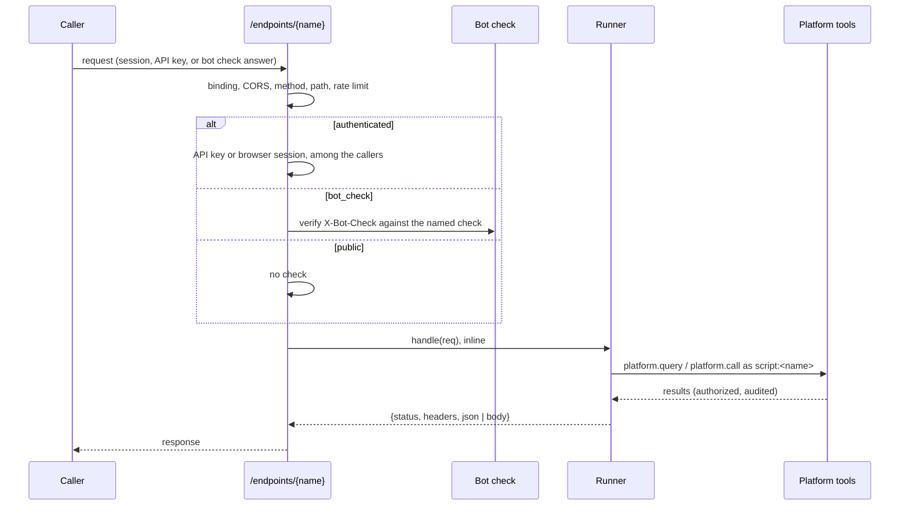
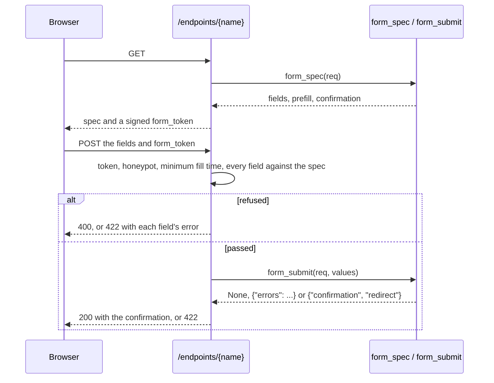

# Endpoints

An endpoint is a managed script bound to an HTTP route. A request to
`/endpoints/{name}/...` runs the script's `handle(req)` on the replica that
received it and answers with what the handler returns. An endpoint answers
HTTP with platform data: a lookup a partner system calls, a feed an automated
client pulls with an API key, a page that sends a form.



## Binding a script

Binding a script to an endpoint is an administrator's. The script's owner and
everyone else are refused, on every surface. A persona that can be granted the
permission comes in a later release.

With `manage_script`:

```json
{"command": "endpoint_set", "name": "order-lookup", "owner_email": "jane@example.com",
 "endpoint": "orders", "methods": ["GET"], "path": "/{id}", "auth_mode": "authenticated",
 "callers": ["persona:analyst", "api_key:partner-sync"], "timeout_seconds": 10}
```

`endpoint_list` reads a script's binding and its recent failed requests, or
lists every binding the caller's scripts have, up to `limit` (at most 200),
with `total`, and a `note` naming how many were left out when the list was cut. `endpoint_enable` and
`endpoint_disable` turn an endpoint on and off without touching the script; a
disabled endpoint answers 404. A script run may read a binding but not set
or turn one on or off.

On the portal, the script's page under Automations shows the binding, and an
administrator binds, changes and turns it on and off there. The routes are
`GET|PUT /api/v1/portal/scripts/{id}/endpoint` and
`POST /api/v1/portal/scripts/{id}/endpoint/enable|disable`.

A binding holds:

| Field | Default | Meaning |
|---|---|---|
| `endpoint` | (required) | The name, `/endpoints/{name}`; lowercase letters, digits, hyphens and underscores, unique across the deployment |
| `methods` | `GET` | The HTTP methods answered; HEAD is answered wherever GET is |
| `path` | empty | The template under the name: `/{id}` takes one segment the handler reads as `req["params"]["id"]` |
| `auth_mode` | (required) | `authenticated`, `public` or `bot_check` (see [Access modes](#access-modes)) |
| `callers` | none | On an `authenticated` endpoint, who it admits besides the administrator: `*`, `persona:<name>`, `api_key:<name>`. Empty admits no one else |
| `bot_check` | (required on `bot_check`) | The name of the [bot check](#bot-checks) a `bot_check` endpoint requires |
| `checked_methods` | every method | On a `bot_check` endpoint, the methods the check applies to; HEAD is checked where GET is |
| `timeout_seconds` | 10 (at most 60) | How long one request may run |
| `max_memory_bytes` | 64 MiB | The memory one request may hold, measured as a run's is |
| `max_body_bytes` | 1 MiB (at most 10 MiB) | The largest request body |
| `allowed_origins` | none | Browser origins a cross-origin request may come from |
| `rate_limit` | 600 | The endpoint's requests a minute on each replica |
| `caller_rate_limit` | 120 | One authenticated caller's requests a minute on each replica |

A script can be bound only when it defines `handle(req)`, and a save of a bound
script whose source no longer defines it is refused, naming the endpoint. A
library cannot be bound. A script with `handle` and no `main()` is a script,
not a library.

## The handler

```python
def handle(req):
    """Looks one order up."""
    rows = platform.query(
        "SELECT status FROM orders WHERE id = :id",
        params = {"id": req["params"]["id"]},
    )
    if not rows["rows"]:
        return {"status": 404, "json": {"error": "no such order"}}
    return {"json": rows["rows"][0]}
```

`req` is a frozen dict:

| Key | Value |
|---|---|
| `method` | The HTTP method |
| `path` | The request path |
| `params` | The path template's values |
| `query` | Each query parameter's first value |
| `headers` | The request headers, names lower-cased, joined with `, `. `Authorization`, `Cookie`, `X-API-Key` and `Proxy-Authorization` are left out: they are the caller's credentials, and `caller` is who the platform found them to be |
| `body` | The body, as bytes |
| `json` | The body parsed when its content type is JSON, else None. A body that says it is JSON and is not is answered 400 before the script runs |
| `form` | Each field's first value when the body is `application/x-www-form-urlencoded`, else None |
| `caller` | On an `authenticated` endpoint, `{"user_id", "email", "auth_type"}` of the session or API key; None on a `public` or `bot_check` one. It never comes from the request body |

The handler returns a dict: `status` (200 to 599, default 200), `headers` (names
to strings) and one of `json` (any value) or `body` (a string or bytes). A
handler may not set `Set-Cookie`, `Content-Length`, `Transfer-Encoding`,
`Connection`, `Content-Security-Policy`, `X-Content-Type-Options`,
`X-Frame-Options` or any `Access-Control-*` header. Every answer carries
`Content-Security-Policy: default-src 'none'; sandbox` and
`X-Content-Type-Options: nosniff`, so whatever a handler returns renders as an
opaque document that runs no script against the platform's origin, and
`Cache-Control: no-store` unless the handler sets its own.

`platform.export` and `platform.publish_data` fail in a handler: a request
answers with what `handle` returns.

A draft (`run_draft`) runs `main()`, so a handler is drafted with a `main()`
that calls it with a request built by hand, which is also how its recording
gets the answers to the platform calls it makes:

```python
def handle(req):
    """Looks one order up."""
    rows = platform.query(
        "SELECT status FROM orders WHERE id = :id",
        params = {"id": req["params"]["id"]},
    )
    return {"json": rows["rows"][0]}

def main():
    """Drafts one request."""
    platform.result(handle({
        "method": "GET",
        "path": "/endpoints/orders/42",
        "params": {"id": "42"},
        "caller": None,
    }))

def test_handle():
    """Answers order 42."""
    testing.replay("<the draft's run id>")
    main()
    assert.eq(testing.outputs().result["json"]["status"], "shipped")
```

A save runs the tests as it does for any script.

## Forms

A bound script that defines `form_spec(req)` and `form_submit(req, values)`,
in place of `handle(req)`, is a form (#2176). The script decides what the form
is; the platform checks every submission against the spec it issued before the
script sees it.



**The spec.** A GET calls `form_spec(req)`, which returns a dict:

| Key | Meaning |
|---|---|
| `fields` | The fields, in order (at most 100). Each has `name` (lowercase letters, digits and underscores), `type`, and optionally `label`, `required`, `max_length`, `min` and `max` (a number), `help` and `choices` (`{"value", "label"}`, at most 500) |
| `prefill` | Each field's starting value. A `hidden` field's prefill is the value a submission must carry back unchanged |
| `confirmation` | Shown once the form is accepted |
| `redirect` | Where the browser goes once the form is accepted: an http or https URL, or a path |
| `min_fill_seconds` | How long after the GET the form may be submitted; at least 2, the default |

Field types: `text` and `long_text` (at most 1,000 and 10,000 characters
unless `max_length` says otherwise, at most 100,000), `email`, `number`, `date`
(`YYYY-MM-DD`, what a date input submits), `single_choice`, `multiple_choice`,
`checkbox`, `hidden` and `file` (see [File fields](#file-fields)). The platform checks the spec (known types, unique
names, choices only on a choice field, limits) and answers the GET with
`{"spec", "form_token", "token_field": "form_token", "honeypot_field":
"website"}`. A spec that fails its check is answered 500 and kept with the
endpoint's failed requests, naming what was wrong. `form_spec` may compute
anything from the request: choices from a `platform.query`, a prefill from the
query string, a token from `platform.mint_token` carried as a hidden field.

**The token.** The spec is signed into `form_token` with a key derived from the
browser-session signing key, bound to the endpoint, and good for a day. The
platform keeps no copy: a submission brings its spec back, on any replica.

**The submission.** A POST (any method but GET and HEAD) carries the fields and
`form_token`, as `application/x-www-form-urlencoded`, as a JSON object, or as
`multipart/form-data`, the one form a submission with files takes; a JSON
number, boolean or list reads as the strings a form would send. Before the
script runs, the platform refuses:

- with 400: no `form_token`, one that was altered, one another form issued, or
  one more than a day old; a value in the `website` field, which the page
  renders hidden from people, so only a program filling every field it finds
  fills it; and a submission sooner than `min_fill_seconds` after the GET;
- with 422 `{"errors": {"<field>": "<message>"}}`: a field the spec does not
  declare, a required field left empty, a value that is not its type (an email
  address, a number within `min` and `max`, a date, one of the choices, a ticked
  or unticked box), a value past `max_length`, and a hidden field whose value is
  not its prefill.

Only then `form_submit(req, values)` runs, `values` holding every declared
field: a number as an int or a float, a checkbox as a bool, a multiple choice
as a list of the values chosen, an empty field as `""`. It returns None to
accept with the spec's `confirmation` and `redirect` (`200 {"ok": true,
"confirmation", "redirect"}`), `{"errors": {"<field>": "<message>"}}` to refuse
field by field (422), or `{"confirmation": ..., "redirect": ...}` to accept with
its own.

```python
def form_spec(req):
    """The plan request form for one customer."""
    customer = req["query"].get("customer_id", "")
    plans = platform.query(
        "SELECT code, name FROM plans WHERE customer_id = :c",
        params = {"c": customer},
    )
    return {
        "fields": [
            {"name": "email", "type": "email", "required": True, "label": "Email"},
            {
                "name": "plan",
                "type": "single_choice",
                "required": True,
                "choices": [{"value": r["code"], "label": r["name"]} for r in plans["rows"]],
            },
            {"name": "customer_id", "type": "hidden"},
            {"name": "application", "type": "hidden"},
        ],
        "prefill": {
            "customer_id": customer,
            "application": platform.mint_token({"customer_id": customer}, 3600, secret = "form-key"),
        },
        "confirmation": "Thanks. We will be in touch.",
    }

def form_submit(req, values):
    """Checks the application token and accepts the request."""
    checked = platform.verify_token(values["application"], secret = "form-key")
    if not checked["ok"]:
        return {"errors": {"application": "start the form again"}}
    return None
```

A form endpoint answers GET for its spec and POST for its submission, so its
binding's `methods` name both; on a `bot_check` endpoint, `checked_methods:
["POST"]` serves the spec without a check and checks the submission. A save of
a bound form that no longer defines both handlers is refused, as a save that
removes `handle(req)` is. The flow diagram draws `form_spec` and then
`form_submit`.

### Where submissions are stored

Binding a form makes a webhook source for it (#2178), named `form-<endpoint>`
(each `_` read as `-`), whose table is `webhook_form_<endpoint>` in the scratch
schema of a Trino connection. `endpoint_set` takes `connection`, the Trino
connection whose scratch catalog holds the table, and defaults it to the only
such connection; on a deployment with several it is required, named once, and
does not change. Each submission `form_submit` accepts is written to that
source as one event before the browser is answered, through the same receiver
spool and object storage path every webhook source's events take; a submission
that could not be stored is answered 503 and never confirmed. Retention is the
source's: `compacted_retention_days` under Admin > Webhooks, where 0 keeps
submissions forever.

| Payload key | What it holds |
|-------------|---------------|
| `values` | The checked values, a sensitive field's as ciphertext |
| `fields` | The fields in the order the spec declared them |
| `sensitive` | The names of the sensitive fields |
| `endpoint`, `version` | The endpoint and the script version that accepted it |
| `submitter` | On an authenticated form, `{"user_id", "email", "auth_type"}` of the caller the platform found; a field claiming another identity changes nothing |

The event's `event_type` is `form_submission` and its `key` the submitter's
address. A form's source is never posted to: `/hooks/form-<endpoint>` answers
404, and the administrator's create refuses a source with input `form`. The
script follows the source, so an endpoint renamed later keeps storing where it
did. A form bound before it defined both handlers, or whose source was deleted
or disabled, answers each submission 503 until `endpoint_set` is called again.
A deployment with no webhook sources (no Trino toolkit) stores nothing, and a
form accepts as it did before submissions were stored.

### Sensitive fields

A field with `"sensitive": True` is encrypted before it is stored (#2179), with
the platform's field encryption (`ENCRYPTION_KEY`), so the receiver's spool
file, the raw segment, the compacted Parquet and `trino_query` on the table
all hold ciphertext. `form_submit` is handed the value as typed. A form
declaring a sensitive field on a deployment without `ENCRYPTION_KEY` is not
shown: its GET is answered 500 and kept for the owner. The plaintext is read
in two places, each audited as `form_decrypt` with the fields read:

- the form owner's Submissions section on the automation's page (and its CSV
  and Excel exports);
- `platform.decrypt(form, payload)` in a script, whose run's persona must be
  among the form's `decrypt_personas` (set with `endpoint_set`); the
  administrator always may.

```python
def main():
    """Lists the week's applications with the SSN in clear."""
    rows = platform.query("SELECT payload FROM webhook_form_apply WHERE received_at > now() - interval '7' day")
    for row in rows["rows"]:
        values = platform.decrypt("apply", row["payload"])
        print(values["name"], values["ssn"])
```

A recording keeps `[encrypted]` in place of each value `platform.decrypt`
opened, so no recording, replay or test holds one. Rotating the key keeps old
submissions readable: set the new key as `ENCRYPTION_KEY` and the old one in
`ENCRYPTION_KEY_PREVIOUS` (comma-separated for several); new values are
written with the new key, and a value the new key does not open is opened with
each previous key in turn.

### The form's page

The platform renders a form at `/forms/<endpoint>` (#2177, #2331): labels,
help, choices, the hidden fields, file pickers, the bot check, field errors and
the confirmation or redirect, in light and dark and at phone width. The page
hands its query string to `form_spec(req)`, so a link `/forms/survey?t=<token>`
reaches it as `req["query"]["t"]`. An address that serves no enabled form
answers 404. The page takes its theme from the browser, or from `form_theme=light`
or `dark` in its address.


An `authenticated` form's page submits as the person signed in to the portal:
opened directly with no session, it sends the browser to sign in and back; in a
frame, where a browser sends another site's frame no session, it offers a
**Sign in** link that opens the form in a tab of its own. A session the
platform refuses (an external persona) is never sent to sign in again: the page
says the form cannot be filled in.

### Embedding a form on a site

A bound form's section on the automation's page offers its page's address and
an embed snippet to copy: a frame of the page and the few lines that size the
frame to the height the page posts to it.

```html
<iframe src="https://data.example.com/forms/contact" title="contact" data-platform-form style="width:100%;border:0" loading="lazy"></iframe>
<script>
window.addEventListener("message", function (e) {
  if (e.origin !== "https://data.example.com" || !e.data || e.data.type !== "mcp-form:height") return;
  document.querySelectorAll("iframe[data-platform-form]").forEach(function (f) {
    if (f.contentWindow === e.source) f.style.height = e.data.height + "px";
  });
});
</script>
```

A site may frame the page only when the binding's `allowed_origins` lists its
origin: the page is served with `frame-ancestors 'self'` and those origins, so
a site the binding does not list is refused by the browser before the form
loads. A framed page runs on the platform's origin and posts to the form as the
platform's own page does.

### Embedding a form in an asset

An HTML or JSX asset embeds a form by declaring `mcp:form:<endpoint>` in its
references and framing it:

```html
<iframe src="mcp:form:contact" style="width:100%;height:640px;border:0"></iframe>
```

Every viewing surface rewrites the reference to the form's page, and the form
is framed inside the asset's own frame, whose sandbox is unchanged. One asset
may embed several forms. The page the asset is opened at hands its query string
to each form, so a shared link `?t=<token>` reaches `form_spec(req)` as
`req["query"]["t"]`. The asset's frame has an opaque origin, which no
`frame-ancestors` source names, so the rewrite writes an embed marker into the
form's address (`form_embed`, signed, bound to the form, good for 12 hours),
and a page opened with a valid one is not held to `allowed_origins`. A form
inside an asset has no session either, so an authenticated form is told who the
signed-in reader is by a viewer token the platform writes into the same address
(`form_viewer`, good for 12 hours); a public share has no reader, so an
authenticated form refuses there. Only the form's owner or an administrator may
embed an authenticated form, because the asset's own script can read that
token. A form's page answers the opaque origin its requests carry, never with
credentials. Proof of work answers a bot check inside an asset; Turnstile and
hCaptcha may need the form opened at its own address.

### File fields

A field with `"type": "file"` takes files (#2333), each saved as a managed
resource:

| Key | Meaning |
|---|---|
| `max_files` | How many files the field takes, 1 (the default) to 20 |
| `max_bytes` | The most each file may hold, 10 MiB unless it says otherwise, and at most `resources.managed.max_upload_bytes`; a spec naming more is not shown (500) |
| `accept` | The content types it takes, such as `image/png` or the family `image/*`; none takes any type. A file's type is judged from its bytes, never from its name or the type the browser sends |

A submission with files is `multipart/form-data`, and the whole of it is held
to the binding's `max_body_bytes` (at most 10 MiB): raise it for a form that
takes large files. Each file is checked with the spec, so a file past
`max_bytes`, of a type the field does not take, one more than `max_files`, or
with an extension managed resources refuse is the field's 422 error, and
nothing is saved. `form_submit` is handed each file as `{"name",
"content_type", "size", "uri"}`, the `uri` being the `mcp://` address the file
will be saved at. The files are saved only once `form_submit` accepts, before
the submission is stored; a submission refused by `form_submit`, or one that
could not be stored, keeps none of them. The stored submission carries the
same description with the file's `resource_id`, never its bytes.

The files are saved in the library of the form's source (an administrator's,
unless the source names a persona), under
`webhooks/form-<endpoint>/attachments/<date>/<submission>/<field>/`, and are
removed with the source. A form with a file field is not shown on a replica
that cannot save them (no webhook receiver), and a file field cannot be
`sensitive`.

### Submissions

The automation's page shows a form's newest submissions under **Submissions**,
read from `webhook_form_<endpoint>`, with sensitive fields decrypted and the
read audited, each file linked to its managed resource, and exports them as CSV
or Excel (a file as its name and its `mcp://` address)
(`GET /api/v1/portal/scripts/{id}/submissions` and `.../submissions/export?format=csv|xlsx`).
It is the script's owner's and an administrator's. A CSV cell a spreadsheet
would read as a formula is written with a leading apostrophe.

## Identity and authority

A request runs as the script's own principal, `script:<name>`, presenting the
roles the current version's author held when they saved it, exactly as a
scheduled run does (see [Managed Scripts security](security.md)). Every platform
call the handler makes goes through the in-memory MCP session a run uses, so the
persona filter authorizes it, the rate limiter counts it and the audit log
records it under the script principal, with the request's session id.

Each request writes one audit row of its own: source `endpoint`, event kind
`endpoint_request`, tool name `endpoint:<name>`, and in its parameters the
endpoint, script, version, method, status, auth mode and the caller. No
`script_runs` row is written.

## Access modes

Every endpoint has exactly one access mode (#2259):

| Mode | Admits | Portal label |
|---|---|---|
| `authenticated` | A platform API key (`Authorization: Bearer` or `X-API-Key`) or a browser session, among the binding's `callers` | Authenticated (API key or session) |
| `public` | Anyone, with no check | Public |
| `bot_check` | Anyone who passes the named bot check, on the methods it checks | Bot check: `<name>` |

**authenticated** answers a platform API key or a browser session. An
anonymous request is answered 401. The binding's `callers` names who it admits:

- `*` admits every authenticated caller, and is named alone;
- `persona:<name>` admits the callers whose roles resolve to that persona;
- `api_key:<name>` admits that API key, whether it stands alone or is bound to
  a person's account.

An empty list admits no one, as a persona's connections do, so `*` is written
when every caller is meant. The administrator is admitted whatever the list
says, as on every other surface. A caller not admitted is answered 403 before the
handler runs, and the refusal is counted under `caller`. A person of an
External persona reaches no endpoint. A GET handler should change nothing: a
browser sends its session with a GET another site navigates it to, as it does
for any page. A browser session's write (POST, PUT, PATCH, DELETE) carries its
CSRF token, as every portal write does; a session refused its token is answered
403. A caller past their own `caller_rate_limit` is answered 429 while other
callers are still answered. An automated caller, a partner system included,
calls an authenticated endpoint with an API key.

**public** answers anyone, with no check. It is marked on every page that lists
it as answering anyone.

**bot_check** answers anyone who passes the bot check the binding names,
carried in the `X-Bot-Check` header. A request without one, or with one refused
(altered, expired, issued for another endpoint or by another check, or already
used), is answered 403. `checked_methods` lists the methods the check applies
to, every method the endpoint answers when empty: a form endpoint that checks
only `POST` serves its page on GET without a check.

`signed_in` and `open_reads` are gone. Migration `000221` rewrote the stored
bindings: `signed_in` became `authenticated` with `callers` `["*"]`, which
admits whom it admitted before; `public` became `bot_check` naming `default`,
the check made from the deployment's former setting, checking every method, or
every method but GET and HEAD where its reads were open. A `public` endpoint
that answered only GET and HEAD with its reads open, and every `public`
endpoint where the setting was `none` with `allow_public_without_check`,
answered with no check, and became `public`. Where the setting was `none`
without the override, every public endpoint was refused; those became
`bot_check` naming `default` and were turned off.

## Bot checks

The bot checks are configured under Admin > Settings > Bot checks: a list of
named checks, each with a provider and that provider's settings
(`GET /api/v1/admin/bot-checks`, `GET|PUT|DELETE /api/v1/admin/bot-checks/{name}`,
the `bot_checks` table). A `bot_check` endpoint names one, so a public read can
use proof of work while a form uses Turnstile on the same deployment.

| Provider | What it is | What it stops |
|---|---|---|
| `pow` | The platform's own proof-of-work challenge. It calls no third party | Nothing outright: each request costs work, which any program can pay. It slows a flood rather than stopping an automated caller |
| `turnstile` | Cloudflare Turnstile, verified on the server | A caller without a browser |
| `hcaptcha` | hCaptcha, verified on the server | A caller without a browser |

A check's name is 1 to 63 lowercase letters, digits, hyphens and underscores.
The deployment's former setting became the check named `default`. A check an
endpoint names cannot be deleted: the delete is answered 409 and names those
endpoints. Binding an endpoint to a check that does not exist is refused, and
so is binding one to a proof-of-work check on a deployment that cannot sign
one. An endpoint that wants no check uses the `public` mode; `none` is no
longer a provider.

A page fetches a challenge and answers it with the platform's script:

```html
<script src="/botcheck/solver.js"></script>
<script>
  const answer = await PlatformBotCheck.answer("contact");
  await fetch("/endpoints/contact", {
    method: "POST",
    headers: {"Content-Type": "application/json", [PlatformBotCheck.header]: answer},
    body: JSON.stringify({email: "ann@example.com"}),
  });
</script>
```

`GET /botcheck/challenge?endpoint=<name>` issues the challenge of the check a
`bot_check` endpoint names, and says which (`check`). A proof-of-work challenge
is signed, bound to the one endpoint and the one check, and answerable for the
check's `challenge_ttl_seconds` (300 by default): an endpoint naming another
check refuses its answer. Challenges are counted
against the endpoint's `rate_limit` in a bucket of their own, so fetching one
does not spend the request it guards. The answer is the
challenge and a counter whose SHA-256 has the challenge's difficulty in leading
zero bits; the browser script computes it in a fraction of a second at the
default difficulty of 16. Every accepted answer is recorded in PostgreSQL as
used, so it cannot be replayed on any replica. The difficulty rises with the
endpoint's recent rate: past `rate_threshold` answers in the last minute (30 by
default), each doubling of the rate adds a bit, up to `max_difficulty` (22 by
default). A person filling out a form does not notice it, and a flood pays more
for each request.

Each proof-of-work check sets its own difficulty, maximum and rate threshold,
so two checks issue challenges at their own difficulty to the endpoints that
name them. The challenge is signed with a key derived from the browser-session
signing key (`auth.browser_session.signing_key`), which every replica holds. A
deployment without one cannot issue a proof-of-work challenge, and the settings
page says so.

Turnstile and hCaptcha take the provider's `site_key`, which the widget is
rendered with, and `secret_name`, a stored secret (Admin > Secrets) holding the
provider's secret key, whose `allow_connections` names `bot_check` and which
lists no personas. The key is read
on the server when a request is verified and never appears in a response or a
log. `PlatformBotCheck.answer(name, {container})` renders the provider's widget
into `container` and resolves with the token it produces. A provider token is
recorded as used like a proof-of-work answer. It is verified with the secret
key of the check the endpoint names, so a token from another check's widget is
refused by the provider unless both checks hold one key.

## Signed tokens

A handler can hand a page a signed token and check it when the page comes
back: a credit application token issued when the form opens and verified when
it is submitted, for example. `platform.mint_token(claims, ttl, secret,
endpoints=None, single_use=False)` returns the token as a string, and
`platform.verify_token(token, secret)` returns what it found.

```python
def handle(req):
    """Issues an application token, or checks the one a submission carries."""
    if req["method"] == "GET":
        token = platform.mint_token(
            {"applicant": req["query"].get("applicant")},
            900,
            secret = "credit-token-key",
            single_use = True,
        )
        return {"json": {"token": token}}
    checked = platform.verify_token(req["json"]["token"], secret = "credit-token-key")
    if not checked["ok"]:
        return {"status": 403, "json": {"error": checked["reason"]}}
    return {"json": {"accepted": checked["claims"]["applicant"]}}
```

- `claims` is a dict carried in the token, up to 4 KiB encoded, and `ttl` the
  seconds it lives, at most 30 days.
- `secret` names a stored secret (Admin > Secrets) whose `allow_connections`
  lists `script_token`. When its `allow_personas` names personas, one of them
  must be the persona the version's author roles resolve to; a script whose
  persona is not listed cannot mint or verify with it. The administrator's
  persona is not limited. The script never holds the key: the platform signs
  with a key derived from the secret, HMAC-SHA256 over the token's JSON body.
- A token minted in an endpoint request is bound to that endpoint, or to every
  endpoint name `endpoints` lists. One minted in a scheduled run or a draft is
  bound to the script.
- `verify_token` answers `{"ok": True, "claims": {...}, "expires_at": "...",
  "single_use": ...}` for a token that holds, and `{"ok": False, "reason":
  ..., "message": ...}` for one that does not. The reason is `expired`,
  `tampered` (another key signed it, or it was changed after signing),
  `other_endpoint`, `used` or `malformed`, so the handler decides what to
  answer.
- With `single_use=True` the verify that accepts the token records its id in
  Postgres (`script_token_uses`), and a second verify on any replica answers
  `used`. A record is deleted once its token has expired.

In a draft and in a run each mint and verify is recorded with the secret's
name, never its value, and a test answers them from that recording, so a
handler's tests need neither the key nor the database. The flow diagram shows
each as a card naming the key.

## CORS

An endpoint answers its own cross-origin requests from its `allowed_origins`;
the platform's CORS layer leaves `/endpoints/` and `/botcheck/` alone. A
preflight from a listed origin is answered with the endpoint's methods and the
`Content-Type`, `Authorization`, `X-API-Key` and `X-Bot-Check` headers; one from
an origin that is not listed is refused with 403. Credentials are never allowed
across origins, so a browser session is never sent from another site, and a
cross-origin caller of an `authenticated` endpoint calls with an API key.

## Limits and failures

| Answer | When |
|---|---|
| 404 | No enabled endpoint has the name, or the path does not match the template |
| 405 | The endpoint does not answer the method (`Allow` lists the ones it does) |
| 413 | The body is past `max_body_bytes`; the script does not run |
| 429 | Past `rate_limit` or the caller's `caller_rate_limit`, with `Retry-After` |
| 503 | The script is disabled, deprecated or superseded; the handler held more than `max_memory_bytes`; the replica is already running 32 handlers (with `Retry-After`); or the bot check could not be made |
| 504 | The handler ran past `timeout_seconds` |
| 500 | The handler failed, or returned something that is not a response |

The rate limits count requests on each replica: three replicas let up to three
times `rate_limit` through between them. No limit depends on the client's
address, which a request behind an ingress and a load balancer does not carry.

A request that fails is kept for seven days with its status, error and duration,
and is listed on the script's page and by `endpoint_list`. The caller is told
only which of the answers above it got, never the script's error.

The compiled module is kept per version on each replica. Each request reads
when its binding and its script were last written, so the first request after a
save runs the new version on every replica.

## Observability

`endpoint_requests_total{endpoint, status_class}` and
`endpoint_request_duration_seconds{endpoint}` measure every request a handler
was run for, by the binding's name; a request refused before that (404, 405,
401, 403, 413, 429) is in `http_server_request_duration_seconds` under the
route template. A 429 is counted in
`http_rate_limited_total{limiter="endpoint"}`. The routes report their template
(`/endpoints/{name}/{rest...}`) to `http_server_request_duration_seconds`,
never the path a caller sent.

## Every endpoint on one page

An administrator sees every binding on the deployment under **Admin >
Automations > Endpoints** (`/portal/admin/automations/endpoints`, #2208),
without opening automations one at a time: each endpoint's automation and
owner, its methods and path, its access mode (for `bot_check`, the check's name
and provider; a `public` endpoint is marked as answering anyone with no check),
whether it is on, and over the last 24 hours or 7 days its
requests, failures, refusals, p95 duration and last request. The list filters
by access and by on or off, shows 50 endpoints a page with the total that match
and pages through the rest (#2251), and a row opens the endpoint.

An endpoint's page charts its requests by status class (an hour a bar over a
day, six hours over a week) beside the requests it refused before its handler
ran, names the reasons it refused them, who an authenticated one admits and its
busiest callers, a bot_check one's check and the methods it checks, and its
failed requests, and turns it on and off. It is edited on its automation's
page, in the Endpoint section, which is also where **Bind an automation** on
the list leads: the automation is picked there, and the binding refuses one
that defines no `handle(req)`.

The answered requests are read from each request's audit row. A request
refused before its handler ran writes no audit row, so the refusals are
counted on their own (`script_endpoint_refusals`, migration `000207`) by
reason: `bot_check`, `rate_limit`, `caller_rate_limit`, `body_limit`,
`credential` (none, or one refused), `caller` (an authenticated caller its
callers list does not name) and `origin` (a cross-origin preflight
from an origin the binding does not list). Each replica counts in memory and
adds its counts every ten seconds, and once more as it stops, one row per
endpoint, hour and reason, so a flood refused at the bot check moves a counter
rather than writing a row per request. The counts are kept 30 days.

The page reads `GET /api/v1/admin/endpoints?range=day|week` and
`GET /api/v1/admin/endpoints/{name}?range=day|week`, admin only. The list
takes `access` (`authenticated`, `public`, `bot_check`), `status` (`on`, `off`), `page` and
`per_page` (default 50, at most 200), and answers `total`, `page` and
`per_page` beside the page's `endpoints`.

## Which automations are endpoints

The Automations list has an Endpoint column: the address a script answers at,
with Off beside it when its binding is turned off, and blank for a script bound
to no endpoint. Its Endpoint filter (All, Bound, Not bound) narrows the listing
on the server (`GET /api/v1/portal/scripts?endpoint=bound|unbound`), and each
listed row bound to an endpoint carries it (`endpoint`: name, address, access
mode, whether it is on).

## The flow diagram

An endpoint script's Flow tab draws `handle(req)`: the platform calls it with
each request, as it calls `main()` for a run. A script that defines both draws
`main()`.
