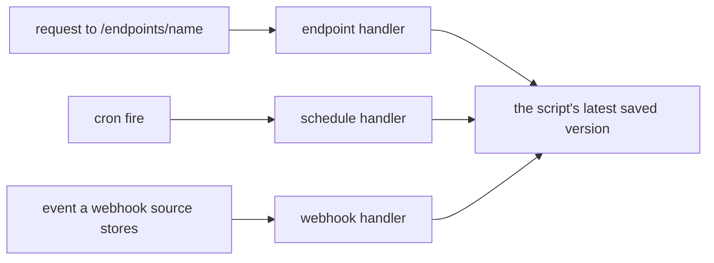

# Handlers

A script's handlers are what start it, besides someone running it (#2441,
#2434, #2435). There are three kinds:

| Kind | Starts the script | The script defines | Settings | Who adds one |
|---|---|---|---|---|
| `endpoint` | Each request to `/endpoints/<endpoint>/...` ([Endpoints](endpoints.md)) | `handle(req)`, or `form_spec(req)` and `form_submit(req, values)` on a form | `endpoint`, `methods`, `path`, `auth_mode` and the rest of the [endpoint settings](endpoints.md#binding-a-script); a form adds `connection` and `decrypt_personas` | An administrator; a form's owner on their own form |
| `schedule` | Each fire of a cadence ([Running one on a schedule](running.md#running-one-on-a-schedule)) | `main()` | `cron`, `timezone`, `args` | The script's owner or an administrator |
| `webhook` | Each event a webhook source stores ([Running one for each event](running.md#running-one-for-each-event-a-webhook-source-stores)) | `main()`, reading `run.event` | `event_source` | The script's owner or an administrator; anyone but an administrator only for the source of a form whose script they own |

A form is not a kind of its own. An endpoint whose script defines `form_spec`
and `form_submit` is a form, and every list reports its type as `form` rather
than `endpoint`.



A script may hold several handlers of each kind, at most 20 of a kind
(`internal/platform/scripthandler`, `MaxPerKind`): two schedules fire on two
cadences, two endpoint handlers answer on two names, and one script may run for
several webhook sources while several scripts run for one. Every handler starts
the script's latest saved version (in a released application, the version the
release pins; a public form serves a caller with no session its approved
version) under the roles its author held at the save; a handler carries no
authority of its own.

Each kind keeps its own table: `script_endpoints`, `script_schedules` and
`script_webhook_handlers`. Migration `000247` dropped the one-per-script
constraint on the first two, moved each script's `scripts.event_source` into a
webhook handler and dropped the column, and added the read-only view
`script_handlers` every handler list reads.

## The commands

| `manage_script` command | Does |
|---|---|
| `handler_set` | Adds a handler of `kind` with that kind's settings, or changes the one `handler` names |
| `handler_list` | One script's handlers (`name`), each described as `handler_get` describes it; with no `name`, the handlers of the caller's scripts (every script's for an administrator); `kind` narrows to one kind |
| `handler_get` | One handler, by its id (`handler`) |
| `handler_enable`, `handler_disable` | Turns one handler on or off, by its id; a disabled endpoint answers 404 and a disabled schedule or webhook handler starts nothing |
| `handler_delete` | Removes one handler, by its id |
| `form_preview` | Opens a preview of the script's form ([Publishing a form](endpoints.md#publishing-a-form)) |

```json
{"command": "handler_set", "name": "daily-sales", "kind": "schedule",
 "cron": "0 7 * * 1-5", "timezone": "America/Los_Angeles", "args": {"report_date": "${fire_date}"}}
```

`handler_set` answers with the handler it set, its id in `handler`. What it
does with no `handler` depends on the kind:

- **endpoint**: it changes the script's endpoint handler with the name sent in
  `endpoint`, or the script's only one when no name is sent, and otherwise adds
  one. A script with several endpoint handlers and no name sent is refused,
  naming them. A name another script holds is refused, naming the handler that
  holds it and its script.
- **schedule**: it adds a schedule. A schedule with the same cron, timezone and
  args as one the script already holds is refused, naming that one, since a
  repeated call would otherwise double the runs. With `handler`, it replaces
  that schedule's cadence in place, and the runs it produced keep pointing at
  it.
- **webhook**: it runs the script for the source. Adding a source the script
  already runs for keeps its handler and turns it on. With `handler`, nothing
  changes: a handler's source does not change, and saving a handler that is
  off leaves it off (`handler_enable` turns it on). To move a script to another
  source, add a handler for the new source and delete the old one.

`handler_list` with `kind=endpoint` includes forms. Its rows without `name`
carry each handler's `id`, `kind`, `type`, `script_id`, `script_name`,
`owner_email`, `target` (an endpoint's name, a schedule's cron and timezone, a
webhook handler's source), `enabled`, `created_by` and `created_at`, with
`count` and `total`.

`handler_delete` removes an endpoint handler with its failed and refused
requests; `/endpoints/<name>` answers nothing from then on, and a form's webhook
source and the submissions in it stay. A webhook handler's deletion leaves the
runs its events started. A schedule that produced runs is not deleted, because
its runs name it: the refusal says to disable it with `handler_disable`.

Who may add or change a handler is the kind's rule in the table above, on every
surface. The handler commands and routes act on a script's handlers for its
owner and administrators only; anyone else reads a script's schedules and
endpoints where the listing and its contract show them. A script run may read
handlers (`handler_list`, `handler_get`) and is
refused `handler_set`, `handler_enable`, `handler_disable` and
`handler_delete`, as it is refused every command that writes a script.

### The commands they replaced

`endpoint_set`, `endpoint_list`, `endpoint_enable`, `endpoint_disable`,
`schedule_set`, `schedule_list`, `schedule_enable` and `schedule_disable` were
removed with no alias. A call to one is refused, naming its replacement:

```text
schedule_set was removed: use handler_set with kind=schedule (#2441)
```

`manage_script update` with `event_source` is refused the same way, naming
`handler_set kind=webhook event_source=<source>`. A kind's settings keep the
parameter names the old commands took.

## What a save checks

A save is refused when the new version could not serve a handler the script
holds, naming the handler: an endpoint handler needs `handle(req)`, and a form
needs `form_spec(req)` and `form_submit(req, values)`. A form script stays a
form while it holds an endpoint handler; to make it something else, delete the
handler first. The check runs on every save, from `manage_script` and from the
portal's editor alike.

## In the portal

A script's page has a **Handlers** section in place of the separate endpoint,
schedule and events sections it had before. Each handler is a row with its type
badge (**Endpoint**, **Form**, **Schedule** or **Webhook**), what it answers to
(an endpoint's path, a schedule in words, "Each event of" a webhook handler's
source) and **On** or **Off**. Opening a row shows that kind's controls: an
endpoint's settings, the schedule builder with Pause and Resume, a webhook
handler's switch with how its event runs stand, and Delete. **Add handler**
offers each kind, and shows the reason beside a kind the viewer may not add.
Adding an endpoint to a form offers **Preview form** and **Request public
access** first.

The Automations list shows each script's type badges beside its name and
narrows by **Filter by type**: Endpoint, Form, Schedule, Webhook, or None for a
script with no handler. A script with a form and a schedule shows both badges
and is listed under both. The schedule and endpoint columns show a script's
first one and say how many more it has.

**Admin > Automations > Handlers** (`/portal/admin/automations/handlers`) lists
every handler of every script, filtered by type, a search over the script's name
and the target, owner, and state (On or Off); a row opens its script.

## Routes

| Route | Does |
|---|---|
| `GET /api/v1/portal/scripts/{id}/handlers` | The script's handlers, each as its kind describes it with `type`; `add`, each kind with whether the caller may add one and why not; `endpoint`, where a page would answer and a form's connections; `sources`, the webhook sources the caller may name; `max_per_kind` |
| `POST /api/v1/portal/scripts/{id}/handlers` | Adds a handler: `kind` and that kind's settings, named as `manage_script` names them (201) |
| `GET`, `PUT`, `DELETE /api/v1/portal/handlers/{id}` | Reads, changes or deletes one handler |
| `POST /api/v1/portal/handlers/{id}/enable`, `.../disable` | Turns one handler on or off |
| `GET /api/v1/admin/handlers` | Every handler, administrators only; `type` (repeatable), `search`, `owner`, `enabled`, `limit` (default and most 500) and `offset`; answers `data` and `total` |

The portal routes are the script's owner's and an administrator's. A refusal by
a kind's rule answers 403, a handler or script that does not exist 404, and a
request that names something wrongly 400.

`GET /api/v1/portal/scripts` takes `type`, repeatable: the scripts holding a
handler of any of the types named (`endpoint`, `form`, `schedule`, `webhook`),
and `none` for the scripts holding none. Each row carries `handler_types`,
`schedules` and `endpoints`, each `[]` when empty. `endpoint=` was removed and
is answered 400. A script's contract (what `fetch` on its reference returns)
lists its cadences under `schedules`.

These routes were removed, and the handler routes above replace them: `GET` and `PUT
/api/v1/portal/scripts/{id}/endpoint` and `.../endpoint/enable|disable`, `GET`
and `PUT /api/v1/portal/scripts/{id}/schedule` and `.../schedule/enable|disable`,
`PUT /api/v1/portal/scripts/{id}/event-source`, `GET
/api/v1/admin/scripts/schedules`, and `GET` and `PUT
/api/v1/admin/scripts/{id}/schedule` and `.../schedule/enable|disable`.

## In an application bundle

An application bundle at `format_version` 2 lists each script's handlers under
`handlers`: `endpoints`, `schedules` and `webhooks` (each source by name, mapped
on import like every other name). Import reads versions 1 and 2; a version 1
bundle's one endpoint, one schedule and one `event_source` per script become one
handler each. An import gives each script its handlers as `handler_set` does,
with the importing administrator's authority: a handler the script already holds
(an endpoint by name, a schedule by cadence and args, a webhook handler by
source) is changed in place, one it holds that the bundle does not name is left,
and each is turned on or off as the bundle holds it. See
[Applications](../server/applications.md#export-and-import).
