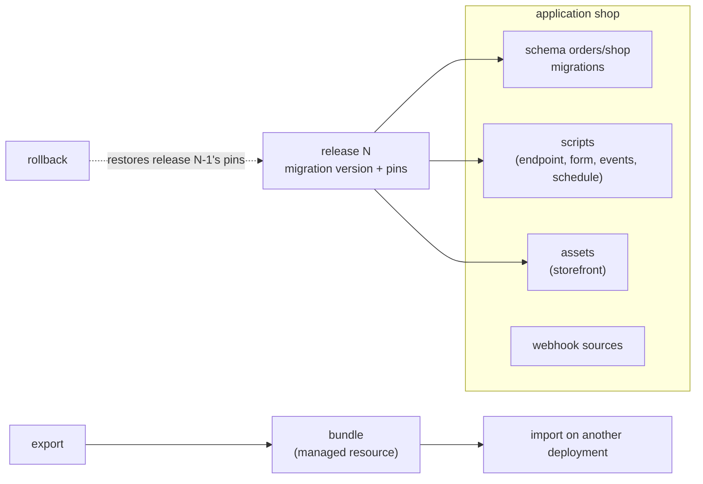

# Applications

An application is a system built entirely on the platform: an [application database](appdb.md) schema with its migrations, managed scripts (an [endpoint](../scripts/endpoints.md) or a form is its script's binding), [webhook sources](webhooks.md) and the portal assets that are its user interface. `manage_application` (#2411) names all of it as one record and releases it as a pinned set; export and import (#2412) move a release between deployments.



## The record

| Field | Meaning |
|---|---|
| `name` | A lowercase slug, unique on the deployment |
| `owner_email` | The one owner; an administrator moves it to another |
| `connection`, `schema` | The application database schema whose migrations a release applies; both or neither. One application per schema, and one schema per application. The connection must be an existing application database connection (kind `appdb`) the caller's persona reaches (#2491, #2539) |
| `schema_adopted_version` | The migration version the schema had applied when it was added; a rollback never reverts a migration at or below it (#2539) |
| `parts` | Scripts (by id), assets (by id), webhook sources (by name) and the schema (kind `schema`, by `<connection>/<schema>`). A part belongs to at most one application |
| `current_release` | The release in force, 0 before the first |

The portal's **New application** dialog says what an application is and links
to the `platform-applications` knowledge page. Its name is checked as it is
typed against the rule above. The database is chosen from the application
database connections the caller's persona reaches, or **None (no database)**
for an application of scripts, sources and assets alone; with one chosen, the
schema is chosen from that connection's schemas, each one another application
holds shown with its name and not offered, or a new name is entered, which the
first release creates. The choices are read from
`GET /api/v1/portal/application-databases`.

### The schema is a part

A schema exists only inside an application (#2539). It is added at any time with `add_part` (`kind: "schema"`, `part_id: "<connection>/<schema>"`, or the schema alone when the caller reaches one application database connection), from the portal's **Add parts** dialog, or by naming `connection` and `schema` at create, which adds it the same way. An application that grew on scratch tables or files takes its schema on this way without being deleted and created again. No application command creates or changes a connection: an administrator configures it. A connection the caller does not reach is refused naming the ones they do; a second schema, or a schema another application holds, is refused naming the holder.

`manage_schema` adds, plans, applies and reverts migrations only on a schema an application holds, and so does the portal's plan route; the refusal names the `add_part` call. Every schema with migrations that no application holds is listed by `manage_schema status` (`unheld_schemas`) and on the admin application database page, with that call. A schema whose migrations were applied before it was added is adopted: its applied version is kept as `schema_adopted_version`, the next release applies nothing already applied and records the schema's version, and a rollback reverts only migrations a release applied.

Adding the schema creates the application's run role on the connection: a login role named `<schema>_run_` and eight characters derived from the database's name, with no `SUPERUSER`, `BYPASSRLS`, `CREATEROLE`, `CREATEDB` or `REPLICATION`, and a password the platform generates. The role is sent its SCRAM-SHA-256 verifier, never the password, and the password is stored in `application_run_roles` sealed with the deployment's encryption key, bound to the application, connection, schema and role; no route, tool, log, audit row, call record, run record or bundle carries it. Creating it needs `CREATEROLE` on the connection's user, and adding a schema without it is refused naming `ALTER ROLE <user> CREATEROLE`; a deployment with no `ENCRYPTION_KEY` adds no schema. Every statement of the application's scripts (a run, a draft, an endpoint request, a form, an event) logs in as the run role of the schema its environment runs in, with that schema as the role's `search_path` (#2709). Its grants come from the platform: after a release or a promote applies migrations to an environment's schema, that environment's run role is granted `USAGE` on the schema and `SELECT`, `INSERT`, `UPDATE` and `DELETE` on every table, sequence and routine in it, and nothing on any other schema; a schema whose migrations defined `<schema>_write` before #2709 also keeps the run role a member of it. A migration that creates, alters, drops or grants to a role, `PUBLIC` included (`role_named`), or names an object qualified by its own schema (`schema_qualified`), in a statement or a function's or `DO` block's body, is refused at add and at import: one migration applies to every environment's schema with the search path set to it. A script of another application, or of none, has no grant on the schema: its statement is refused by the database, and the error names the application holding the schema and says to use its endpoints and exports. Adding a script whose source reads or writes a schema another application holds is refused. Removing the schema drops the run role and its stored password and leaves the schema and its data; on a released application it is for administrators. An application holding a schema from before run roles has none until the schema is added again.

Everyone signed in reads an application. Its owner and administrators edit its description and its parts, except that taking out a part the current release pins, or deleting a released application, is for administrators: either puts the part's newest version live, which is what a release does. A part is added by its owner (a webhook source, which only administrators manage, by an administrator). Only administrators release, roll back, export and import: a release changes the code behind a public endpoint and runs migrations on the target database, which is the authority an endpoint handler (`manage_script handler_set kind=endpoint`) and `manage_schema apply` already require. There is no second approver.

## Releases

`release` applies the schema's pending migrations and pins every script part at its newest saved version and every asset part at its newest version. The release records the migration version it holds applied, each pin, and what changed: the parts whose pinned version moved and the migrations it applied.

While a script belongs to a released application, its endpoints, forms, schedules, event runs, `run_script` and the portal's run action execute the pinned version (`scripts.released_version`, read through `Script.RunVersion`); saving the script makes a new version that runs at the next release. While an asset belongs to one, the portal's content route, its signed content URLs, public shares and the reference route serve the pinned version (`portal_assets.released_version`, `portaldomain.Served`); a version a release pins is kept by version retention. Removing a part, or deleting the application, lets go of it: it runs and serves its newest version again.

A release that cannot be made changes nothing:

- a part that can no longer be read (a deleted script or asset, a removed webhook source) refuses the release naming it;
- the pending migrations that run in a transaction are first run together in one transaction that is rolled back; one that fails refuses the release before anything is applied. Should a migration still fail during the apply, the migrations this release applied are reverted with their down migrations, and the error names any that had none;
- a release decided against a current release another release has since moved fails and records nothing;
- a part loading one of the application's libraries at a version other than the one the release pins refuses the release, naming the script, the version it loads and the version to load (#2540). Inside an application the release's pin is the version. The diagram's other findings are recorded on the release (`changes.findings`) without refusing it.

`rollback` restores the pins of an earlier release (`to_release`, or the one before the current release) and records itself as a new release. It reverts the migrations applied since that release when every one of them has a down migration; when one has none it reverts none and says which (`changes.migrations_kept`). `releases` lists every release, newest first, with its pins and changes.

## Environments and variables

An application runs in ordered environments (#2696). `manage_application create` makes one, `prod`, so its releases go live as they always have; `add_environment` with `environment: "dev"` and no `after` puts dev first. The portal's New application dialog (and `POST /api/v1/portal/applications` with `environments`, for example `["dev", "prod"]`) creates them at once, filled in with `dev, prod`. Each environment records the release it runs:

- `release` lands in the first environment;
- `promote` with `environment` copies that environment's release to the next one;
- `rollback` with `environment` moves that environment back one release, or to `to_release`. With no `environment` it rolls back the last, as before.

The last environment is what `/endpoints/<name>`, the page origin and every schedule or webhook handler naming no environment run. `scripts.released_version` and `portal_assets.released_version` hold its pins, so everything that names no environment behaves as it did before environments. Another environment's endpoints answer at `/environments/<env>/endpoints/<name>/...` with the same binding, access mode and limits, running the version its release pins. An environment running no release answers 404 there. A schedule or webhook handler names the environment its runs execute in with `manage_script handler_environment` (`handler`, `environment`), or the Environment field on the script's handler forms. A queued run records its environment in `script_runs.environment`. Assets are served at the last environment's pins.

`add_environment` puts one after another (`after`; none puts it first), never after the last. `remove_environment` removes one other than the last, with its variables. `requires_approval` (on `add_environment` or `set_environment`) makes an agent's `promote` or `rollback` into that environment refused with `APPROVAL_REQUIRED`: a person carries it out with Promote or Roll back on the application's page. Environments are an administrator's to change, promote and roll back.

**Each environment runs in a schema of its own** (#2709). `add_environment` takes `schema` (default `<application schema>_<environment>`, a hyphen written as an underscore, at most 50 bytes, a lowercase identifier) on the application's connection. The platform builds it from the structure of the last environment's schema (`internal/appdbdrift` renders it from the catalog with every qualifier pointed at the new schema: tables, views, functions, indexes, types, sequences, constraints, triggers, policies and comments, no rows and no grants) in one transaction, refuses it naming each object that would still reach the source schema (a view, foreign key, default, trigger, policy or function depending on an object there, a function body naming it qualified or a `search_path` setting holding it), records the source's applied migrations as applied in the new schema's own ledger, and creates a run role for it as for the application's schema, its password sealed bound to the application, connection, schema and role and stored in `application_run_roles` (keyed by application and schema since migration 000260). A schema that exists, or another environment's or application's, is refused. Every environment that existed before #2709 keeps the application's schema (migration 000260 sets `application_environments.schema_name` to it), so nothing moves on upgrade. Migration 000260 also keeps every site answering as before, since a site part called the last environment until #2709: a site part whose environment the application lacked is given it, ahead of the others, with the last environment's release on the application's schema, and an environment a site part calls that had no release is given the last environment's release. Such an environment shares the application's schema; to give it its own, prepare, remove the site part and the environment, add the environment again and add the site part back. `release` applies the pending migrations to the first environment's schema; `promote` applies the migrations the promoted release recorded to the target's schema before the target moves, and one that fails refuses the promote with `nothing was promoted` and leaves the target as it was (the answer's `applied` lists what it applied); `rollback` reverts migrations in a schema only its environment runs in, and leaves a schema environments share alone. `remove_environment` drops the environment's run role and keeps its schema until an administrator drops it. A run in one environment logs in as that environment's run role, so a statement naming another environment's schema is refused by the database (`permission denied for schema <name>`). The application's `get` carries `schema.environments`: each environment's schema, its applied migration version, what is pending there and the environment it shares a schema with.

**Prepare.** An application whose scripts, the libraries they load, or pending migrations name its schema or its roles is refused `add_environment`, with the counts: from a new environment such SQL would reach this one's data. `manage_application command=prepare` (and `GET /api/v1/portal/applications/{app}/prepare`, the owner's and administrators') lists each such file with the text proposed without the schema qualifier and the role statements (applied migrations stay as their ledger records them), and puts each changed script and library through the save gate, which replays its recent recorded runs; `save=true` (and `POST .../prepare`, administrators) saves each library as a new version, then each script loading the library's new version, then each pending migration, and saves nothing while the gate refuses a file, as when a replayed run answers differently (`422` with the plan). `get` carries `prepare`, the counts. A script save that adds a name qualified by one of the application's schemas is refused naming the line (`line N names the schema S. Inside an application write T: each environment's runs read their own schema`); what a script already said is left alone. Prepare removes a qualifier only where SQL names an object with it (after a keyword such as `FROM`, `JOIN`, `INTO` or `UPDATE`, in a call, after a comma or an operator; a file such as `hello.css` is left alone), and leaves a name inside a quoted SQL value (`'orders.refunds'`, an outbox `source_table`) as written, listing it for a hand edit to `current_schema() || '.refunds'`. A script that is not yet a part drafts in an application with `manage_script command=run_draft application=<name>` (its owner and administrators): the draft's statements on the application's connection log in as its first environment's run role, so unqualified SQL finds that environment's tables; without it a draft belongs to no application. A site environment or a handler naming the application's last environment runs what `/endpoints/<name>` runs, the script's released version, so an application never released still answers there.

**Approval on every agent surface** (#2706). The `requires_approval` check is the application service's own, keyed on whether the caller is an agent: every `manage_application` call is, and so is a portal API request a tool call made (`selfcall.ByTool`: the platform-admin connection, a managed script calling the platform). An agent's `promote` or `rollback` into such an environment answers `409` with `APPROVAL_REQUIRED` from the tool and the portal API alike; a person signed in to the portal carries it out.

**Variables** are `NAME=value` per environment, plus application-wide defaults (no `environment`). A script reads them with `platform.env("NAME", default=None)`: the environment's own value, else the default, else `default`. `platform.environment()` names the environment, or None for a script no application holds. A change takes effect on the next run; no release is needed. `set_variable`, `delete_variable` and `variables` on `manage_application`, the portal's Variables table and `GET`/`PUT`/`DELETE /api/v1/portal/applications/{app}/variables[/{name}]` are the application owner's and administrators'. A name is uppercase letters, digits and underscores, at most 64; a value is at most 8 KiB.

A value is plain text, shown to the owner and administrators and recorded in the call's audit row like any other argument. Never put a secret's value in a variable. To use one, store it in Admin > Secrets and write `{{secret:<name>}}` as the value: the script reads the placeholder as written, and the API gateway fills it only when a request carrying it is sent through a connection the secret's `allow_connections` lists. The answer is redacted as for any stored secret, so the script, its run, its recording and the audit never hold the value.

## Export and import

`export` (an administrator) writes a release as a bundle, a JSON managed resource in the caller's library at `applications/<name>/<name>-release-<n>.json`:

| Bundle part | What it holds |
|---|---|
| `schema` | The connection name, the schema, and each migration up to the release's version (up, down, transactional) |
| `scripts` | Each pinned script version: source, parameters, descriptive fields, its [handlers](../scripts/handlers.md) under `handlers` (`endpoints`, each with the connection a form's submissions table is on; `schedules`; `webhooks`, each a source by name), and the recorded runs its tests replay (`recordings`, each by run id) |
| `assets` | Each pinned asset version's content and type |
| `sources` | The webhook sources that are parts, by name |
| `names` | Every connection, secret (`{{secret:<name>}}` in a source), webhook source and bot check the parts use, read statically; a script that names a connection a static read cannot see is noted in the export's answer |

A bundle's `format` is `mcp-data-platform.application` at `format_version` 2, which lists every handler of each script (#2441). Import reads versions 1 and 2: a version 1 bundle carried at most one endpoint, one schedule and one `event_source` per script, and each becomes one handler.

A bundle carries no secret value, credential, script state or run history: export reads none of them. It does carry the recordings a script's tests replay (#2476): each holds the calls the recorded run made and the answers they were given, which can include rows a query returned, so the importing deployment runs the same tests. A recording keeps a stored secret only as its `{{secret:<name>}}` placeholder, a minted token and a decrypted value as placeholders, and a role password as `'[REDACTED]'`. A test naming a recording this deployment no longer holds refuses the export. Connection passwords, per-persona role passwords and client keys, webhook source secrets and stored secrets stay on the deployment they were configured on; a bundle names them only. A migration that writes a credential (`CREATE ROLE ... PASSWORD '...'`) is refused when it is added (`password_literal`, see [the migration review](appdb.md)), and export refuses any stored migration the rule refuses, so a bundle never carries one.

`import` (an administrator) reads a bundle from a managed resource and takes `map`, the name on this deployment for every name the bundle uses. An unmapped name refuses the import, naming each, before anything is written, as does a mapped name that is not a plain name (letters, digits, `.`, `_` and `-`), since it is written into script sources. Every migration in the bundle is held to the migration review's refused rules (a credential, `COPY ... PROGRAM`, code in an untrusted language, an event trigger, `ALTER SYSTEM`), as `manage_schema add` holds one, and a bundle carrying one is refused. Every script crosses this deployment's save gate as the importing administrator saving it (#2476): the format, the lint and limits, its tests (against the recordings the bundle carries, renamed by `map` as the source is) and their coverage, with the bundle's release as the summary of what it changes. A script the gate refuses refuses the import, naming the script and the gate's finding. So does a carried recording over the 8 MiB a run's own recording may hold, one that does not read, and one whose run id this deployment holds with other content: a bundle never replaces another script's recording. All of this is decided before anything is written. It then:

1. finds the application with the bundle's name, or creates it on the mapped connection (refused when the mapped connection is not an application database here, or when an existing application of that name is on another schema);
2. stores each migration this deployment does not hold, refusing one it holds with another checksum;
3. writes each script and asset: a new version of the part with that name, or a new one owned by the importing administrator. A script's source has each mapped connection name and `{{secret:<name>}}` rewritten, and is stored as the gate formatted it, with its test report; the recordings its tests replay are stored, encrypted at rest like any recording, as the importing administrator's drafts of the script, and kept while its tests name them. Its run identity is the importing administrator's session: nothing in a bundle names who a part runs as. Its handlers are set as `handler_set` sets them, with the importing administrator's authority: a handler the script already holds (an endpoint by name, a schedule by cadence and args, a webhook handler by its mapped source) is changed in place, one it holds that the bundle does not name is left, and each is turned on or off as the bundle holds it;
4. releases the application, recorded as action `import`.

Importing a later release of the same application is a release on the target.

## Surfaces

The MCP tool `manage_application` takes `command`: `create`, `get`, `list`, `update`, `delete`, `add_part`, `remove_part`, `release`, `rollback`, `releases`, `export` and `import`. A managed-script run may read applications but not change one.

The portal's **Applications** section lists applications; an application's page shows its parts by name, grouped by kind, with the version each is pinned at and whether a newer one exists, what a release would change and anything it would refuse, and its releases with what each changed. `GET /{app}` carries `parts`: each part's `name`, the facts its row is described with (a script's description, its schedules and the webhook sources it runs for, an asset's type, a webhook source's accepted requests in the last day, told to administrators), its `latest_version`, and its `state`: `ok`, `deleted`, or `not_visible` for an asset the caller cannot open, whose name is not told. Add parts searches what the caller may add by name (`GET /{app}/candidates?q=`): their own scripts, assets and site environments (`<site>/<environment>`), every one and the webhook sources for an administrator, at most 50 of each kind, a part already in another application listed with that application, which refuses it. The routes are under `/api/v1/portal/applications`: `GET` and `POST` on the collection, `GET`, `PATCH` and `DELETE` on `/{app}`, `GET /{app}/candidates`, `POST /{app}/parts` and `DELETE /{app}/parts/{kind}/{id}`, `POST /{app}/release`, `POST /{app}/rollback`, `GET /{app}/export` (the bundle as a download) and `POST /import` (an uploaded bundle with its map). Every write is audited as a `manage_application` call from the portal; an import's audit row names the application and the map, never the bundle's content; a refused import's row keeps the refusal, which names the script and the save gate's finding, and a failing test's finding can quote a value the test compared, read from a recording the bundle carried. The section follows the persona's Automations switch.

The Parts card has two tabs, **List** and **Diagram** (#2540). The diagram, `GET /{app}/diagram?version=current|latest|<release>&compare=<release>`, draws how the parts fit together from their sources and stored settings, never from a run: drawing it starts no run and makes no outbound request. Its nodes are the parts and what they reach outside the application (tables on other stores, channels, libraries, outputs, endpoints); its links are a webhook source starting a script, a script reading or writing a table, loading a library at a version, exporting or refreshing an asset, notifying a channel or submitting a form to its source, and an asset calling an endpoint or embedding a form, read from the asset's content and matched to the bindings of the application's scripts. Each schedule and endpoint handler is shown on its script's card. A name a source computes when it runs is a node marked computed and is never matched to a part. `compare` marks each node and link added, removed or unchanged, and a part whose version moved changed. An asset the caller cannot open is drawn unnamed and its content is not read. The diagram's findings, which `manage_application get` reports under `problems` and in `findings`, are a script loading one of the application's libraries at a version other than the one pinned (a release refuses it), a table of the application's schema its scripts read and no part writes (a table its migrations fill counts as written), and a script using a schema the application does not hold. A write is read from `platform.execute`, a transaction's `tx.execute`, `tx.query` and `tx.batch`, `platform.batch`, and rows copied in with `tx.copy_in` or `platform.copy_in` (#2665). A statement list is followed to the statements it holds wherever the source says what they are (#2699): through a parameter to what each caller passed, through a loop variable to the elements of what it iterates (a list, `d.values()`, `d.items()`, `enumerate(...)`), into a field of a dict constant (`spec["write"]`), into a function the source defines to what it returns, across `+`, `.append`, `.extend` and `+=`, through a comprehension whose element, or whose element's `"sql"`, is its loop variable, and through a statement that is a helper's return value. A name the script loads from a library (`load("lib:<name>@<version>", ...)`) is read from that library version's source: a constant it defines is its text, and a function it defines is followed to what it returns. A step whose statements are still built when it runs is drawn as one "table named when it runs" card per script and connection, however many such steps the script has. A table no part is known to write says a script that writes a table named only when it runs may write it, and one further finding (`runtime_writes`) names those scripts once. A function the source names as a value rather than calls (a route table's handler, the function a wrapper is handed and returns a lambda calling) is followed as a call, so what it runs counts. The schema is drawn as its group's heading, selected like a card, and every table its migrations leave created is drawn inside it, used by a part or not. An application with more than twelve script-to-table links is drawn the large way (#2700): its parts are rows in four columns (what starts the scripts, the scripts, what else they reach, the schema's tables), shrunk to fit the width, with one band between the scripts and the tables in place of every line. Selecting a script draws its tables, writes thick and reads thin, tags each table writes or reads, dims the rest, and lists them in a side column; selecting a table lists **Written by** and **Read by**. **Drawing | Table** switches to a table of scripts by tables whose cells read R, W or R W, with a **Written by** row that flags a table nothing writes; a phone opens on that view as a list. A comparison draws the added and removed links without a selection, and the findings are shown above the drawing. A smaller application is drawn as before. A `manage_script` update or patch of an application's script returns the findings the save introduced (`application_findings`).

The application data is in `applications`, `application_parts`, `application_releases` and `application_release_pins` (migration 000228), and `application_run_roles` with the schema's columns on `applications` (migration 000234).

## Building one

The built-in knowledge page `platform-applications` walks through an e-commerce application built with platform tools alone: migrations, a checkout form that writes an order and its lines and takes their stock in one transaction, a row-level security policy keyed on the caller, an outbox event that sends the confirmation, scheduled maintenance, a storefront asset, and the release. The built-in example `example-shop-checkout` is its checkout script with tests that run on a copy of the database.

The built-in knowledge page `platform-application-environments` (#2709) is the agent's guide to running one application in dev and prod with its own data in each: what an environment holds, connections and keys from variables per environment, unqualified SQL and migrations that name no role, sites calling the environment of their name, what promote and rollback move, bringing an older application over with prepare, and every refusal with its fix. The platform's agent instructions name it beside `platform-applications`, and `manage_script help` lists it.

The built-in knowledge page `platform-public-applications` builds one for the public, whose visitors have no platform account (#2558), in the preferred shape: a storefront site (static pages or a single-page application) whose environment is a part of the application and calls the application's JSON endpoints at `/endpoints/<name>` on the site's own address. It covers one JSON endpoint on `/{route...}` routing the whole API; the site's `_redirects` answering the application's routes with its shell by a 200 rewrite, `404.html`, `robots.txt` naming a sitemap the API builds, and `_headers` naming the payment processor's script, hosted card fields and API; the processor's signed callback on a webhook source; a cart row keyed by `gen_random_uuid()` in an application cookie, which reaches the endpoints a site calls; sign-in by a single-use emailed link from `platform.mint_token`; mail from an outbox through an `api` connection, its `sent_at` and `attempts` columns and a schedule that sends what is owed, since the platform does not re-run a failed run, and the audit log keeping each recipient address for its retention period; `ip_rate_limit` and a bot check on the sign-in request; product images in the site's release with fingerprinted names, served immutable; `www` as a public domain on the site and the apex sent there by a site whose `_redirects` holds a `:splat` rule (an application served by page endpoints takes a hostname with `add_domain application=`); pages rendered on the server by a page endpoint as the option where a page must be readable without script; and the same pieces for a marketing site, an intranet and a single-page application. Its acceptance criteria build the application and the site from the page's own blocks.

## Site parts

One environment of a static site can be a part of an application: `add_part` with `kind: "site"` and `part_id: "<site>/<environment>"`. Being a part gives the environment the application's `/endpoints/<name>` on its own address, the application's cookies and its viewer. Whether an application release also ships it is the part's **release mode** (#2679):

| | linked | coupled |
|---|---|---|
| Same-origin `/endpoints/`, application cookies, viewer identity | yes | yes |
| An application release moves the environment | only when `move_sites` names it | yes, one step |
| `manage_site promote` and `rollback` own the environment | yes | the next release moves it again |
| An application rollback returns it | only when the rolled-back release moved it | yes |

A site environment part calls the application environment of the same name (#2709): its `/endpoints/<name>` run in that environment's release, variables and schema, so `shop-web/dev` calls `dev` and `shop-web/prod` calls `prod`. Adding a part whose environment name the application has none of is refused naming the environment to add; `remove_environment` of an environment a part calls is refused naming the part; a site environment renamed out of a match answers `/endpoints/...` with 404 and a body naming the environment the application lacks, never another environment's endpoints. The application's own page origin still serves the last environment.

A new site part is **linked**; `add_part` takes `release_mode: "coupled"` to make it coupled, and `set_part` (or `PATCH /api/v1/portal/applications/{app}/parts/site/{id}`) changes it. Parts added before v1.163.0 are coupled, so nothing changes for them. A coupled part moves with the environment it calls: a release moves only the parts calling the first environment, a promote moves the parts calling the target to the site release the source's part ran with that release, and a rollback in an environment returns only the parts calling it. A release that moves a part pins it at what the environment before it serves, `dev` at the site's newest release, and points that environment at it. `release` takes `move_sites: ["<site>/<environment>", ...]` to move named parts one step in this release, linked or not, and a rollback of that release returns exactly the parts it moved.

### The compatibility contract

Front ends and backends are usually compatible across releases; a contract says when they are not. The application declares a **contract version**, a whole number raised by hand when a release breaks what front ends call: `manage_application update contract_version=3`, or `contract` on `release` (saved once the release is recorded). 0 declares none. A site release may declare the range it needs in an `_application` file at its root:

```json
{"application": "store", "contract": ">=2 <4"}
```

A range is clauses of an operator (`>=`, `>`, `<=`, `<`, `=`) and a whole number; a release with no `_application` file, or one naming another application, is compatible with everything. The file is read at publish, kept on the release (not served), and reads back through `manage_asset` like `_redirects`.

- An application release is refused while any site part would serve, after it, a release whose range excludes the contract, naming each part, its release and the range. `force` (an administrator's) releases anyway and the release records each part under `changes.forced`.
- `manage_site promote` of a release whose range excludes the contract of the application the target environment is a part of is refused, naming the contract.
- A breaking change is then a coordinated release: publish front ends that accept both contracts, promote them, release the backend with the new contract, and later drop the old one.

`manage_application get` (and the portal's Parts card) lists each site part under `site_parts` with its mode, the release it serves, the release a move would point it at, the range that release declares and whether it works with the contract. See [Sites and pages](sites.md).
