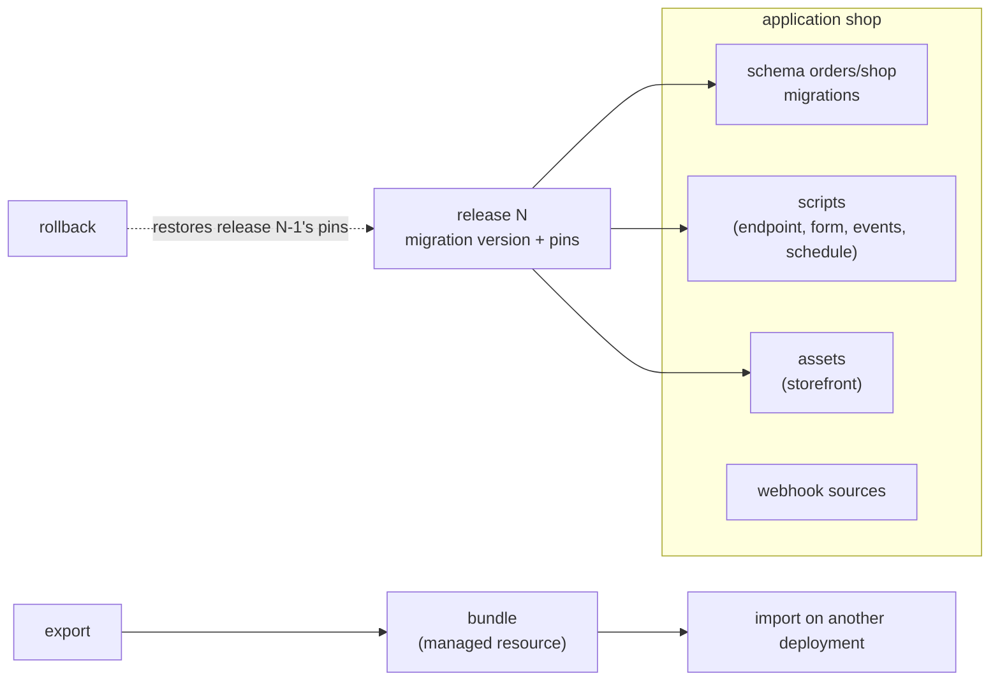

# Applications

An application is a system built entirely on the platform: an [application database](appdb.md) schema with its migrations, managed scripts (an [endpoint](../scripts/endpoints.md) or a form is its script's binding), [webhook sources](webhooks.md) and the portal assets that are its user interface. `manage_application` (#2411) names all of it as one record and releases it as a pinned set; export and import (#2412) move a release between deployments.

## The record

| Field | Meaning |
|---|---|
| `name` | A lowercase slug, unique on the deployment |
| `owner_email` | The one owner; an administrator moves it to another |
| `connection`, `schema` | The application database schema whose migrations a release applies; both or neither. One application per schema |
| `parts` | Scripts (by id), assets (by id) and webhook sources (by name). A part belongs to at most one application |
| `current_release` | The release in force, 0 before the first |

Everyone signed in reads an application. Its owner and administrators edit its description and its parts, except that taking out a part the current release pins, or deleting a released application, is for administrators: either puts the part's newest version live, which is what a release does. A part is added by its owner (a webhook source, which only administrators manage, by an administrator). Only administrators release, roll back, export and import: a release changes the code behind a public endpoint and runs migrations on the target database, which is the authority `endpoint_set` and `manage_schema apply` already require. There is no second approver.

## Releases

`release` applies the schema's pending migrations and pins every script part at its newest saved version and every asset part at its newest version. The release records the migration version it holds applied, each pin, and what changed: the parts whose pinned version moved and the migrations it applied.

While a script belongs to a released application, its endpoint, form, schedule, event runs, `run_script` and the portal's run action execute the pinned version (`scripts.released_version`, read through `Script.RunVersion`); saving the script makes a new version that runs at the next release. While an asset belongs to one, the portal's content route, its signed content URLs, public shares and the reference route serve the pinned version (`portal_assets.released_version`, `portaldomain.Served`); a version a release pins is kept by version retention. Removing a part, or deleting the application, lets go of it: it runs and serves its newest version again.

A release that cannot be made changes nothing:

- a part that can no longer be read (a deleted script or asset, a removed webhook source) refuses the release naming it;
- the pending migrations that run in a transaction are first run together in one transaction that is rolled back; one that fails refuses the release before anything is applied. Should a migration still fail during the apply, the migrations this release applied are reverted with their down migrations, and the error names any that had none;
- a release decided against a current release another release has since moved fails and records nothing.

`rollback` restores the pins of an earlier release (`to_release`, or the one before the current release) and records itself as a new release. It reverts the migrations applied since that release when every one of them has a down migration; when one has none it reverts none and says which (`changes.migrations_kept`). `releases` lists every release, newest first, with its pins and changes.

## Export and import

`export` (an administrator) writes a release as a bundle, a JSON managed resource in the caller's library at `applications/<name>/<name>-release-<n>.json`:

| Bundle part | What it holds |
|---|---|
| `schema` | The connection name, the schema, and each migration up to the release's version (up, down, transactional) |
| `scripts` | Each pinned script version: source, parameters, descriptive fields, its endpoint binding (with the connection a form's submissions table is on), its schedule, and the recorded runs its tests replay (`recordings`, each by run id) |
| `assets` | Each pinned asset version's content and type |
| `sources` | The webhook sources that are parts, by name |
| `names` | Every connection, secret (`{{secret:<name>}}` in a source), webhook source and bot check the parts use, read statically; a script that names a connection a static read cannot see is noted in the export's answer |

A bundle carries no secret value, credential, script state or run history: export reads none of them. It does carry the recordings a script's tests replay (#2476): each holds the calls the recorded run made and the answers they were given, which can include rows a query returned, so the importing deployment runs the same tests. A recording keeps a stored secret only as its `{{secret:<name>}}` placeholder, a minted token and a decrypted value as placeholders, and a role password as `'[REDACTED]'`. A test naming a recording this deployment no longer holds refuses the export. Connection passwords, per-persona role passwords and client keys, webhook source secrets and stored secrets stay on the deployment they were configured on; a bundle names them only. A migration that writes a credential (`CREATE ROLE ... PASSWORD '...'`) is refused when it is added (`password_literal`, see [the migration review](appdb.md)), and export refuses any stored migration the rule refuses, so a bundle never carries one.

`import` (an administrator) reads a bundle from a managed resource and takes `map`, the name on this deployment for every name the bundle uses. An unmapped name refuses the import, naming each, before anything is written, as does a mapped name that is not a plain name (letters, digits, `.`, `_` and `-`), since it is written into script sources. Every migration in the bundle is held to the migration review's refused rules (a credential, `COPY ... PROGRAM`, code in an untrusted language, an event trigger, `ALTER SYSTEM`), as `manage_schema add` holds one, and a bundle carrying one is refused. Every script crosses this deployment's save gate as the importing administrator saving it (#2476): the format, the lint and limits, its tests (against the recordings the bundle carries, renamed by `map` as the source is) and their coverage, with the bundle's release as the summary of what it changes. A script the gate refuses refuses the import, naming the script and the gate's finding. So does a carried recording over the 8 MiB a run's own recording may hold, one that does not read, and one whose run id this deployment holds with other content: a bundle never replaces another script's recording. All of this is decided before anything is written. It then:

1. finds the application with the bundle's name, or creates it on the mapped connection (refused when the mapped connection is not an application database here, or when an existing application of that name is on another schema);
2. stores each migration this deployment does not hold, refusing one it holds with another checksum;
3. writes each script and asset: a new version of the part with that name, or a new one owned by the importing administrator. A script's source has each mapped connection name and `{{secret:<name>}}` rewritten, and is stored as the gate formatted it, with its test report; the recordings its tests replay are stored, encrypted at rest like any recording, as the importing administrator's drafts of the script, and kept while its tests name them. Its run identity is the importing administrator's session: nothing in a bundle names who a part runs as. Its endpoint is bound as `endpoint_set` binds one, and its schedule set;
4. releases the application, recorded as action `import`.

Importing a later release of the same application is a release on the target.

## Surfaces

The MCP tool `manage_application` takes `command`: `create`, `get`, `list`, `update`, `delete`, `add_part`, `remove_part`, `release`, `rollback`, `releases`, `export` and `import`. A managed-script run may read applications but not change one.

The portal's **Applications** section lists applications; an application's page shows its parts with the version each is pinned at, what a release would change and anything it would refuse, and its releases with what each changed. The routes are under `/api/v1/portal/applications`: `GET` and `POST` on the collection, `GET`, `PATCH` and `DELETE` on `/{app}`, `POST /{app}/parts` and `DELETE /{app}/parts/{kind}/{id}`, `POST /{app}/release`, `POST /{app}/rollback`, `GET /{app}/export` (the bundle as a download) and `POST /import` (an uploaded bundle with its map). Every write is audited as a `manage_application` call from the portal; an import's audit row names the application and the map, never the bundle's content; a refused import's row keeps the refusal, which names the script and the save gate's finding, and a failing test's finding can quote a value the test compared, read from a recording the bundle carried. The section follows the persona's Automations switch.

The application data is in `applications`, `application_parts`, `application_releases` and `application_release_pins` (migration 000228).

## Building one

The built-in knowledge page `platform-applications` walks through an e-commerce application built with platform tools alone: migrations, a checkout form that writes an order and its lines and takes their stock in one transaction, a row-level security policy keyed on the caller, an outbox event that sends the confirmation, scheduled maintenance, a storefront asset, and the release. The built-in example `example-shop-checkout` is its checkout script with tests that run on a copy of the database.
