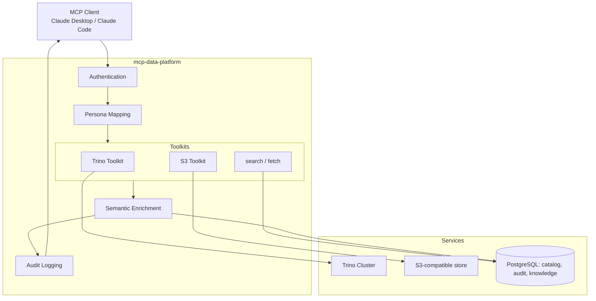

# MCP Server Overview

This MCP server connects AI assistants to your data infrastructure for exploration and analysis. It's not an API wrapper. It's a platform that understands your data's business context.

## What It Does

The platform keeps its own [catalog](catalog.md) in PostgreSQL: every connection is scanned into it, and people and agents curate it. It is the semantic layer that gives meaning to your data, and it's what cross-enrichment works from:

- **Catalog** - Search it, read a dataset with its curation and lineage, curate it in the portal or with `apply_knowledge`
- **Trino** - Run SQL queries (results include the catalog's context automatically)
- **S3** - Access files in object storage

The difference from standalone tools: **cross-enrichment**. Query a table in Trino, get its business context in the response. Read a dataset from the catalog, see whether and where it is queryable.

If you have no warehouse, the platform still runs. The gateways, knowledge layer, memory, portal, and `search`/`fetch` are database-backed and need only PostgreSQL. See [Deployment Shapes](deployment-shapes.md).

## Architecture



## Request Flow

For HTTP (remote) deployments:

1. **Auth** - Validate OIDC token or API key
2. **Persona** - Map user roles to tool permissions
3. **Execute** - Run the tool
4. **Enrich** - Add catalog context to results
5. **Audit** - Log the request

For stdio (local), skip steps 1-2. Your machine, your credentials.

## Transport

| Transport | When to use |
|-----------|-------------|
| **stdio** | Local. Claude Code, development. |
| **HTTP** | Remote. Shared server, Claude Desktop connecting over network. Serves both SSE and Streamable HTTP. |

## Minimal Configuration

The catalog lives in the platform's database, which is what cross-enrichment
needs. Add Trino and S3 if you have them; for a configuration with neither, see
[Deployment Shapes](deployment-shapes.md):

```yaml
server:
  name: mcp-data-platform
  transport: stdio

database:
  dsn: ${DATABASE_URL}

toolkits:
  # Optional: add Trino for SQL queries; the catalog scan catalogs it
  trino:
    enabled: true
    instances:
      primary:
        host: trino.example.com
        port: 443
        user: analyst
        ssl: true
        catalog: hive
    default: primary

enrichment:
  trino_semantic_enrichment: true
  column_context_filtering: true   # Only enrich columns referenced in SQL (default: true)
```

## Next Steps

- [Deployment Shapes](deployment-shapes.md)
- [Installation](installation.md)
- [Configuration](configuration.md)
- [Tools](tools.md)
