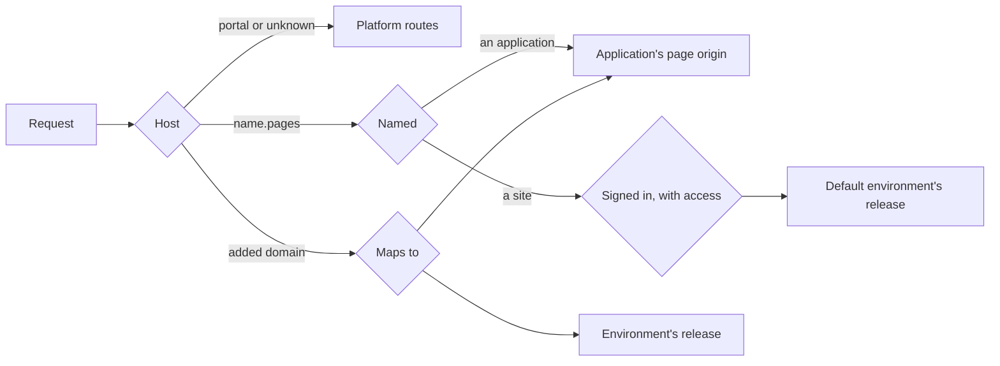

# Sites and pages

The platform serves two kinds of browser traffic on hostnames other than its
own: an application's browser pages, and static sites with environments. Both
go through one serving layer that routes by `Host` and sits outside the
platform's routes, so a request to a site or page origin never reaches a
portal, admin, MCP or API route, and a request for any other hostname passes
through untouched.

People run sites from the portal's **Sites** section and agents through
`manage_site`. Both act through one service, so they cannot disagree about who
may do what.

## How a site is used

1. Someone whose persona holds `manage_site` creates a site. They own it.
2. The site has one environment, `default`, at `<site>.<pages_domain>`.
3. A system administrator adds an ingress rule for that address.
4. The owner invites internal people to work on it (**Can manage**).
5. All of them see their work at the site's own address after signing in.
6. They share it view-only with anyone, internal or external, such as a client
   approving the work (**Can view**), or tick **Everyone internal can view** for
   an intranet.
7. They add domains such as `dev.example.com` and `example.com`, each serving an
   environment. A domain is public at the platform: who may use it is the site's
   own business.
8. A system administrator adds an ingress rule for each domain. Admin > Domains
   lists every address that needs one.

The platform does not manage or check DNS, certificates or who owns a name, and
TLS belongs to the ingress.

## Configuration

```yaml
sites:
  enabled: true                  # default: on with a database and a portal bucket
  pages_domain: pages.example.net
  max_release_files: 20000
  max_file_bytes: 67108864       # 64 MiB
  max_release_bytes: 2147483648  # 2 GiB
  cache:
    memory_bytes: 268435456      # per replica
    dir: /var/cache/platform-sites
    disk_bytes: 2147483648
  crawl:
    allow_private_cidrs: []
    max_pages: 2000
    max_bytes: 536870912
  reserved_hostnames: []         # names the deployment answers on itself
```

The file's values are the seed. Once an administrator saves **Admin > Settings >
Sites** (`PUT /api/v1/admin/settings/sites`), the pages domain and the limits
come from `platform_settings` and apply on every replica within a few seconds,
with no restart. `sites.tls` and `sites.verify` no longer exist, and a
configuration that sets them is refused at startup.

`pages_domain` is the parent of every application's page origin
(`<application>.<pages_domain>`) and every site's own address
(`<site>.<pages_domain>`). With none set, no page and no site address is
served, and a domain added to a site still is.

!!! warning "Use a registrable domain of its own"
    Give `pages_domain` a registrable domain the portal is not on. A sibling of
    the portal, such as `pages.example.com` beside `platform.example.com`, is
    same-site: browsers then send the portal's `SameSite=Lax` cookie on requests
    a page makes. The portal's cross-origin rules still refuse to let a page read
    the answer, and its writes need a CSRF token, but a separate domain removes
    the exposure. The platform refuses a `pages_domain` that holds the portal's
    host or sits under the session cookie's `Domain`.

On https with no cookie `Domain`, the portal's session cookie carries the
`__Host-` prefix, so a script on a sibling hostname cannot set it. Upgrading to
this release signs everyone out once.

## How routing works



A hostname routes as soon as it is added. Which release it serves is read again
every half second per replica and at once on the replica that moved it, so a
promote or rollback takes effect immediately. File bytes are cached by content
digest in memory and on disk, which never go stale. A site and an application
cannot be created with one name; a pair from before that rule answers as the
application.

## Who may do what

| | Everyone with the Sites area | Can view | Can manage | Owner | Administrator |
|---|---|---|---|---|---|
| Read the site in the portal | Yes | No | Yes | Yes | Yes |
| Open the site's own address | No | Yes | Yes | Yes | Yes |
| Publish, promote, roll back, add domains | No | No | Yes | Yes | Yes |
| Share view access, open to everyone internal | No | No | Yes | Yes | Yes |
| Add or remove people who manage, edit, change owner | No | No | No | Yes | Yes |
| Delete the site, map a domain to an application | No | No | No | No | Yes |

**Can manage** is for internal people only. **Can view** needs no Sites area and
no `manage_site`, so a client on an external persona limited to assets can have
it. Access is keyed to the email the identity provider reports; when the provider
says outright that it has not verified the address, the address matches no owner
or grant, and the person is told why. A provider that sends no `email_verified`
claim is trusted.

The Sites area is a persona's `portal.sites` switch. Unset, it is on for a persona
holding `manage_site`.

## A site's own address

Every request to `<site>.<pages_domain>`, on every path and for `HEAD`, is checked
first, and a refusal holds nothing of the release.

- A `GET` or `HEAD` with no valid sign-in goes straight to the portal's sign-in and
  comes back to the path it asked for, so someone already signed in to the portal
  arrives with no click. Any other method gets a sign-in page, since it cannot be
  carried across a redirect. Signing in hands the portal's session across by a
  code good for a minute, once, bound to the browser that started it. The address
  then keeps its own HttpOnly cookie, bound to that one site, for an hour.
- Who may open it is read on every request, so removing someone takes effect on
  their next one. Files there are `Cache-Control: private, no-cache`, so a browser
  has to come back and be checked.
- Administrator and external are read from the live persona, never from the cookie.
- API keys are not honored, and every answer carries `X-Robots-Tag: noindex`.
- `/_auth`, `/_signin` and `/_signout` are answered before any file, so a release
  holding those paths cannot stand in for them.

## Pages

See the `platform-pages-and-sites` knowledge page for how to build one. What an
operator should know:

- A page origin answers only `/`, `/endpoints/...`, `/_static/...`, `/_viewer` and
  `/_auth`. Portal, admin and MCP routes do not exist there.
- The portal's session never crosses. A signed-in person is handed over by a code
  good for a minute, once, bound to the browser that started the sign-in; the
  origin then keeps its own HttpOnly cookie, scoped to one application, for
  twelve hours. API keys are not honored on a page origin.
  The page origin answers on the port of `portal.public_base_url`, and the redirect back to it names the stored hostname and that port, nothing the request sent.
- A page's content policy is built by the platform per binding. Endpoints that do
  not opt in keep `default-src 'none'; sandbox`, and a page requested on the
  portal's own origin stays sandboxed.

## Sites

A file's bytes are kept once per site, under `sites/<id>/objects/<sha256>` in the
portal bucket with their gzip and brotli variants beside them (files published
before this stay under `sites/<id>/releases/<release id>/`, named by
`site_release_files.stored_in`). Promote and rollback only move an environment's
pointer, and `site_deployments` records every move. Serving
needs no CDN: strong ETags and `304`, `immutable` on fingerprinted names on a
domain, range requests, redirects and a custom 404. A CDN can be put in front
later with no change.

### Changing a site in place

An agent changes a site with the tools it already has. `manage_asset`'s content
actions (`outline`, `locate`, `get_content`, `stats`, `diff`, `patch`) take
`mcp:site:<site>/<environment>/<path>` for one file, a path ending in `/` for a
folder, and `mcp:site:<site>/<environment>` for the whole tree. `version` is the
release number, and `base_version` is refused when `default` has moved past it, with
nothing written. `patch` writes a new release derived from the current one.
`manage_site publish` with `base` overlays that release: files sent are added or
replaced, an entry with `delete: true` removes a path, and the rest carries over.

Only `default` takes edits or an overlay: it is behind sign-in, and `promote` moves
a finished change to any other environment, so a change made in several patches
reaches the public in one step. A full `publish` to another environment that
requires no approval still works, for a build pipeline. Patching needs manage access
and a persona that holds `manage_site`, because `manage_asset` would otherwise reach
further than `manage_site` does. Reading current files needs the access that opens
the site's own address, including Can view; `diff` and earlier releases need manage.

A derived release stores only what differs from its parent, plus a removal row for
each deleted path, and `Files` reads the whole set by walking the chain. Every
32nd link stores the whole set again, so a read walks at most 32 releases and a
patch on a release of 20,000 files writes one row. The manifest digest is computed
over the whole set, so a rollback is provably the same files. A file set is listed
with `limit` and `offset`, and a search across a tree reports what it scanned and
skipped, so a search that could not reach a file does not read as a clean result.

### Rendering

A site with a `_layouts/` folder is rendered during publish, inside the platform,
with no build tool: `_layouts/` and `_includes/` hold Liquid templates, `_data/<collection>/`
holds records as JSON, YAML or Markdown, and any `.html`, `.md`, `.xml`, `.json` or
`.txt` file with front matter is a page. `for_each` generates one page per record or
taxonomy value and `per_page` makes paged lists. A site with no `_layouts/` folder is
served exactly as published.

A rendered release holds two trees: the output, which is all the gateway reads, and
the source, which is what `mcp:site:` references address and what someone who manages
the site reads. Someone with Can view reads the output. Source is unservable because
it is not in the tree that is served. The record of what each output read is stored
with the release, and a patch re-renders only the outputs that read a changed file;
a change to a layout renders every page using it, in one release.

Templates are written by the people who manage a site and their agents, and they run
in the platform's process, so each render is bounded: one render at a time per
replica, a five-minute deadline, and limits on loop iterations (50,000,000), include
depth (32), block nesting (64), the bytes one page can hold (`sites.max_file_bytes`),
total output (`sites.max_release_bytes`), output files (`sites.max_release_files`)
and records held in memory (256 MiB). A panic in the template engine fails the page.
Source and output each count against the limits on their own. A render is a function
of the source tree: `date` refuses `now`, loops over objects run in key order, and no
template reaches the network or a file outside the tree. A template error refuses the
release, lists every file and line that failed, and leaves the environment where it
was.

A publish or a copy from the portal runs in the background (`site_jobs`): it goes
on if the browser goes away, and a copy can be stopped. A job nobody has reported
on for fifteen minutes reads as failed, since the replica running it has stopped.

An environment may require approval: a release reaches it only by promote, and
someone who is not an administrator files a request in Approvals first. Promote
and Approvals show the files changed, added and removed and the redirects added.

Every `manage_site` call and every portal write is audited. Requests to a site
are counted in the platform's HTTP metrics and are not audited individually.

A release is never rendered on the portal's origin.

## Domains

Whoever manages a site adds a domain with `add_domain`, or Add domain on the site
page, naming the environment it serves; an environment that does not exist yet is
created. `default` cannot have a domain, since a domain is public and the default
environment is not. Only an administrator maps a hostname to an application.

The gateway answers an added hostname before the platform's routes, so the
portal's hostname, the OAuth and sign-in issuers' hostnames, anything under the
pages domain and anything under the session cookie's `Domain` are refused. If the
deployment answers on any other name, such as an internal service name, list it in
`sites.reserved_hostnames`; that name and everything under it are refused too.

A domain on an environment that requires approval can be removed only by an
administrator, since moving it to another environment would publish to it
unapproved.

`GET /api/v1/admin/sites/domains` lists every site address and domain, for the
system administrator's ingress rules.
