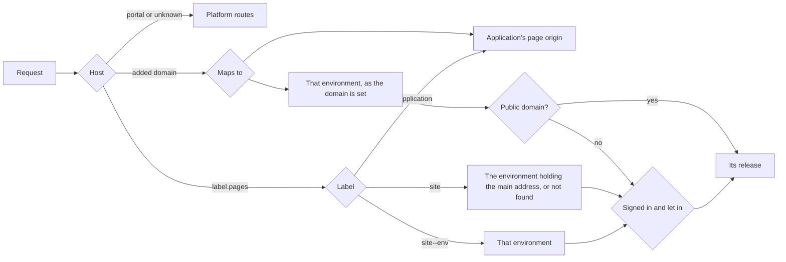

# Sites and pages

The platform serves two kinds of browser traffic on hostnames other than its
own: an application's browser pages, and static sites with environments. Both
go through one serving layer that routes by `Host` and sits outside the
platform's routes, so a request to a site or page origin never reaches a
portal, admin, MCP or API route, and a request for any other hostname passes
through untouched.

People run sites from the portal's **Sites** section and agents through
`manage_site`. Both act through one service, so they cannot disagree about who
may do what.

## Agents work in dev, people use what was promoted

`dev` is a site's working copy. Every publish, patch and in-place edit lands
there and nowhere else, whether a person or an agent makes it, and nothing
anyone relies on is served from it. You change `dev`, review it at its address,
and **promote** the exact release to an environment people use, such as `stage`
or `prod`. Those environments are read-only: they move only by promote and
rollback, with approval where an environment requires it. A publish, an overlay
or a patch aimed at one is refused, naming `dev` and `promote`, even for an
administrator.

A new site starts with two environments: `dev`, and `prod`, which holds the
main address. `dev` is always first and `prod` always last; an environment
between them is placed when it is created and can be moved later, and a release
moves one environment at a time, from `dev` to `prod` (see
[Environments and promotion](#environments-and-promotion)).

Access is decided per **address** (#2619):

- **Every address on the pages domain** (the main address and each
  `<site>--<env>`) is **private**: it asks for the platform's sign-in and opens
  only for administrators, the site's owner, the people who manage the site, and
  whoever the environment is shared with. Anything finer is the site's own
  business, using the identity the platform hands it (see
  [Inside a private environment](#inside-a-private-environment)).
- **An added domain** is private too, unless it is set **public**: then it opens
  for anyone at that one hostname. The platform asks no one to sign in there; a
  site that wants a sign-in builds its own.

No domain is needed: an environment works at its pages addresses for people who
sign in. Making an environment answer anyone takes two deliberate steps, adding a
domain and setting that domain public, and only the owner or an administrator
takes the second.

## How a site is used

1. Someone whose persona holds `manage_site` creates a site. They own it. It has
   `dev`, at `<site>--dev.<pages_domain>`, and `prod`, at
   `<site>--prod.<pages_domain>` and the site's main address,
   `<site>.<pages_domain>`.
2. The owner invites internal people to work on it (**Can manage**). They and
   their agents publish and edit `dev`.
3. They add the environments a release passes through on its way to `prod`
   (`stage`, `test`) with **New environment** or `set_environment`, placed
   between `dev` and `prod`, and promote releases one step at a time.
4. They share each environment with people and personas, and give the main
   address to the environment people should reach there, or to none.
5. They add domains such as `example.com` to any environment but `dev`. A domain
   is private until the owner or an administrator sets it public.
6. A system administrator adds an ingress rule for each domain. Admin > Domains
   lists every address that needs one. The pages domain needs one wildcard.

The platform does not manage or check DNS, certificates or who owns a name, and
TLS belongs to the ingress.

## Addresses

| Address | What answers |
|---|---|
| `<site>.<pages_domain>` | The **main address**: the one environment the owner gives it to (`prod` on a new site), or, given to none, a "Nothing is published here" page. Always private |
| `<site>--<env>.<pages_domain>` | That environment, whichever environment holds the main address. Always private |
| A domain added to an environment | That environment: private, or public when set public |

Every address on the pages domain is one label under it, so one
`*.<pages_domain>` wildcard certificate and one wildcard ingress rule cover
every site and environment, and moving the main address needs no DNS or ingress
change. Moving the main address is the owner's or an administrator's, since it
changes what people reach at the site's main address.

No site or environment name holds `--`, and an application created since #2604
cannot either, so `<site>--<env>` is never another site's or application's
address. An application whose name held `--` before then keeps its address. A
site or environment whose address could not be one DNS label is refused with
the reason: a composed label longer than 63 characters (a new site's `dev` and
`prod` addresses count, so a site name is at most 57), and a label with `--` as its 3rd
and 4th characters, the form RFC 5891 reserves for an encoded international name
(`xn--`), which certificate authorities refuse to issue for. Every
`<site>--<env>` of a two-character site has that form, so a site name cannot be
two characters (#2611). A site created with such a name before this rule keeps
its main address and its domains; its environments' `<site>--<env>` addresses
are not reported (its `pages_addresses` are `""` for them), its JSON carries an
`address_note` saying why, `GET /api/v1/admin/sites/domains` does not list
them, and the platform logs the `site_reserved_label` configuration warning
naming the site at startup. Give each environment people use a domain.

## Configuration

```yaml
sites:
  enabled: true                  # default: on with a database and a portal bucket
  pages_domain: pages.example.net
  max_release_files: 20000
  max_file_bytes: 67108864       # 64 MiB
  max_release_bytes: 2147483648  # 2 GiB
  cache:
    memory_bytes: 268435456      # per replica
    dir: /var/cache/platform-sites
    disk_bytes: 2147483648
  crawl:
    allow_private_cidrs: []
    max_pages: 2000
    max_bytes: 536870912
  reserved_hostnames: []         # names the deployment answers on itself
  releases:
    keep_default: 50             # releases each environment keeps; 0 keeps every one
    mode: delete                 # delete, or report: the cleanup counts and deletes nothing
    orphan_grace: 24h            # how old an object no release names must be before it goes
    every: 24h                   # how often the cleanup runs
  tls:
    hsts:
      enabled: false             # send Strict-Transport-Security on https answers (#2557)
      max_age: 31536000          # seconds a browser keeps the rule; 0 is a year
      include_subdomains: false  # apply it to every name under each address too
```

The file's values are the seed. Once an administrator saves **Admin > Settings >
Sites** (`PUT /api/v1/admin/settings/sites`), the pages domain and the limits
come from `platform_settings` and apply on every replica within a few seconds,
with no restart. `sites.verify` no longer exists, and `sites.tls` holds only
`hsts`: a configuration that sets either's other keys is refused at startup.

`sites.tls.hsts` sends `Strict-Transport-Security` on every https answer at a
page origin, a site's addresses on the pages domain and its added domains. The
platform does not verify who owns an added domain, so each one is held to it
alike. It is off by default: once a browser holds the rule, it will not open
those addresses over plain http until the rule expires, whatever the setting
says then. Nothing is sent over http.

`pages_domain` is the parent of every application's page origin
(`<application>.<pages_domain>`) and every site address (`<site>.<pages_domain>`
and `<site>--<env>.<pages_domain>`). With none set, no page and no site address
is served, and a domain added to a site still is.

!!! warning "Use a registrable domain of its own"
    Give `pages_domain` a registrable domain the portal is not on. A sibling of
    the portal, such as `pages.example.com` beside `platform.example.com`, is
    same-site: browsers then send the portal's `SameSite=Lax` cookie on requests
    a page makes. The portal's cross-origin rules still refuse to let a page read
    the answer, and its writes need a CSRF token, but a separate domain removes
    the exposure. The platform refuses a `pages_domain` that holds the portal's
    host or sits under the session cookie's `Domain`.

On https with no cookie `Domain`, the portal's session cookie carries the
`__Host-` prefix, so a script on a sibling hostname cannot set it. Upgrading to
this release signs everyone out once.

## How routing works



A hostname routes as soon as it is added. Which release it serves, and whether
it is private, is read again every half second per replica and at once on the
replica that changed it, so a promote, a rollback, a change of a domain's access
or a move of the main address takes effect immediately. Whether a request is
private is decided by the route its `Host` matched, an address on the pages
domain or an added domain, and by no other header the client sends. File bytes are cached by content
digest in memory and on disk, which never go stale. A site and an application
cannot be created with one name; a pair from before that rule answers as the
application.

## Who may do what

| | Everyone with the Sites area | Shared with | Can manage | Owner | Administrator |
|---|---|---|---|---|---|
| See the site in the portal | Yes, and only the environments they can open | Yes | Yes | Yes | Yes |
| Open an environment at its private addresses | Only if shared with them | The environments shared | Every one | Every one | Every one |
| Publish and edit dev, promote, roll back, add domains, add and place environments | No | No | Yes | Yes | Yes |
| Share an environment, make a domain private, set approval | No | No | Yes | Yes | Yes |
| Make a domain public, move the main address | No | No | No | Yes | Yes |
| Add or remove people who manage, edit, change owner | No | No | No | Yes | Yes |
| Delete the site, map a domain to an application, take approval off, move an environment forward past one that requires approval | No | No | No | No | Yes |

A share names **who** and **which environments**:

- **A person**, by the email the identity provider reports. A person can also
  be given **Can manage**, which is site-wide and for internal people only.
  External people can be shared with, never made managers. When the provider
  says outright that it has not verified an address, the address matches no
  owner or grant, and the person is told why. A provider that sends no
  `email_verified` claim is trusted.
- **A persona**. A persona share is matched on every request against the
  persona the viewer's roles resolve to in the live registry, so a change to
  the persona applies on their next request. A role changed at the identity
  provider applies at their next sign-in, as everywhere on the platform.
- **Everyone internal** is a per-environment setting (`internal_view`): it opens
  that environment's private addresses to everyone signed in whose persona is not
  external.

A share naming no environments opens every environment. A share applies at every
private address of an environment; at a public domain anyone opens it.

Someone who does not manage a site sees, in the portal and in the site's API
answers, only the environments they can open and the domains on them.

The Sites area is a persona's `portal.sites` switch. Unset, it is on for a persona
holding `manage_site`.

## Making a domain public

Public is a setting of a domain, not of an environment (#2619). `set_environment`
with `public` is refused, naming the domain setting. A domain is added private
unless public is asked for (`add_domain` with `public: true`), and its access
changes later with `set_domain` (`public: true` or `false`), Make public and Make
private on the Domains tab, or `PUT /api/v1/portal/sites/{site}/domains/{hostname}`.

Only the owner or an administrator makes a domain public; anyone who manages the
site makes one private. On an environment that requires approval, an owner's
request files a request in Approvals (purpose `site_public`, naming the domain)
and the domain stays private; once it is approved, the same request makes it
public. An approval holds for the access it was asked against: a domain made
private and then public again asks again. An administrator's own request goes
through at once. Every address on the pages domain keeps asking for a sign-in
whatever its environment's domains are set to.

Caching follows the address: a public domain's answers are cacheable as public
answers are (`immutable` on a fingerprinted name, `max-age=0, must-revalidate`
otherwise), and every private address answers `Cache-Control: private,
no-cache` with `Vary: Cookie`.

## Environments and promotion

A site's environments have a stored order, the path a release takes (#2617):

- `dev` is always first and `prod` always last. Neither can be moved, and
  neither can be deleted while the site exists.
- A new environment is placed when it is created, with `after` naming the
  environment it follows: `dev` or one between `dev` and `prod`. Nothing goes
  after `prod`. With only `dev` and `prod` there is one place, and a new
  environment goes there; with more, leaving the place out is refused, naming the
  environments it could follow.
- An environment between them can be moved later the same way
  (`set_environment` with `after`, or Move on its card). Moving one
  forward past an environment that requires approval is an administrator's:
  otherwise a release that environment never approved could feed the next one.
- Every list of a site's environments follows the stored order: the cards, the
  Sites list, the Promote dialog and `manage_site get`.

**Promotion goes one step.** An environment takes a release only from the
environment immediately before it, and only the release that environment serves.
With `dev`, `stage`, `prod`, `prod` takes only what `stage` serves. `promote`
names the target (`to`); `from`, when given, must be the environment before it,
and a `release`, when given, must be the one that environment serves. A refusal
names the environment the release must come from, in the same words from the
portal, the API and `manage_site`. Nothing is promoted to `dev`, which takes every
publish and edit directly. Rollback is unchanged: an environment returns to a
release it served before.

**Applications.** An application release pins each site environment part at what
the environment before it serves, and `dev`, which has nothing before it, at the
site's newest release. Pins are read before any environment moves, so an
application holding both `stage` and `prod` moves each one step in one release, as
promoting each would. Application rollback is unchanged.

## Response headers

A `_redirects` rule with status 200 is a rewrite (#2558): the path is answered
in place, with status 200, by the file of this site the target names, so a
single-page application answers its own routes (`/* /index.html 200`, or
`/products/* /index.html 200` for one section). The target is a local path; a
file the release holds still answers itself first, and a rewrite to a file the
release lacks answers the 404 page.

A release may carry a `_headers` file (#2557). Like `_redirects` it is read into
the release rather than served, it travels with the release, so a rollback
restores the headers that release declared, and it reads and edits like any file
(`manage_asset` on `mcp:site:<site>/dev/_headers`). A path line starts a block, in
the form a redirect's `from` takes (`/*` matches everything beneath), and each
indented `Name: value` line under it is a header every answer under that path
carries:

```
/*
  Content-Security-Policy: default-src 'self'; img-src 'self' data:
  Permissions-Policy: camera=(), microphone=()
/embed/*
  Content-Security-Policy: frame-ancestors https://partner.example
```

A release may set only `Content-Security-Policy`,
`Content-Security-Policy-Report-Only`, `Permissions-Policy`,
`Cross-Origin-Opener-Policy`, `Cross-Origin-Embedder-Policy`,
`Cross-Origin-Resource-Policy` and `X-Frame-Options`. Any other header (a cookie,
caching, CORS), a value holding a control character, or a malformed line refuses
the publish, naming the file and line. Where two blocks match a path, the later
one's header replaces the earlier one's of the same name.

A release that declares no framing rule is served with
`Content-Security-Policy: frame-ancestors 'self'`, so nothing on another origin
can frame it. Declaring `frame-ancestors` in a `Content-Security-Policy`, or
`X-Frame-Options`, replaces the default; a `Content-Security-Policy` without
`frame-ancestors` is sent beside it, and a browser enforces both. The platform's
own sign-in, no-access and not-found pages keep their own policy, and nothing a
release declares reaches them.

## Signing in to a private environment

Every request to a private environment, on every path and for `HEAD`, on its
pages address or a domain, is checked first, and a refusal holds nothing of the
release.

- A `GET` or `HEAD` with no valid sign-in goes straight to the portal's sign-in and
  comes back to the hostname and path it started on, so someone already signed in
  to the portal arrives with no click. Any other method gets a sign-in page, since
  it cannot be carried across a redirect.
- Signing in hands the portal's session across by a code good for a minute, once,
  bound to the site, the hostname and the browser that started it. The portal's
  handoff (`/sites/handoff`) reads the hostname from the request only to choose:
  it sends the person back only to a hostname the store says serves a private
  environment of that site, and refuses any other.
- The hostname then keeps its own HttpOnly, host-only cookie, bound to that site
  and that hostname, for an hour. It never receives the portal's session.
- Who may open the environment is read on every request, so removing someone, or
  changing a persona, takes effect on their next one. Files are
  `Cache-Control: private, no-cache`, so a browser has to come back and be checked.
- Administrator, external and persona are read from the live registry, never from
  the cookie.
- API keys are not honored, and every answer carries `X-Robots-Tag: noindex`.
- `/_auth`, `/_signin`, `/_signout`, `/_viewer` and, on an environment that is a
  part of an application, `/endpoints/` are answered before any file, so a release
  holding those paths cannot stand in for them.

A domain beside the portal (portal `portal.example.com`, site `docs.example.com`)
can be added and made private when the session cookie names no `Domain`, as it
does by default (`__Host-` on https): the site signs people in on its own
hostname and never receives the portal's session. A deployment whose session
cookie names a `Domain` refuses hostnames under it.

## Inside a private environment

A site builds its own access control (roles, per-page rules, what a person can see
or do) and uses the platform's sign-in for who someone is.

- `/_viewer` answers the signed-in person as JSON: `email`, `user_id`, `persona`
  and `name` (the directory's display name, empty when it has none). It never
  carries the cookie or anything signed. At a public domain it answers 401,
  "nobody is signed in on this site".
- When the environment is a part of an application (`add_part kind=site`), its
  hosts also serve that application's endpoints at `/endpoints/<name>/...`, run as
  the signed-in person (`req["caller"]`), as on the application's page origin. Every
  site and environment under the pages domain is one site to a browser, so the
  viewer is attached only to a request the browser marks as coming from this
  origin (`Sec-Fetch-Site: same-origin`, or `none` for an address the person typed);
  a sibling site's page cannot call an environment's endpoints as its viewer. At a
  public domain the endpoints run as nobody.
- The platform makes no decision inside the site beyond who may open the
  environment.

## Pages

See the `platform-pages-and-sites` knowledge page for how to build one. What an
operator should know:

- A page origin answers `/endpoints/...`, `/_static/...`, `/_viewer` and `/_auth`,
  and every other path with the endpoint named after the application: `/` alone
  when its path is empty, any path when its path ends in a catch-all
  `/{route...}` (#2553), which the handler routes itself. Portal, admin and MCP
  routes do not exist there.
- The portal's session never crosses. A signed-in person is handed over by a code
  good for a minute, once, bound to the browser that started the sign-in; the
  origin then keeps its own HttpOnly cookie, scoped to one application, for
  twelve hours. API keys are not honored on a page origin.
  The page origin answers on the port of `portal.public_base_url`, and the redirect back to it names the stored hostname and that port, nothing the request sent.
- A page's content policy is built by the platform per binding: its own origin,
  `page_cdns` for scripts, styles, images and fonts, and `page_frame_origins`,
  `page_connect_origins` and `page_form_origins` for `frame-src`, `connect-src`
  and `form-action` (#2554). Endpoints that do not opt in keep
  `default-src 'none'; sandbox`, and a page requested on the portal's own origin
  stays sandboxed.
- A handler on the application's origin reads and sets application cookies
  under the prefix `__Host-app-` (`app-` over http), which no platform cookie
  has (#2555), and so does one a site environment that is a part of the
  application calls at `/endpoints/<name>` on the site's own address (#2558). A request with a method other than GET or HEAD carries them only
  when the browser says it came from that origin. Their values are replaced in
  every audit row the request writes.
- `req["client_ip"]` and an endpoint's `ip_rate_limit` read the client's address
  through `server.trusted_proxies` (#2556); see
  [The client's address](configuration.md#the-clients-address).

## Sites

A file's bytes are kept once per site, under `sites/<id>/objects/<sha256>` in the
portal bucket with their gzip and brotli variants beside them (files published
before this stay under `sites/<id>/releases/<release id>/`, named by
`site_release_files.stored_in`). Promote and rollback only move an environment's
pointer, and `site_deployments` records every move. Serving
needs no CDN: strong ETags and `304`, `immutable` on fingerprinted names on a
domain, range requests, redirects and a custom 404. A CDN can be put in front
later with no change.

### Changing a site in place

An agent changes a site with the tools it already has. `manage_asset`'s content
actions (`outline`, `locate`, `get_content`, `stats`, `diff`, `patch`) take
`mcp:site:<site>/<environment>/<path>` for one file, a path ending in `/` for a
folder, and `mcp:site:<site>/<environment>` for the whole tree. `version` is the
release number, and `base_version` is refused when `dev` has moved past it, with
nothing written. `patch` writes a new release derived from the current one.
`manage_site publish` with `base` overlays that release: files sent are added or
replaced, an entry with `delete: true` removes a path, and the rest carries over.

Only `dev` takes a publish, an edit or an overlay, and `promote` moves a finished
change to any other environment, so a change made in several patches reaches people
in one step. A publish, overlay or patch aimed at any other environment is refused:
"environment "prod" is read-only: publish, patch and edits change dev, and a release
reaches prod by promote". A build pipeline publishes to `dev` and promotes. Patching
needs manage access and a persona that holds `manage_site`, because `manage_asset`
would otherwise reach further than `manage_site` does. `diff` and earlier releases
need manage.

A derived release stores only what differs from its parent, plus a removal row for
each deleted path, and `Files` reads the whole set by walking the chain. Every
32nd link stores the whole set again, so a read walks at most 32 releases and a
patch on a release of 20,000 files writes one row. The manifest digest is computed
over the whole set, so a rollback is provably the same files. A file set is listed
with `limit` and `offset`, and a search across a tree reports what it scanned and
skipped, so a search that could not reach a file does not read as a clean result.

### Rendering

A site with a `_layouts/` folder is rendered during publish, inside the platform,
with no build tool: `_layouts/` and `_includes/` hold Liquid templates, `_data/<collection>/`
holds records as JSON, YAML or Markdown, and any `.html`, `.md`, `.xml`, `.json` or
`.txt` file with front matter is a page. `for_each` generates one page per record or
taxonomy value and `per_page` makes paged lists. A site with no `_layouts/` folder is
served exactly as published.

A rendered release holds two trees: the output, which is all the gateway reads, and
the source, which is what `mcp:site:` references address and what someone who manages
the site reads. Someone the site is shared with reads the output. Source is unservable because
it is not in the tree that is served. The record of what each output read is stored
with the release, and a patch re-renders only the outputs that read a changed file;
a change to a layout renders every page using it, in one release.

Templates are written by the people who manage a site and their agents, and they run
in the platform's process, so each render is bounded: one render at a time per
replica, a five-minute deadline, and limits on loop iterations (50,000,000), include
depth (32), block nesting (64), the bytes one page can hold (`sites.max_file_bytes`),
total output (`sites.max_release_bytes`), output files (`sites.max_release_files`)
and records held in memory (256 MiB). A panic in the template engine fails the page.
Source and output each count against the limits on their own. A render is a function
of the source tree: `date` refuses `now`, loops over objects run in key order, and no
template reaches the network or a file outside the tree. A `for` loop's range bounds,
and a loop's `limit`, `offset` and `cols`, are whole numbers: a literal, a `size`, the
result of integer arithmetic (`plus`, `minus`, `times`, `divided_by` or `modulo` on
whole numbers) or a whole number in a JSON or YAML record (#2633). A float such as
`6 | divided_by: 2.0` is refused as a bound; `| floor` makes it one. A template error
refuses the release, lists every file and line that failed, and leaves the environment
where it was.

A publish or a copy from the portal runs in the background (`site_jobs`): it goes
on if the browser goes away, and a copy can be stopped. A job nobody has reported
on for fifteen minutes reads as failed, since the replica running it has stopped.

An environment may require approval: a release reaches it only by promote, and
someone who is not an administrator files a request in Approvals first. Promote
and Approvals show the files changed, added and removed and the redirects added.

Every `manage_site` call and every portal write is audited. Requests to a site
are not audited individually; they are recorded under the HTTP route `site`
(`pages` for an application's page origin) and counted per site and environment in
`site_requests_total` and `site_request_duration_seconds`, with
`site_cache_reads_total` counting where each file came from (see
[Observability](observability.md)).

A release is never rendered on the portal's origin.

## Releases kept

Each environment keeps its last `keep_releases` distinct releases, the deployment's
default (`sites.releases.keep_default`, 50, or **Releases kept per environment** in
Admin > Settings > Sites) unless it has its own: `manage_site set_environment
keep_releases=N`, `0` for every release, `"default"` to return to the default, also
in the environment's Settings dialog in the portal. Only the owner or an
administrator changes it, since a lower limit removes rollback history at the next
cleanup.

A release stays while it is in any environment's window, an environment points at
it, an application release pins it, or a pending approval request names it. The
daily cleanup (one replica at a time, under an advisory lock) removes every other
release's file rows and the objects no kept release names, compressed forms
included. A removed release keeps its record, marked `pruned`, so the deployments
and approvals that name it read as before; it cannot be served, compared, promoted
or rolled back to, and the refusal names the limits (a comparison's refusal names
only the release). A move that started while a cleanup was deciding waits for it
and is then refused if the cleanup removed its release. A kept release that read its
files through a removed one is rewritten first, onto its nearest kept ancestor or
whole, and checked to resolve to exactly the files it held. Files stored before
v1.157.0 under a release's own prefix stay while any kept release names them.

The same cleanup deletes objects under a site that no release names (a render that
failed, a delete that failed) once they are older than `orphan_grace`, and refuses
a site where more than half of what it holds reads as orphaned. In report mode it
decides exactly as delete mode does and deletes nothing.

A publish and a cleanup never overlap on one site's stored files. A publish holds
them from its first stored file until its release is recorded, and a cleanup holds
them from before it decides until its deletes finish (`site_object_holds`). The
cleanup leaves a site with a publish in progress for the next run, and a publish
that starts while a cleanup is deleting waits up to a minute and is then refused,
saying the cleanup is running. Holds expire, so a replica that stopped while
holding one blocks the other only for a few minutes; a publish whose hold ran out
is refused rather than recorded. A site whose bucket cannot be listed still has
its releases cleaned up, and the run reports `orphans_unchecked` for it.

| Route | What it does |
|---|---|
| `GET /api/v1/admin/sites/retention` | The default, the mode, the grace, the interval, and the recent cleanups' counts |
| `POST /api/v1/admin/sites/retention/run` | `{mode: "report" or "delete", site?}`: a cleanup now, answering which releases it removes per site and the files, bytes and orphans |

`manage_site get` shows each environment's `keep_releases`,
`keep_releases_default` and `releases_kept`; `releases` and the portal's release
reads carry `pruned` and `kept_by` (the environments, `application <name>` and
`approval` that keep each release).

## Media folders

A site mounts managed-resource folders at URL prefixes for images, video and
downloads that do not change with its pages:

```
manage_site command=update site=marketing
  media=[{"prefix":"/media/","scope":"global","folder":"sites/marketing/media"}]
```

`media` is the whole list (`[]` removes every mount), also `PATCH
/api/v1/portal/sites/{site}` with `{"media": [...]}` and the Media tab in the
portal. A prefix is a path under the site such as `/media/`, never `/`, `/_...` or
`/.well-known/`; a site has at most 20.

The gateway answers a path from the release first, then the longest mount whose
prefix it starts with, then the redirects and the 404 page. A mounted file is
served by range with its validators on every environment, with that environment's
access; publish, promote and rollback leave media alone and it counts toward no
release limit. A file replaced with `manage_resource replace_content` shows at once.
A mount serves only what its folder holds now: a file moved out of it stops
answering at its old address at once (the library's own reference to the old
address keeps working for the file's readers), and a file moved within it answers
at its new path.
HTML, SVG, JavaScript and XML in a mount are sent as downloads, so a media folder
cannot become a second, unreviewed site.

Mounting publishes the folder: whoever mounts must manage the site and be able to
read the folder, and its files are then public at a public domain. A file in a
mounted folder is refused deletion (`manage_resource delete`, or `DELETE
/api/v1/resources/{id}` answering 409) unless forced (`force=true`).

## Domains

Whoever manages a site adds a domain with `add_domain`, or Add domain on the site
page, naming the environment it serves; an environment that does not exist yet is
created, placed by `after`; `requires_approval` sent with the domain applies to
the environment whether the request creates it or it exists. The domain is **private** unless the
request asks for public, which only the owner or an administrator can; on an
environment that requires approval, someone who is not an administrator adds it
private and the request to make it public goes to Approvals. `dev` cannot have a
domain: it is the working copy, not an address people rely on. Only an
administrator maps a hostname to an application, whose domain answers by the
application's own rules and has no public setting.

The gateway answers an added hostname before the platform's routes, so the
portal's hostname, the OAuth and sign-in issuers' hostnames, anything under the
pages domain and anything under the session cookie's `Domain` are refused. If the
deployment answers on any other name, such as an internal service name, list it in
`sites.reserved_hostnames`; that name and everything under it are refused too.

A domain on an environment that requires approval can be removed only by an
administrator, since moving it to another environment would publish to it
unapproved.

`GET /api/v1/admin/sites/domains` lists every site address (each main address and
each `<site>--<env>`) and every domain, for the system administrator's ingress rules.
A `<site>--<env>` no certificate can be issued for (a two-character site's, #2611)
is left out.

## manage_site

| Command | What it does |
|---|---|
| `create` | A site with `dev` and `prod`, `prod` holding the main address |
| `set_environment` | Creates, places or changes an environment: `after` (the environment it goes after, or moves after), `internal_view`, `requires_approval`, `keep_releases` (owner and administrators), and `main: true` to give it the main address. `public` is refused: it is a setting of a domain |
| `update` | `description`, `owner_email`, `main_environment` to move the main address (`""` gives it to none), and `media`, every mounted resource folder |
| `publish` | A new release into `dev` (files, an archive or a folder; `base` overlays dev's release) |
| `promote`, `rollback` | Move an environment's pointer; `promote` takes the release of the environment before `to` |
| `grant` | `email` or `persona`, `level` (`view`; `manage` is for a person, site-wide), and `environments` the view grant opens (none is every private environment) |
| `revoke` | `email` or `persona` |
| `add_domain`, `set_domain`, `remove_domain`, `domains` | Domains. `add_domain` with `public` opens the domain to anyone; `set_domain` with `hostname` and `public` changes it later. `after` places an environment `add_domain` creates, and `requires_approval` applies to the environment whether it creates it or it exists |
| `crawl` | Copies an existing site into `dev` |
| `get`, `list`, `releases`, `deployments` | Read; `get` answers the environments in their order, each environment's `addresses` and `pages_addresses`, and the site's `domains` with each one's `public` |

`default`, the old name of `dev`, is read as `dev` wherever an environment is named
for one minor release, and the answer carries a `note` saying so. A reference
`mcp:site:<site>/default/...` reads as `mcp:site:<site>/dev/...`, and an application
part `<site>/default` is added as `<site>/dev`.

## Portal routes

| Route | What it does |
|---|---|
| `PUT /api/v1/portal/sites/{site}/environments/{name}` | Creates, places or changes an environment. Body `{requires_approval?, internal_view?, keep_releases?, before?, after?}`, a field left out left alone; `keep_releases` is a number or `"default"`, and `public` is refused. Answers `{site, status, note?}` |
| `POST /api/v1/portal/sites/{site}/domains` | `{hostname, environment, public?, reason?, requires_approval?, before?, after?}`. Answers the domain with `status` (`done` or `awaiting_approval`) and `approval?` |
| `PUT /api/v1/portal/sites/{site}/domains/{hostname}` | `{public, reason?}`: makes one domain public or private. Answers as above |
| `PUT /api/v1/portal/sites/{site}/main-environment` | `{environment}`; `""` gives the main address to none. Owner and administrators |
| `GET /api/v1/portal/sites/{site}/access` | `{owner_email, grants, personas}`: each grant's `email` or `persona`, `level` and `environments`, and every persona a share can name |
| `PUT /api/v1/portal/sites/{site}/access` | `{email? or persona?, level, environments?, notify?}` |
| `DELETE /api/v1/portal/sites/{site}/access?email=` or `?persona=` | Removes the grant; applies on the next request |
| `POST /api/v1/portal/sites/{site}/publish` | `environment` is `dev`, and may be left out |

A site's JSON carries `main_environment`, `address` (the main address, `""` when it
is given to none), `addresses` (where people reach each environment: the first of
its domains, otherwise its pages address), `pages_addresses` (each environment's
address on the pages domain: the main address for the one holding it, otherwise
`<site>--<env>`, which answers only where the deployment's ingress routes it),
`address_note` when a two-character name leaves its environments without a pages
address, `domains` with each one's `public`, and per environment, in the site's
order, `public_domains` and `internal_view`. `addresses` and `pages_addresses` are
the ones `manage_site get` answers (#2607).

## In the portal

The Sites section's Environments tab opens with **How this site works**: changes
land in dev, promote what is ready one step at a time, and every pages address
asks for a sign-in, with only a domain set public opening to anyone. It can be
hidden. Each environment is a card, in the site's stored order, `dev` first and
`prod` last, each marked **Always first** or **Always last**. A card shows a
**Private** or **Public domain** badge, Requires approval, its release, its
addresses and **Who can open it**, with Publish (dev only), Promote, Roll back,
Share, Move (an environment between dev and prod, when there is somewhere to move
it) and Settings. Each address carries its tag (**Domain**, **Main address** or
**Pages address**) and its access: every pages address **Private**, each domain
**Private** or **Public**. The domain people use comes first and every later
address is muted (#2607). **Who can open it** names anyone at each public domain,
then who opens the environment everywhere else after a sign-in. An environment
with no domain says how to open it to anyone. A site with an `address_note`
(#2611) shows it under **The environments of `<site>` have no pages address**.

**Main address**, **Add domain** and **New environment** sit above the cards. The
**New site** dialog shows both environments and their addresses before the site
is created, and refuses a two-character name, saying why. **New environment**
shows the new address and the place it goes: with one place it says so, with
more it offers each, drawn as the order it makes. **Move** offers the same places,
marks the current one, and says what each environment takes from after the move.
**Promote** names its one source, the environment before, and its release; with
nothing there it says what to promote first. **Add domain** chooses **Private**
(the default) or **Public**, which is the owner's or an administrator's; making a
domain public asks for the domain's name to be typed, names that one domain, says
the pages addresses keep asking for a sign-in, and waits in Approvals where the
environment requires it. The Domains tab lists every pages address as Private and
each domain with its access and **Make public** or **Make private**. The Access
tab lists **Who manages** and **Shared with**. Someone a site is shared with sees
only the environments open to them.

## Worked examples

**An intranet** for people who already have platform accounts. `dev` is for the
people who develop it; `prod`, on the main address, is for a persona. No domain is
needed: everyone signs in.

```
manage_site command=create name=intranet                       # dev and prod; prod holds the main address
manage_site command=set_environment site=intranet environment=prod requires_approval=true
manage_site command=grant site=intranet persona=management-team environments=["prod"]
manage_site command=publish site=intranet files=[...]          # lands in dev
manage_site command=promote site=intranet to=prod              # from dev, through Approvals
```

`intranet--dev.<pages_domain>` opens for the owner, the people who manage the site
and administrators; `intranet.<pages_domain>` serves `prod` to `management-team`.

**A client site** with a client review stage. `stage` is the client's, and `prod`
answers anyone at the client's domain.

```
manage_site command=create name=cool-site
manage_site command=grant site=cool-site persona=web-team environments=["dev"]
manage_site command=set_environment site=cool-site environment=stage           # between dev and prod
manage_site command=set_environment site=cool-site environment=prod requires_approval=true
manage_site command=grant site=cool-site email=client@example.com level=view environments=["stage"]
manage_site command=add_domain site=cool-site hostname=cool-site.example.com environment=prod public=true
                                                                                 # owner: through Approvals
manage_site command=promote site=cool-site to=stage                            # from dev
manage_site command=promote site=cool-site to=prod                             # from stage, through Approvals
```

`cool-site.<pages_domain>` and `cool-site--prod.<pages_domain>` still ask for a
sign-in; only `cool-site.example.com` answers anyone.

## Upgrading to v1.159.0 (migrations 000244 and 000245)

- **Order (000244).** Every site's environments are stored in the order the portal
  drew them by until now: `dev` first, `prod`, `production` and `live` last, the rest
  by name between. Every site with no `prod` gets an empty one, last, with no
  release; its main address stays where it was. Promotion goes one step from here
  on, so a site that promoted `dev` straight to an environment past `stage` now
  promotes through `stage`.
- **Access (000245).** An environment that was public keeps answering anyone at
  each of its domains, which become public. Its pages addresses (the main address
  and `<site>--<env>`) answer only to someone signed in from here on.
- **A public environment with no domain stops answering anonymously.** Before
  000245 runs, the platform logs the `site_public_without_domain` configuration
  warning for each one, naming the site and environment. Add a domain to it and
  set the domain public to open it to anyone again. A deployment already past
  000245 is not warned: nothing recorded what was public.
- A request still waiting in Approvals to make an environment public is withdrawn,
  with a note saying public is now a setting of each domain; ask again for a
  domain.
- Existing grants open every environment they opened before, now at every private
  address of it.

## Upgrading to #2604 (migration 000239)

- Every environment named `default` becomes `dev`, with its release, deployment
  history, domains, jobs and approval requests. A site that already held an
  environment named `dev` beside `default` has that one renamed first, to
  `development`, or `dev-previous` when that is taken too.
- Every site keeps its main address on `dev`, so `<site>.<pages_domain>` serves what
  it served.
- Every environment that already had a domain becomes public, so nothing that
  answered stops answering. Every other environment is private.
- A site's "Everyone internal can view" moves onto `dev`, which is what it opened.
- Existing grants name no environment, so they open every private environment.
- An application part `<site>/default` becomes `<site>/dev`, in the parts and in
  every release's pins, so releasing and rolling back the application still move it.
- An environment cannot be renamed, so a site whose `dev` was the team's real
  development environment keeps it as `development` (or `dev-previous`). Before
  000239 runs, the platform logs the `site_environment_renamed` configuration
  warning for each site whose `dev` environment has a domain, naming the site, its
  domains and the name the environment is given (#2608). A deployment already past
  000239 is not warned: nothing recorded what it renamed.
