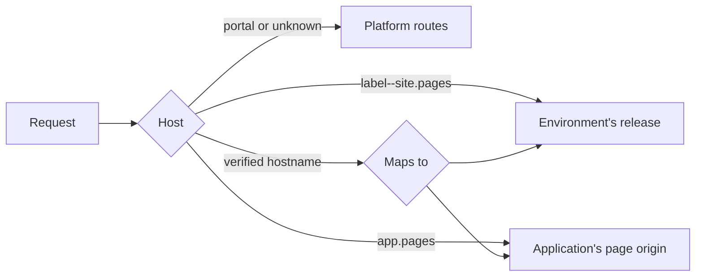

# Sites and pages

The platform serves two kinds of browser traffic on hostnames other than its
own: an application's browser pages, and static sites with environments. Both
go through one serving layer that routes by `Host` and sits outside the
platform's routes, so a request to a site or page origin never reaches a
portal, admin, MCP or API route, and a request for any other hostname passes
through untouched.

## Configuration

```yaml
sites:
  enabled: true                  # default: on with a database and a portal bucket
  pages_domain: pages.example.net
  max_release_files: 20000
  max_file_bytes: 67108864       # 64 MiB
  max_release_bytes: 2147483648  # 2 GiB
  cache:
    memory_bytes: 268435456      # per replica
    dir: /var/cache/platform-sites
    disk_bytes: 2147483648
  verify:
    dns_server: ""               # host:port for TXT lookups; empty uses the system's
    allow_private_cidrs: []      # for the HTTP check
  crawl:
    allow_private_cidrs: []
    max_pages: 2000
    max_bytes: 536870912
  tls:
    acme:
      enabled: false
      address: ":8443"
      email: ops@example.com
      directory_url: https://acme-v02.api.letsencrypt.org/directory
      ca_file: ""                # trust a private ACME server's root
```

`pages_domain` is the parent of every application's page origin
(`<application>.<pages_domain>`) and every environment's preview
(`<environment>--<site>.<pages_domain>`), so it needs a wildcard DNS record.
With none set, no page and no preview is served.

!!! warning "Use a registrable domain of its own"
    Give `pages_domain` a registrable domain the portal is not on. A sibling of
    the portal, such as `pages.example.com` beside `platform.example.com`, is
    same-site: browsers then send the portal's `SameSite=Lax` cookie on requests
    a page makes. The portal's cross-origin rules still refuse to let a page read
    the answer, and its writes need a CSRF token, but a separate domain removes
    the exposure. The platform refuses a `pages_domain` that holds the portal's
    host or sits under the session cookie's `Domain`.

## How routing works



Only a hostname that passed verification routes. Which release a hostname serves
is read again every half second per replica and at once on the replica that moved
it, so a promote or rollback takes effect immediately. File bytes are cached by
content digest in memory and on disk, which never go stale.

## Pages

See the `platform-pages-and-sites` knowledge page for how to build one. What an
operator should know:

- A page origin answers only `/`, `/endpoints/...`, `/_static/...`, `/_viewer` and
  `/_auth`. Portal, admin and MCP routes do not exist there.
- The portal's session never crosses. A signed-in person is handed over by a code
  good for a minute, once, bound to the browser that started the sign-in; the
  origin then keeps its own HttpOnly cookie, scoped to one application, for
  twelve hours. API keys are not honored on a page origin.
  The page origin answers on the port of `portal.public_base_url`, and the redirect back to it names the stored hostname and that port, nothing the request sent.
- A page's content policy is built by the platform per binding. Endpoints that do
  not opt in keep `default-src 'none'; sandbox`, and a page requested on the
  portal's own origin stays sandboxed.

## Sites

Files land once per release under `sites/<id>/releases/<n>/` in the portal
bucket, with gzip and brotli variants made at publish. Promote and rollback only
move an environment's pointer, and `site_deployments` records every move. Serving
needs no CDN: strong ETags and `304`, `immutable` on fingerprinted names, range
requests, redirects and a custom 404. A CDN can be put in front later with no
change.

Every `manage_site` call is audited like any other tool call. Requests to a site
are counted in the platform's HTTP metrics and are not audited individually.

## TLS

**Through the ingress.** `manage_site command=hosts`, and
`GET /api/v1/admin/sites/hosts` for automation, list the verified hostnames, those
awaiting verification and the wildcard the pages domain needs, with a cert-manager
`Certificate` manifest covering them.

**Built in.** `sites.tls.acme` issues certificates for verified hostnames on a
listener of its own, over TLS-ALPN-01, so that address must be what port 443
reaches. It needs `ENCRYPTION_KEY`: the account key and every certificate key are
sealed in `site_certificates`, each bound to its row. Only verified hostnames and
environments or applications that exist get a certificate, so a request naming a
random label cannot make the platform order one.

## Domains

An administrator maps a hostname with `add_domain`. It starts routing once
`verify_domain` finds its token in a DNS TXT record at
`_platform-site-verify.<hostname>`, or served at
`http://<hostname>/.well-known/platform-site-verify`. The HTTP check goes through
the egress guard and only compares the token. The portal's hostname, anything
under the pages domain and anything under the session cookie's `Domain` are
refused.
