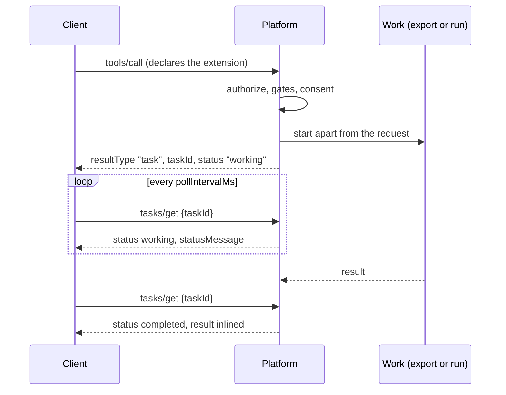

# MCP Tasks

The platform implements the MCP Tasks extension, `io.modelcontextprotocol/tasks`
([specification, revision 2026-07-28](https://github.com/modelcontextprotocol/ext-tasks/blob/main/specification/2026-07-28/tasks.md)).
A client that declares it is answered with a **task** for the calls that run long,
and follows the work with `tasks/get` and `tasks/cancel` instead of holding a
request open.

## Which calls become tasks

| Tool | What the task is |
|---|---|
| `run_script` | The managed-script run itself. The task id is the run id, and nothing is stored beside it. See [Following a run as an MCP task](../scripts/running.md#following-a-run-as-an-mcp-task). |
| `trino_export` | The export, executed apart from the request on the replica that took the call. |
| `api_export` | The same. |
| `graphql_export` | The same. |

Every other tool is answered with its result, as before.

A call becomes a task only when the request itself declares the extension, in
its per-request client capabilities:

```json
{
  "jsonrpc": "2.0", "id": 7, "method": "tools/call",
  "params": {
    "name": "trino_export",
    "arguments": {"connection": "warehouse", "sql": "SELECT ...", "name": "orders", "format": "csv"},
    "_meta": {
      "io.modelcontextprotocol/clientCapabilities": {
        "extensions": {"io.modelcontextprotocol/tasks": {}}
      }
    }
  }
}
```

A request that does not declare it is answered exactly as before, whatever the
session declared earlier: the extension forbids answering such a request with a
task.

The server advertises the extension in its capabilities wherever a database is
configured and `tasks.enabled` is not false.

## The flow



- The call is authorized, gated and asked for consent before any task exists, so
  a refusal or a consent prompt is answered directly.
- The answer is a `CreateTaskResult`: `resultType: "task"`, `taskId`, `status`,
  `statusMessage`, `createdAt`, `lastUpdatedAt`, `ttlMs` and `pollIntervalMs`.
  The task exists in the database before the answer is sent, so a `tasks/get` to
  any replica resolves it.
- `tasks/get` answers with the task and, once it ends, its outcome: a `completed`
  task carries the tool's result under `result` (a tool error included, with
  `isError: true`); a `failed` task carries the JSON-RPC error under `error`; a
  `cancelled` task carries neither.
- `tasks/cancel` asks the work to stop and acknowledges at once. A run stops as
  `cancel_run` stops it; an export stops at once on the replica running it, or
  at that replica's next heartbeat, within seconds, when another replica took the
  cancel. Work that finished first keeps its outcome.
- `tasks/update` is acknowledged for a task the caller may follow. No task the
  platform runs asks the client for input.
- There is no `tasks/list` and no `tasks/result`: the 2026-07-28 extension has
  neither.

## Who may follow a task

A task is followed by whoever started it and by administrators; a run's task
also by the script's owner, the same rule as `get_run`. Everyone else, and a
request with no identity, is told the task does not exist (`-32602`). A
`tasks/*` request from a client that does not declare the extension is refused
with `-32021`, naming the capability. Task ids carry 128 random bits.

## An export as a task

An export executed as a task runs on the replica that took the call, on a
context that outlives the request. Progress and log notifications are not sent
for it (the extension carries none for a task). Its audit row is written when it
ends, with what it did, so the call catalog and the audit log record the export
rather than the handle.

The task is a row in `call_tasks`. While the export runs, its replica stamps the
row every two seconds and reads in the same statement whether a cancel was asked
for. A working task whose replica stopped stamping for 30 seconds belongs to a
replica that is gone, and reads as `failed` with an error that says so; call the
tool again. On a shutdown the platform lets running exports finish within the
shutdown grace, and records the ones still running as failed.

## Configuration

```yaml
tasks:
  enabled: true        # default; false answers every call directly
  retention_days: 7    # how long an export task is kept for its caller to read
```

A run's task lives as long as the run (`scripts.run_retention_days`). An export
task is deleted by the retention pass once `retention_days` have passed since it
was created; `ttlMs` on the task says when.
