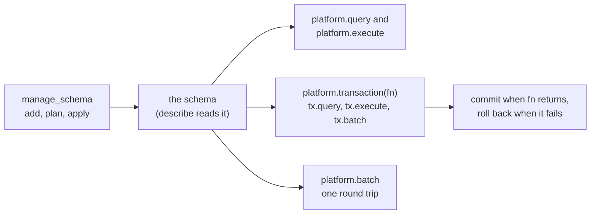

# Application databases from a script

An application database (a connection of kind `appdb`) is an application's
own PostgreSQL database: the orders, customers and line items an application
built in the platform commits. Scripts and endpoints read and write it; no
agent tool reaches its data. Its schema is built with `manage_schema`.



## One statement

`platform.query` and `platform.execute` bind each `:name` as a parameter,
never as a literal, and run on the connection's pool directly: the query in a
READ ONLY transaction, the execute committed in a transaction of its own. A
list binds as one array, so write `= ANY(:ids)`. What PostgreSQL says about a
failure, DETAIL included, reaches the script alone, under the envelope's
`postgres` field with `on_error="return"`; the run's error names only the
SQLSTATE and the objects.

## Statements that commit together

`platform.transaction(connection, fn, isolation="read_committed",
read_only=False, retry=False, on_error="raise")` opens one transaction, calls
`fn(tx)`, and commits when `fn` returns; it returns what `fn` returned. When
`fn` fails the transaction is rolled back and the failure is the call's.

```python
def main():
    """Places one order and its line items."""
    order = {"id": 1001, "total": "59.70"}
    items = [{"sku": "A-1", "qty": 2}, {"sku": "B-7", "qty": 1}]

    def place(tx):
        """Inserts the order and its items."""
        tx.execute("INSERT INTO orders (id, total) VALUES (:id, :total)", params = order)
        tx.batch([{"sql": "INSERT INTO items (order_id, sku, qty) VALUES (:o, :s, :q)",
                   "params": {"o": order["id"], "s": i["sku"], "q": i["qty"]}} for i in items])

    platform.transaction("orders", place)
```

- `tx.query(sql, params={}, timeout_seconds=0, on_error="raise")`,
  `tx.execute(...)` with the same arguments, and `tx.batch(statements,
  on_error="raise")` run in the transaction and bind as `platform.query` does.
- The first statement that fails ends the transaction, as PostgreSQL does;
  every later call on `tx` fails saying so.
- `isolation` is `read_committed`, `repeatable_read` or `serializable`.
  `read_only=True` opens a READ ONLY transaction, the only kind a read_only
  connection opens.
- `retry=True` runs `fn` again on a serialization failure (SQLSTATE 40001) or
  a deadlock (40P01), and on nothing else: three tries in all, with a short
  jittered pause. Because `fn` may run more than once, a retried `fn` reads and
  writes only through `tx`: `platform.call`, `platform.query`,
  `platform.execute`, `platform.batch`, `platform.export`,
  `platform.publish_data`, `platform.notify`, `platform.publish`,
  `platform.save_state` and `platform.mint_token` are refused inside it.
- Transactions do not nest. While one is open, `platform.query` and
  `platform.execute` on its connection are refused: run those through `tx`.
- A `tx` is used only inside `fn`.

The transaction is rolled back when the run ends however it ends, and when it
goes the connection's `transaction_idle_timeout` (10 seconds by default)
without a statement, so do slow work before or after it. An endpoint handler
may open one; it does not outlive the request. In a draft, `tx.execute` and
`tx.batch` are writes, refused unless the draft allows writes. A recording
keeps each statement and whether it committed, and a test replays them.

## Statements in one round trip

`platform.batch(connection, statements, on_error="raise")` sends statements
pipelined, in a transaction of their own that commits only when every one
succeeds, and returns their results in order. A statement is a SQL string or
`{"sql": ..., "params": {...}}`, and none reads another's result. A batch is a
write in a draft, and a failure names its statement: `statement 2 of the
batch: ...`.

## The schema

Tables are created and changed through versioned migrations, never ad hoc DDL:
`manage_schema` `add` a migration (version, name, up SQL, optional down SQL),
`plan` it to see what it changes and the locks it takes, and `apply` it (an
administrator, or a persona the connection's `schema_apply_personas` names).
`describe` returns the tables, columns, constraints and indexes the applied
migrations produced, which is how to read an application's schema while
writing its scripts. An applied migration is immutable: a fix is a new one.

`add` reviews a migration before it saves. Each statement that locks or
rewrites a live table is returned as a finding naming the statement, what it
does and the safe form: `CREATE INDEX` without `CONCURRENTLY`, a column added
`NOT NULL` with no default or with a default computed per row, `ALTER COLUMN
... TYPE`, a foreign key or check added without `NOT VALID`, a `lock_timeout`
set above the platform's 10 seconds, and a rename of a table or column a saved
script names. A migration that removes data (`DROP TABLE`, `DROP COLUMN`,
`TRUNCATE`, a `DELETE` or `UPDATE` with no `WHERE`) saves only with
`change_summary` saying what it removes and `user_agreed=true` once the person
the application is built for agreed; the summary is in its history. The
schema's migrations are then applied from zero on a throwaway database, and a
set that does not apply is refused naming the migration.

## Tests against a real database

In a test, `testing.database(connection, schemas=None)` answers every
statement the test makes on that application database from a database built
from its migrations (every schema, or the ones named), cloned for that test
alone and dropped when it ends, rather than from the recording. Constraints,
triggers and policies run. Write fixtures with `platform.execute`; nothing
reaches the connection's own database.

    def test_a_duplicate_email_is_refused():
        testing.database("shop", schemas = ["app"])
        platform.execute("INSERT INTO app.users (email) VALUES (:e)", connection = "shop", params = {"e": "a@example.com"})
        msg = assert.fails(lambda: platform.execute("INSERT INTO app.users (email) VALUES (:e)",
                                                    connection = "shop", params = {"e": "a@example.com"}))
        assert.contains(msg, "unique_violation")

The databases are created on the server of the connection's `test_connection`
(the connection itself by default), whose user needs `CREATEDB`; without it
the test fails naming the privilege.

## Who a statement runs for

A connection's `persona_roles` maps a persona to a database login role. A
run's statements log in as the role of the persona the script version's author
holds (an endpoint request's too), so the database's own grants and row-level
security apply on top of the platform's persona check. A persona the map does
not name runs as the connection's `user`. The role logs in itself; it is never
switched to with `SET ROLE`, so `RESET ROLE` in a statement changes nothing.

Every transaction sets who it runs for as transaction-local settings, read
with `current_setting(name, true)`:

- `mcp.user_id` and `mcp.email`: an authenticated endpoint's caller; empty on
  a public endpoint; outside an endpoint, the script's author (in a draft, the
  person running it).
- `mcp.persona`: the persona whose role the statement runs as.
- `mcp.source`: `endpoint` or `script`.

A policy that shows each caller their own rows treats an empty setting as no
one:

    CREATE POLICY own_orders ON orders TO orders_sales
      USING (customer_id = nullif(current_setting('mcp.user_id', true), ''));

A claim protects against the person who did not write the SQL, such as an
endpoint's caller. The script's author can set any setting in their own
statement; against them the boundary is their persona's login role.

## Rows as events

`manage_schema` `add` with `template="outbox"` (and `capture`, the tables to
watch) writes a migration the platform provides: an outbox table, a trigger
function that writes each inserted, updated or deleted row of a captured table
to it and notifies its channel, and a trigger on each captured table. A
webhook source with input `postgres` and mode `outbox` then files each row as
an event and deletes it, and the scripts naming that source run once per row,
reading it from `run.event["payload"]["row"]`.
