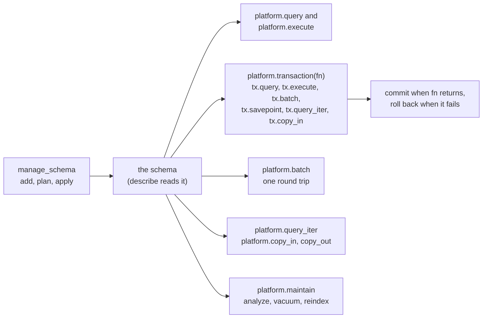

# Application databases from a script

An application database (a connection of kind `appdb`) is an application's
own PostgreSQL database: the orders, customers and line items an application
built in the platform commits. Scripts and endpoints read and write it; no
agent tool reaches its data. Its schema is built with `manage_schema`.



Designing the schema itself (upserts, constraints, documents, search, time,
security, queues, partitions) is covered page by page, starting from
mcp:knowledge_page:platform-postgres-write-patterns; what does not work
through the platform's pooled connections is
mcp:knowledge_page:platform-postgres-what-does-not-work.

## One statement

`platform.query` and `platform.execute` bind each `:name` as a parameter,
never as a literal, and run on the connection's pool directly: the query in a
READ ONLY transaction, the execute committed in a transaction of its own. A
list binds as one array, so write `= ANY(:ids)`. What PostgreSQL says about a
failure, DETAIL included, reaches the script alone, under the envelope's
`postgres` field with `on_error="return"`; the run's error names only the
SQLSTATE and the objects.

## Statements that commit together

`platform.transaction(connection, fn, isolation="read_committed",
read_only=False, retry=False, on_error="raise")` opens one transaction, calls
`fn(tx)`, and commits when `fn` returns; it returns what `fn` returned. When
`fn` fails the transaction is rolled back and the failure is the call's.

```python
def main():
    """Places one order and its line items."""
    order = {"id": 1001, "total": "59.70"}
    items = [{"sku": "A-1", "qty": 2}, {"sku": "B-7", "qty": 1}]

    def place(tx):
        """Inserts the order and its items."""
        tx.execute("INSERT INTO orders (id, total) VALUES (:id, :total)", params = order)
        tx.batch([{"sql": "INSERT INTO items (order_id, sku, qty) VALUES (:o, :s, :q)",
                   "params": {"o": order["id"], "s": i["sku"], "q": i["qty"]}} for i in items])

    platform.transaction("orders", place)
```

- `tx.query(sql, params={}, timeout_seconds=0, on_error="raise")`,
  `tx.execute(...)` with the same arguments, and `tx.batch(statements,
  on_error="raise")` run in the transaction and bind as `platform.query` does.
  `tx.savepoint`, `tx.query_iter` and `tx.copy_in` are below.
- The first statement that fails ends the transaction, as PostgreSQL does;
  every later call on `tx` fails saying so.
- `isolation` is `read_committed`, `repeatable_read` or `serializable`.
  `read_only=True` opens a READ ONLY transaction, the only kind a read_only
  connection opens.
- `retry=True` runs `fn` again on a serialization failure (SQLSTATE 40001) or
  a deadlock (40P01), and on nothing else: three tries in all, with a short
  jittered pause. Because `fn` may run more than once, a retried `fn` reads and
  writes only through `tx`: `platform.call`, `platform.query`,
  `platform.execute`, `platform.batch`, `platform.query_iter`,
  `platform.copy_in`, `platform.copy_out`, `platform.export`,
  `platform.publish_data`, `platform.notify`, `platform.publish`,
  `platform.save_state` and `platform.mint_token` are refused inside it.
- Transactions do not nest. While one is open, `platform.query` and
  `platform.execute` on its connection are refused: run those through `tx`.
- A `tx` is used only inside `fn`.

The transaction is rolled back when the run ends however it ends, and when it
goes the connection's `transaction_idle_timeout` (10 seconds by default)
without a statement, so do slow work before or after it. An endpoint handler
may open one; it does not outlive the request. In a draft, `tx.execute` and
`tx.batch` are writes, refused unless the draft allows writes. A recording
keeps each statement and whether it committed, and a test replays them.

## Statements in one round trip

`platform.batch(connection, statements, on_error="raise")` sends statements
pipelined, in a transaction of their own that commits only when every one
succeeds, and returns their results in order. A statement is a SQL string or
`{"sql": ..., "params": {...}}`, and none reads another's result. A batch is a
write in a draft, and a failure names its statement: `statement 2 of the
batch: ...`.

## Undoing part of a transaction

`tx.savepoint(fn, on_error="raise")` calls `fn(tx)` under a savepoint the
platform names. When `fn` returns the savepoint is released and its work kept;
when `fn` fails the transaction is rolled back to the savepoint, so only `fn`'s
work is undone and the transaction goes on. It returns what `fn` returned.

```python
def import_rows(tx, rows):
    """Inserts each row, skipping the ones whose key already exists."""
    skipped = 0
    for r in rows:
        got = tx.savepoint(lambda t: t.execute(
            "INSERT INTO customers (email, name) VALUES (:email, :name)", params = r),
            on_error = "return")
        if got and got.get("error"):
            skipped += 1
    return skipped
```

- A statement in `fn` that fails stops the savepoint even when `fn` took the
  failure with `on_error="return"` and went on: PostgreSQL runs nothing in it
  after a failure, so the platform rolls back to it and the failure is
  `tx.savepoint`'s. `on_error="return"` hands back a failed statement's
  envelope, as for every call; `fn`'s own `fail(...)` ends the run after the
  rollback.
- Savepoints nest, and none is left open past the call that made it. The SQL
  statements `SAVEPOINT`, `RELEASE` and `ROLLBACK TO` are refused.
- Each savepoint is a subtransaction. PostgreSQL keeps 64 of them per session
  in memory and spills past that, and a transaction holding thousands slows
  every other session that checks row visibility. A savepoint per row of a
  large import is the case to avoid: insert with `ON CONFLICT DO NOTHING`, or
  check first, and keep savepoints for the steps that can fail.

## Results larger than max_rows

`platform.query_iter(connection, sql, params={}, page_rows=0,
timeout_seconds=0, on_error="raise")` returns the query's rows to loop over,
read in pages of `page_rows` (the connection's `max_rows` when 0, at most
100000) from a cursor in a READ ONLY transaction of its own.
`tx.query_iter(sql, ...)` reads from a cursor in the transaction.

```python
def main():
    """Totals every order, however many there are."""
    total = 0
    for row in platform.query_iter("orders", "SELECT total FROM orders WHERE placed_at >= :since",
                                   params = {"since": "2026-01-01"}, page_rows = 5000):
        total += float(row["total"])
    print(total)
```

- The run holds one page at a time, and each page is charged against its
  memory budget. Keep a row only if the result needs it.
- A loop reads at most the connection's `iter_max_rows` rows (1000000 by
  default); past it, a page that fails to read, or the memory budget, the run
  fails naming why. A loop never ends early as though the result were whole.
- The cursor closes when the loop ends, breaks or fails, and never outlives
  the run. A result is read by one loop; call `query_iter` again to read it
  again.
- A loop body that spends longer than the connection's
  `transaction_idle_timeout` between pages loses the cursor's transaction.
- For results a person pages through (an endpoint's list view), use keyset
  pagination in SQL, `WHERE (placed_at, id) < (:last_at, :last_id) ORDER BY
  placed_at DESC, id DESC LIMIT 50`, which reads the same rows whatever page
  is asked for and holds nothing between requests.

## Copying rows in and out

`platform.copy_in(connection, table, columns, rows, on_error="raise")` writes
rows into a table through PostgreSQL's COPY protocol, in a transaction of its
own, and returns the number written. `tx.copy_in(table, columns, rows)` writes
them in the transaction, committed with it. A row is a list in `columns`'
order or a dict keyed by column; values bind by each column's type as a
parameter does. It runs as the persona's role with the caller's claims set.

`platform.copy_out(connection, name, sql, params={}, format="csv",
timeout_seconds=0, on_error="raise")` writes every row of a query as an output
named `name`, CSV with a header or COPY's text format (`format="text"`, stored
as tab-separated values), however many rows `max_rows` allows a query. It
takes `platform.export`'s `destination`, `key`, `register`, `tags`,
`metadata`, `scope`, `scope_id` and `index`, and its output is stored where an
export's is. The rows stream from the database to the output and are never
the script's values.

- One call moves at most the connection's `copy_max_rows` rows (1000000) and
  `copy_max_bytes` bytes (64 MiB); a `copy_out` is also held to the 100 MB an
  output may be. A `copy_in` past either is refused before its first row is
  sent.
- A `copy_in` row's values reach no audit row, log, span or metric label, and
  its recording keeps the table, the columns and the row count, never a value.
- `COPY` written as SQL is refused in every statement a script runs.

## Values

`res["columns"]` names each column's PostgreSQL type, so a script tells an enum
(its type's name) from text. Beyond numbers, strings, timestamps, `json`,
`uuid`, arrays and `bytea`:

| Type | Value |
|------|-------|
| range | `{"lower", "upper", "lower_inc", "upper_inc", "empty"}`, bounds mapped by the element type, an unbounded one null |
| multirange | a list of ranges |
| `interval` | `{"months", "days", "microseconds", "text"}` |
| composite | an object keyed by attribute name, each mapped by its type |
| `hstore` | an object of string to string or null |
| `vector` (pgvector) | a list of numbers |
| `inet`, `cidr`, an enum, `ltree`, `tsvector` | the text PostgreSQL writes |

The same shapes bind as parameters, so a booking's period goes in as
`{"lower": start, "upper": end}` and an exclusion constraint refuses an
overlapping one with SQLSTATE 23P01. A string is taken as the type's own
literal.

## The schema

Tables are created and changed through versioned migrations, never ad hoc DDL:
`manage_schema` `add` a migration (version, name, up SQL, optional down SQL),
`plan` it to see what it changes and the locks it takes, and `apply` it (an
administrator, or a persona the connection's `schema_apply_personas` names).
`describe` returns the server's major and version, the extensions installed
and available, and every object the applied migrations produced: tables with
their columns, constraints, indexes, row-level security, policies, triggers
and partitions, views with their definitions, functions and procedures with
their bodies, enums and domains. It is how to read an application's schema
while writing its scripts, and the major it reports is the one to write SQL
for. An applied migration is immutable: a fix is a new one. The server is
PostgreSQL 17 or later; an older one is refused.

`add` reviews a migration before it saves. Each statement that locks or
rewrites a live table is returned as a finding naming the statement, what it
does and the safe form: `CREATE INDEX` without `CONCURRENTLY`, a column added
`NOT NULL` with no default or with a default computed per row, `ALTER COLUMN
... TYPE`, a foreign key or check added without `NOT VALID`, a `lock_timeout`
set above the platform's 10 seconds, and a rename of a table or column a saved
script names. A migration that removes data (`DROP TABLE`, `DROP COLUMN`,
`TRUNCATE`, a `DELETE` or `UPDATE` with no `WHERE`) saves only with
`change_summary` saying what it removes and `user_agreed=true` once the person
the application is built for agreed; the summary is in its history. The
schema's migrations are then applied from zero on a throwaway database, and a
set that does not apply is refused naming the migration.

The review also warns on what leaves the database open: a `SECURITY DEFINER`
function without `SET search_path = ..., pg_temp` or without `REVOKE EXECUTE
... FROM PUBLIC` in the same migration, `ENABLE ROW LEVEL SECURITY` without
`FORCE ROW LEVEL SECURITY`, and a view over a table with row-level security
created without `security_invoker = true`. Against a PostgreSQL 17 server it
warns on what 18 introduced (`uuidv7()`, `RETURNING old`/`new`, virtual
generated columns, `WITHOUT OVERLAPS`, `NOT ENFORCED`), and against 18 on an
index of a generated column declared without `STORED`. `COPY ... PROGRAM`,
`CREATE LANGUAGE` or code in an untrusted language, `CREATE EVENT TRIGGER`,
`ALTER SYSTEM`, and a role, user, group or user mapping given a password in
the migration (`PASSWORD '...'`) are refused, in the up SQL and the down SQL
alike: a migration is stored, applied and exported as written, so a
credential never belongs in one. The audit row of the call keeps the SQL with
the password replaced by `'[REDACTED]'`.

`status` also reports `schema_drift` for the schema: the applied migrations
are built from zero on a throwaway database and compared with the live
schema, and each object that differs (a table, column, constraint, index,
trigger, policy, view, function, enum or domain) is named as added outside
migrations, missing, or changed. Drift means someone changed the database by
hand; write a migration that makes the change, or undo it, before the next
apply. `describe` adds `findings` a build can act on in the schema its
migrations made: an index never scanned, indexes that index the same thing,
and a table whose dead rows outrun autovacuum.

## Maintenance

`platform.maintain(connection, command, table=None, on_error="raise")` runs
`analyze`, `vacuum` (with ANALYZE), `vacuum_full` (VACUUM FULL, which holds an
ACCESS EXCLUSIVE lock on the table while it rewrites it) or `reindex` (REINDEX
TABLE CONCURRENTLY) outside a transaction, under a 5 second lock timeout, and
returns `statement` and `duration_ms`. `analyze` and `vacuum` act on the whole
database without a table; the other two need one. It is allowed for the
administrator and the personas the connection's `schema_apply_personas`
names, refused in a draft, and audited. A scheduled script calling it is how
maintenance runs on a timer (the built-in example `example-nightly-maintenance`
shows one). Creating or dropping an index is a schema change, refused here:
add it as a migration.

## Tests against a real database

In a test, `testing.database(connection, schemas=None)` answers every
statement the test makes on that application database from a database built
from its migrations (every schema, or the ones named), cloned for that test
alone and dropped when it ends, rather than from the recording. Constraints,
triggers and policies run. Write fixtures with `platform.execute`; nothing
reaches the connection's own database.

    def test_a_duplicate_email_is_refused():
        testing.database("shop", schemas = ["app"])
        platform.execute("INSERT INTO app.users (email) VALUES (:e)", connection = "shop", params = {"e": "a@example.com"})
        msg = assert.fails(lambda: platform.execute("INSERT INTO app.users (email) VALUES (:e)",
                                                    connection = "shop", params = {"e": "a@example.com"}))
        assert.contains(msg, "unique_violation")

The databases are created on the server of the connection's `test_connection`
(the connection itself by default), whose user needs `CREATEDB`; without it
the test fails naming the privilege.

## Who a statement runs for

A connection's `persona_roles` maps a persona to a database login role. A
run's statements log in as the role of the persona the script version's author
holds (an endpoint request's too), so the database's own grants and row-level
security apply on top of the platform's persona check. A persona the map does
not name runs as the connection's `user`. The role logs in itself; it is never
switched to with `SET ROLE`, so `RESET ROLE` in a statement changes nothing.

Every transaction sets who it runs for as transaction-local settings, read
with `current_setting(name, true)`:

- `mcp.user_id` and `mcp.email`: an authenticated endpoint's caller; empty on
  a public endpoint; outside an endpoint, the script's author (in a draft, the
  person running it; in a test, the person saving or testing the script).
- `mcp.persona`: the persona whose role the statement runs as.
- `mcp.source`: `endpoint` or `script`.

A policy that shows each caller their own rows treats an empty setting as no
one:

    CREATE POLICY own_orders ON orders TO orders_sales
      USING (customer_id = nullif(current_setting('mcp.user_id', true), ''));

A claim protects against the person who did not write the SQL, such as an
endpoint's caller. The script's author can set any setting in their own
statement; against them the boundary is their persona's login role.

## Rows as events

`manage_schema` `add` with `template="outbox"` (and `capture`, the tables to
watch) writes a migration the platform provides: an outbox table, a trigger
function that writes each inserted, updated or deleted row of a captured table
to it and notifies its channel, and a trigger on each captured table. A
webhook source with input `postgres` and mode `outbox` then files each row as
an event and deletes it, and the scripts naming that source run once per row,
reading it from `run.event["payload"]["row"]`.

For a table many sessions write at once, add with `notify` set to false. Each
transaction that notifies takes a lock at commit that every other notifying
commit waits on; without the notification the source's poll (`poll_seconds`)
still delivers every row, only later.
