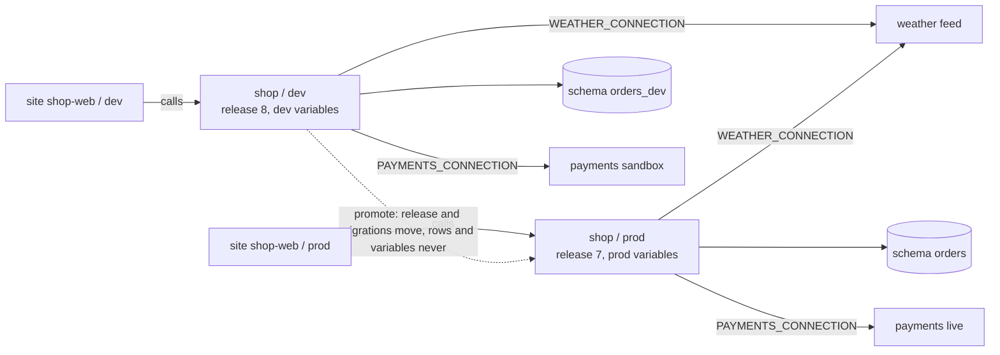

# Application environments: dev and prod, each with its own data

An application usually runs in more than one place: a `dev` where a release is
tried and a `prod` people use. Most of the time the two run the same code and
differ only in the data systems they reach: their own database rows, a payments
API's sandbox or live account, a CRM's test or production org. Some services are
the same in both, a public weather feed for one. A dev website reads and writes
dev's data, so a test order never pollutes prod. This page is how the platform
keeps them apart and how an application is written to run in all of them.



## 1. What an environment is

An environment is four things the application holds:

- **A release.** A release lands in the first environment; `promote` moves it
  one environment on. Each environment runs the script and asset versions its
  own release pins.
- **Its variables.** `NAME=value` per environment, with an application-wide
  default for the ones that do not differ. A script reads them with
  `platform.env("NAME")`; a change applies to the next run, no release needed.
- **Its schema.** Every environment runs in a schema of its own on the
  application's connection, and its statements log in as a run role granted
  on that schema alone, with that schema as their search path. A statement
  naming another environment's schema is refused by the database. The schema
  is never a variable: an environment's runs are already in their own.
- **The site environments that call it.** A site environment that is a part of
  the application calls the application environment of the same name.

An application starts with one environment, `prod`, on the schema it holds.
`manage_application add_environment environment=dev` with no `after` puts dev
first, so releases land there. Dev runs in `orders_dev` (the application's
schema, an underscore and the environment's name, a hyphen written as an
underscore) unless `schema` names another. The platform builds it from the
structure of the last environment's schema: its tables, views, functions,
indexes, types, sequences, constraints, triggers and policies, with no rows,
recorded as having applied every migration the last environment had, so a
large application never replays its history. Grants are not copied: the
platform grants dev's run role on dev's schema. Removing an environment drops
its run role and keeps its schema until an administrator drops it.

## 2. Same code, different systems

The shop below differs between dev and prod in payments, its CRM, a shipping
key and whether it mails receipts, and shares a weather feed. Each difference is
a variable; the code reads the variable and never names a system itself.

| Variable | Default | dev | prod |
|---|---|---|---|
| `PAYMENTS_CONNECTION` | | `payments-sandbox` | `payments-live` |
| `PAYMENTS_MODE` | | `test` | `live` |
| `CRM_CONNECTION` | `crm-sandbox` | | `crm-prod` |
| `SHIPPING_API_KEY` | | `{{secret:shipping-test}}` | `{{secret:shipping-live}}` |
| `SEND_RECEIPTS` | `true` | `false` | |
| `WEATHER_CONNECTION` | `weather-public` | | |

- Give a variable a value per environment where dev must not touch prod
  (payments, the shipping key).
- Give it one default where both may use the same service (the weather feed),
  and a per-environment value only where one differs (prod's CRM).
- A secret is never a variable's value. A value is plain text, shown on the
  application's page and returned by `variables`; write `{{secret:<name>}}` and
  the gateway fills the stored secret when a request carrying it is sent
  through a connection the secret allows, and removes it from what comes back.

Set them with `manage_application set_variable variable=PAYMENTS_CONNECTION
value=payments-sandbox environment=dev`, and `environment` left out for the
default.

## 3. A script that runs in every environment

Every connection and every value that differs comes from `platform.env`, and
every table is named without a schema:

```python
REFUND = "INSERT INTO refunds (order_id, amount) VALUES (:order_id, :amount) RETURNING id"

def refund(order_id, amount):
    """Refunds an order through this environment's payment account and records it."""
    paid = platform.call("api_invoke_endpoint", {
        "connection": platform.env("PAYMENTS_CONNECTION"),
        "method": "POST",
        "path": "/v1/refunds",
        "body": {"order": str(order_id), "amount": amount, "mode": platform.env("PAYMENTS_MODE")},
        "purpose": "Refunds an order.",
    })
    row = platform.query(REFUND, connection = "orders", params = {"order_id": order_id, "amount": amount})
    return {"refund": row["rows"][0]["id"], "payment": paid["status"]}
```

`platform.environment()` names the environment the run is in, for a label or a
log line; choose a connection by variable, never by testing the environment's
name. The same statement reads `orders_dev.refunds` in dev and `orders.refunds`
in prod, because each run's search path is its own schema. A table written
with the schema (`orders.refunds`) would reach prod from dev: the database
refuses it in dev, and a save of a script that adds one is refused naming the
line.

A draft of an application's part runs in its first environment, as that
environment's run role. A script that is not a part yet, being written
before its first save, names the application to draft in:
`manage_script command=run_draft application=shop`. Without it the draft
belongs to no application, and an unqualified table resolves to nothing
(*statement failed with SQLSTATE 42P01 (undefined_table)*).

A table's name written as a value is data, not a reference to the table. The
outbox template's trigger records each row's source as the schema and table it
came from, so the same insert records `orders_dev.refunds` in dev and
`orders.refunds` in prod. A script that writes or compares such a value builds
it from the run's own schema, never from fixed text naming one:

```sql no-run
SELECT id, payload FROM outbox WHERE source_table = current_schema() || '.refunds' ORDER BY id
```

A webhook source is not copied per environment. An outbox source names one
outbox table (`orders.outbox`), so the rows a dev schema's outbox receives are
not filed as events by it.

## 4. Migrations

A migration is written once and applied to every environment's schema with the
search path set to that schema, so it names no schema and no role:

```sql
CREATE TABLE refunds (
    id          bigint GENERATED ALWAYS AS IDENTITY PRIMARY KEY,
    order_id    bigint NOT NULL,
    amount      numeric(10,2) NOT NULL CHECK (amount > 0),
    created_at  timestamptz NOT NULL DEFAULT now()
);
CREATE INDEX refunds_order ON refunds (order_id);
```

The run role's grants come from the platform: after a release or a promote
applies migrations to an environment's schema, that environment's run role is
granted `USAGE` on the schema and `SELECT`, `INSERT`, `UPDATE` and `DELETE` on
every table, sequence and routine in it, and nothing elsewhere. A migration
that creates, alters, drops or grants to a role, `PUBLIC` included (`CREATE
ROLE`, `GRANT ... TO`, `ALTER DEFAULT PRIVILEGES`, a `REVOKE ... FROM` a named
role), or names a name qualified by its own schema, in a statement or in a
function's body, is refused when it is added. `REVOKE ... FROM PUBLIC` is
accepted, and is what `security_definer_public_execute` asks of a `SECURITY
DEFINER` function. A function that must keep its schema pins it with `SET
search_path FROM CURRENT`: a migration runs with its schema then `pg_temp` on
the search path, so the function keeps its schema with `pg_temp` last, and an
environment's copy keeps the environment's schema. Leave `search_path` alone in
the migration: a function pinned after a `SET search_path` keeps that path, and
the review warns. `manage_schema
template=outbox` writes its function that way.

`release` applies the pending migrations to the first environment's schema. A
`promote` applies the ones the promoted release recorded to the target's
schema before the target moves, in that schema's own ledger; one that fails
refuses the promote and the target stays as it was.

## 5. Sites in front of an application

A site environment that is a part of the application (`add_part kind=site
part_id="shop-web/dev"`) answers the application's `/endpoints/<name>` on the
site's own address, run in the application environment of the same name:
`shop-web/dev` calls `dev`, with dev's release, variables and schema, and
`shop-web/prod` calls `prod`. There is no mapping to set and none to get wrong:
matching is by name. A site environment whose name the application has no
environment of is refused as a part, naming the environment to add, and one
renamed out of a match answers 404 naming the missing environment; it never
falls back to another environment's endpoints.

Before environments had schemas of their own, every site part called the
application's last environment, whatever its name. The upgrade keeps each
such site answering as it did: a site part whose environment the application
did not have is given that environment, ahead of the others, running the last
environment's release in the application's schema, and an environment a site
part calls that had no release is given the last environment's release. Such
an environment shares the application's schema and its rows, and a release
now lands in it first. To give it data of its own, prepare the application
(section 7), then remove the site part, remove the environment, add it again
(it is built a schema of its own) and add the site part back.

A coupled part moves with the environment it calls: a release into dev moves
`shop-web/dev`, a promote into prod moves `shop-web/prod` to the site release
dev ran with that application release, and a rollback in an environment
returns only the parts calling it. A linked part moves only by the site's own
promote and rollback.

## 6. Promote and roll back

`manage_application promote environment=dev` copies dev's release to the next
environment. What moves: the release (each script and asset at the version it
pins), the migrations it recorded, applied to the target's schema, and the
coupled site parts calling the target. What never moves: rows and variables.
Prod keeps its schema's rows and its own variables; dev keeps its own.

`rollback environment=<name>` moves one environment back to an earlier release
(the last environment when `environment` is left out), returns the site parts
calling it, and reverts the migrations applied since in a schema only that
environment runs in, when each has a down migration.

An environment with `requires_approval` refuses an agent's promote or rollback
into it however the agent calls (`manage_application`, the portal API through
the platform-admin connection, or a managed script calling the platform): a
person carries it out on the application's page.

## 7. Bringing an existing application to two environments

An application built before environments had their own schemas names its
schema in its SQL, as the pages taught then. The upgrade leaves every
environment it had running as it was, on its schema and run role, and an
environment the upgrade added for a site part (section 5) runs there too. An
environment with a schema of its own takes one reviewed change first:

1. **Prepare.** `manage_application command=prepare application=shop` lists
   each script, each library its scripts load and each pending migration that
   names the schema or its roles, with the same text proposed without them
   (applied migrations stay as their ledger records them), and replays each
   changed script's recent recorded runs to show the answers are the same.
   With the search path set to the schema, the change does nothing in prod. A
   run that answers differently blocks the save and is shown. Prepare removes
   the schema only where SQL names an object with it (after `FROM`, `JOIN`,
   `INTO` or `UPDATE`, in a call, after a comma or an operator), so a file
   such as `shop.css` is left alone. A name inside a
   quoted SQL value (`'orders.refunds'`) is data and is left as written and
   listed: change it by hand to build the value from `current_schema()`
   (section 3).
2. **Save.** `prepare save=true` (an administrator) saves each change as a new
   version: each library first, then each script loading the library's new
   version, then each pending migration.
3. **Release to prod** as any change is released.
4. **Add dev.** `add_environment environment=dev`. Its schema is built from
   prod's structure at prod's migration version, with no rows. When the
   upgrade already gave the application a `dev` sharing its schema (section
   5), remove the dev site part, remove `dev`, then add it; the site part goes
   back in step 6.
5. **Set dev's variables**: the per-environment values of section 2.
6. **Add the dev site part**, `shop-web/dev`, when the application has a site.
7. **Test** in dev: its site, its endpoints at
   `/environments/dev/endpoints/<name>`, its schedules and webhook handlers
   (`manage_script handler_environment=dev`).
8. **Promote** dev to prod.

SQL a script builds from strings when it runs cannot be found by reading its
text. In dev such a statement reaching prod's schema is refused by the
database (`permission denied for schema orders`) and writes nothing; build the
name without the schema and it reads dev's own table.

## 8. Before promoting to prod

- Every variable the release reads has a value prod uses, its own or the
  default; `variables` lists them.
- The migrations the release recorded apply: they applied to dev's schema with
  the same text, and `manage_schema status` on prod's schema shows them
  pending.
- The prod site part maps: the site environment prod's front end runs in is
  named `prod`, or the site's endpoints answer 404.
- If prod requires approval, the person promoting it is on the application's
  page.

## 9. Refusals

Each refusal below is the platform's text, with what fixes it.

- *site part shop-web/staging would call environment staging of application
  "shop", which it does not have (it has dev, prod); add environment staging
  first*: add the environment, or add the site environment of a name the
  application has.
- *dev can't be removed: site part shop-web/dev calls it. Remove that site part
  first. Its schema orders_dev is kept until an administrator drops it*: remove
  the site part, then the environment.
- *application shop has no environment named staging; add one to run this site
  environment's endpoints* (404 on `/endpoints/...`): add the environment, or
  rename the site environment to one the application has.
- *APPROVAL_REQUIRED: environment prod of application shop requires approval,
  so an agent does not move it: a person promotes or rolls it back on the
  application's page in the portal (Applications > shop > Environments)*: ask
  the person.
- *application "shop" is not ready for an environment of its own: 41 scripts, 2
  libraries and 3 pending migrations name schema orders or its roles, which
  from a new environment would reach this one's data. Prepare the application
  first (manage_application command prepare, or Prepare on the application's
  page)...*: run prepare, save it, release, then add the environment.
- *line 2 names the schema orders. Inside an application write invoices: each
  environment's runs read their own schema*: write the table without the
  schema. What a script already said is left alone; only an edit that adds a
  qualified name is refused.
- *migration 14 is refused: statement 1 (orders.refunds) names refunds in
  schema orders: the migration applies to every environment's schema, and a
  qualified name would reach orders from whichever environment applies it*:
  write the name without the schema.
- *... names role orders_write: the migration applies to every environment's
  schema, each with a run role the platform grants on it alone, and a role
  belongs to the whole server, so a grant here would reach data in another
  environment or another application*: leave the grant out; the platform
  grants each environment's run role what the migration creates.
- *schema "orders_dev" already exists on connection "orders"; name another, or
  have an administrator drop it first*: pass another `schema`.
- *schema "orders_dev" would reach schema orders through view open_orders,
  which run with their owner's privileges and would let its runs read or write
  rows there; remove the schema qualifier from them in the source schema's
  migrations, then add the environment again*: a view, function, default,
  trigger or policy in prod names prod's schema; write a migration that
  recreates it without the qualifier, release it, then add the environment.
- *schema "Orders Dev": a lowercase identifier (letters, digits and
  underscores)*, *schema "..." is 53 bytes; an environment's schema is at most 50,
  so its run role's name fits; name a shorter one*, and *schema orders is
  environment prod's; each new environment runs in a schema of its own*: name
  another schema.
- *nothing was promoted: ...* naming a migration: the migration failed in the
  target's schema and the target is unchanged; fix it with a new migration
  released to dev, then promote again.
- *statement failed with SQLSTATE 42P01 (undefined_table)* from a draft of a script that is not
  yet a part of the application: draft it with `application=shop`, or add it
  as a part first.
- *permission denied for schema orders* from a run in dev: the statement names
  prod's schema, written or built at run time; name the table without it.
