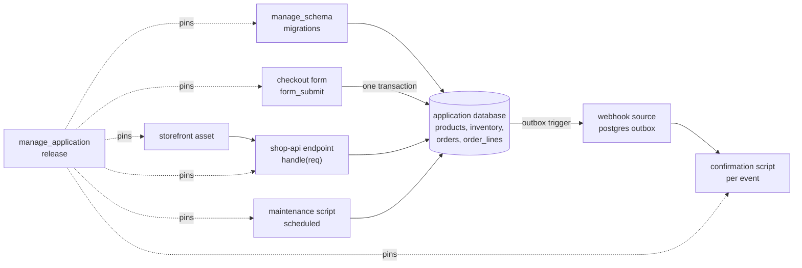

# Building an application on the platform

An application is a system built entirely in the platform: its data in an
application database, its API and pages as endpoints and forms, its side
effects as events, its user interface as portal assets, and its upkeep as
scheduled scripts. `manage_application` names all of it as one record and
releases it as a pinned set. This page builds one end to end, a small shop,
with platform tools alone.



## The order of work

1. The application, then its schema as a part: `manage_application` `create`,
   and `add_part` with `kind: "schema"`. A schema exists only inside the
   application holding it, so this comes before its first migration.
   Every table, constraint and policy is then a migration added with
   `manage_schema` `add`, planned and applied. The schema is the contract the
   scripts are written against; `manage_schema describe` reads it back.
2. Scripts against the schema, each with tests that run on a throwaway copy
   of the database (`testing.database`).
3. The front: an endpoint for the JSON API, a form for anything a person
   submits, a portal asset for the pages.
4. Side effects as events: a row the application writes becomes an event a
   script handles, never a call made inside the transaction.
5. Upkeep as a schedule: maintenance and reports run on a timer.
6. A release, which pins all of it.

A system usually grows into this order rather than starting from it: an
application that began on scratch tables or files, with a few scripts and an
asset, gains a database when it needs one. It takes the schema on the same
way, `add_part` with `kind: "schema"`, at any time; nothing is deleted or
created again, and its releases keep their history. A schema whose migrations
were applied before it was added is adopted: the next release applies nothing
already applied and records the schema's migration version, and a rollback
never reverts a migration no release applied. Move the scripts to the schema,
then release.

The design pages for the database are
mcp:knowledge_page:platform-application-databases and
mcp:knowledge_page:platform-postgres-write-patterns onward; this page is how
the parts fit.

## 1. The schema

First the application and its schema:

1. `manage_application` `create` with `name: "shop"`. A site and an application
   cannot share a name, because both answer under the pages domain, and an
   application's name cannot hold `--`, which is kept for a site environment's
   address, `<site>--<env>`.
2. `add_part` with `application: "shop"`, `kind: "schema"` and `part_id:
   "orders/shop"`: the schema `shop` on the application database connection
   `orders`. The connection must be an existing application database
   connection (kind `appdb`) your persona reaches; with only one, the schema
   alone (`part_id: "shop"`) names it, and with several the refusal lists them.
   No application command creates or changes a connection; an administrator
   configures it. An application holds one schema, and a schema belongs to one
   application: a schema another application holds is refused naming it.

Adding the schema creates the application's run role, `shop_run_` followed by
eight characters derived from the database's name, which every
statement of the application's scripts logs in as (below). `manage_schema`
refuses to add, plan or apply a migration on a schema no application holds,
naming this call.

Each block below is one migration. Add each with `manage_schema` `add`
(`connection: "orders"`, `schema: "shop"`, `version`, `name`, `up`, and a
`down` that undoes it), read `plan`, then `apply`. A migration runs with the
schema as its search path, so it names tables bare; a script's statement runs
with the connection's, so the scripts below name them `shop.`. The checks
below are the database's, so every write path is held to them, the checkout
included.

```sql
CREATE TABLE products (
    sku         text PRIMARY KEY,
    name        text NOT NULL,
    price       numeric(10,2) NOT NULL CHECK (price >= 0),
    active      boolean NOT NULL DEFAULT true
);

CREATE TABLE inventory (
    sku         text PRIMARY KEY REFERENCES products (sku),
    on_hand     integer NOT NULL CHECK (on_hand >= 0)
);
```

`on_hand >= 0` is what keeps a checkout from overselling: the decrement that
would take stock below zero fails, and the transaction it is in rolls back.

```sql
CREATE TABLE orders (
    id              bigint GENERATED ALWAYS AS IDENTITY PRIMARY KEY,
    customer_email  text NOT NULL,
    total           numeric(10,2) NOT NULL DEFAULT 0,
    placed_at       timestamptz NOT NULL DEFAULT now()
);

CREATE TABLE order_lines (
    order_id    bigint NOT NULL REFERENCES orders (id) ON DELETE CASCADE,
    sku         text NOT NULL REFERENCES products (sku),
    qty         integer NOT NULL CHECK (qty > 0),
    price       numeric(10,2) NOT NULL,
    PRIMARY KEY (order_id, sku)
);

CREATE INDEX order_lines_sku ON order_lines (sku);
CREATE INDEX orders_customer ON orders (customer_email, placed_at DESC);
```

A customer sees only their own orders. The policy reads `mcp.email`, which
the platform sets in every transaction: an authenticated endpoint's caller,
empty on a public one, so an empty setting matches no row. `FORCE` holds the
table's owner to the policy too; a superuser or a role with `BYPASSRLS`
passes every policy, so the scripts' statements log in as an ordinary role
(below).

```sql
ALTER TABLE orders ENABLE ROW LEVEL SECURITY;
ALTER TABLE orders FORCE ROW LEVEL SECURITY;
CREATE POLICY own_orders ON orders
    USING (customer_email = nullif(current_setting('mcp.email', true), ''))
    WITH CHECK (customer_email = nullif(current_setting('mcp.email', true), ''));

ALTER TABLE order_lines ENABLE ROW LEVEL SECURITY;
ALTER TABLE order_lines FORCE ROW LEVEL SECURITY;
CREATE POLICY own_lines ON order_lines
    USING (EXISTS (SELECT 1 FROM orders o WHERE o.id = order_id));
```

A line is visible when its order is, because the subquery is itself held to
the orders policy.

The order confirmation is an event, so the schema writes one for each new
order. `manage_schema` `add` with `template="outbox"` and `capture=["orders"]`
writes that migration: an outbox table, a trigger that copies each inserted,
updated or deleted order into it, and a notification on its channel. Add and
apply it like the others.

The schema is owned by the connection's user, which runs its migrations; the
application's statements never run as the owner. They log in as the shop's run role, the
role the platform created when the schema was added, with no `SUPERUSER` and no
`BYPASSRLS`, so the policies above hold it. What it may do is the application's
to define, in a last migration, with roles that cannot log in and whose names
start with the schema's (a migration naming any other role, or `PUBLIC`, is
refused). The platform grants the run role `shop_write` once a migration
defines it:

```sql no-run
DO $$BEGIN
  IF NOT EXISTS (SELECT 1 FROM pg_roles WHERE rolname = 'shop_read') THEN CREATE ROLE shop_read NOLOGIN; END IF;
  IF NOT EXISTS (SELECT 1 FROM pg_roles WHERE rolname = 'shop_write') THEN CREATE ROLE shop_write NOLOGIN IN ROLE shop_read; END IF;
END$$;
REVOKE ALL ON SCHEMA shop FROM PUBLIC;
GRANT USAGE ON SCHEMA shop TO shop_read;
GRANT SELECT ON products, inventory, orders, order_lines TO shop_read;
GRANT INSERT, UPDATE, DELETE ON products, inventory TO shop_write;
GRANT INSERT, UPDATE ON orders, order_lines TO shop_write;
GRANT INSERT ON outbox TO shop_write;
GRANT USAGE ON ALL SEQUENCES IN SCHEMA shop TO shop_write;
GRANT MAINTAIN ON orders, order_lines, inventory TO shop_write;
```

The roles are created only when absent: the platform applies the migrations
from zero on a throwaway database on the same server before saving each one,
and a role belongs to the whole server. The down migration is `DROP OWNED BY
shop_write, shop_read; DROP ROLE shop_write; DROP ROLE shop_read;`. A
migration never gives a role a password; one that does is refused.

The application keeps its own catalog, so it writes products and stock; it
never deletes an order. `MAINTAIN` lets the maintenance script below vacuum
and analyze the tables it does not own. Its scripts' statements cannot change
a table (`DROP TABLE`, `ALTER TABLE`, `CREATE TABLE` are refused by the
database); every change to the schema is a migration a release applies. Only
the shop's own scripts reach `shop`: another application's script is refused
by the database, with an error naming the shop and saying to use its
endpoints and exports, and adding a script that uses `shop` to another
application is refused. More on the roles, and narrower grants, is on
mcp:knowledge_page:platform-application-databases.

## 2. The checkout, in one transaction

The checkout is a form: `form_spec` returns the fields, `form_submit` places
the order. Everything it writes is one `platform.transaction`, so either the
order, its lines and the stock decrements all commit, or none do. The order's
`customer_email` is written from `mcp.email` in SQL, never from a submitted
field, so a submission cannot claim another customer. Preview the form with
`manage_script command=form_preview` before binding it; the checkout is
served to people who are not signed in only at a version an administrator
approved (`manage_approval`), so request that approval early.

```python
CONNECTION = "orders"

PLACE_ORDER = """
    INSERT INTO shop.orders (customer_email)
    VALUES (nullif(current_setting('mcp.email', true), ''))
    RETURNING id
"""

ADD_LINE = """
    INSERT INTO shop.order_lines (order_id, sku, qty, price)
    SELECT :order_id, sku, :qty, price FROM shop.products WHERE sku = :sku AND active
"""

TAKE_STOCK = "UPDATE shop.inventory SET on_hand = on_hand - :qty WHERE sku = :sku"

SET_TOTAL = """
    UPDATE shop.orders SET total = (SELECT sum(qty * price) FROM shop.order_lines WHERE order_id = :id)
     WHERE id = :id
"""

def lines_of(values):
    """Returns the submitted lines that name a product and a quantity."""
    out = []
    for n in ["1", "2"]:
        sku, qty = values.get("sku_" + n, ""), values.get("qty_" + n, "")
        if sku and qty:
            out.append({"sku": sku, "qty": int(qty)})
    return out

def place(lines):
    """Places one order and its lines and takes their stock, in one transaction."""

    def work(tx):
        """Writes the order, its lines and the stock, and returns the order id."""
        order_id = tx.query(PLACE_ORDER)["rows"][0]["id"]
        for line in lines:
            tx.execute(ADD_LINE, params = {"order_id": order_id, "sku": line["sku"], "qty": line["qty"]})
            tx.execute(TAKE_STOCK, params = line)
        tx.execute(SET_TOTAL, params = {"id": order_id})
        return order_id

    return platform.transaction(CONNECTION, work, on_error = "return")

def form_spec(req):
    """The checkout form: up to two products and their quantities."""
    products = platform.query("SELECT sku, name FROM shop.products WHERE active ORDER BY name", connection = CONNECTION)
    choices = [{"value": p["sku"], "label": p["name"]} for p in products["rows"]]
    return {
        "fields": [
            {"name": "sku_1", "type": "single_choice", "required": True, "label": "Product", "choices": choices},
            {"name": "qty_1", "type": "number", "required": True, "label": "Quantity", "min": 1, "max": 100},
            {"name": "sku_2", "type": "single_choice", "label": "Second product", "choices": choices},
            {"name": "qty_2", "type": "number", "label": "Second quantity", "min": 1, "max": 100},
        ],
        "confirmation": "Thank you. Your order is placed.",
    }

def form_submit(req, values):
    """Places the order; refuses the form when the stock is short."""
    got = place(lines_of(values))
    if type(got) == "dict" and got.get("error"):
        if "check_violation" in str(got["error"]):
            return {"errors": {"qty_1": "There is not enough stock for this order."}}
        fail("the order was not placed: " + str(got["error"]))
    return {"confirmation": "Thank you. Order " + str(got) + " is placed."}
```

What the user sees is the form; what the database sees is one transaction
whose last decrement either fits or rolls the whole order back. The
`order_lines` insert reads the price from `products`, so the price is the
shop's, not the submission's.

The built-in example `example-shop-checkout` (`manage_script` `get`) is this
script with its tests: each runs on a copy of the database built from the
migrations, with fixtures written by the test.

Bind it as a form on an authenticated endpoint, so `mcp.email` is the
signed-in customer: `manage_script` `endpoint_set` with `endpoint:
"checkout"`, `methods: ["GET", "POST"]`, `auth_mode: "authenticated"` and the
personas that may order as `callers`.

## 3. The JSON API

One script answers the API: products for anyone, orders for the caller.

```python
CONNECTION = "orders"

def products():
    """The active products with their stock."""
    rows = platform.query("""
        SELECT p.sku, p.name, p.price, i.on_hand
          FROM shop.products p JOIN shop.inventory i USING (sku)
         WHERE p.active ORDER BY p.name
    """, connection = CONNECTION)
    return {"json": {"products": rows["rows"]}}

def my_orders():
    """The caller's orders, newest first: the policy hides everyone else's."""
    rows = platform.query("""
        SELECT o.id, o.total, o.placed_at,
               json_agg(json_build_object('sku', l.sku, 'qty', l.qty) ORDER BY l.sku) AS lines
          FROM shop.orders o JOIN shop.order_lines l ON l.order_id = o.id
         GROUP BY o.id ORDER BY o.placed_at DESC
    """, connection = CONNECTION)
    return {"json": {"orders": rows["rows"]}}

def handle(req):
    """Routes /products and /orders."""
    if req["params"]["resource"] == "products":
        return products()
    if req["params"]["resource"] == "orders":
        return my_orders()
    return {"status": 404, "json": {"error": "no such resource"}}

def main():
    """Drafts one request for the products."""
    platform.result(handle({"method": "GET", "path": "/endpoints/shop/products", "params": {"resource": "products"}, "caller": None}))

def test_the_products_and_an_unknown_resource():
    """Lists the products with their stock, and answers 404 for anything else."""
    testing.database(CONNECTION, schemas = ["shop"])
    platform.execute("DELETE FROM shop.inventory", connection = CONNECTION)
    platform.execute("DELETE FROM shop.products", connection = CONNECTION)
    platform.execute("INSERT INTO shop.products (sku, name, price) VALUES ('mug', 'Mug', 12.50)", connection = CONNECTION)
    platform.execute("INSERT INTO shop.inventory (sku, on_hand) VALUES ('mug', 5)", connection = CONNECTION)
    main()
    listed = testing.outputs().result["json"]["products"]
    assert.eq([(p["sku"], p["on_hand"]) for p in listed], [("mug", 5)])
    assert.eq(handle({"params": {"resource": "orders"}})["json"]["orders"], [])
    assert.eq(handle({"params": {"resource": "carts"}})["status"], 404)
```

Bind it with `path: "/{resource}"` and `auth_mode: "authenticated"`; the
orders query needs no `WHERE` for the caller, because the database adds it.

## 4. The confirmation, as an event

An administrator creates a webhook source with input `postgres`, mode
`outbox`, the connection and the outbox table the template made (Admin >
Webhooks, or `POST /api/v1/admin/webhooks/sources` through the platform-admin
connection). Each order the trigger copies becomes one event, and the
confirmation script names the source as its `event_source`
(`manage_script` `update`), so it runs once per order:

```python
CHANNEL = "order-confirmations"

def confirm(event):
    """Sends the confirmation of the order an event carries; other changes send nothing."""
    if event["payload"]["op"] != "INSERT":
        return False
    row = event["payload"]["row"]
    platform.notify(
        CHANNEL,
        "Order " + str(row["id"]) + " is placed",
        body = "Thank you for your order. Its total is " + str(row["total"]) + ".",
        data = {"order_id": row["id"], "customer_email": row["customer_email"], "total": row["total"]},
    )
    return True

def main():
    """Confirms the order this run's event carries."""
    platform.result({"sent": confirm(run.event)})

def test_a_new_order_is_confirmed_and_an_update_is_not():
    """An inserted order sends one confirmation naming it; an update sends none."""
    order = {"id": 7, "total": "45.00", "customer_email": "ann@example.com"}
    testing.answer("notify", {
        "action": "send",
        "channel": CHANNEL,
        "title": "Order 7 is placed",
        "body": "Thank you for your order. Its total is 45.00.",
        "data": {"order_id": 7, "customer_email": "ann@example.com", "total": "45.00"},
        "link": "",
    }, {"channel": CHANNEL, "kind": "email", "queued": 1, "delivered": False, "detail": "queued for delivery"})
    assert.true(confirm({"payload": {"op": "INSERT", "row": order}}))
    assert.true(not confirm({"payload": {"op": "UPDATE", "row": order}}))
    sent = testing.outputs().notifies
    assert.eq(len(sent), 1)
    assert.eq(sent[0]["title"], "Order 7 is placed")
    assert.eq(sent[0]["channel"], CHANNEL)
    assert.eq(sent[0]["data"]["customer_email"], "ann@example.com")
```

`order-confirmations` is a notification channel an administrator configures:
an email list, or a webhook to the system that mails the customer, which
reads the address from `data`. The confirmation is sent after the order
commits, by a run of its own: a mail server that is down delays the mail,
never the checkout, and an order cannot be confirmed without existing.

## 5. Upkeep

A scheduled script keeps the database healthy: the built-in example
`example-nightly-maintenance` analyzes it and vacuums the tables that churn,
outside any transaction. Set its schedule with `manage_script`
`schedule_set`. Its author's persona must be the administrator or one the
connection's `schema_apply_personas` names. The connection page's Health card
shows what it is keeping in check: a status (healthy, needs attention,
critical) judged by the same thresholds the database alerts are posted by,
each finding with its threshold, and the application's slowest statements
when the database installs `pg_stat_statements` (the platform's own
statements are left out, and those of other roles the connection's login
cannot read are counted rather than listed).

## 6. The storefront

The pages are portal assets: an HTML asset that presents the shop and links
to the checkout form, which the platform renders at `/forms/checkout`, saved
with `save_asset`. A product list on it is kept current by a scheduled script
that rewrites its data with `platform.publish_data`
(mcp:knowledge_page:platform-semi-dynamic-dashboards); a client of the shop
reads the same list from `/endpoints/shop/products`.

## 7. The release

`manage_application` names the parts and releases them:

1. The application exists with its schema as a part (section 1). `create`
   also takes `connection` and `schema` and adds the schema as `add_part`
   does; an application with no database names neither, and adds a schema
   later when it needs one. Removing the schema (`remove_part`, `kind:
   "schema"`) drops the run role and leaves the schema and its data; on a
   released application it is an administrator's.
2. `add_part` for each script (`kind: "script"`, its id: checkout, API,
   confirmation, maintenance), the storefront asset (`kind: "asset"`), and the
   outbox webhook source (`kind: "source"`, its name). A part belongs to one
   application; adding one held by another is refused naming it. The owner
   adds the parts they own; an administrator adds a webhook source. On the
   application's portal page the parts are listed by name, and Add parts
   searches the owner's scripts and assets (and, for an administrator,
   webhook sources) by name and adds several at once.
3. `get` shows what a release would change (`pending`), the schema part
   (`schema`: its migration version, the one the current release recorded,
   the pending migrations and the role its scripts log in as), and anything
   a release would refuse (`problems`).
4. `release` (an administrator) applies the pending migrations and pins each
   script's and asset's newest version. A migration that fails refuses the
   release and changes nothing.

From then on the endpoints, the form, the schedule, the events and
`run_script` run the pinned script versions, and the portal serves the pinned
asset version. Saving a script or a new asset version changes nothing live
until the next release, so an application is edited and tested, then released
as a whole. `rollback` restores the previous release's pins, and reverts the
migrations applied since when each has a down migration; when one has none it
reverts none and says which. `releases` lists every release and what each
changed.

`export` writes a release as a bundle (a managed resource) carrying the
migrations, script versions with their endpoints and schedules and the
recorded runs their tests replay, and asset versions, and naming the
connections, secrets, webhook sources and bot checks they use; it carries no
secret value, credential, script state or run history. A recording holds the
answers its run's calls were given, which can include rows. On another
deployment `import` reads the bundle with `map` naming the local connection,
secret, source and bot check for each name, is refused until every name is
mapped, puts every script through this deployment's save gate (format, lint,
its tests against the carried recordings, coverage) and refuses the import
naming any script the gate refuses, all before anything is written, then
creates or releases the application there. A migration that writes a
credential (`PASSWORD '...'`) is refused when it is added, so no bundle ever
carries one.

## Giving it a front

An endpoint with `response_mode: "page"` is a working browser page on the
application's own origin, and a static site's environment can be a part of the
application: mcp:knowledge_page:platform-pages-and-sites.
