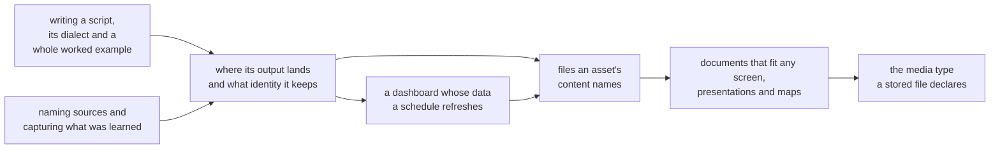

# What the platform documents about itself

These pages ship with the platform and are updated by each release on its next
start. They hold what a tool's schema cannot: the rules behind a feature, the
patterns that work, and the mistakes worth avoiding. Each page below is named
with a one-line summary; `fetch` one by its reference, or open it here.

How the topics lead into one another:

{{PAGE_INDEX}}
