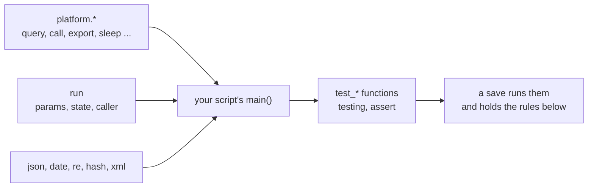

# The managed-script dialect contract

This page is the whole contract a managed script is written against: every
module and member a script has, every argument they take, and every rule a
save holds a script to. It is the same text `manage_script command=help`
returns, shipped with this release, so it always describes the platform it
is read on. How to build an automation with it -- the draft, test and save
loop -- is on mcp:knowledge_page:platform-writing-managed-scripts, and a
whole worked script is on mcp:knowledge_page:platform-reference-script.



```text
{{DIALECT_CONTRACT}}
```
