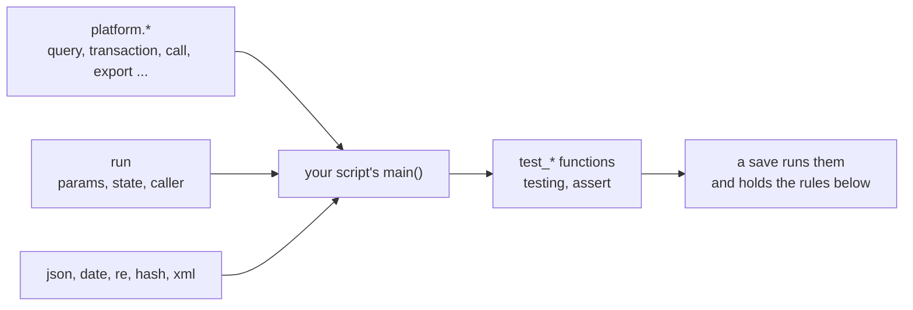

# The managed-script dialect contract

The contract a managed script is written against: every module, member and
argument, and every rule a save holds a script to. It is the text
`manage_script command=help` returns in this release. The authoring loop is on
mcp:knowledge_page:platform-writing-managed-scripts.



```text
{{DIALECT_CONTRACT}}
```
