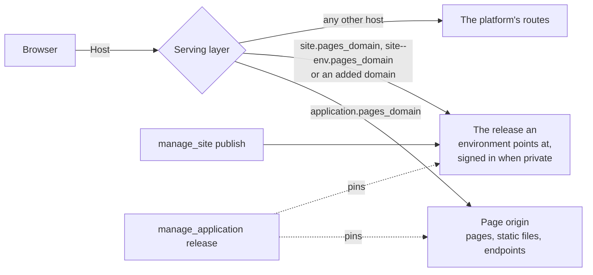

# Pages and sites the platform serves

The platform answers two kinds of browser traffic on hostnames of their own,
outside the portal: an application's **pages** and a **static site**. Neither
origin ever sees a portal session, which is what makes it safe to run a page's
script.



## A page on an application's origin

An endpoint is a page when it is bound with `response_mode: "page"`. The script
must be a part of an application, and the deployment needs `sites.pages_domain`.

```
manage_script command=handler_set kind=endpoint endpoint=shop response_mode=page
  methods=["GET"] path="/{route...}" auth_mode=public page_cdns=["https://cdn.jsdelivr.net"]
```

The application answers at `https://<application>.<pages_domain>/`:

| Path | What answers |
|---|---|
| `/` | the page endpoint named after the application |
| any other path | that endpoint too, when its path ends in a catch-all `{route...}`; otherwise 404 |
| `/endpoints/<name>/...` | any endpoint of this application |
| `/_static/<asset name>` | an asset part, at the version the release pins |
| `/_viewer` | who is signed in on this origin, as JSON |

A path template's last segment may be a catch-all, `{name...}`: it matches the
rest of the path at any depth, including none, and the handler reads it as
`req["params"]["name"]`, with no leading slash (`/products/shoe` is
`"products/shoe"`, `/` is `""`). The handler routes it and chooses each status,
so `robots.txt` can answer `text/plain` and an unknown path its own 404 page. A
segment that is empty, `.` or `..`, or holds a backslash or a control character,
matches nothing and answers 404 without the handler running, here and on the
platform's own address alike, so `route` is always a clean relative path. Only the last
segment may be a catch-all. `/endpoints/`, `/_static/`, `/_viewer` and `/_auth`
keep their meaning whatever the root endpoint catches.

A page's content policy allows its own origin and the listed CDNs. An inline
script runs only with this response's nonce, which the handler reads as
`req["csp_nonce"]`:

```python
def handle(req):
    """Answers the storefront page."""
    body = "<script nonce=" + req["csp_nonce"] + ">start()</script>"
    return {"headers": {"Content-Type": "text/html; charset=utf-8"}, "body": body}
```

A script with no nonce does not run, and the browser's console says so. Move it
to an asset and load it from `/_static/app.js`, or give it the nonce. Inline
style is allowed. Requests go to the page's own origin (`connect-src 'self'`),
so a page calls its application's endpoints at `/endpoints/<name>`.

Three more lists open the policy for a page that needs another site, such as a
payment processor's hosted card fields. Each takes https origins with no path,
at most 20, and one leading `*.` label with two labels after it
(`https://*.js.stripe.com`, never `https://*` or `https://*.com`); `page_cdns`
takes the same shapes:

| Field | Adds to | For |
|---|---|---|
| `page_frame_origins` | `frame-src` | a site the page shows in a frame (`https://js.stripe.com`) |
| `page_connect_origins` | `connect-src 'self'` | a site the page's script calls (`https://api.stripe.com`) |
| `page_form_origins` | `form-action 'self'` | a site a form posts to, or is redirected to after a post |

A page that sets none answers the policy it always did. The same endpoint on
the portal's own origin stays sandboxed and runs nothing.

### Application cookies

A handler on the application's own address reads its cookies as
`req["cookies"]` and sets them by returning `"cookies"`:

```python
def handle(req):
    """Remembers the visitor's theme."""
    chosen = req["query"].get("theme")
    theme = chosen if chosen in ("light", "dark") else req["cookies"].get("theme", "light")
    return {"json": {"theme": theme}, "cookies": [{"name": "theme", "value": theme, "max_age": 31536000}]}
```

Each is written as `__Host-app-<name>` over https (`app-<name>` over http),
`HttpOnly`, `Path=/`, `Secure` over https and with no `Domain`, so the platform's
own cookies are never among them. `same_site` is `Lax` by default or `Strict`,
never `None`. `max_age` is seconds, at most 400 days; `0` deletes the cookie and
leaving it out makes a session cookie. A name is 1 to 32 letters, digits, `_`
and `-`; a value is at most 1024 bytes with no spaces, quotes, commas,
semicolons or backslashes (encode JSON as base64); a response sets at most 10
and a request carries at most 20, the first in name order. A response that sets
a cookie is `Cache-Control: private`.

The same cookies reach the application's endpoints when a site environment
that is a part of the application calls them at `/endpoints/<name>` on the
site's own address, so a static site or a single-page application calling its
application's JSON endpoints keeps a session too (#2558).

A request other than GET or HEAD reaches the handler with no cookies unless the
browser says it came from this origin, so a form on another site cannot act
with a visitor's session. It is not refused: a payment processor's server calls
the same endpoint. On the portal's own address a handler reads and sets none.
A cookie value never reaches an audit row (the request's own, and each platform
call the handler makes with it is written with `[REDACTED:cookie]`) or a kept
failure. A value minted during a request, before it is a cookie, is written as
any argument is.

### The client's address

`req["client_ip"]` is the address the request came from, and `ip_rate_limit`
limits each address to that many requests a minute on each replica; an IPv6
client is counted by its /64. Behind a load balancer or an ingress the address
is right only when `server.trusted_proxies` names the proxy's range: the
platform reads `X-Forwarded-For` from a trusted proxy alone, so a forged header
moves nothing. `handler_set` warns when the limit is set and no proxy is
trusted. The address is not written to an audit row or a log.

### Who is viewing

An `authenticated` page sends a browser with no viewer through a one-time
sign-in at the portal, and the origin then holds a cookie of its own, scoped to
this application for 12 hours. The handler reads `req["caller"]`, the page's
script reads `/_viewer`, and calls to the application's endpoints run as that
person. API keys are not honored on a page origin. A `POST` the page's own
script makes carries the proof a browser adds by itself; one from anywhere else
is refused.

### Releases

A page, its assets and its endpoints follow the application's releases: saving
changes nothing live until `manage_application release`, and `rollback` restores
all of them together.

## A static site

**Publish makes a release; promote moves one.** `publish` turns files into a new
release and puts it in `dev`: it is the only way a release is made. `promote` makes
no new release: no files are sent and nothing is rebuilt, and the next environment
serves, unchanged, the release the environment before it serves, so what reaches
`prod` is exactly what was checked in `dev` and `stage`. `rollback` returns an
environment to a release it served before. Explain it to a person in those words.

**Agents work in dev, people use what was promoted.** `dev` is a site's working
copy: every publish, patch and in-place edit lands there and nowhere else, and
nothing people rely on is served from it. Change `dev`, let a person review it, and
`promote` the exact release to an environment people use (`stage`, `prod`). Those
environments are read-only: they move only by `promote` and `rollback`, and a
publish, overlay or patch aimed at one is refused, naming `dev` and `promote`. Never
try to change `prod` directly.

**You stop at dev; the person moves what people use.** `promote`, `rollback`, and
`add_domain` or `set_domain` with `public: true`, on any environment but `dev`,
wait on the person you work for, whatever their role. Their client asks them,
naming the release and the address to look at; when it cannot, the call answers
`APPROVAL_REQUIRED` and files a request a person decides in the portal, which you
cannot decide (`manage_approval decide` refuses it). So finish your change on
`dev`, give the person the dev address, and stop. Call again only once they
accepted or approved. An environment an administrator marked
`agents_may_promote` is the exception.

**One hostname wins.** When a site answers at both `example.com` and
`www.example.com`, make one the environment's primary (`set_domain primary:
true`) and the other a redirect (`set_domain mode: redirect`): the platform
answers it with a permanent redirect to the primary, path and query kept. Do not
build a second site holding a `_redirects` file for this. A redirect needs a
primary on its environment, and a primary others redirect to cannot be removed.

```
manage_site command=create name=marketing          # dev and prod; prod holds the main address
manage_site command=publish site=marketing files=[{"path":"index.html","content":"<h1>Hello</h1>"}]
manage_site command=promote site=marketing to=prod # from dev; waits on the person (see below)
```

**Environments are in order, and a release moves one step at a time.** `dev` is
always first and `prod` always last. An environment you add goes between them:
`set_environment site=marketing environment=stage` when there is one place, and
`after=dev` or `after=stage` when there are more, naming the environment it follows
(left out, the call is refused naming them; nothing goes after `prod`). The same
call with `after` moves an existing one.
`promote` names the target: it takes only the release the environment before it
serves, and `from`, when you give it, must be that environment. With `dev`,
`stage`, `prod`, promote to `stage` first, then to `prod`. A refusal names the
environment the release must come from.

`publish` takes `files` inline, an `archive` (a zip or gzipped tar managed
resource), or a `folder` of managed resources, which is how a script's build
output reaches a site. It always lands in `dev`. `promote` and `rollback` only move
an environment's pointer: no file is copied and the change shows at once.
`rollback` returns to a release that environment served before.

### Addresses

| Address | What answers |
|---|---|
| `https://<site>.<pages_domain>/` | The main address: one environment the owner chooses (`prod` on a new site), or none, when it answers "Nothing is published here". Private |
| `https://<site>--<env>.<pages_domain>/` | That environment. Private |
| A domain added to an environment | That environment: private, or public when set public |

Where an administrator chose a Site routing script (Admin > Settings >
Integrations), the platform hands it every one of these hostnames to route
through the deployment's ingress. `get`, `domains` and `add_domain` then carry
`routing` on each domain (`pages_routing` by environment for the pages
addresses): `pending` until the script answers, then `ready` or `failed` with
its message. A domain you add is saved at once and reads `pending`; tell the
person it routes once it reads `ready`, and pass on a `failed` message as it is.
With no script chosen there is no `routing`, and a person adds the ingress.

`set_environment ... main=true` gives an environment the main address, and
`update main_environment=""` gives it to none; both are the owner's or an
administrator's. Every environment keeps its `<site>--<env>` address. A site or
environment whose address would be longer than 63 characters is refused with the
reason, and so is a site name of two characters: `ab--prod` has `--` as its 3rd
and 4th characters, a form DNS reserves and certificate authorities refuse.

`get` answers `addresses`, where people reach each environment (its public
domain first, then its other domains, otherwise its address on the pages domain),
`production_address`, the address of the environment holding the main address,
and `pages_addresses`, each
environment's `<site>--<env>` or main address, which answers only where the
deployment's ingress routes it. Give people the address in `addresses`. A site
named with two characters before that rule has no pages address for its
environments other than the main one, and `get` says so in `address_note`: give
those environments a domain.

`list` takes `query` (a part of a site's name, description, owner or domain),
`limit` (at most 200) and `offset`, and answers the page of `sites`, `total`, how
many sites match, and `production_addresses`, each listed site's production
address by name. An endpoint's answer on a site's or an application's
address is sent compressed when the client accepts it, unless it may hold one of
the platform's tokens.

### Private and public

Access is per address. **Every address on the pages domain** (the main address and
each `<site>--<env>`) is private: it asks for the platform's sign-in and opens only
for administrators, the owner, the people who manage the site and whoever the
environment is shared with. **Only an added domain can be public**, opening for
anyone at that hostname; the site builds any sign-in it wants itself. No domain is
needed for people who sign in. A domain is added private unless `public=true` is
asked for, and `set_domain hostname=... public=true` (or `false`) changes it later.
`set_environment` with `public` is refused: public is a setting of a domain. Only
the owner or an administrator makes a domain public; where the environment
requires approval, the request waits in `manage_approval`, and the same request
after approval makes it public. Anyone who manages the site makes one private.

An environment can require approval (`requires_approval` on `add_domain` or
`set_environment`). It is then reached only by `promote`: an administrator's
promote records its own approval, and anyone else's files a request in
`manage_approval` and goes through when they promote again after it is approved.

`default`, the old name of `dev`, is read as `dev` for one minor release, and the
answer carries a `note`.

### Changing a site

Do not resend a site to change it. `manage_asset` reads and edits a site's files
in place, with the same content actions it has for an asset. The reference names
what to work on:

| Reference | What it names |
|---|---|
| `mcp:site:marketing/dev/pricing/index.html` | one file, as that environment serves it |
| `mcp:site:marketing/dev/docs/` | the files in a folder |
| `mcp:site:marketing/dev` | the whole tree |

```
manage_asset action=outline asset_id=mcp:site:marketing/dev
manage_asset action=locate  asset_id=mcp:site:marketing/dev find="From $99"
manage_asset action=patch   asset_id=mcp:site:marketing/dev/pricing/index.html
             base_version=41 change_summary="Fix the pricing headline"
             edits=[{"find":"From $99","replace":"From $89"}]
manage_site  command=promote site=marketing from=dev to=prod
```

| `manage_asset` | On a site file |
|---|---|
| `version` | the release number |
| `base_version` | the release you read; a moved one is refused and nothing is written |
| `patch` | a new release derived from the current one, with `dev` moved to it |
| `change_summary` | the release note |
| `dry_run` | reports the diff and creates no release |
| `from_version`, `to_version` | two release numbers |

`outline` on a tree or folder lists its files, with `limit` and `offset`.
`locate` on one searches every text file and reports `files_scanned` and
`files_skipped`. `diff` on one names the files changed, added and removed; on a
file it is a unified diff. `share`, `delete` and the other asset actions do not
apply: a site's sharing and lifecycle are `manage_site`'s.

Edits land only on `dev`, and `promote` moves the result to any other environment.
So a change spread over several patches reaches people in one step. Every other
environment can be read here and not changed. Patching needs manage access and a
persona that holds `manage_site`, and earlier releases need manage.

`patch` covers text. For new files, binaries, deletions or several files that must
change in one release, `publish` with `base` overlays that release, which must be
the one `dev` serves now:

```
manage_site command=publish site=marketing base=42 note="New pricing page"
  files=[{"path":"pricing/index.html","content":"..."},{"path":"old.html","delete":true}]
```

Everything you do not send carries over and is not stored again, so a change costs
what the change costs. The `_redirects` file reads and patches as the rules it
became, without any comments the original held.

### Layouts and generated pages

A site with a `_layouts/` folder is rendered when it is published, with no build
tool. A site without one is served exactly as published.

| In the source | What it is |
|---|---|
| `_layouts/<name>.html` | A Liquid layout. `{{ content }}` is what it wraps; its own front matter can name a parent `layout`. |
| `_includes/<file>` | `` shares the page's variables; `render` sees only its arguments. |
| `_data/<collection>/<file>` | One record per file: JSON, YAML, or Markdown with front matter. `slug` defaults to the file name. `site.data.<collection>` is the list. |
| Any `.html`, `.md`, `.xml`, `.json` or `.txt` with front matter | A page. Without front matter a file is copied as it is. |

Front matter keys: `layout`, `title`, `permalink`, `date`, `tags`, `categories`,
`draft` (not published), `for_each`, `per_page`, and `liquid: false` to leave a body
containing `{{` alone, such as a page using another template syntax.

```yaml
---
layout: base
for_each: products
permalink: /products/{{ item.slug }}/
---
<h1>{{ item.name }}</h1>
```

That is one page per record, with the record as `item`. `for_each: tags` or
`categories` makes one page per value, where `item` has `name`, `slug` and `pages`.
Add `per_page: 20` for paged lists: `paginator` has `items`, `page`, `per_page`,
`total_pages`, `total_items`, `previous_page` and `next_page`, and the permalink
uses `{{ paginator.page }}`. A sitemap or feed is an ordinary `.xml` or `.json` page
looping over `site.data.<collection>`, `site.pages` or `site.tags`.

The source is what you edit: `mcp:site:` references address `_layouts/`, records and
page templates, and the output follows in the same release. A patch re-renders only
what read the file you changed, and `dry_run` reports `outputs_changed` and any
template error without writing anything. Everyone who manages the site reads source;
someone with view reads what is served. Source is never served, because the site is
served from the rendered output alone.

A template error refuses the release, names every file and line that failed, and the
environment does not move. A render is a function of the source tree alone, with no
network or clock, so `{{ "now" | date }}` is refused: use a date from a page or
record. A range such as `(1..n)` works only in a `for` tag. Its bounds, and a loop's
`limit`, `offset` and `cols`, are whole numbers: a literal, a `size`, integer arithmetic
(`plus`, `minus`, `times`, `divided_by`, `modulo`) or a whole number in a record. A float
such as `6 | divided_by: 2.0` is refused as a bound; `| floor` makes it one. Each render
has limits on loop iterations, include depth and bytes; going past one fails that page.

### TypeScript, TSX and JSX

A site written in TypeScript or JSX keeps its source in the site: a `_build.json` at
the release root compiles it when it is published, with no Node, npm or build tool.
A release without `_build.json` is published exactly as before.

```json
{
  "entries": ["app.tsx", "admin/admin.tsx"],
  "imports": {
    "react": "https://esm.sh/react@18.3.1",
    "react-dom/client": "https://esm.sh/react-dom@18.3.1/client?deps=react@18.3.1",
    "react-router-dom": "https://esm.sh/react-router-dom@6.28.0?deps=react@18.3.1,react-dom@18.3.1",
    "@/": "/src/"
  },
  "define": { "import.meta.env.DEV": false, "import.meta.env.VITE_API_BASE_URL": "/api" },
  "remote": "external",
  "sourcemap": "private"
}
```

| Key | What it does |
|---|---|
| `entries` | The files compiled. Each, with the local modules it imports, becomes an ES module at the same path ending `.js`: `app.tsx` is served as `/app.js`, so the page loads `<script type="module" src="/app.js">`. A CSS file an entry imports becomes `app.css` beside it (name the imported stylesheet something else, such as `styles.css`, or it collides with that output); its `url()` references are left as written. |
| `imports` | Where each library comes from: a package name, or a prefix ending `/`, mapped to an `https` URL at an exact version (`@18.3.1`; `@18` or `@^18` is refused). A path inside a mapped package follows its URL: with `react` mapped, `react/jsx-runtime` is `https://esm.sh/react@18.3.1/jsx-runtime`. A prefix may instead map to a folder of the site, written from its root: `"@/": "/src/"` makes `@/components/Button` the local file `/src/components/Button.tsx`, as `tsconfig` paths do. `"@/": "/../"` and `"@/": "src/"` are refused. An import of a name not mapped refuses the publish, naming it. There is no npm install and no `node_modules`. |
| `imports_from` | `"package.json"` generates the imports map at every publish from `package.json` and the lockfile (`package-lock.json`, `pnpm-lock.yaml` or `yarn.lock`), as `manage_site imports` proposes it; an entry you write in `imports` wins, and a library written there publishes though the lockfile does not lock it. |
| `define` | Replaces `import.meta.env.X` or `process.env.X` with a JSON value (a string, number, `true`, `false` or `null`). A read of an `import.meta.env.X` that `define` does not set refuses the publish, naming the file, line and key, rather than compiling into a page that throws. The values are the same in every environment: a release is promoted unchanged, so a value that differs per environment comes from an application endpoint read when the page starts. |
| `remote` | `external` (the default) leaves URL imports as URLs, which the browser loads from the CDN; the compile reads nothing from the network. `bundle` fetches them at publish and bundles them into the output, so the site loads nothing from a CDN. |
| `splitting` | `true` (the default) puts what an entry loads by `import()` (`React.lazy(() => import("./pages/Reports"))`) in chunks of its own under `/_chunks/`, named by a hash of their content, loaded when first used. An entry with no dynamic import is one file, as before. `false` compiles each entry into one file. |
| `sourcemap` | `true` writes `app.js.map` beside each output, holding the source text, served to anyone. `"private"` writes the same maps and serves them only to the people who manage the site, on the environment's own address while signed in there (`/_signin`); anyone else gets 404. `false` writes none. |
| `minify` | `true` shortens the output. |
| `tailwind` | An exact Tailwind CSS 4 version (`"4.1.13"`): the stylesheet holding `@import "tailwindcss"` is compiled by Tailwind at publish, in the platform, and its output takes its place. `tailwind_input` names that stylesheet when it is not an entry's own. Configure in CSS with `@theme`, `@custom-variant` and `@utility`; `@plugin` and `@config` refuse the publish, since no code from the site runs. |
| `budgets` | `{"app.tsx": {"js_gzip": "300KB"}}`: a publish whose entry is larger than its budget (`js`, `js_gzip`, `css`, `css_gzip`, a size such as `"300KB"` at 1024 bytes to the KB, or a number of bytes) warns in its result; it is not refused. `js` and `js_gzip` measure what loads at start: the entry's script and the chunks it imports statically. |
| `singletons` | Packages only one copy of which may load, beside `react` and `react-dom`. |
| `exclude` | Globs of files kept as source and never served: `["e2e/**", "docs/**"]`. |
| `typecheck` | `{"tsconfig": "tsconfig.json"}` type-checks each release after it publishes, with that project file (a `.json` path in the site; `tsconfig.json` when left out). See Type checks below. |

Local imports start `./`, `../` or `/` and resolve inside the site, trying the path,
then `.tsx`, `.ts`, `.jsx`, `.js`, `.mjs`, `.json` and `.css`, then the folder's `index`
file. A `.js` file may hold JSX. An import that leaves the site is refused. Source is
never served: the `.ts`, `.tsx`, `.jsx` files, `_build.json`, a project's package and
tooling files at the root (`package.json`, the lockfiles, `tsconfig*.json`,
`*.config.{js,ts,mjs,cjs,mts,cts}`, `.nvmrc`, `.eslintrc*`, `.prettierrc*`) and what
`exclude` names. They read and patch through `manage_asset` like any source file.
`.npmrc` is refused at publish: it often holds a registry token. A file in the release
at an output's path (an `app.js` beside `app.tsx`, or anything under `_chunks/`)
refuses the publish, naming both, including when a publish with `base` adds the file
and the entry itself is unchanged.

One copy of React across CDN libraries: on esm.sh every library that uses React is
built against its own copy unless its URL pins the same versions with `?deps=`, and two
copies make hooks fail when the page runs ("Invalid hook call"). Give each library that
uses React `?deps=react@18.3.1,react-dom@18.3.1`, and `react-dom/client`
`?deps=react@18.3.1`. A URL with a query does not pass its path on to subpaths, so
`react-dom/client` and `@hookform/resolvers/zod` need keys of their own. A publish in
`external` mode refuses a map that would load two copies: two URLs naming React at
different versions, a `deps` pin of another version, or an esm.sh URL for a package that
peers on React without pinning it (peers read from the lockfile, else from the npm
registry), naming the URL and the package. `manage_site imports` writes such a map for
you.

A library stylesheet a component imports (`import "some-editor/style.css"`), mapped to a
URL in `external` mode, becomes an `@import` of that URL at the top of the entry's
stylesheet, since a browser refuses a stylesheet loaded as a module. The page links the
entry's `.css` output (`app.css`), which is written when the entry had no stylesheet of
its own. In `bundle` mode the fetched stylesheet is bundled into it.

The compile defines `import.meta.site` as `{ release, published_at, site }`: the
release's number, when it was published, and the site's name. It describes the release,
not the environment, so a release promoted elsewhere serves the same bytes. Show it as a
build number: `` `${config.version}+r${import.meta.site.release}` ``.

Chunks are served with `Cache-Control: public, max-age=31536000, immutable`; an entry
is revalidated, which is how a page picks up the chunk names of a new release. A page
still running release N after N+1 is published can load a chunk N has and N+1 does not:
it is served from one of the five releases before the current one, while they are kept.
After that, a lazy route can fail with "Failed to fetch dynamically imported module";
the usual remedy is to reload the page when a dynamic import fails.

A publish, a patch and a dry run report what each entry compiled to, in `builds`: each
output with its bytes and gzip bytes and, against the release before, its change
(`app.js 412 KB → 498 KB (+86 KB)`; a chunk is compared by its name without the hash),
and what loads when the page starts, the entry's script and the chunks it imports
statically: its size (`start_bytes`, `start_gzip_bytes`), the URLs it imports
(`start_imports`) and the inputs contributing most bytes to it (`largest_inputs`); a
chunk reached only through `import()` is left out of these, and `largest_inputs_lazy`
names what makes those chunks big. It also lists any budget the start exceeds. `manage_site build_report` reads a release's report later, and
`manage_site symbolicate` with `stack` maps a stack trace from the minified output to
original files, lines and columns through the release's maps.

A compile error refuses the release, naming every file, line and column, and the
environment does not move. A patch compiles again only the entries that read the file
you changed (an entry that reads `import.meta.site` compiles at every publish), and
`dry_run` reports `outputs_changed`, `builds` and any compile error without writing a
release; before an environment's first release it reports `release: null`. The render limits cover the compile: the modules and bytes one entry may read,
the bytes it may write, and the time; a Tailwind run has limits on time, candidates and
output of its own, and a refusal names the one it hit.

Types are removed at publish, not verified, so a type error publishes. A site that
sets `typecheck` in `_build.json` has each release type-checked after it publishes,
by TypeScript 7 in the platform:

- It is a check, not a gate. The release publishes and the environment moves
  whatever the check finds. `manage_site publish` reports the queued check as
  `typecheck: {id, status}`; checks run one at a time, so a result can take minutes on a busy
  deployment.
- Dependency types come from the lockfile in the site (`package-lock.json`,
  `pnpm-lock.yaml` or a Yarn 1 `yarn.lock`): each package at its locked version,
  verified against the lockfile's SHA-256 or stronger integrity hash (a package
  locked with a SHA-1 hash alone is listed as `unverifiable` and not read), with only its `package.json` and
  declaration (`.d.ts`, `.d.mts`, `.d.cts`) files read. No install script runs. A Yarn 2+ lockfile cannot be verified
  and fails the check; use one of the others. A package the code imports that the
  lockfile does not lock is listed as `missing`; add it to `package.json` and the
  lockfile.
- `manage_site build_report` shows the release's newest check under `typecheck`:
  `clean`, `errors` with each error's file, line, column, code and message,
  `over_limit` (the compiler needed more memory than the deployment allows),
  `unsupported` or `failed` with the reason (a compiler that crashed is reported with
  its own panic message). `queued` or `running` means it has not finished; read it
  again later. A tsconfig's `include` may name files, directories or globs.
- `unsupported` is a tsconfig that is not in the release at the path `_build.json`
  names, or one that sets `compilerOptions.baseUrl`, which TypeScript 7 no longer
  reads: replace it with `paths` entries that start with `./`.
- `manage_site typecheck site=<site>` runs the check again (`release` defaults to the
  one `environment` serves, `dev` unless named). Fix the errors in the source, publish
  again, and read the new release's report.

PostCSS, Sass, Vue and Svelte single-file components need a JavaScript
toolchain and are not compiled; write the CSS, or import CSS files from an entry.

### A site's guide

`AGENTS.md` at a site's root is the site's guide for whoever works on it next: how it
is built, where its settings live, which libraries are pinned and why, what not to
touch. It is never served, whatever else the site holds, and it is versioned with the
release. `manage_site get` returns it, and the first `manage_asset` read or patch, or
`manage_site publish`, on a site in a session carries it in the result as
`site_guide`. Read it before you change the site, and keep it current when you change
how the site is built, what it loads or where its settings live.

### Who has access

`grant` names **who** and **which environments**:

```
manage_site command=grant site=intranet persona=management-team environments=["prod"]
manage_site command=grant site=cool-site email=client@example.com level=view environments=["stage"]
manage_site command=grant site=cool-site email=dev@example.com level=manage
manage_site command=revoke site=intranet persona=management-team
```

`view` opens the private environments it names (none named is every private
environment) and changes nothing, so a client
on an external persona can have it, and anyone who manages the site can give it. A
**persona** is always given view and is matched on every request against the
viewer's persona, so moving someone out of it applies on their next request.
`manage` is for a person, site-wide: it publishes and edits `dev`, promotes, rolls
back, adds domains and shares; it is for internal people, and only the owner or an
administrator adds it. `set_environment ... internal_view=true` opens one private
environment to everyone internal, for an intranet.

A person finds the environments a grant opens for them on the portal's Home,
under **Sites shared with you**, each with its address and an Open link, an
external person included: the Sites area is for people who publish and manage
sites and stays closed to an external persona. Nothing else of the site is
listed there, not its other environments and not who else it is shared with
(`GET /api/v1/portal/shared-sites`, #2718).

### Inside a private environment

The platform decides who may open an environment; anything finer is the site's.
A private environment answers `/_viewer` with the signed-in person (`email`,
`user_id`, `persona`, `name`), so the site's script knows who is there; at a public
domain it answers 401, nobody signed in. When the environment is a part of an
application (`manage_application add_part kind=site part_id="<site>/<environment>"`),
its hosts also serve that application's endpoints at `/endpoints/<name>/...`, run
as the signed-in person (`req["caller"]`) in the application environment of the
environment's name, so the site enforces its own rules on the server. Only requests the browser marks as coming from the site's own origin
carry the viewer.

An environment's tile in the portal is drawn as the site's owner sees it
(#2747): `/_viewer` names the owner and the page's GET and HEAD requests to
`/endpoints/` run as them, with `req["caller"]["auth_type"]` set to
`site_tile` and the run's audit row marked `tile_draw`. Any other method answers
405 while a tile is drawn, so keep a GET handler free of writes. An owner the
directory no longer holds draws the page for nobody (`/_viewer` and the
endpoints answer 401). A file the page loads is answered to the tile up to
16 MiB (#2721): a larger image is answered 413 and the tile is drawn without
it, a video gets its first 16 MiB as a range, and an `index.html` larger than
that cannot be drawn, so keep a first screen's images under the bound.

### Two shapes

An intranet: `dev` for its developers, `prod` on the main address for a persona.
Everyone signs in; no domain is needed.

```
manage_site command=create name=intranet
manage_site command=set_environment site=intranet environment=prod requires_approval=true
manage_site command=grant site=intranet persona=management-team environments=["prod"]
manage_site command=publish site=intranet files=[...]
manage_site command=promote site=intranet to=prod
```

A client site: `stage` for the client, `prod` public on the client's domain after
approval.

```
manage_site command=grant site=cool-site persona=web-team environments=["dev"]
manage_site command=set_environment site=cool-site environment=stage
manage_site command=set_environment site=cool-site environment=prod requires_approval=true
manage_site command=grant site=cool-site email=client@example.com level=view environments=["stage"]
manage_site command=add_domain site=cool-site hostname=cool-site.example.com environment=prod public=true
manage_site command=promote site=cool-site to=stage
manage_site command=promote site=cool-site to=prod
```

### What a release holds

| File | Meaning |
|---|---|
| `_redirects` | The redirect map, not served: `from to [status]`, with `/old/*` and `:splat`. Status 200 is a rewrite: the path is answered in place, with status 200, by the file of this site the target names, which is how a single-page application answers its routes (`/* /index.html 200`); a file the release holds still answers itself, and a rewrite to a file the release lacks is the 404 page |
| `_headers` | The headers each path is served with, not served: a path line (`/*`), then indented `Name: value` lines. Only `Content-Security-Policy`, `Content-Security-Policy-Report-Only`, `Permissions-Policy`, `Cross-Origin-Opener-Policy`, `Cross-Origin-Embedder-Policy`, `Cross-Origin-Resource-Policy` and `X-Frame-Options`; anything else refuses the publish naming the line. A release declaring no framing rule is served with `frame-ancestors 'self'` |
| `_build.json` | Compiles the release's TypeScript, TSX and JSX at publish, not served; see TypeScript, TSX and JSX above |
| `AGENTS.md` | The site's guide, never served; see A site's guide above |
| `_layouts/`, `_includes/`, `_data/` | The render's templates and records, never served, whether or not the site uses Liquid |
| `404.html` | Served with status 404 for a path nothing answers |
| `index.html` in a folder | The folder's address |
| `name.html` | Also answers at `/name` |

A file whose name carries a content hash (`site.3f2a9c1b.css`), and every file under
`/_chunks/`, is served as immutable. Dotted paths other than `.well-known` are refused, so a source tree's
`.env` or `.git` cannot become a public address. Text files are compressed with
gzip and brotli when published.

### Releases kept

Each environment keeps its last `keep_releases` distinct releases: the deployment's
default (50 unless an administrator changed it in Admin > Settings > Sites), or its
own, set with `set_environment keep_releases=N` (`0` keeps every release,
`"default"` returns to the default). Only the owner or an administrator changes it,
since lowering it removes rollback history. A daily cleanup removes every release no
environment keeps, and the files only those releases held; a release an application
release pins, or one a pending approval names, always stays. A removed release keeps
its record, marked `pruned`, and can no longer be served, compared, promoted or
rolled back to. `get` shows each environment's `keep_releases` and how many
releases it keeps now (`releases_kept`). A publish and the cleanup never work on one
site's stored files at once: the cleanup leaves a site alone while a publish writes
to it, and a publish that starts while the cleanup is deleting waits up to a minute,
then is refused, asking you to publish again in a few minutes. Nothing was published;
send the same publish again.

### Media folders

Images, video and downloads that do not change with the pages belong in a
managed-resource folder mounted at a URL prefix, not in releases:

```
manage_site command=update site=marketing
  media=[{"prefix":"/media/","scope":"global","folder":"sites/marketing/media"}]
```

`media` is every mount, replacing the list (`[]` removes them all). A mounted file
answers on every environment after the release's own files, so a release file at the
same path wins, and it is public at a public domain: mounting publishes the
folder, so it needs manage access to the site and read access to the folder. Publish,
promote and rollback leave media alone, it counts toward no release limit, and a file
replaced with `manage_resource replace_content` shows at once, and a file moved out
of the folder stops answering at its old address. HTML, SVG, JavaScript and XML in a
mount are sent as downloads. A file in a mounted folder cannot be
deleted unless forced.

### Offline, redirect, rename, remove, traffic

An environment other than `dev` can be taken offline or redirected for a while
without a release, and brought back; the release it points at is untouched.

```
manage_site command=set_environment site=marketing environment=prod status=offline
            message="Back at 2pm" back_at=2026-11-14T14:00:00Z    # every address answers 503
manage_site command=set_environment site=marketing environment=prod status=redirect
            redirect_to=https://status.example.com keep_path=true # every address answers 302
manage_site command=set_environment site=marketing environment=prod status=online
```

A redirect target is an `https://` address on another site. On an environment that
requires approval, a redirect by someone who is not an administrator waits in
Approvals. `rename_to` renames an environment between `dev` and `prod` (every
reference moves, its tile included; `mcp:site:<site>/<old>` references stop
resolving), and `remove_environment` removes one with no domain, no main
address, no application part and no job running, and deletes its tile. `get` answers `traffic`: the last 24 hours of requests
and latency (p50, p95, p99) for the site and per environment, which answers "is
the site slow" without Prometheus.

### Domains

`add_domain` maps a hostname to an environment, creating the environment when it
does not exist (placed with `after`; `requires_approval` sent with it applies to
an environment that already exists too), or an administrator's
`application` maps it to an application's endpoints and pages. The domain is
private unless the owner or an administrator asks for `public=true`: a private one
signs people in on that domain and sends them back to it. It routes as soon as it
is added. The platform does not check DNS, certificates or who owns the name; a
system administrator adds the ingress, and whoever owns the domain points its DNS
at the deployment. `dev` cannot have a domain: it is the working copy.

### Moving a site here

When you hold a site's source, bring it in from the source instead, following
`mcp:knowledge_page:platform-sites-from-source`: its templates, records and media
stay maintainable, and nothing large passes through a tool call. `crawl` is for a
site whose source you do not have.

`crawl` copies a site into a release in `dev`: each page keeps its address, an address
that redirected becomes a redirect rule, and the sitemap and robots file come
along. So do the files each page loads: stylesheets and scripts (one linked as
`/site.css?ver=1.2` is copied as `site.css`, and the page keeps its link), every
`srcset` candidate and lazy-loaded image (`data-src`, `data-srcset`,
`data-lazy-src`), and the fonts, images and imports a stylesheet, a `<style>`
element or a `style` attribute names. A link to a page with a query string, such
as `/search?q=1`, is not followed. `form_map` names, for a page path, the platform form that replaces that
page's `<form>` elements.

```
manage_site command=crawl site=marketing url=https://www.example.com/
  form_map={"/contact":"contact-form"}
```

A URL holding a user name or password is refused, and a release records only the
address it was copied from, without a query string.

A public or bot-checked endpoint answers the sites its application holds without
listing them in `allowed_origins`, and a public form may be framed by them.

### In an application

`manage_application add_part kind=site part_id="<site>/<environment>"` makes one
environment a part, which serves the application's `/endpoints/` with its
cookies and viewer on the site's own address. The endpoints run in the
application environment of the site environment's name (#2709): `shop-web/dev`
calls the application's `dev`, with dev's release, variables and schema, and
`shop-web/prod` calls `prod`. A site environment whose name the application
has no environment of is refused as a part, naming the environment to add; one
renamed out of a match answers `/endpoints/...` with 404 and a body naming the
environment the application lacks, never another environment's endpoints. An
application environment a site part calls cannot be removed until the part is.
A part is linked (the default: moved only by `promote` and `rollback` here, or
by a release naming it in `move_sites`) or coupled (`release_mode=coupled`: it
moves when a release reaches the environment it calls, to what the site
environment before it serves, `dev` at the site's newest release, and that
environment's rollback returns it). A release into the application's first
environment moves the coupled part calling it; a promote into prod moves the
one calling prod, to the site release the source ran with that release.

An `_application` file at a release's root declares the application it is a
front end of and the contract versions it works with,
`{"application": "store", "contract": ">=2 <4"}`. It is kept on the release, not
served, and reads back through `manage_asset` like `_redirects`. A promote into an
environment that is a part of that application is refused when the range
excludes the application's contract.

The rest of building an application is in mcp:knowledge_page:platform-applications,
and every built-in page is listed in mcp:knowledge_page:platform-index.
