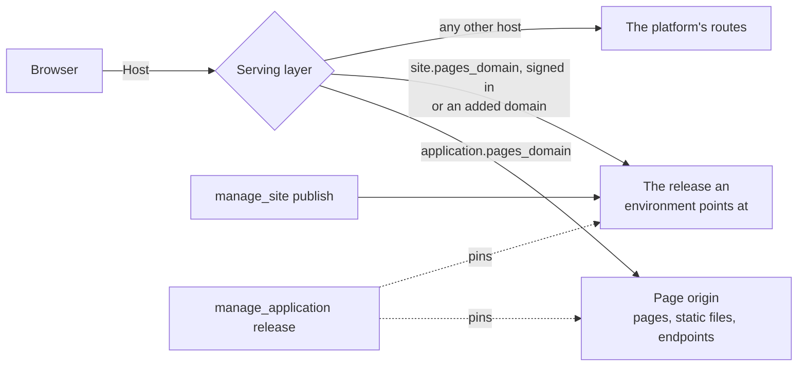

# Pages and sites the platform serves

The platform answers two kinds of browser traffic on hostnames of their own,
outside the portal: an application's **pages** and a **static site**. Neither
origin ever sees a portal session, which is what makes it safe to run a page's
script.



## A page on an application's origin

An endpoint is a page when it is bound with `response_mode: "page"`. The script
must be a part of an application, and the deployment needs `sites.pages_domain`.

```
manage_script command=endpoint_set endpoint=shop response_mode=page
  methods=["GET"] path="/" auth_mode=public page_cdns=["https://cdn.jsdelivr.net"]
```

The application answers at `https://<application>.<pages_domain>/`:

| Path | What answers |
|---|---|
| `/` and paths under it | the page endpoint named after the application |
| `/endpoints/<name>/...` | any endpoint of this application |
| `/_static/<asset name>` | an asset part, at the version the release pins |
| `/_viewer` | who is signed in on this origin, as JSON |

A page's content policy allows its own origin and the listed CDNs. An inline
script runs only with this response's nonce, which the handler reads as
`req["csp_nonce"]`:

```python
def handle(req):
    """Answers the storefront page."""
    body = "<script nonce=" + req["csp_nonce"] + ">start()</script>"
    return {"headers": {"Content-Type": "text/html; charset=utf-8"}, "body": body}
```

A script with no nonce does not run, and the browser's console says so. Move it
to an asset and load it from `/_static/app.js`, or give it the nonce. Inline
style is allowed. Requests go only to the page's own origin (`connect-src
'self'`), so a page calls its application's endpoints at `/endpoints/<name>`.

The same endpoint on the portal's own origin stays sandboxed and runs nothing.

### Who is viewing

An `authenticated` page sends a browser with no viewer through a one-time
sign-in at the portal, and the origin then holds a cookie of its own, scoped to
this application for 12 hours. The handler reads `req["caller"]`, the page's
script reads `/_viewer`, and calls to the application's endpoints run as that
person. API keys are not honored on a page origin. A `POST` the page's own
script makes carries the proof a browser adds by itself; one from anywhere else
is refused.

### Releases

A page, its assets and its endpoints follow the application's releases: saving
changes nothing live until `manage_application release`, and `rollback` restores
all of them together.

## A static site

`manage_site` makes a site with one environment, `default`, pointing at one
immutable release. A person does the same from the portal's Sites section.

```
manage_site command=create name=marketing
manage_site command=publish site=marketing files=[{"path":"index.html","content":"<h1>Hello</h1>"}]
manage_site command=add_domain site=marketing hostname=dev.example.com environment=dev
manage_site command=promote site=marketing from=default to=dev
```

`publish` takes `files` inline, an `archive` (a zip or gzipped tar managed
resource), or a `folder` of managed resources, which is how a script's build
output reaches a site. With no `environment` it lands in `default`. `promote` and
`rollback` only move an environment's pointer: no file is copied and the change
shows at once. `rollback` returns to a release that environment served before.

The site's own address, `https://<site>.<pages_domain>/`, serves `default` to
people who sign in and have access. Every other environment is created by adding
a domain to it, and answers there to anyone: who may use a domain is the site's
own business.

An environment can require approval (`requires_approval` on `add_domain` or
`set_environment`). It is then reached only by `promote`: an administrator's
promote records its own approval, and anyone else's files a request in
`manage_approval` and goes through when they promote again after it is approved.

### Changing a site

Do not resend a site to change it. `manage_asset` reads and edits a site's files
in place, with the same content actions it has for an asset. The reference names
what to work on:

| Reference | What it names |
|---|---|
| `mcp:site:marketing/default/pricing/index.html` | one file, as that environment serves it |
| `mcp:site:marketing/default/docs/` | the files in a folder |
| `mcp:site:marketing/default` | the whole tree |

```
manage_asset action=outline asset_id=mcp:site:marketing/default
manage_asset action=locate  asset_id=mcp:site:marketing/default find="From $99"
manage_asset action=patch   asset_id=mcp:site:marketing/default/pricing/index.html
             base_version=41 change_summary="Fix the pricing headline"
             edits=[{"find":"From $99","replace":"From $89"}]
manage_site  command=promote site=marketing from=default to=dev
```

| `manage_asset` | On a site file |
|---|---|
| `version` | the release number |
| `base_version` | the release you read; a moved one is refused and nothing is written |
| `patch` | a new release derived from the current one, with `default` moved to it |
| `change_summary` | the release note |
| `dry_run` | reports the diff and creates no release |
| `from_version`, `to_version` | two release numbers |

`outline` on a tree or folder lists its files, with `limit` and `offset`.
`locate` on one searches every text file and reports `files_scanned` and
`files_skipped`. `diff` on one names the files changed, added and removed; on a
file it is a unified diff. `share`, `delete` and the other asset actions do not
apply: a site's sharing and lifecycle are `manage_site`'s.

Edits land only on `default`, which is behind sign-in, and `promote` moves the
result to any other environment. So a change spread over several patches reaches
the public in one step. Every other environment can be read here and not changed.
Patching needs manage access and a persona that holds `manage_site`; reading needs
the access that opens the site's own address, and earlier releases need manage.

`patch` covers text. For new files, binaries, deletions or several files that must
change in one release, `publish` with `base` overlays that release, which must be
the one `default` serves now:

```
manage_site command=publish site=marketing base=42 note="New pricing page"
  files=[{"path":"pricing/index.html","content":"..."},{"path":"old.html","delete":true}]
```

Everything you do not send carries over and is not stored again, so a change costs
what the change costs. The `_redirects` file reads and patches as the rules it
became, without any comments the original held.

### Who has access

`grant` and `revoke` take `email` and `level`. `manage` publishes, promotes, rolls
back, adds domains and shares view access; it is for internal people, and only the
owner or an administrator adds it. `view` opens the site's own address and reads
the files it serves now, and changes nothing, so a client on an external persona can have it, and anyone who
manages the site can give it. `update internal_view=true` opens the address to
everyone internal, for an intranet.

### What a release holds

| File | Meaning |
|---|---|
| `_redirects` | The redirect map, not served: `from to [status]`, with `/old/*` and `:splat` |
| `404.html` | Served with status 404 for a path nothing answers |
| `index.html` in a folder | The folder's address |
| `name.html` | Also answers at `/name` |

A file whose name carries a content hash (`site.3f2a9c1b.css`) is served as
immutable. Dotted paths other than `.well-known` are refused, so a source tree's
`.env` or `.git` cannot become a public address. Text files are compressed with
gzip and brotli when published.

### Domains

`add_domain` maps a hostname to an environment, creating the environment when it
does not exist, or an administrator's `application` maps it to an application's
endpoints and pages. It routes as soon as it is added. The platform does not check
DNS, certificates or who owns the name; a system administrator adds the ingress,
and whoever owns the domain points its DNS at the deployment. `default` cannot have
a domain, since a domain is public.

### Moving a site here

`crawl` copies a site into a release: each page keeps its address, an address
that redirected becomes a redirect rule, and the sitemap and robots file come
along. `form_map` names, for a page path, the platform form that replaces that
page's `<form>` elements.

```
manage_site command=crawl site=marketing url=https://www.example.com/
  form_map={"/contact":"contact-form"}
```

A URL holding a user name or password is refused, and a release records only the
address it was copied from, without a query string.

A public or bot-checked endpoint answers the sites its application holds without
listing them in `allowed_origins`, and a public form may be framed by them.

### In an application

`manage_application add_part kind=site part_id="<site>/<environment>"` makes one
environment a part: a release pins the site's newest release and points that
environment at it, and a rollback restores it.

The rest of building an application is in mcp:knowledge_page:platform-applications,
and every built-in page is listed in mcp:knowledge_page:platform-index.
