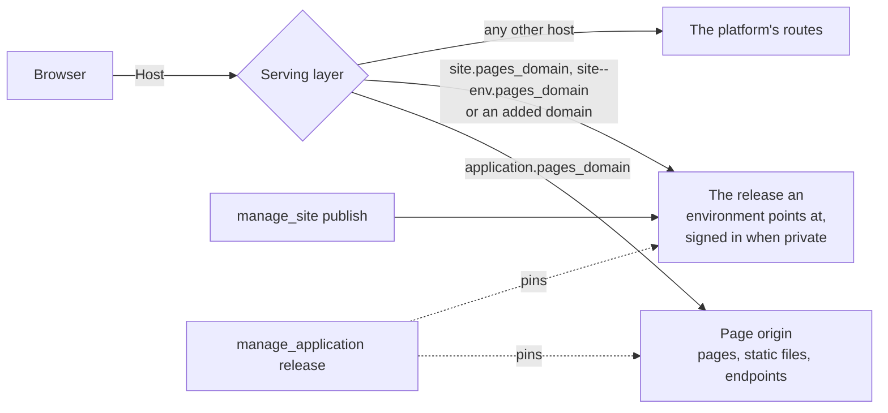

# Pages and sites the platform serves

The platform answers two kinds of browser traffic on hostnames of their own,
outside the portal: an application's **pages** and a **static site**. Neither
origin ever sees a portal session, which is what makes it safe to run a page's
script.



## A page on an application's origin

An endpoint is a page when it is bound with `response_mode: "page"`. The script
must be a part of an application, and the deployment needs `sites.pages_domain`.

```
manage_script command=handler_set kind=endpoint endpoint=shop response_mode=page
  methods=["GET"] path="/{route...}" auth_mode=public page_cdns=["https://cdn.jsdelivr.net"]
```

The application answers at `https://<application>.<pages_domain>/`:

| Path | What answers |
|---|---|
| `/` | the page endpoint named after the application |
| any other path | that endpoint too, when its path ends in a catch-all `{route...}`; otherwise 404 |
| `/endpoints/<name>/...` | any endpoint of this application |
| `/_static/<asset name>` | an asset part, at the version the release pins |
| `/_viewer` | who is signed in on this origin, as JSON |

A path template's last segment may be a catch-all, `{name...}`: it matches the
rest of the path at any depth, including none, and the handler reads it as
`req["params"]["name"]`, with no leading slash (`/products/shoe` is
`"products/shoe"`, `/` is `""`). The handler routes it and chooses each status,
so `robots.txt` can answer `text/plain` and an unknown path its own 404 page. A
segment that is empty, `.` or `..`, or holds a backslash or a control character,
matches nothing and answers 404 without the handler running, here and on the
platform's own address alike, so `route` is always a clean relative path. Only the last
segment may be a catch-all. `/endpoints/`, `/_static/`, `/_viewer` and `/_auth`
keep their meaning whatever the root endpoint catches.

A page's content policy allows its own origin and the listed CDNs. An inline
script runs only with this response's nonce, which the handler reads as
`req["csp_nonce"]`:

```python
def handle(req):
    """Answers the storefront page."""
    body = "<script nonce=" + req["csp_nonce"] + ">start()</script>"
    return {"headers": {"Content-Type": "text/html; charset=utf-8"}, "body": body}
```

A script with no nonce does not run, and the browser's console says so. Move it
to an asset and load it from `/_static/app.js`, or give it the nonce. Inline
style is allowed. Requests go to the page's own origin (`connect-src 'self'`),
so a page calls its application's endpoints at `/endpoints/<name>`.

Three more lists open the policy for a page that needs another site, such as a
payment processor's hosted card fields. Each takes https origins with no path,
at most 20, and one leading `*.` label with two labels after it
(`https://*.js.stripe.com`, never `https://*` or `https://*.com`); `page_cdns`
takes the same shapes:

| Field | Adds to | For |
|---|---|---|
| `page_frame_origins` | `frame-src` | a site the page shows in a frame (`https://js.stripe.com`) |
| `page_connect_origins` | `connect-src 'self'` | a site the page's script calls (`https://api.stripe.com`) |
| `page_form_origins` | `form-action 'self'` | a site a form posts to, or is redirected to after a post |

A page that sets none answers the policy it always did. The same endpoint on
the portal's own origin stays sandboxed and runs nothing.

### Application cookies

A handler on the application's own address reads its cookies as
`req["cookies"]` and sets them by returning `"cookies"`:

```python
def handle(req):
    """Remembers the visitor's theme."""
    chosen = req["query"].get("theme")
    theme = chosen if chosen in ("light", "dark") else req["cookies"].get("theme", "light")
    return {"json": {"theme": theme}, "cookies": [{"name": "theme", "value": theme, "max_age": 31536000}]}
```

Each is written as `__Host-app-<name>` over https (`app-<name>` over http),
`HttpOnly`, `Path=/`, `Secure` over https and with no `Domain`, so the platform's
own cookies are never among them. `same_site` is `Lax` by default or `Strict`,
never `None`. `max_age` is seconds, at most 400 days; `0` deletes the cookie and
leaving it out makes a session cookie. A name is 1 to 32 letters, digits, `_`
and `-`; a value is at most 1024 bytes with no spaces, quotes, commas,
semicolons or backslashes (encode JSON as base64); a response sets at most 10
and a request carries at most 20, the first in name order. A response that sets
a cookie is `Cache-Control: private`.

The same cookies reach the application's endpoints when a site environment
that is a part of the application calls them at `/endpoints/<name>` on the
site's own address, so a static site or a single-page application calling its
application's JSON endpoints keeps a session too (#2558).

A request other than GET or HEAD reaches the handler with no cookies unless the
browser says it came from this origin, so a form on another site cannot act
with a visitor's session. It is not refused: a payment processor's server calls
the same endpoint. On the portal's own address a handler reads and sets none.
A cookie value never reaches an audit row (the request's own, and each platform
call the handler makes with it is written with `[REDACTED:cookie]`) or a kept
failure. A value minted during a request, before it is a cookie, is written as
any argument is.

### The client's address

`req["client_ip"]` is the address the request came from, and `ip_rate_limit`
limits each address to that many requests a minute on each replica; an IPv6
client is counted by its /64. Behind a load balancer or an ingress the address
is right only when `server.trusted_proxies` names the proxy's range: the
platform reads `X-Forwarded-For` from a trusted proxy alone, so a forged header
moves nothing. `handler_set` warns when the limit is set and no proxy is
trusted. The address is not written to an audit row or a log.

### Who is viewing

An `authenticated` page sends a browser with no viewer through a one-time
sign-in at the portal, and the origin then holds a cookie of its own, scoped to
this application for 12 hours. The handler reads `req["caller"]`, the page's
script reads `/_viewer`, and calls to the application's endpoints run as that
person. API keys are not honored on a page origin. A `POST` the page's own
script makes carries the proof a browser adds by itself; one from anywhere else
is refused.

### Releases

A page, its assets and its endpoints follow the application's releases: saving
changes nothing live until `manage_application release`, and `rollback` restores
all of them together.

## A static site

**Agents work in dev, people use what was promoted.** `dev` is a site's working
copy: every publish, patch and in-place edit lands there and nowhere else, and
nothing people rely on is served from it. Change `dev`, let a person review it, and
`promote` the exact release to an environment people use (`stage`, `prod`). Those
environments are read-only: they move only by `promote` and `rollback`, and a
publish, overlay or patch aimed at one is refused, naming `dev` and `promote`. Never
try to change `prod` directly.

```
manage_site command=create name=marketing          # dev and prod; prod holds the main address
manage_site command=publish site=marketing files=[{"path":"index.html","content":"<h1>Hello</h1>"}]
manage_site command=promote site=marketing to=prod # from dev, the environment before it
```

**Environments are in order, and a release moves one step at a time.** `dev` is
always first and `prod` always last. An environment you add goes between them:
`set_environment site=marketing environment=stage` when there is one place, and
`after=dev` or `after=stage` when there are more, naming the environment it follows
(left out, the call is refused naming them; nothing goes after `prod`). The same
call with `after` moves an existing one.
`promote` names the target: it takes only the release the environment before it
serves, and `from`, when you give it, must be that environment. With `dev`,
`stage`, `prod`, promote to `stage` first, then to `prod`. A refusal names the
environment the release must come from.

`publish` takes `files` inline, an `archive` (a zip or gzipped tar managed
resource), or a `folder` of managed resources, which is how a script's build
output reaches a site. It always lands in `dev`. `promote` and `rollback` only move
an environment's pointer: no file is copied and the change shows at once.
`rollback` returns to a release that environment served before.

### Addresses

| Address | What answers |
|---|---|
| `https://<site>.<pages_domain>/` | The main address: one environment the owner chooses (`prod` on a new site), or none, when it answers "Nothing is published here". Private |
| `https://<site>--<env>.<pages_domain>/` | That environment. Private |
| A domain added to an environment | That environment: private, or public when set public |

`set_environment ... main=true` gives an environment the main address, and
`update main_environment=""` gives it to none; both are the owner's or an
administrator's. Every environment keeps its `<site>--<env>` address. A site or
environment whose address would be longer than 63 characters is refused with the
reason, and so is a site name of two characters: `ab--prod` has `--` as its 3rd
and 4th characters, a form DNS reserves and certificate authorities refuse.

`get` answers `addresses`, where people reach each environment (the first of its
domains, otherwise its address on the pages domain), and `pages_addresses`, each
environment's `<site>--<env>` or main address, which answers only where the
deployment's ingress routes it. Give people the address in `addresses`. A site
named with two characters before that rule has no pages address for its
environments other than the main one, and `get` says so in `address_note`: give
those environments a domain.

### Private and public

Access is per address. **Every address on the pages domain** (the main address and
each `<site>--<env>`) is private: it asks for the platform's sign-in and opens only
for administrators, the owner, the people who manage the site and whoever the
environment is shared with. **Only an added domain can be public**, opening for
anyone at that hostname; the site builds any sign-in it wants itself. No domain is
needed for people who sign in. A domain is added private unless `public=true` is
asked for, and `set_domain hostname=... public=true` (or `false`) changes it later.
`set_environment` with `public` is refused: public is a setting of a domain. Only
the owner or an administrator makes a domain public; where the environment
requires approval, the request waits in `manage_approval`, and the same request
after approval makes it public. Anyone who manages the site makes one private.

An environment can require approval (`requires_approval` on `add_domain` or
`set_environment`). It is then reached only by `promote`: an administrator's
promote records its own approval, and anyone else's files a request in
`manage_approval` and goes through when they promote again after it is approved.

`default`, the old name of `dev`, is read as `dev` for one minor release, and the
answer carries a `note`.

### Changing a site

Do not resend a site to change it. `manage_asset` reads and edits a site's files
in place, with the same content actions it has for an asset. The reference names
what to work on:

| Reference | What it names |
|---|---|
| `mcp:site:marketing/dev/pricing/index.html` | one file, as that environment serves it |
| `mcp:site:marketing/dev/docs/` | the files in a folder |
| `mcp:site:marketing/dev` | the whole tree |

```
manage_asset action=outline asset_id=mcp:site:marketing/dev
manage_asset action=locate  asset_id=mcp:site:marketing/dev find="From $99"
manage_asset action=patch   asset_id=mcp:site:marketing/dev/pricing/index.html
             base_version=41 change_summary="Fix the pricing headline"
             edits=[{"find":"From $99","replace":"From $89"}]
manage_site  command=promote site=marketing from=dev to=prod
```

| `manage_asset` | On a site file |
|---|---|
| `version` | the release number |
| `base_version` | the release you read; a moved one is refused and nothing is written |
| `patch` | a new release derived from the current one, with `dev` moved to it |
| `change_summary` | the release note |
| `dry_run` | reports the diff and creates no release |
| `from_version`, `to_version` | two release numbers |

`outline` on a tree or folder lists its files, with `limit` and `offset`.
`locate` on one searches every text file and reports `files_scanned` and
`files_skipped`. `diff` on one names the files changed, added and removed; on a
file it is a unified diff. `share`, `delete` and the other asset actions do not
apply: a site's sharing and lifecycle are `manage_site`'s.

Edits land only on `dev`, and `promote` moves the result to any other environment.
So a change spread over several patches reaches people in one step. Every other
environment can be read here and not changed. Patching needs manage access and a
persona that holds `manage_site`, and earlier releases need manage.

`patch` covers text. For new files, binaries, deletions or several files that must
change in one release, `publish` with `base` overlays that release, which must be
the one `dev` serves now:

```
manage_site command=publish site=marketing base=42 note="New pricing page"
  files=[{"path":"pricing/index.html","content":"..."},{"path":"old.html","delete":true}]
```

Everything you do not send carries over and is not stored again, so a change costs
what the change costs. The `_redirects` file reads and patches as the rules it
became, without any comments the original held.

### Layouts and generated pages

A site with a `_layouts/` folder is rendered when it is published, with no build
tool. A site without one is served exactly as published.

| In the source | What it is |
|---|---|
| `_layouts/<name>.html` | A Liquid layout. `{{ content }}` is what it wraps; its own front matter can name a parent `layout`. |
| `_includes/<file>` | `` shares the page's variables; `render` sees only its arguments. |
| `_data/<collection>/<file>` | One record per file: JSON, YAML, or Markdown with front matter. `slug` defaults to the file name. `site.data.<collection>` is the list. |
| Any `.html`, `.md`, `.xml`, `.json` or `.txt` with front matter | A page. Without front matter a file is copied as it is. |

Front matter keys: `layout`, `title`, `permalink`, `date`, `tags`, `categories`,
`draft` (not published), `for_each`, `per_page`, and `liquid: false` to leave a body
containing `{{` alone, such as a page using another template syntax.

```yaml
---
layout: base
for_each: products
permalink: /products/{{ item.slug }}/
---
<h1>{{ item.name }}</h1>
```

That is one page per record, with the record as `item`. `for_each: tags` or
`categories` makes one page per value, where `item` has `name`, `slug` and `pages`.
Add `per_page: 20` for paged lists: `paginator` has `items`, `page`, `per_page`,
`total_pages`, `total_items`, `previous_page` and `next_page`, and the permalink
uses `{{ paginator.page }}`. A sitemap or feed is an ordinary `.xml` or `.json` page
looping over `site.data.<collection>`, `site.pages` or `site.tags`.

The source is what you edit: `mcp:site:` references address `_layouts/`, records and
page templates, and the output follows in the same release. A patch re-renders only
what read the file you changed, and `dry_run` reports `outputs_changed` and any
template error without writing anything. Everyone who manages the site reads source;
someone with view reads what is served. Source is never served, because the site is
served from the rendered output alone.

A template error refuses the release, names every file and line that failed, and the
environment does not move. A render is a function of the source tree alone, with no
network or clock, so `{{ "now" | date }}` is refused: use a date from a page or
record. A range such as `(1..n)` works only in a `for` tag. Its bounds, and a loop's
`limit`, `offset` and `cols`, are whole numbers: a literal, a `size`, integer arithmetic
(`plus`, `minus`, `times`, `divided_by`, `modulo`) or a whole number in a record. A float
such as `6 | divided_by: 2.0` is refused as a bound; `| floor` makes it one. Each render
has limits on loop iterations, include depth and bytes; going past one fails that page.

### Who has access

`grant` names **who** and **which environments**:

```
manage_site command=grant site=intranet persona=management-team environments=["prod"]
manage_site command=grant site=cool-site email=client@example.com level=view environments=["stage"]
manage_site command=grant site=cool-site email=dev@example.com level=manage
manage_site command=revoke site=intranet persona=management-team
```

`view` opens the private environments it names (none named is every private
environment) and changes nothing, so a client
on an external persona can have it, and anyone who manages the site can give it. A
**persona** is always given view and is matched on every request against the
viewer's persona, so moving someone out of it applies on their next request.
`manage` is for a person, site-wide: it publishes and edits `dev`, promotes, rolls
back, adds domains and shares; it is for internal people, and only the owner or an
administrator adds it. `set_environment ... internal_view=true` opens one private
environment to everyone internal, for an intranet.

### Inside a private environment

The platform decides who may open an environment; anything finer is the site's.
A private environment answers `/_viewer` with the signed-in person (`email`,
`user_id`, `persona`, `name`), so the site's script knows who is there; at a public
domain it answers 401, nobody signed in. When the environment is a part of an
application (`manage_application add_part kind=site part_id="<site>/<environment>"`),
its hosts also serve that application's endpoints at `/endpoints/<name>/...`, run
as the signed-in person (`req["caller"]`), so the site enforces its own rules on
the server. Only requests the browser marks as coming from the site's own origin
carry the viewer.

### Two shapes

An intranet: `dev` for its developers, `prod` on the main address for a persona.
Everyone signs in; no domain is needed.

```
manage_site command=create name=intranet
manage_site command=set_environment site=intranet environment=prod requires_approval=true
manage_site command=grant site=intranet persona=management-team environments=["prod"]
manage_site command=publish site=intranet files=[...]
manage_site command=promote site=intranet to=prod
```

A client site: `stage` for the client, `prod` public on the client's domain after
approval.

```
manage_site command=grant site=cool-site persona=web-team environments=["dev"]
manage_site command=set_environment site=cool-site environment=stage
manage_site command=set_environment site=cool-site environment=prod requires_approval=true
manage_site command=grant site=cool-site email=client@example.com level=view environments=["stage"]
manage_site command=add_domain site=cool-site hostname=cool-site.example.com environment=prod public=true
manage_site command=promote site=cool-site to=stage
manage_site command=promote site=cool-site to=prod
```

### What a release holds

| File | Meaning |
|---|---|
| `_redirects` | The redirect map, not served: `from to [status]`, with `/old/*` and `:splat`. Status 200 is a rewrite: the path is answered in place, with status 200, by the file of this site the target names, which is how a single-page application answers its routes (`/* /index.html 200`); a file the release holds still answers itself, and a rewrite to a file the release lacks is the 404 page |
| `_headers` | The headers each path is served with, not served: a path line (`/*`), then indented `Name: value` lines. Only `Content-Security-Policy`, `Content-Security-Policy-Report-Only`, `Permissions-Policy`, `Cross-Origin-Opener-Policy`, `Cross-Origin-Embedder-Policy`, `Cross-Origin-Resource-Policy` and `X-Frame-Options`; anything else refuses the publish naming the line. A release declaring no framing rule is served with `frame-ancestors 'self'` |
| `404.html` | Served with status 404 for a path nothing answers |
| `index.html` in a folder | The folder's address |
| `name.html` | Also answers at `/name` |

A file whose name carries a content hash (`site.3f2a9c1b.css`) is served as
immutable. Dotted paths other than `.well-known` are refused, so a source tree's
`.env` or `.git` cannot become a public address. Text files are compressed with
gzip and brotli when published.

### Releases kept

Each environment keeps its last `keep_releases` distinct releases: the deployment's
default (50 unless an administrator changed it in Admin > Settings > Sites), or its
own, set with `set_environment keep_releases=N` (`0` keeps every release,
`"default"` returns to the default). Only the owner or an administrator changes it,
since lowering it removes rollback history. A daily cleanup removes every release no
environment keeps, and the files only those releases held; a release an application
release pins, or one a pending approval names, always stays. A removed release keeps
its record, marked `pruned`, and can no longer be served, compared, promoted or
rolled back to. `get` shows each environment's `keep_releases` and how many
releases it keeps now (`releases_kept`). A publish and the cleanup never work on one
site's stored files at once: the cleanup leaves a site alone while a publish writes
to it, and a publish that starts while the cleanup is deleting waits up to a minute,
then is refused, asking you to publish again in a few minutes. Nothing was published;
send the same publish again.

### Media folders

Images, video and downloads that do not change with the pages belong in a
managed-resource folder mounted at a URL prefix, not in releases:

```
manage_site command=update site=marketing
  media=[{"prefix":"/media/","scope":"global","folder":"sites/marketing/media"}]
```

`media` is every mount, replacing the list (`[]` removes them all). A mounted file
answers on every environment after the release's own files, so a release file at the
same path wins, and it is public at a public domain: mounting publishes the
folder, so it needs manage access to the site and read access to the folder. Publish,
promote and rollback leave media alone, it counts toward no release limit, and a file
replaced with `manage_resource replace_content` shows at once, and a file moved out
of the folder stops answering at its old address. HTML, SVG, JavaScript and XML in a
mount are sent as downloads. A file in a mounted folder cannot be
deleted unless forced.

### Domains

`add_domain` maps a hostname to an environment, creating the environment when it
does not exist (placed with `after`; `requires_approval` sent with it applies to
an environment that already exists too), or an administrator's
`application` maps it to an application's endpoints and pages. The domain is
private unless the owner or an administrator asks for `public=true`: a private one
signs people in on that domain and sends them back to it. It routes as soon as it
is added. The platform does not check DNS, certificates or who owns the name; a
system administrator adds the ingress, and whoever owns the domain points its DNS
at the deployment. `dev` cannot have a domain: it is the working copy.

### Moving a site here

When you hold a site's source, bring it in from the source instead, following
`mcp:knowledge_page:platform-sites-from-source`: its templates, records and media
stay maintainable, and nothing large passes through a tool call. `crawl` is for a
site whose source you do not have.

`crawl` copies a site into a release in `dev`: each page keeps its address, an address
that redirected becomes a redirect rule, and the sitemap and robots file come
along. So do the files each page loads: stylesheets and scripts (one linked as
`/site.css?ver=1.2` is copied as `site.css`, and the page keeps its link), every
`srcset` candidate and lazy-loaded image (`data-src`, `data-srcset`,
`data-lazy-src`), and the fonts, images and imports a stylesheet, a `<style>`
element or a `style` attribute names. A link to a page with a query string, such
as `/search?q=1`, is not followed. `form_map` names, for a page path, the platform form that replaces that
page's `<form>` elements.

```
manage_site command=crawl site=marketing url=https://www.example.com/
  form_map={"/contact":"contact-form"}
```

A URL holding a user name or password is refused, and a release records only the
address it was copied from, without a query string.

A public or bot-checked endpoint answers the sites its application holds without
listing them in `allowed_origins`, and a public form may be framed by them.

### In an application

`manage_application add_part kind=site part_id="<site>/<environment>"` makes one
environment a part: a release pins the site's newest release and points that
environment at it, and a rollback restores it.

The rest of building an application is in mcp:knowledge_page:platform-applications,
and every built-in page is listed in mcp:knowledge_page:platform-index.
