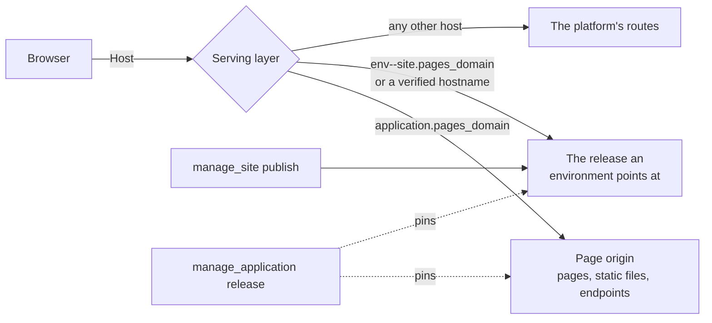

# Pages and sites the platform serves

The platform answers two kinds of browser traffic on hostnames of their own,
outside the portal: an application's **pages** and a **static site**. Neither
origin ever sees a portal session, which is what makes it safe to run a page's
script.



## A page on an application's origin

An endpoint is a page when it is bound with `response_mode: "page"`. The script
must be a part of an application, and the deployment needs `sites.pages_domain`.

```
manage_script command=endpoint_set endpoint=shop response_mode=page
  methods=["GET"] path="/" auth_mode=public page_cdns=["https://cdn.jsdelivr.net"]
```

The application answers at `https://<application>.<pages_domain>/`:

| Path | What answers |
|---|---|
| `/` and paths under it | the page endpoint named after the application |
| `/endpoints/<name>/...` | any endpoint of this application |
| `/_static/<asset name>` | an asset part, at the version the release pins |
| `/_viewer` | who is signed in on this origin, as JSON |

A page's content policy allows its own origin and the listed CDNs. An inline
script runs only with this response's nonce, which the handler reads as
`req["csp_nonce"]`:

```python
def handle(req):
    """Answers the storefront page."""
    body = "<script nonce=" + req["csp_nonce"] + ">start()</script>"
    return {"headers": {"Content-Type": "text/html; charset=utf-8"}, "body": body}
```

A script with no nonce does not run, and the browser's console says so. Move it
to an asset and load it from `/_static/app.js`, or give it the nonce. Inline
style is allowed. Requests go only to the page's own origin (`connect-src
'self'`), so a page calls its application's endpoints at `/endpoints/<name>`.

The same endpoint on the portal's own origin stays sandboxed and runs nothing.

### Who is viewing

An `authenticated` page sends a browser with no viewer through a one-time
sign-in at the portal, and the origin then holds a cookie of its own, scoped to
this application for 12 hours. The handler reads `req["caller"]`, the page's
script reads `/_viewer`, and calls to the application's endpoints run as that
person. API keys are not honored on a page origin. A `POST` the page's own
script makes carries the proof a browser adds by itself; one from anywhere else
is refused.

### Releases

A page, its assets and its endpoints follow the application's releases: saving
changes nothing live until `manage_application release`, and `rollback` restores
all of them together.

## A static site

`manage_site` makes a site with `dev`, `stage` and `prod` environments, each
pointing at one immutable release.

```
manage_site command=create name=marketing
manage_site command=publish site=marketing files=[{"path":"index.html","content":"<h1>Hello</h1>"}]
manage_site command=promote site=marketing from=dev to=stage
```

`publish` takes `files` inline, an `archive` (a zip or gzipped tar managed
resource), or a `folder` of managed resources, which is how a script's build
output reaches a site. It answers with a preview URL,
`https://<environment>--<site>.<pages_domain>/`, public to anyone with the
address. `promote` and `rollback` only move an environment's pointer: no file is
copied and the change shows at once. `rollback` returns to a release that
environment served before.

`prod` requires approval. It is reached only by `promote`: an administrator's
promote records its own approval, and anyone else's files a request in
`manage_approval` and goes through when they promote again after it is approved.

### What a release holds

| File | Meaning |
|---|---|
| `_redirects` | The redirect map, not served: `from to [status]`, with `/old/*` and `:splat` |
| `404.html` | Served with status 404 for a path nothing answers |
| `index.html` in a folder | The folder's address |
| `name.html` | Also answers at `/name` |

A file whose name carries a content hash (`site.3f2a9c1b.css`) is served as
immutable. Dotted paths other than `.well-known` are refused, so a source tree's
`.env` or `.git` cannot become a public address. Text files are compressed with
gzip and brotli when published.

### Hostnames

An administrator maps a hostname with `add_domain` to a site and environment, or
to an application's endpoints and pages with `application`. It routes once
`verify_domain` finds the token it was given, in a DNS TXT record at
`_platform-site-verify.<hostname>` or served at
`http://<hostname>/.well-known/platform-site-verify`. `hosts` reports what the
ingress needs, with a cert-manager `Certificate`.

### Moving a site here

`crawl` copies a site into a release: each page keeps its address, an address
that redirected becomes a redirect rule, and the sitemap and robots file come
along. `form_map` names, for a page path, the platform form that replaces that
page's `<form>` elements.

```
manage_site command=crawl site=marketing url=https://www.example.com/
  form_map={"/contact":"contact-form"}
```

A public or bot-checked endpoint answers the sites its application holds without
listing them in `allowed_origins`, and a public form may be framed by them.

### In an application

`manage_application add_part kind=site part_id="<site>/<environment>"` makes one
environment a part: a release pins the site's newest release and points that
environment at it, and a rollback restores it.

The rest of building an application is in mcp:knowledge_page:platform-applications,
and every built-in page is listed in mcp:knowledge_page:platform-index.
