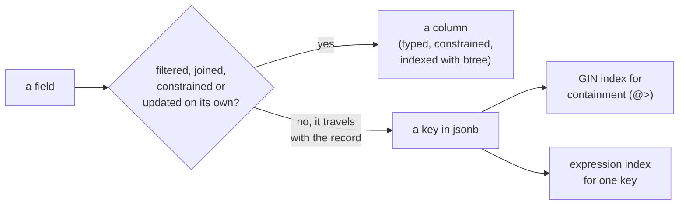

# PostgreSQL documents: jsonb, GIN indexes and SQL/JSON

When a field belongs in a `jsonb` document and when it is a column, how to
index a document so a query finds it, and the SQL/JSON functions PostgreSQL 17
added. A `jsonb` value reaches a script as a decoded object, and a dict binds
back as one (mcp:knowledge_page:platform-postgres-queries-and-values).



## A column or a key

A field the application filters or sorts on, joins through, constrains or
updates on its own is a column: typed, checked by a constraint, indexed with
a btree, and its statistics tell the planner how many rows match. A field
that varies by record and is read with the record (a product's attributes, a
webhook's payload, settings a user sets) is a key in a `jsonb` document.

Updating one key of a `jsonb` value writes the whole value again, as a new
row version. A document many small writes change is a table of its own, not a
growing `jsonb`.

```sql
CREATE TABLE products (
  sku text PRIMARY KEY,
  category text NOT NULL,
  price_cents bigint NOT NULL,
  attrs jsonb NOT NULL DEFAULT '{}'
);
INSERT INTO products VALUES
  ('A-1', 'tools', 1999, '{"color": "black", "weight_kg": 4.5, "tags": ["cast", "heavy"]}'),
  ('B-7', 'fasteners', 45, '{"color": "silver", "thread": "M8"}');
```

## Indexing a document

A GIN index with `jsonb_path_ops` answers containment, `@>`, over every key at
once and is smaller than the default operator class, which also answers the
key-existence operators `?`, `?|` and `?&`.

```sql
CREATE INDEX products_attrs ON products USING gin (attrs jsonb_path_ops);
SELECT sku FROM products WHERE attrs @> '{"color": "black"}';
```

One key read in a comparison is indexed by an expression index on exactly the
expression the query writes:

```sql
CREATE INDEX products_weight ON products (((attrs ->> 'weight_kg')::numeric));
SELECT sku FROM products WHERE (attrs ->> 'weight_kg')::numeric > 4;
```

## Changing a key

`jsonb_set` replaces the value at a path, `||` merges objects, and `-` removes
a key.

```sql
UPDATE products SET attrs = jsonb_set(attrs, '{color}', '"graphite"') WHERE sku = 'A-1';
UPDATE products SET attrs = (attrs || '{"finish": "matte"}') - 'thread' WHERE sku = 'B-7';
```

## SQL/JSON on PostgreSQL 17

`JSON_TABLE` turns a document into rows and columns, `JSON_VALUE` reads one
scalar with a type, `JSON_QUERY` reads an object or array, and `JSON_EXISTS`
tests a path.

```sql
SELECT p.sku, t.tag
FROM products p,
     JSON_TABLE(p.attrs, '$.tags[*]' COLUMNS (tag text PATH '$')) AS t;
SELECT sku, JSON_VALUE(attrs, '$.weight_kg' RETURNING numeric) AS weight,
       JSON_QUERY(attrs, '$.tags') AS tags
FROM products WHERE JSON_EXISTS(attrs, '$.color');
```

## Validating a document

A `CHECK` constraint keeps a document's required keys and types, so a script
that forgets one is refused at the write rather than read wrong later.

```sql
ALTER TABLE products ADD CONSTRAINT attrs_is_object CHECK (jsonb_typeof(attrs) = 'object');
```

```sql refuses 23514
INSERT INTO products VALUES ('C-3', 'tools', 500, '[1, 2]');
```
