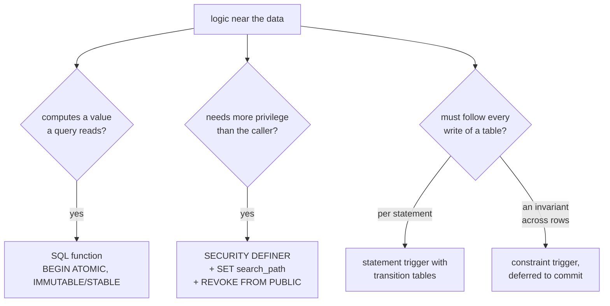

# PostgreSQL functions, procedures and triggers

Code that runs inside the database: SQL functions a query calls, a
`SECURITY DEFINER` function that does one privileged thing for a less
privileged role, triggers that keep derived rows current, and when a trigger
is the wrong tool. Each is created in a migration with `manage_schema`, whose
review warns on the unsafe forms below
(mcp:knowledge_page:platform-application-databases).



## SQL functions with BEGIN ATOMIC

A SQL-standard body (`BEGIN ATOMIC ... END`) is parsed when the function is
created, so a misspelled column fails the migration rather than the first
call, and the tables it reads are dependencies PostgreSQL tracks: dropping one
is refused while the function uses it. Label the volatility: `IMMUTABLE` for a
function of its arguments alone, `STABLE` for one that reads tables but does
not change them within a statement. A wrong label makes the planner reuse a
result it must not.

```sql
CREATE TABLE orders (id bigint PRIMARY KEY, customer bigint NOT NULL, total_cents bigint NOT NULL);
INSERT INTO orders VALUES (1, 7, 1000), (2, 7, 2500), (3, 8, 400);
CREATE FUNCTION customer_spend(c bigint) RETURNS bigint
  LANGUAGE sql STABLE PARALLEL SAFE
BEGIN ATOMIC
  SELECT coalesce(sum(total_cents), 0) FROM orders WHERE customer = c;
END;
SELECT customer_spend(7);
```

```sql refuses 2BP01
DROP TABLE orders;
```

## SECURITY DEFINER, safely

A `SECURITY DEFINER` function runs with its owner's privileges, which is how a
role that cannot read a table may still do one checked thing with it. Pin its
`search_path` (with `pg_temp` last) so a caller cannot put a table of their
own in front of the one it means, and revoke `EXECUTE` from `PUBLIC` in the
same migration, then grant it to the roles that need it.

```sql
CREATE TABLE secrets (id int PRIMARY KEY, token text NOT NULL);
CREATE FUNCTION token_matches(given text) RETURNS boolean
  LANGUAGE sql STABLE SECURITY DEFINER SET search_path = public, pg_temp
BEGIN ATOMIC
  SELECT EXISTS (SELECT 1 FROM secrets WHERE token = given);
END;
REVOKE EXECUTE ON FUNCTION token_matches(text) FROM PUBLIC;
```

## Statement triggers with transition tables

A row trigger runs once per row; a statement trigger with `REFERENCING NEW
TABLE` runs once per statement and reads every changed row as a table, which
is what keeps a summary current after a batch insert without a call per row.

```sql
CREATE TABLE customer_totals (customer bigint PRIMARY KEY, total_cents bigint NOT NULL);
CREATE FUNCTION add_totals() RETURNS trigger LANGUAGE plpgsql AS $$
BEGIN
  INSERT INTO customer_totals (customer, total_cents)
  SELECT customer, sum(total_cents) FROM new_rows GROUP BY customer
  ON CONFLICT (customer) DO UPDATE SET total_cents = customer_totals.total_cents + EXCLUDED.total_cents;
  RETURN NULL;
END $$;
CREATE TRIGGER orders_totals AFTER INSERT ON orders
  REFERENCING NEW TABLE AS new_rows FOR EACH STATEMENT EXECUTE FUNCTION add_totals();
INSERT INTO orders VALUES (4, 7, 100), (5, 8, 200);
SELECT * FROM customer_totals ORDER BY customer;
```

## Constraint triggers for invariants across rows

An invariant no constraint can state (an order's line items must add up to
its total) is a constraint trigger, `DEFERRABLE INITIALLY DEFERRED`, so it is
checked once at commit after every row of the transaction is written.

```sql
CREATE TABLE baskets (id int PRIMARY KEY, total int NOT NULL);
CREATE TABLE basket_items (basket int NOT NULL REFERENCES baskets, amount int NOT NULL);
CREATE FUNCTION basket_adds_up() RETURNS trigger LANGUAGE plpgsql AS $$
BEGIN
  IF (SELECT b.total FROM baskets b WHERE b.id = NEW.basket)
     <> (SELECT coalesce(sum(amount), 0) FROM basket_items WHERE basket = NEW.basket) THEN
    RAISE EXCEPTION 'basket % does not add up', NEW.basket USING ERRCODE = 'check_violation';
  END IF;
  RETURN NULL;
END $$;
CREATE CONSTRAINT TRIGGER basket_total AFTER INSERT OR UPDATE ON basket_items
  DEFERRABLE INITIALLY DEFERRED FOR EACH ROW EXECUTE FUNCTION basket_adds_up();
BEGIN;
INSERT INTO baskets VALUES (1, 30);
INSERT INTO basket_items VALUES (1, 10), (1, 20);
COMMIT;
```

```sql refuses 23514
BEGIN;
INSERT INTO baskets VALUES (2, 30);
INSERT INTO basket_items VALUES (2, 10);
COMMIT;
```

## When a trigger is the wrong tool

- A rule one row can state: a `CHECK` constraint
  (mcp:knowledge_page:platform-postgres-integrity).
- Sending an email, calling an API or starting work elsewhere: a trigger runs
  inside the transaction, so the work happens even when it rolls back. Write
  an outbox row and let the platform deliver it after commit
  (mcp:knowledge_page:platform-postgres-queues-locks-events).
- Logic a person reading the application expects to find: a trigger acts
  unseen on every write. Prefer the statement the script runs, unless every
  writer must be held to it.
