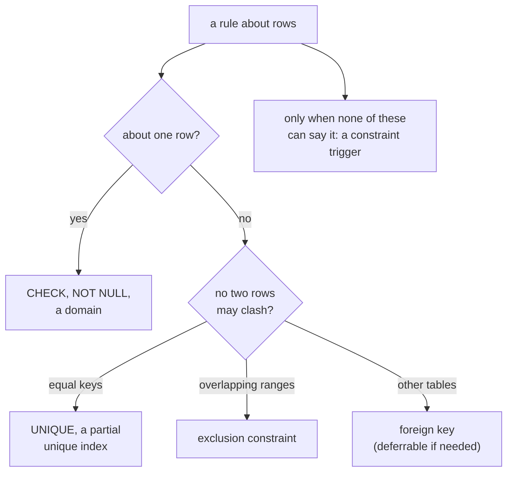

# PostgreSQL integrity: constraints, exclusion constraints, keys and money

Rules the database enforces on every write, whoever writes: a script, an
endpoint, a migration, an administrator's console. A rule in a constraint
holds for every row; a rule in application code holds only for the code that
remembers it. Declare these in migrations with `manage_schema`
(mcp:knowledge_page:platform-application-databases).



## Constraints over triggers

A `CHECK` constraint, `NOT NULL`, a foreign key or a unique index is checked
by PostgreSQL itself, can be added `NOT VALID` and validated later without a
long lock, and is visible to `manage_schema describe`. A trigger that raises
an error does the same job slower and invisibly; reach for one only for a rule
across rows no constraint can state
(mcp:knowledge_page:platform-postgres-functions-triggers).

```sql
CREATE TABLE customers (
  id bigint GENERATED ALWAYS AS IDENTITY PRIMARY KEY,
  email text NOT NULL,
  deleted_at timestamptz,
  CHECK (email LIKE '%@%')
);
```

## Partial unique indexes

A unique index with a `WHERE` clause makes a key unique among the rows it
covers: one live account per email, any number of deleted ones.

```sql
CREATE UNIQUE INDEX customers_live_email ON customers (lower(email)) WHERE deleted_at IS NULL;
INSERT INTO customers (email) VALUES ('ann@example.com');
UPDATE customers SET deleted_at = now() WHERE email = 'ann@example.com';
INSERT INTO customers (email) VALUES ('Ann@example.com');
```

```sql refuses 23505
INSERT INTO customers (email) VALUES ('ANN@example.com');
```

## NULLS NOT DISTINCT

A unique constraint treats nulls as distinct by default, so any number of rows
may share a null. `UNIQUE NULLS NOT DISTINCT` makes a null one value like any
other: at most one row with no region.

```sql
CREATE TABLE settings (scope text, region text, value text NOT NULL, UNIQUE NULLS NOT DISTINCT (scope, region));
INSERT INTO settings VALUES ('tax', NULL, '0.07');
```

```sql refuses 23505
INSERT INTO settings VALUES ('tax', NULL, '0.08');
```

## Exclusion constraints with ranges

An exclusion constraint refuses two rows whose values clash under an
operator: two bookings of one room whose periods overlap (`&&`). Equality on a
plain column in a GiST index needs the `btree_gist` extension; read the
extensions `manage_schema describe` lists as available before relying on one.
A script binds a range as `{"lower": start, "upper": end}`.

```sql
CREATE EXTENSION IF NOT EXISTS btree_gist;
CREATE TABLE bookings (
  room int NOT NULL,
  during tstzrange NOT NULL,
  EXCLUDE USING gist (room WITH =, during WITH &&)
);
INSERT INTO bookings VALUES (1, '[2026-11-03 10:00, 2026-11-03 11:00)');
INSERT INTO bookings VALUES (1, '[2026-11-03 11:00, 2026-11-03 12:00)');
```

```sql refuses 23P01
INSERT INTO bookings VALUES (1, '[2026-11-03 10:30, 2026-11-03 11:30)');
```

PostgreSQL 18 adds temporal keys: `PRIMARY KEY (room, during WITHOUT OVERLAPS)`
says the same as the exclusion constraint above and can be referenced by a
foreign key with `PERIOD`.

```sql pg18
CREATE TABLE rooms_booked (room int, during tstzrange, PRIMARY KEY (room, during WITHOUT OVERLAPS));
```

## Deferrable constraints

A constraint declared `DEFERRABLE INITIALLY DEFERRED` is checked at commit
instead of after each statement, so a transaction may pass through a state
that breaks it: two rows swapping positions, or rows that reference each
other inserted in either order.

```sql
CREATE TABLE slots (id int PRIMARY KEY, position int NOT NULL, CONSTRAINT one_per_position UNIQUE (position) DEFERRABLE INITIALLY DEFERRED);
INSERT INTO slots VALUES (1, 1), (2, 2);
BEGIN;
UPDATE slots SET position = 2 WHERE id = 1;
UPDATE slots SET position = 1 WHERE id = 2;
COMMIT;
```

## Domains

A domain is a type with its rule attached, used wherever the rule applies so
it is stated once.

```sql
CREATE DOMAIN positive_cents AS bigint CHECK (VALUE > 0);
CREATE TABLE refunds (id bigint GENERATED ALWAYS AS IDENTITY PRIMARY KEY, cents positive_cents NOT NULL);
```

```sql refuses 23514
INSERT INTO refunds (cents) VALUES (-5);
```

## Generated columns

A generated column is computed from the row's other columns. `STORED` writes
the value and can be indexed. PostgreSQL 18 makes a generated column `VIRTUAL`
when the kind is not named: computed on read, and not indexable. Write
`STORED` for a column an index or a constraint will use.

```sql
CREATE TABLE line_items (qty int NOT NULL, unit_cents bigint NOT NULL, total_cents bigint GENERATED ALWAYS AS (qty * unit_cents) STORED);
CREATE INDEX line_items_total ON line_items (total_cents);
```

## Keys

`GENERATED ALWAYS AS IDENTITY` is the key column: the database numbers rows
and refuses a written value unless the statement says `OVERRIDING SYSTEM
VALUE`. A key exposed in a URL that should not reveal how many rows exist is a
UUID; `uuidv7()`, on 18, is time-ordered, so new keys land at the end of the
index instead of scattering across it.

```sql pg18
CREATE TABLE sessions_v7 (id uuid PRIMARY KEY DEFAULT uuidv7(), started_at timestamptz NOT NULL DEFAULT now());
```

## Money

Store an amount as `numeric` with its scale, or as integer minor units
(cents) in `bigint`. Never `float8`, which cannot hold 0.10 exactly, and never
the `money` type, whose value depends on the server's locale. A `numeric`
reaches a script as a string, so arithmetic on it does not lose a cent
(mcp:knowledge_page:platform-postgres-queries-and-values).

```sql
CREATE TABLE ledger (id bigint GENERATED ALWAYS AS IDENTITY PRIMARY KEY, amount numeric(12,2) NOT NULL, currency char(3) NOT NULL);
INSERT INTO ledger (amount, currency) VALUES (0.10, 'USD'), (0.20, 'USD');
SELECT sum(amount) = 0.30 AS exact FROM ledger;
```

## Gapless numbers

A sequence skips values when a transaction rolls back, by design. An invoice
number that must have no gaps comes from a counter row updated in the
transaction that writes the invoice, which serializes those writers on that
row. Use it only where a gap is not allowed.

```sql
CREATE TABLE counters (name text PRIMARY KEY, last bigint NOT NULL);
INSERT INTO counters VALUES ('invoice', 0);
CREATE TABLE invoices (number bigint PRIMARY KEY, customer bigint NOT NULL);
WITH n AS (UPDATE counters SET last = last + 1 WHERE name = 'invoice' RETURNING last)
INSERT INTO invoices (number, customer) SELECT last, 7 FROM n;
```
