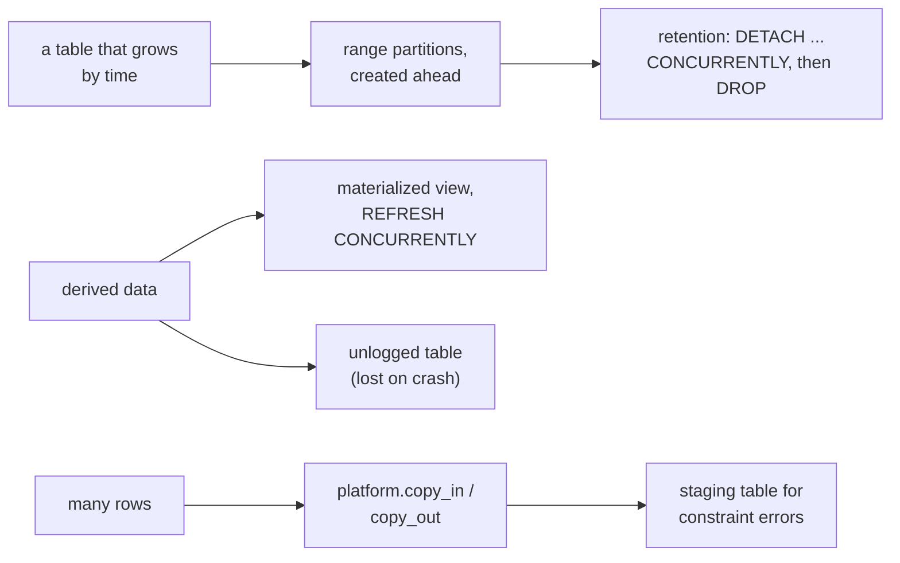

# PostgreSQL partitioning, caching and bulk data

Keeping a table that only grows (events, orders, logs) cheap to query and
cheap to trim, holding derived data a query would otherwise compute every
time, and moving many rows in or out at once with `COPY`.



## Range partitions

A table partitioned by a time range keeps each period in its own table.
Queries that name a period read only its partitions, and dropping a period is
dropping a table instead of deleting millions of rows. Create partitions ahead
of the data (a scheduled script can create next month's), and include the
partition key in every unique key: a primary key on a partitioned table must
contain the columns it is partitioned by.

```sql
CREATE TABLE events (
  id bigint GENERATED ALWAYS AS IDENTITY,
  at timestamptz NOT NULL,
  kind text NOT NULL,
  PRIMARY KEY (id, at)
) PARTITION BY RANGE (at);
CREATE TABLE events_2026_10 PARTITION OF events FOR VALUES FROM ('2026-10-01') TO ('2026-11-01');
CREATE TABLE events_2026_11 PARTITION OF events FOR VALUES FROM ('2026-11-01') TO ('2026-12-01');
INSERT INTO events (at, kind) VALUES ('2026-10-15', 'login'), ('2026-11-02', 'login');
```

```sql refuses 0A000
CREATE TABLE events_bad (id bigint, at timestamptz NOT NULL, PRIMARY KEY (id)) PARTITION BY RANGE (at);
```

Retention detaches the oldest partition without blocking reads and writes of
the rest, then drops it. `DETACH ... CONCURRENTLY` runs outside a transaction
(a migration with `transactional: false`) and is refused while the table has a
`DEFAULT` partition.

```sql
ALTER TABLE events DETACH PARTITION events_2026_10 CONCURRENTLY;
```

```sql
DROP TABLE events_2026_10;
```

Partitioning does not make a single-row lookup faster: an index on an
unpartitioned table finds one row as quickly. It pays where whole periods are
read, aggregated or removed.

## Materialized views

A materialized view stores a query's result until it is refreshed. `REFRESH
MATERIALIZED VIEW CONCURRENTLY` replaces the rows without blocking readers,
and needs a unique index on the view.

```sql
CREATE MATERIALIZED VIEW daily_events AS SELECT date_trunc('day', at) AS day, kind, count(*) AS n FROM events GROUP BY 1, 2;
CREATE UNIQUE INDEX daily_events_key ON daily_events (day, kind);
REFRESH MATERIALIZED VIEW CONCURRENTLY daily_events;
```

## Unlogged tables

An unlogged table skips the write-ahead log, so writes are faster, and it is
emptied after a crash and is not on a standby. It has no expiry of its own: a
cache in one needs a column the reader checks and a delete that clears old
rows. It is not a temporary table; every session sees it and it outlives the
session. When only some writes need not be durable, `SET LOCAL
synchronous_commit = off` in that transaction is the alternative.

```sql
CREATE UNLOGGED TABLE quote_cache (key text PRIMARY KEY, value jsonb NOT NULL, expires_at timestamptz NOT NULL);
INSERT INTO quote_cache VALUES ('fx:usd:eur', '{"rate": 0.92}', now() + interval '10 minutes');
DELETE FROM quote_cache WHERE expires_at < now();
```

## Bulk data with COPY

`platform.copy_in(connection, table, columns, rows)` and
`platform.copy_out(connection, name, sql, ...)` move rows through PostgreSQL's
COPY protocol, and `platform.query_iter` reads a result larger than
`max_rows` a page at a time
(mcp:knowledge_page:platform-application-databases). `COPY` written as SQL is
refused in a script's statements; these bindings are the way in.

A type error in a row fails a COPY. PostgreSQL 17 adds `ON_ERROR ignore` to
skip rows whose values do not parse, and 18 adds `REJECT_LIMIT` to fail past a
number of them; a constraint violation still fails the whole COPY. For rows
that may break constraints, copy into an unconstrained staging table and move
the valid rows with one `INSERT ... SELECT ... ON CONFLICT`
(mcp:knowledge_page:platform-postgres-write-patterns).

```sql
CREATE TABLE customers (email text PRIMARY KEY, name text NOT NULL);
CREATE TABLE customers_staging (email text, name text);
INSERT INTO customers_staging VALUES ('a@example.com', 'Ann'), ('a@example.com', 'Ann again'), (NULL, 'No email');
INSERT INTO customers (email, name)
SELECT DISTINCT ON (email) email, name FROM customers_staging WHERE email IS NOT NULL AND name IS NOT NULL ORDER BY email
ON CONFLICT (email) DO NOTHING;
TRUNCATE customers_staging;
```
