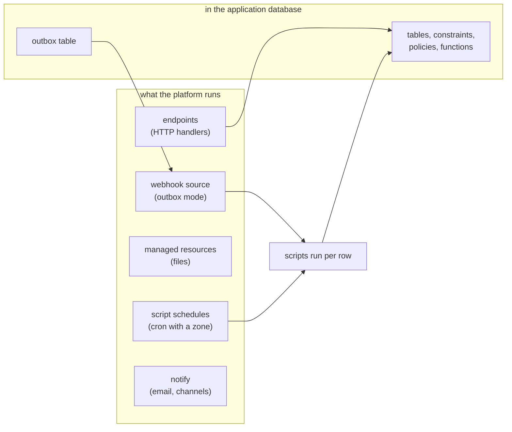

# What the platform provides instead of building it in PostgreSQL

Much of what an application would build inside its database (a scheduler, a
job queue, a file store, an event relay, a mail sender) the platform already
runs, with its own retries, audit and administration. Build the application's
data in PostgreSQL and use these for the machinery around it.



| What an application needs | Built in PostgreSQL | What the platform provides |
|---------------------------|---------------------|-----------------------------|
| Run something every night | `pg_cron` | a managed script's schedule: a cron expression and an IANA time zone, a run record with its log, its cause when it fails and whether running it again is expected to help, and failure mail |
| A job queue with workers | a jobs table claimed with `SKIP LOCKED`, a worker process, a reaper | a script run per event or per schedule; the run queue, its leases and its reclaim are the platform's |
| React to a row as it changes | a trigger calling out, or `LISTEN` in a long-lived process | `manage_schema add` with `template="outbox"`, and a webhook source in `outbox` mode that files each row as an event for the scripts naming it |
| Publish an event to several consumers | `NOTIFY`, a pub/sub table | webhook events: each script naming the source runs once per event |
| Store an uploaded file | a `bytea` column | managed resources: object storage with versions, a library, scopes and a URL |
| Serve an HTTP API | a separate service | an endpoint: a managed script bound to `/endpoints/{name}/...`, with authentication, rate limits and an audit row |
| A form on a page | a forms service storing rows | a form script: previewed by its owner unbound, published to signed-in people by its owner, and served to everyone at a version an administrator approved; each accepted submission is stored for it |
| Send an email or a chat message | a mail extension | `platform.notify` to a channel an administrator configured: an email list, Slack, Mattermost or an incoming webhook |
| Maintenance on a timer | `pg_cron` running `VACUUM` | a scheduled script calling `platform.maintain` |

A queue table in the application's database is still right when the queue is
part of the application's data (orders waiting to be packed, which a person
looks at and reorders); see
mcp:knowledge_page:platform-postgres-queues-locks-events. A queue whose only
purpose is running code later is a script.

## Rows as events, end to end

The outbox the platform writes is an ordinary table and trigger in the
application's schema:

```sql
CREATE TABLE orders (id bigint PRIMARY KEY, status text NOT NULL);
CREATE TABLE outbox (
  id bigint GENERATED ALWAYS AS IDENTITY PRIMARY KEY,
  table_name text NOT NULL, op text NOT NULL, row jsonb NOT NULL,
  created_at timestamptz NOT NULL DEFAULT now()
);
CREATE FUNCTION orders_to_outbox() RETURNS trigger LANGUAGE plpgsql AS $$
BEGIN
  INSERT INTO outbox (table_name, op, row) VALUES (TG_TABLE_NAME, TG_OP, to_jsonb(coalesce(NEW, OLD)));
  RETURN NULL;
END $$;
CREATE TRIGGER orders_outbox AFTER INSERT OR UPDATE OR DELETE ON orders
  FOR EACH ROW EXECUTE FUNCTION orders_to_outbox();
INSERT INTO orders VALUES (1, 'placed');
UPDATE orders SET status = 'packed' WHERE id = 1;
SELECT op, row ->> 'status' AS status FROM outbox ORDER BY id;
```

Write it with `manage_schema add` and `template="outbox"` rather than by
hand: the template's trigger, channel and table are the shape the webhook
source reads. The source deletes each row once it is filed, so the table
stays small. See mcp:knowledge_page:platform-application-databases for the
template's arguments.
