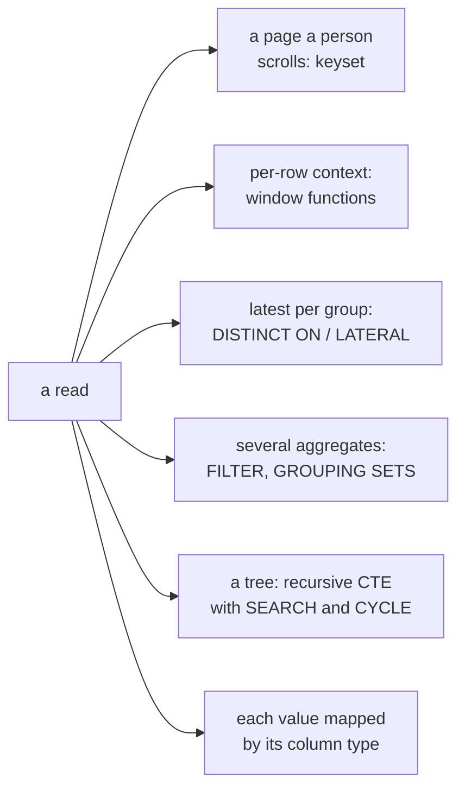

# PostgreSQL queries and the values the platform returns

The query shapes an application's reads are built from (keyset pagination,
window functions, `DISTINCT ON`, `LATERAL`, `FILTER`, grouping sets and
recursive queries over a hierarchy), and how each PostgreSQL type reaches a
script and binds back from one.



The table the examples read:

```sql
CREATE TABLE orders (id bigint PRIMARY KEY, customer bigint NOT NULL, region text NOT NULL, status text NOT NULL, total numeric(10,2) NOT NULL, placed_at timestamptz NOT NULL);
INSERT INTO orders VALUES
  (1, 7, 'east', 'paid', 10.00, '2026-11-01 09:00+00'),
  (2, 7, 'east', 'refunded', 25.00, '2026-11-02 10:00+00'),
  (3, 8, 'west', 'paid', 4.50, '2026-11-02 11:00+00'),
  (4, 9, 'west', 'paid', 30.00, '2026-11-03 08:00+00');
CREATE INDEX orders_recent ON orders (placed_at DESC, id DESC);
```

## Keyset pagination

`OFFSET` reads and throws away every row before the page, so page 500 costs
500 pages, and rows written meanwhile shift what a page shows. Keyset
pagination asks for the rows after the last one shown, using the index, and
reads the same rows whatever page is asked for. In a script, the last row's
values are bound as `:last_at` and `:last_id`.

```sql
SELECT id, placed_at FROM orders
WHERE (placed_at, id) < ('2026-11-02 11:00+00', 3)
ORDER BY placed_at DESC, id DESC
LIMIT 50;
```

## Window functions

A window function computes over rows related to the current one without
collapsing them: a running total, a rank within a group, the previous row.

```sql
SELECT id, customer, total,
       sum(total) OVER (PARTITION BY customer ORDER BY placed_at) AS running,
       rank() OVER (ORDER BY total DESC) AS by_size,
       lag(placed_at) OVER (PARTITION BY customer ORDER BY placed_at) AS previous
FROM orders;
```

## The latest row per group

`DISTINCT ON (key)` keeps the first row of each key in the `ORDER BY`. For the
latest few per group, `LATERAL` runs a subquery per outer row.

```sql
SELECT DISTINCT ON (customer) customer, id, placed_at FROM orders ORDER BY customer, placed_at DESC;
SELECT c.customer, recent.id
FROM (SELECT DISTINCT customer FROM orders) c,
     LATERAL (SELECT id FROM orders o WHERE o.customer = c.customer ORDER BY placed_at DESC LIMIT 2) recent;
```

## Several aggregates in one pass

`FILTER` restricts one aggregate without a `CASE`, and `GROUPING SETS`
computes subtotals and the grand total in one statement.

```sql
SELECT region,
       count(*) FILTER (WHERE status = 'paid') AS paid,
       sum(total) FILTER (WHERE status = 'refunded') AS refunded
FROM orders GROUP BY region;
SELECT region, status, sum(total) FROM orders GROUP BY GROUPING SETS ((region, status), (region), ());
```

## Hierarchies

A recursive CTE walks a tree (categories, an org chart, a bill of materials).
`SEARCH DEPTH FIRST BY` orders the result as the tree reads, and `CYCLE`
stops at a loop instead of running forever.

```sql
CREATE TABLE categories (id int PRIMARY KEY, parent int REFERENCES categories, name text NOT NULL);
INSERT INTO categories VALUES (1, NULL, 'tools'), (2, 1, 'hand tools'), (3, 2, 'hammers'), (4, 1, 'power tools');
WITH RECURSIVE tree AS (
  SELECT id, parent, name, 1 AS depth FROM categories WHERE parent IS NULL
  UNION ALL
  SELECT c.id, c.parent, c.name, t.depth + 1 FROM categories c JOIN tree t ON c.parent = t.id
) SEARCH DEPTH FIRST BY id SET ordering
  CYCLE id SET is_cycle USING path
SELECT repeat('  ', depth - 1) || name AS name FROM tree ORDER BY ordering;
```

## Values the platform returns

A result's `columns` names each column's PostgreSQL type. Each value is
mapped by that type, and the same shapes bind back as parameters:

| PostgreSQL type | In a script |
|-----------------|-------------|
| `int2`, `int4`, `int8` | a number; an `int8` past 2^53 is its decimal text |
| `numeric` | its decimal text, so no digit is lost |
| `float4`, `float8` | a number; `NaN` and the infinities as their text |
| `bool` | a boolean |
| `text`, `varchar`, `char` | a string |
| `timestamptz` | RFC 3339 in UTC |
| `timestamp`, `date`, `time` | text with no zone: `2026-11-03T08:00:00`, `2026-11-03`, `08:00:00` |
| `json`, `jsonb` | the decoded value: an object, a list, a scalar |
| `uuid` | its text |
| `bytea` | base64 text |
| an array | a list, each element mapped by the element type |
| a range | `{"lower", "upper", "lower_inc", "upper_inc", "empty"}`, an unbounded end null |
| a multirange | a list of ranges |
| `interval` | `{"months", "days", "microseconds", "text"}` |
| a composite | an object keyed by attribute, each mapped by its type |
| `hstore` | an object of string to string or null |
| `vector` (pgvector) | a list of numbers |
| `inet`, `cidr`, an enum, `ltree`, `tsvector` | the text PostgreSQL writes; the column type names which |

A string bound where PostgreSQL expects another type is read as that type's
literal, so `"2026-11-03"` binds to a `date` and `"[1,5)"` to an `int4range`.

```sql
SELECT 9007199254740993::int8 AS big, 0.1::numeric + 0.2 AS exact,
       '[2026-11-03, 2026-11-04)'::daterange AS day, interval '1 month 2 days' AS gap;
```
