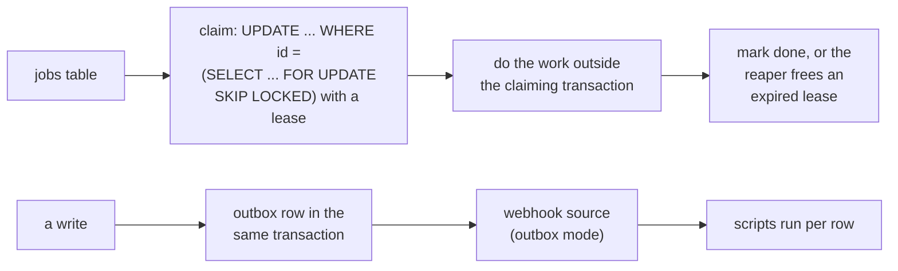

# PostgreSQL job queues, locks and events

Work claimed from a table by many workers, locks that serialize the steps
that must not run twice at once, and events that tell another part of the
application something changed. Before building any of these, check what the
platform already runs for you: a scheduled or event-driven script is a job
queue's worker, and an outbox webhook source is an event relay
(mcp:knowledge_page:platform-postgres-platform-provides).



## A job queue with SKIP LOCKED

A worker claims a job by locking it with `FOR UPDATE SKIP LOCKED`, which
skips rows another worker holds instead of waiting on them, and records a
lease: who claimed it and until when. It commits the claim at once and does
the work outside the transaction, so a slow job holds no lock and no
connection.

```sql
CREATE TABLE jobs (
  id bigint GENERATED ALWAYS AS IDENTITY PRIMARY KEY,
  kind text NOT NULL,
  payload jsonb NOT NULL DEFAULT '{}',
  state text NOT NULL DEFAULT 'queued' CHECK (state IN ('queued', 'running', 'done', 'failed')),
  lease_until timestamptz,
  attempts int NOT NULL DEFAULT 0
) WITH (fillfactor = 70, autovacuum_vacuum_scale_factor = 0.02);
CREATE INDEX jobs_ready ON jobs (id) WHERE state = 'queued';
INSERT INTO jobs (kind) VALUES ('email'), ('email'), ('thumbnail');
UPDATE jobs SET state = 'running', lease_until = now() + interval '5 minutes', attempts = attempts + 1
WHERE id = (SELECT id FROM jobs WHERE state = 'queued' ORDER BY id FOR UPDATE SKIP LOCKED LIMIT 1)
RETURNING id, kind;
```

A worker that dies leaves its job running past its lease; the reaper returns
it to the queue, and a job past its attempts is failed rather than retried
forever:

```sql
UPDATE jobs SET state = CASE WHEN attempts >= 5 THEN 'failed' ELSE 'queued' END, lease_until = NULL
WHERE state = 'running' AND lease_until < now();
```

What limits a busy queue is not lock waits but dead row versions: every claim
and completion is an update, so the table and its indexes fill with dead
tuples autovacuum must clear. Keep few indexes on columns that change, leave
room on each page (`fillfactor`) so an update stays on its page, vacuum the
table more eagerly than the default, and move finished jobs out (or partition
them away) rather than keeping them in the hot table. `SKIP LOCKED` does not
remove any of this.

## Advisory locks

A transaction-scoped advisory lock serializes a step that is not one row,
"only one rebuild of this customer's totals at a time", and is released when
the transaction ends. Namespace the key so two features never collide on a
number: hash a string that names the feature and the thing.

```sql
SELECT pg_try_advisory_xact_lock(hashtextextended('totals:customer:7', 0)) AS got_it;
```

Session advisory locks (`pg_advisory_lock`) outlive the transaction, which a
pooled connection does not carry from one statement to the next: use the
transaction-scoped form (mcp:knowledge_page:platform-postgres-what-does-not-work).

## Row lock strengths

`FOR UPDATE` blocks every other locker, including a foreign key check from a
child row. `FOR NO KEY UPDATE` is the usual lock for changing a row's
non-key columns: it lets other transactions insert rows that reference it.

```sql
BEGIN;
SELECT id FROM jobs WHERE id = 1 FOR NO KEY UPDATE;
UPDATE jobs SET state = 'done' WHERE id = 1;
COMMIT;
```

## SERIALIZABLE and retries

At `serializable` isolation PostgreSQL refuses a transaction whose outcome
could differ from running the transactions one after another, with SQLSTATE
40001. The fix is to run it again: `platform.transaction(connection, fn,
isolation="serializable", retry=True)` does, up to three times, so `fn` must
do nothing but read and write through its `tx`.

## Bounding waits

`SET LOCAL lock_timeout` makes a statement give up rather than queue behind a
long lock, and `statement_timeout` bounds how long it runs. PostgreSQL 17 adds
`transaction_timeout`, which bounds the whole transaction. `SET LOCAL` lasts
until the transaction ends.

```sql
BEGIN;
SET LOCAL lock_timeout = '2s';
SET LOCAL statement_timeout = '30s';
SET LOCAL transaction_timeout = '60s';
UPDATE jobs SET attempts = attempts WHERE id = 2;
COMMIT;
```

## Events: LISTEN/NOTIFY is a hint

`NOTIFY channel, 'payload'` wakes listeners when the transaction commits, and
says nothing to a listener that was not connected then. Treat a notification
as "go read the table", never as the message: the payload is at most 8000
bytes, and a notifying transaction takes a lock at commit that every other
notifying commit waits on, so a busy table relies on polling an outbox instead
of a notification per transaction.

```sql
CREATE TABLE outbox (id bigint GENERATED ALWAYS AS IDENTITY PRIMARY KEY, topic text NOT NULL, row jsonb NOT NULL, created_at timestamptz NOT NULL DEFAULT now());
BEGIN;
UPDATE jobs SET state = 'done' WHERE id = 2;
INSERT INTO outbox (topic, row) VALUES ('job.done', '{"id": 2}');
NOTIFY outbox_ready;
COMMIT;
```

`manage_schema add` with `template="outbox"` writes such an outbox and its
triggers, and a webhook source in `outbox` mode delivers each row as an event
to the scripts naming it. An outbox's `id` order is not commit order: a row
with a lower id can commit after a higher one. A consumer deduplicates on the
event id rather than tracking the highest id it has seen.
