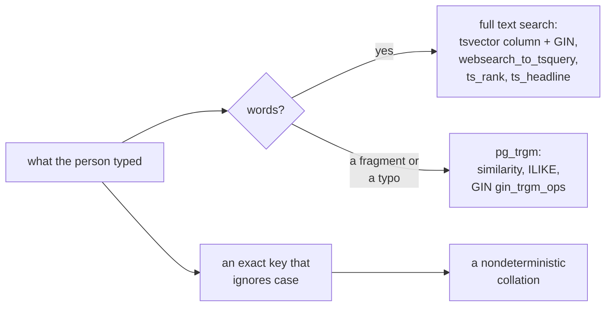

# PostgreSQL search: full text search, trigram matching and case-insensitive keys

Finding rows by the words they hold, by a fragment or a misspelling, and by a
key that ignores case, inside the application database. This is search over an
application's own rows; the platform's `search` tool finds the platform's
assets, tables and pages, not these.



## Full text search

Keep the searchable text as a stored generated `tsvector` column and index it
with GIN. The column is computed on every write, so a query never builds a
`tsvector` row by row. Weight the fields so a title outranks a body.

```sql
CREATE TABLE articles (
  id bigint GENERATED ALWAYS AS IDENTITY PRIMARY KEY,
  title text NOT NULL,
  body text NOT NULL,
  search tsvector GENERATED ALWAYS AS (
    setweight(to_tsvector('english', title), 'A') || setweight(to_tsvector('english', body), 'B')
  ) STORED
);
CREATE INDEX articles_search ON articles USING gin (search);
INSERT INTO articles (title, body) VALUES
  ('Choosing a drill', 'A cordless drill for masonry needs a hammer action.'),
  ('Anvil care', 'Keep the face of an anvil dry and oiled.');
```

`websearch_to_tsquery` reads what a person types into a search box (quoted
phrases, `or`, a leading `-` to exclude) and never fails on stray punctuation,
unlike `to_tsquery`. `ts_rank` orders the matches and `ts_headline` marks the
words that matched in a snippet.

```sql
SELECT id, title, ts_rank(search, q) AS rank,
       ts_headline('english', body, q, 'MaxWords=12, MinWords=4') AS snippet
FROM articles, websearch_to_tsquery('english', 'drill -anvil') AS q
WHERE search @@ q
ORDER BY rank DESC
LIMIT 20;
```

The configuration (`english` here) stems words and drops stop words; use
`simple` for codes and names that must match as written.

## Fragments and misspellings: pg_trgm

The `pg_trgm` extension compares strings by their three-character pieces. A
GIN index with `gin_trgm_ops` serves `ILIKE '%fragment%'`, which no btree can,
and `%` matches by similarity, which finds "anvel" for "anvil". Check that
`manage_schema describe` lists `pg_trgm` as available before a migration
creates it.

```sql
CREATE EXTENSION IF NOT EXISTS pg_trgm;
CREATE INDEX articles_title_trgm ON articles USING gin (title gin_trgm_ops);
SELECT title FROM articles WHERE title ILIKE '%nvil%';
SELECT title, similarity(title, 'anvel care') AS score FROM articles WHERE title % 'anvel care' ORDER BY score DESC;
```

## Keys that ignore case

A nondeterministic ICU collation compares strings ignoring case (and, with
other settings, accents), so a unique email or username refuses `Ann@` beside
`ann@` without a `lower()` in every query. `LIKE` does not work with a
nondeterministic collation before PostgreSQL 18; use `lower()` there or a
separate column for pattern matching.

```sql
CREATE COLLATION case_insensitive (provider = icu, locale = 'und-u-ks-level2', deterministic = false);
CREATE TABLE accounts (email text COLLATE case_insensitive PRIMARY KEY);
INSERT INTO accounts VALUES ('ann@example.com');
```

```sql refuses 23505
INSERT INTO accounts VALUES ('ANN@example.com');
```
