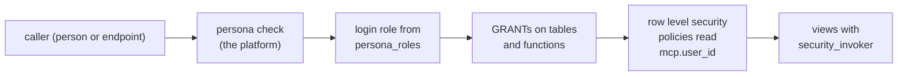

# PostgreSQL security: roles, grants and row level security

What the application database itself refuses, beneath the platform's persona
check: the login role a persona's statements run as, the grants that role
holds, row level security that shows each caller their own rows, and views
that do not leak past it. The platform sets who a statement runs for as
transaction-local settings (mcp:knowledge_page:platform-application-databases).



## Roles and grants

A connection's `persona_roles` maps each persona to a login role, which the
operator creates with a password the connection stores; a persona the map
does not name runs as the connection's user. The application's migrations
grant each role what its persona may do, and nothing by default: a table a
role was never granted is refused to it.

```sql
CREATE ROLE sec_sales NOLOGIN;
CREATE ROLE sec_support NOLOGIN;
CREATE TABLE customers (id bigint PRIMARY KEY, owner text NOT NULL, email text NOT NULL, notes text);
INSERT INTO customers VALUES (1, 'ann@example.com', 'c1@example.com', 'VIP'), (2, 'bob@example.com', 'c2@example.com', NULL);
GRANT SELECT, INSERT, UPDATE ON customers TO sec_sales;
GRANT SELECT (id, email) ON customers TO sec_support;
```

A column grant limits a role to the columns it names:

```sql refuses 42501
SET ROLE sec_support;
SELECT notes FROM customers;
```

```sql
RESET ROLE;
```

## Row level security, forced

`ENABLE ROW LEVEL SECURITY` filters every row through the table's policies;
`FORCE ROW LEVEL SECURITY` applies them to the table's owner too, which a
migration's review warns when it is left out. A policy reads the caller from
`current_setting('mcp.user_id', true)` (an endpoint's authenticated caller,
or the script's author), treating the empty setting of a public endpoint as
no one.

```sql
ALTER TABLE customers ENABLE ROW LEVEL SECURITY;
ALTER TABLE customers FORCE ROW LEVEL SECURITY;
CREATE POLICY own_customers ON customers TO sec_sales
  USING (owner = nullif(current_setting('mcp.user_id', true), ''))
  WITH CHECK (owner = nullif(current_setting('mcp.user_id', true), ''));
BEGIN;
SET LOCAL ROLE sec_sales;
SELECT set_config('mcp.user_id', 'ann@example.com', true);
SELECT count(*) = 1 AS only_anns FROM customers;
COMMIT;
```

`WITH CHECK` refuses a write that would create a row the caller could not
see:

```sql refuses 42501
BEGIN;
SET LOCAL ROLE sec_sales;
SELECT set_config('mcp.user_id', 'ann@example.com', true);
INSERT INTO customers VALUES (3, 'bob@example.com', 'c3@example.com', NULL);
COMMIT;
```

A claim protects against a person who did not write the SQL, an endpoint's
caller. A script's author can set any setting in their own statement; against
the author, the boundary is their persona's login role and its grants.

## Views that keep the policies

A view runs with its owner's privileges by default, so a view over a table
with row level security shows every row its owner can see. Create it with
`security_invoker = true` so it runs as the caller and the policies apply.

```sql
CREATE VIEW customer_emails WITH (security_invoker = true) AS SELECT id, email FROM customers;
GRANT SELECT ON customer_emails TO sec_sales;
BEGIN;
SET LOCAL ROLE sec_sales;
SELECT set_config('mcp.user_id', 'bob@example.com', true);
SELECT count(*) = 1 AS only_bobs FROM customer_emails;
COMMIT;
```

## Functions that cross the line

A `SECURITY DEFINER` function is the one way a role does something its grants
do not allow, so it must pin its `search_path` and revoke `EXECUTE` from
`PUBLIC` (mcp:knowledge_page:platform-postgres-functions-triggers).
