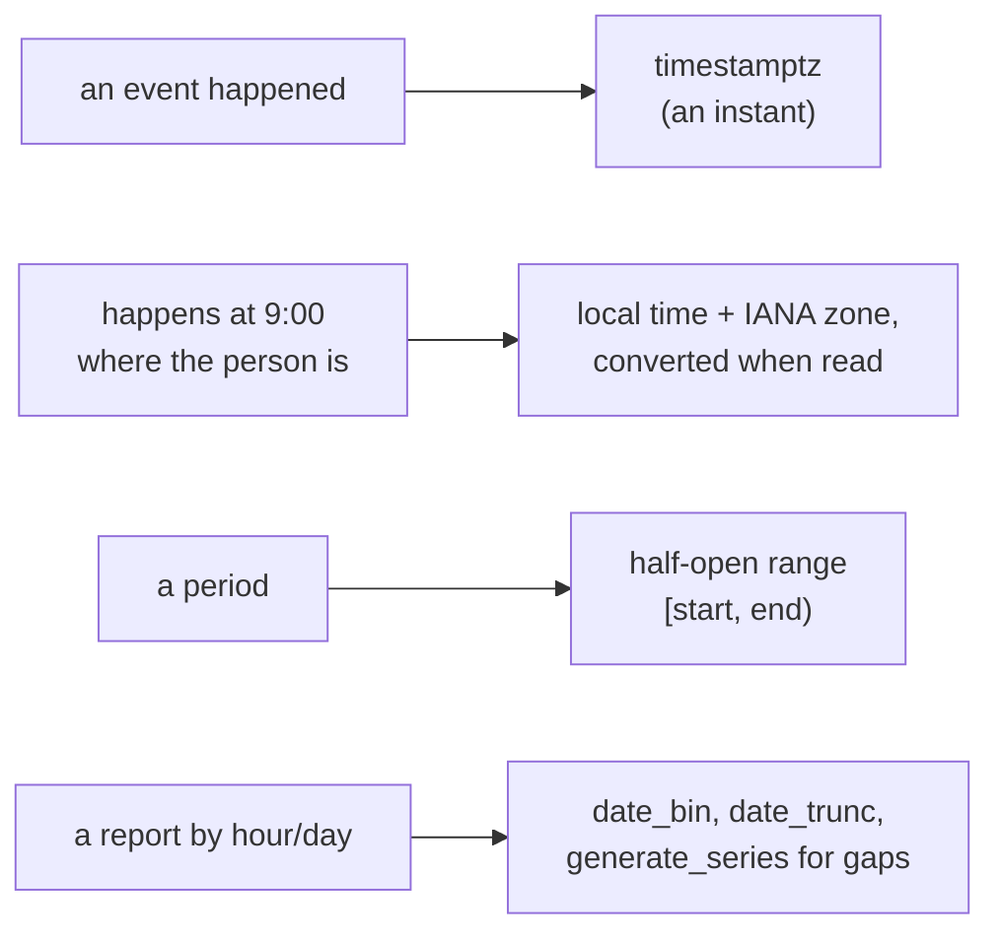

# PostgreSQL time: instants, zones, ranges and buckets

Storing when something happened, when something recurs in a person's own
zone, and periods, and grouping rows into hours, days and weeks. A
`timestamptz` reaches a script as RFC 3339 in UTC, an `interval` as months,
days and microseconds (mcp:knowledge_page:platform-postgres-queries-and-values).



## Instants are timestamptz

An event that happened at a moment (an order placed, a payment taken) is a
`timestamptz`. It stores the instant, not a zone, and is shown in the
session's `TimeZone`. A `timestamp` without a zone is a wall-clock reading
with no instant behind it; storing an event in one loses which instant it was
when zones or daylight saving differ.

```sql
CREATE TABLE orders (id bigint PRIMARY KEY, placed_at timestamptz NOT NULL DEFAULT now(), customer_zone text NOT NULL DEFAULT 'UTC');
INSERT INTO orders (id, placed_at, customer_zone) VALUES
  (1, '2026-03-08 06:30:00+00', 'America/New_York'),
  (2, '2026-03-08 08:30:00+00', 'America/New_York'),
  (3, '2026-03-09 15:00:00+00', 'Europe/Berlin');
SELECT id, placed_at AT TIME ZONE customer_zone AS local_time FROM orders;
```

## Recurrence in a person's zone

"Every day at 9:00 where I live" is a local time and the person's IANA zone
name (`America/New_York`, never a fixed offset like `-05:00`, which is wrong
for half the year). Convert to an instant when the next occurrence is needed,
so daylight saving moves it correctly.

```sql
CREATE TABLE reminders (id int PRIMARY KEY, at_local time NOT NULL, zone text NOT NULL);
INSERT INTO reminders VALUES (1, '09:00', 'America/New_York');
SELECT id, (('2026-03-09'::date + at_local) AT TIME ZONE zone) AS next_instant FROM reminders;
```

A managed script's schedule is the platform's own cron with a time zone, so a
reminder sent at 9:00 local time is a schedule, not a table a loop polls
(mcp:knowledge_page:platform-postgres-platform-provides). One script may hold
several schedules, each read in its own zone, so reminders at 9:00 in New York
and at 9:00 in Los Angeles are two schedules of one script.

## Periods are half-open ranges

A period is `[start, end)`: it includes its start and excludes its end, so
consecutive periods meet without overlapping or leaving a gap. A range type
holds both ends and its operators (`&&` overlaps, `@>` contains) use a GiST
index; an exclusion constraint refuses overlapping rows
(mcp:knowledge_page:platform-postgres-integrity).

```sql
CREATE TABLE shifts (worker int NOT NULL, during tstzrange NOT NULL);
INSERT INTO shifts VALUES (7, '[2026-11-03 09:00+00, 2026-11-03 17:00+00)');
SELECT worker FROM shifts WHERE during @> '2026-11-03 12:00+00'::timestamptz;
SELECT '[2026-11-03 09:00+00, 2026-11-03 17:00+00)'::tstzrange && '[2026-11-03 17:00+00, 2026-11-03 18:00+00)'::tstzrange AS overlaps;
```

## Buckets

`date_trunc` cuts to a calendar unit; `date_bin` cuts to any width from an
origin (every 15 minutes, every 6 hours). `generate_series` makes the buckets
that had no rows, so a chart shows a zero instead of skipping the hour.

```sql
SELECT date_bin('6 hours', placed_at, '2026-01-01 00:00+00') AS bucket, count(*) FROM orders GROUP BY 1 ORDER BY 1;
SELECT d::date AS day, count(o.id) AS orders
FROM generate_series('2026-03-07'::date, '2026-03-10'::date, '1 day') AS d
LEFT JOIN orders o ON o.placed_at >= d AND o.placed_at < d + interval '1 day'
GROUP BY 1 ORDER BY 1;
```

## now() and clock_timestamp()

`now()` (and `CURRENT_TIMESTAMP`) is the start of the transaction, the same
for every row a transaction writes: every row of one order gets one time.
`clock_timestamp()` is the moment it is called, and changes within a
statement; use it to time a step, not to stamp rows that belong together.

```sql
SELECT now() = now() AS same_in_one_statement, clock_timestamp() <= clock_timestamp() AS moves;
```

## Months are not seconds

`interval '1 month'` is a calendar month, so adding it depends on the date:
January 31 plus one month is February 28 or 29. An interval keeps months,
days and microseconds apart for this reason; never convert a month to a
number of seconds.

```sql
SELECT '2026-01-31'::date + interval '1 month' AS feb, '2026-03-31'::date + interval '1 month' AS apr;
```
