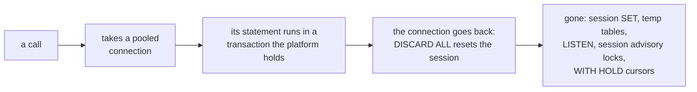

# What does not work through the platform's connections, and common claims corrected

A script or endpoint reaches its application database through a pool: each
call takes a connection, runs in a transaction the platform holds, and gives
the connection back reset to how it opened. Most of PostgreSQL works
unchanged; a few features that live in one transaction or one session do not,
and a few things said about PostgreSQL are wrong.



## A procedure that commits

`platform.execute` runs each statement in a transaction of its own, so a
procedure that runs `COMMIT` or `ROLLBACK` itself is refused by PostgreSQL
(SQLSTATE 2D000, invalid transaction termination) when called through it, as
it is inside any transaction block:

```sql
CREATE TABLE batches (id int PRIMARY KEY);
CREATE PROCEDURE load_in_chunks() LANGUAGE plpgsql AS $$
BEGIN
  INSERT INTO batches VALUES (1);
  COMMIT;
  INSERT INTO batches VALUES (2);
END $$;
```

```sql refuses 2D000
BEGIN;
CALL load_in_chunks();
COMMIT;
```

Write the procedure without its own `COMMIT`, and let the script decide what
commits together with `platform.transaction`, or split the work into calls the
script makes one after another.

## Session-scoped features

The connection a statement ran on goes back to the pool reset, so nothing a
statement leaves in its session reaches the next statement:

- `SET` without `LOCAL`: the next call starts with the connection's defaults.
  Use `SET LOCAL` inside a `platform.transaction`, which lasts for it.
- Temporary tables: dropped when the connection is reset. A temporary table
  created `ON COMMIT DROP` inside one transaction works:

```sql
BEGIN;
CREATE TEMP TABLE scratch (id int) ON COMMIT DROP;
INSERT INTO scratch SELECT generate_series(1, 3);
SELECT count(*) FROM scratch;
COMMIT;
```

- `LISTEN`: the connection stops listening when it is released. A webhook
  source with input `postgres` listens for you and runs scripts per
  notification or outbox row
  (mcp:knowledge_page:platform-postgres-platform-provides).
- Session advisory locks (`pg_advisory_lock`): released with the connection.
  Use `pg_advisory_xact_lock` or `pg_try_advisory_xact_lock` inside a
  transaction (mcp:knowledge_page:platform-postgres-queues-locks-events).
- `WITH HOLD` cursors: closed with the connection. Read past `max_rows` with
  `platform.query_iter`, which pages a cursor for you.
- SQL `PREPARE`, `DEALLOCATE` and `DISCARD` are refused: the platform prepares
  and caches statements itself.

`BEGIN`, `COMMIT` and `ROLLBACK` written as SQL are refused because the
platform holds the transaction; `platform.transaction` is how statements
commit together. `SAVEPOINT`, `RELEASE` and `ROLLBACK TO` are refused because
`tx.savepoint(fn)` works savepoints, and `COPY` because `platform.copy_in` and
`platform.copy_out` copy rows, all available in this release
(mcp:knowledge_page:platform-application-databases).

## Common claims, corrected

**LISTEN/NOTIFY is not a queue.** A notification reaches only the sessions
listening when it commits, carries at most 8000 bytes, and is gone if nobody
is. It says "look at the table"; the table holds the work.

**SKIP LOCKED does not remove vacuum pressure.** It stops workers waiting on
each other's rows. Every claim and completion is still an update that leaves a
dead row version, and a busy queue is limited by how fast autovacuum clears
them.

**Unlogged tables are not temporary tables.** Every session sees an unlogged
table and it outlives the session; it is emptied after a crash and is not on a
standby. A temporary table is one session's alone.

**A jsonb update rewrites the whole value.** Changing one key writes a new
version of the whole document, however small the change:

```sql
CREATE TABLE profiles (id int PRIMARY KEY, doc jsonb NOT NULL);
INSERT INTO profiles VALUES (1, jsonb_build_object('name', 'Ann', 'history', repeat('x', 3000)));
UPDATE profiles SET doc = jsonb_set(doc, '{name}', '"Anne"') WHERE id = 1;
```

**Generated columns on 18 are virtual unless stored.** PostgreSQL 18 makes a
generated column `VIRTUAL` when the kind is not named, and a virtual column
cannot be indexed:

```sql pg18
CREATE TABLE prices (cents int NOT NULL, dollars numeric GENERATED ALWAYS AS (cents / 100.0));
```

```sql pg18 refuses 0A000
CREATE INDEX prices_dollars ON prices (dollars);
```

**`interval '1 month'` is not a fixed number of seconds.** It is a calendar
month, so it adds 28 to 31 days depending on the date
(mcp:knowledge_page:platform-postgres-time).

```sql
SELECT '2026-02-01'::date + interval '1 month' - '2026-02-01'::date AS february_days,
       '2026-03-01'::date + interval '1 month' - '2026-03-01'::date AS march_days;
```
