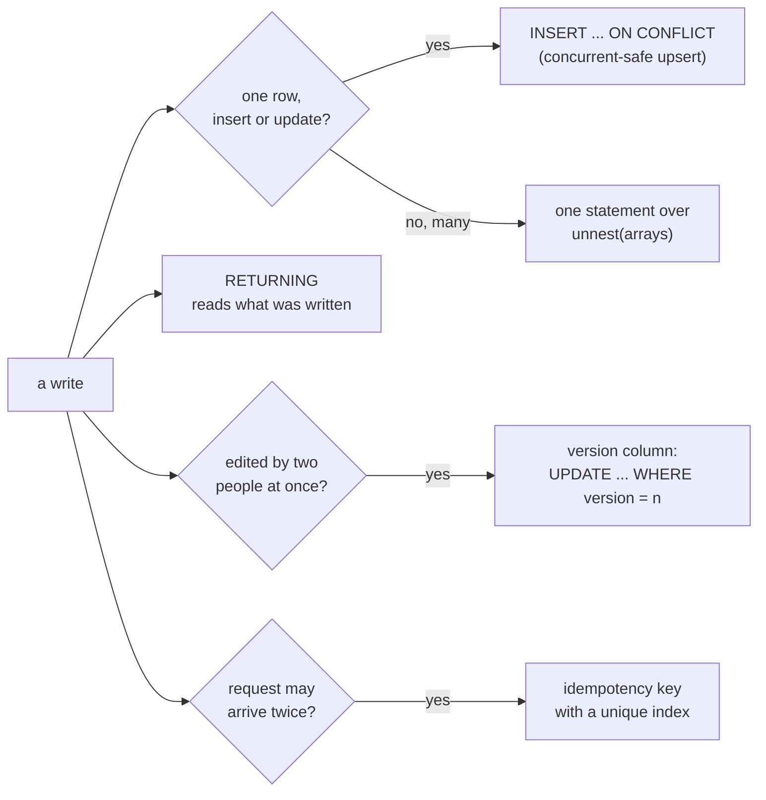

# PostgreSQL write patterns: upsert, MERGE, RETURNING and batches

How an application built in the platform writes rows to its application
database so that concurrent writers, retries and repeated requests all leave
the right state. The examples are SQL as a migration or a script's statement
would run it; in a script, values are bound with `:name`, never written into
the statement (mcp:knowledge_page:platform-application-databases).



The tables the examples use:

```sql
CREATE TABLE products (sku text PRIMARY KEY, name text NOT NULL, stock int NOT NULL DEFAULT 0);
CREATE TABLE prices (sku text PRIMARY KEY REFERENCES products, cents int NOT NULL, updated_at timestamptz NOT NULL DEFAULT now());
INSERT INTO products (sku, name, stock) VALUES ('A-1', 'Anvil', 3), ('B-7', 'Bolt', 40);
```

## Upsert with ON CONFLICT

`INSERT ... ON CONFLICT (key) DO UPDATE` inserts the row or updates the one
holding its key, and is the upsert to use when two sessions may write the same
key at once: PostgreSQL takes the row lock as part of the insert, so neither
session sees "no row" and both try to insert. `EXCLUDED` is the row the
statement tried to insert.

```sql
INSERT INTO prices (sku, cents) VALUES ('A-1', 1999)
ON CONFLICT (sku) DO UPDATE SET cents = EXCLUDED.cents, updated_at = now();
```

`DO NOTHING` keeps the first row and skips the rest, the form for "record it
once":

```sql
INSERT INTO prices (sku, cents) VALUES ('A-1', 2500) ON CONFLICT (sku) DO NOTHING;
```

A conflict target names a unique index or constraint; without one PostgreSQL
refuses the statement:

```sql refuses 42P10
INSERT INTO products (sku, name) VALUES ('C-3', 'Clamp') ON CONFLICT (name) DO NOTHING;
```

## RETURNING

`RETURNING` hands back the rows a write touched, so a script reads a generated
key or the stored value without a second query:

```sql
UPDATE products SET stock = stock - 1 WHERE sku = 'A-1' AND stock > 0 RETURNING sku, stock;
```

On PostgreSQL 18, `RETURNING old.*` and `new.*` name the row before and after
the write in one statement. Read the server's major from `manage_schema
describe` before using a feature first available in 18:

```sql pg18
UPDATE products SET stock = stock + 5 WHERE sku = 'B-7' RETURNING old.stock AS before, new.stock AS after;
```

## MERGE

`MERGE` matches a source against a table and inserts, updates or deletes each
row by whether it matched. PostgreSQL 17 adds `RETURNING merge_action()` and
`WHEN NOT MATCHED BY SOURCE`, which acts on target rows the source no longer
holds. MERGE is not the concurrent-safe upsert: two sessions merging a new key
at once both take the `NOT MATCHED` branch, and one fails with a unique
violation. Use it for a reconciliation one session runs, and `ON CONFLICT` for
writes many sessions make.

```sql
CREATE TABLE price_feed (sku text, cents int);
INSERT INTO price_feed VALUES ('A-1', 2100), ('B-7', 45);
MERGE INTO prices p
USING price_feed f ON p.sku = f.sku
WHEN MATCHED AND p.cents <> f.cents THEN UPDATE SET cents = f.cents, updated_at = now()
WHEN NOT MATCHED THEN INSERT (sku, cents) VALUES (f.sku, f.cents)
WHEN NOT MATCHED BY SOURCE THEN DELETE
RETURNING merge_action(), p.sku;
```

## Data-modifying CTEs

A `WITH` clause may hold `INSERT`, `UPDATE` or `DELETE ... RETURNING`, and the
statement around it reads what it returned. Every part sees the same
snapshot, so one part does not see another's changes; chain them through
`RETURNING`, not by reading the table again.

```sql
CREATE TABLE stock_moves (sku text NOT NULL, delta int NOT NULL, at timestamptz NOT NULL DEFAULT now());
WITH moved AS (
  UPDATE products SET stock = stock - 2 WHERE sku = 'B-7' AND stock >= 2 RETURNING sku
)
INSERT INTO stock_moves (sku, delta) SELECT sku, -2 FROM moved;
```

## Many rows in one statement

Send a batch as arrays and expand them with `unnest`, one statement however
many rows: in a script, `params = {"skus": skus, "qtys": qtys}` binds each list
as one array parameter. It is one round trip and one plan, where a statement
per row is many.

```sql
INSERT INTO stock_moves (sku, delta)
SELECT * FROM unnest(ARRAY['A-1', 'B-7']::text[], ARRAY[4, -1]::int[]);
```

`platform.batch` sends several different statements in one round trip; for
rows of one table, one statement over arrays is cheaper. For hundreds of
thousands of rows, `platform.copy_in` (mcp:knowledge_page:platform-postgres-partitioning-caching-bulk).

## Optimistic concurrency

When two people may edit the same record, carry a version and update only the
version that was read. Zero rows updated means someone else saved first; tell
the person and reload, rather than overwrite their change.

```sql
ALTER TABLE products ADD COLUMN version int NOT NULL DEFAULT 1;
UPDATE products SET name = 'Anvil, cast', version = version + 1 WHERE sku = 'A-1' AND version = 1;
```

## Idempotency keys

A request that may arrive twice (a retried payment, a form submitted again)
carries a key the client chose, stored under a unique index. The second
arrival conflicts and does nothing, and the stored row answers it.

```sql
CREATE TABLE payments (idempotency_key text PRIMARY KEY, order_id bigint NOT NULL, cents int NOT NULL, created_at timestamptz NOT NULL DEFAULT now());
INSERT INTO payments (idempotency_key, order_id, cents) VALUES ('req-7f3a', 1001, 5970) ON CONFLICT (idempotency_key) DO NOTHING;
INSERT INTO payments (idempotency_key, order_id, cents) VALUES ('req-7f3a', 1001, 5970) ON CONFLICT (idempotency_key) DO NOTHING;
```
