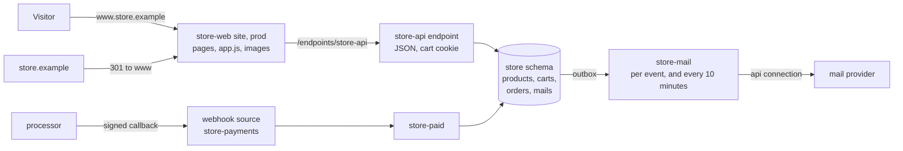

# A public application, start to finish

mcp:knowledge_page:platform-applications builds a shop whose customers are
platform users: they sign in to the portal, and every order is written from
`mcp.email`. This page builds one for the public: anyone with a browser
browses, fills a cart, pays and is mailed, with no platform account.

The preferred shape is a **site that calls JSON endpoints**. The storefront is
a static site, plain pages or a single-page application, published like any
other site; its environment is a part of the application, so its pages call
the application's endpoints at `/endpoints/<name>` on the site's own address.
The data, the rules and the side effects live in the application: its schema,
its endpoints, its events and its schedule.



## What changes when the visitor has no account

On a `public` endpoint `req["caller"]` is `None` and `mcp.email` is empty in
every statement the handler runs, so nothing about the visitor comes from the
platform. A row-level security policy keyed on `mcp.email` matches no row for
them. Who the visitor is, the application keeps itself: a session row whose id
is in an application cookie. Everything a handler reads from the request (the
path, the query, the body, the cookies) is the visitor's to forge, so the
handler checks each value's shape and reads prices and totals from its own
tables, never from the request.

Serving a `public` endpoint to people who are not signed in takes a version an
administrator approved (`manage_approval`), so ask for the approval early.

## 1. The schema

Create the application and its schema as mcp:knowledge_page:platform-applications
does (`manage_application create name=store`, `add_part kind=schema`), then add
these migrations with `manage_schema add`, `plan` and `apply`:

```sql
CREATE TABLE products (
    slug    text PRIMARY KEY CHECK (slug ~ '^[a-z0-9-]{1,60}$'),
    name    text NOT NULL,
    price   numeric(10,2) NOT NULL CHECK (price >= 0),
    image   text NOT NULL
);

CREATE TABLE carts (
    id          uuid PRIMARY KEY DEFAULT gen_random_uuid(),
    lines       jsonb NOT NULL DEFAULT '[]',
    email       text,
    created_at  timestamptz NOT NULL DEFAULT now()
);

CREATE TABLE orders (
    id          bigint GENERATED ALWAYS AS IDENTITY PRIMARY KEY,
    cart_id     uuid NOT NULL REFERENCES carts (id),
    email       text NOT NULL,
    total       numeric(10,2) NOT NULL,
    placed_by   text,
    paid_at     timestamptz,
    placed_at   timestamptz NOT NULL DEFAULT now()
);

CREATE TABLE mails (
    id          bigint GENERATED ALWAYS AS IDENTITY PRIMARY KEY,
    recipient   text NOT NULL,
    subject     text NOT NULL,
    body        text NOT NULL,
    sent_at     timestamptz,
    attempts    integer NOT NULL DEFAULT 0,
    last_error  text,
    created_at  timestamptz NOT NULL DEFAULT now()
);

CREATE INDEX mails_unsent ON mails (created_at) WHERE sent_at IS NULL;
```

A cart is the visitor's session: its id is a random UUID the database makes,
which is what the cookie carries, and it holds the email once the visitor gives
one or signs in. Anonymous checkout needs nothing more. `placed_by` is
`mcp.email` at the time of the order: empty for a visitor, a staff member's
address for an order placed through an authenticated endpoint. `sent_at` is
what a mail was sent at, so a mail with none is one still owed.

Then `manage_schema add template=outbox capture=["mails"]`, so each mail
written is an event, and the last migration's roles, as on
mcp:knowledge_page:platform-applications: `store_write` with `SELECT, INSERT,
UPDATE` on the four tables, `INSERT` on `outbox` and `USAGE` on the schema's
sequences.

## 2. The JSON API

One endpoint answers the whole API. Its path ends in a catch-all, so the
handler reads the rest of the path as `req["params"]["route"]` and routes it.
Save it as `store-api`, add it to the application (`manage_application add_part
kind=script`), and bind it:

```
manage_script command=handler_set kind=endpoint endpoint=store-api methods=["GET", "POST"]
  path="/{route...}" auth_mode=public rate_limit=600 ip_rate_limit=60
```

```python
CONNECTION = "orders"
ORIGIN = "https://www.store.example"
SIGN_IN_KEY = "store-sign-in"
UUID = "^[0-9a-f]{8}-[0-9a-f]{4}-[0-9a-f]{4}-[0-9a-f]{4}-[0-9a-f]{12}$"

PRODUCTS = "SELECT slug, name, price, image FROM store.products ORDER BY name"
PRODUCT = "SELECT slug, name, price, image FROM store.products WHERE slug = :slug"
NEW_CART = "INSERT INTO store.carts DEFAULT VALUES RETURNING id"
CART = "SELECT jsonb_array_length(lines) AS items FROM store.carts WHERE id = CAST(:cart AS uuid)"
ADD_LINE = """
    UPDATE store.carts SET lines = lines || jsonb_build_array(:slug)
     WHERE id = CAST(:cart AS uuid) AND EXISTS (SELECT 1 FROM store.products WHERE slug = :slug)
    RETURNING jsonb_array_length(lines) AS items
"""
PLACE = """
    INSERT INTO store.orders (cart_id, email, total, placed_by)
    SELECT c.id, :email, coalesce(sum(p.price), 0), nullif(current_setting('mcp.email', true), '')
      FROM store.carts c
      LEFT JOIN LATERAL jsonb_array_elements_text(c.lines) AS l(slug) ON true
      LEFT JOIN store.products p ON p.slug = l.slug
     WHERE c.id = CAST(:cart AS uuid)
     GROUP BY c.id
    RETURNING id, total, placed_by
"""
QUEUE_MAIL = "INSERT INTO store.mails (recipient, subject, body) VALUES (:to, :subject, :body)"
ATTACH = "UPDATE store.carts SET email = :email WHERE id = CAST(:cart AS uuid)"

def answer(body, status = 200, cookies = []):
    """A JSON answer, with the cookies it sets."""
    return {"status": status, "json": body, "cookies": cookies}

def cart_cookie(cart):
    """The cookie that holds the visitor's cart for 30 days."""
    return {"name": "cart", "value": cart, "max_age": 2592000}

def cart_of(req):
    """The visitor's cart id from their cookie, or None when it is absent or not a UUID."""
    cart = req["cookies"].get("cart", "")
    return cart if re.match(UUID, cart) else None

def body_of(req, key):
    """One field of the JSON body as trimmed text, empty when it is absent."""
    return str((req["json"] or {}).get(key, "")).strip()

def list_products(_req, rest):
    """Every product, or the one rest names."""
    if not rest:
        return answer(platform.query(PRODUCTS, connection = CONNECTION)["rows"])
    rows = platform.query(PRODUCT, connection = CONNECTION, params = {"slug": rest})["rows"]
    return answer(rows[0]) if rows else answer({"error": "no such product"}, 404)

def cart_items(req, _rest):
    """The visitor's cart, or a product a POST adds to it, making the cart first when they have none."""
    cart = cart_of(req)
    if req["method"] != "POST":
        rows = platform.query(CART, connection = CONNECTION, params = {"cart": cart})["rows"] if cart else []
        return answer({"items": rows[0]["items"] if rows else 0})
    slug = body_of(req, "slug")
    added = []
    if cart:
        added = platform.execute(ADD_LINE, connection = CONNECTION, params = {"cart": cart, "slug": slug})["rows"]
    if not added:
        cart = platform.execute(NEW_CART, connection = CONNECTION)["rows"][0]["id"]
        added = platform.execute(ADD_LINE, connection = CONNECTION, params = {"cart": cart, "slug": slug})["rows"]
    if not added:
        return answer({"error": "no such product"}, 404)
    return answer({"items": added[0]["items"]}, cookies = [cart_cookie(cart)])

def place(cart, email):
    """Writes the order and its confirmation mail in one transaction, and returns the order."""

    def work(tx):
        """Places the order, queues its mail and keeps the address on the cart."""
        order = tx.query(PLACE, params = {"cart": cart, "email": email})["rows"][0]
        body = "Thank you. Order " + str(order["id"]) + " totals " + str(order["total"]) + "."
        tx.execute(QUEUE_MAIL, params = {"to": email, "subject": "Your order", "body": body})
        tx.execute(ATTACH, params = {"cart": cart, "email": email})
        return order

    return platform.transaction(CONNECTION, work)

def check_out(req, _rest):
    """Places the order a POST asks for, from the visitor's cart."""
    cart = cart_of(req)
    email = body_of(req, "email").lower()
    if req["method"] != "POST" or not cart or "@" not in email:
        return answer({"error": "a cart and an email address are needed"}, 400)
    order = place(cart, email)
    return answer({"order": order["id"], "total": order["total"], "caller": req["caller"], "placed_by": order["placed_by"]})

def verify(token):
    """Signs the visitor in with a link's token, which works once."""
    checked = platform.verify_token(token, secret = SIGN_IN_KEY)
    if not checked["ok"]:
        return answer({"error": "this link was used or has expired; ask for a new one"}, 403)
    claims = checked["claims"]
    platform.execute(ATTACH, connection = CONNECTION, params = {"cart": claims["cart"], "email": claims["email"]})
    return answer({"email": claims["email"]}, cookies = [cart_cookie(claims["cart"])])

def sign_in(req, rest):
    """Mails a sign-in link for the address a POST names; signin/verify signs in with the link's token."""
    if req["method"] != "POST":
        return not_found(req, rest)
    if rest == "verify":
        return verify(body_of(req, "token"))
    email = body_of(req, "email").lower()
    if "@" not in email:
        return answer({"error": "an email address is needed"}, 400)
    cart = cart_of(req) or platform.execute(NEW_CART, connection = CONNECTION)["rows"][0]["id"]
    token = platform.mint_token({"email": email, "cart": cart}, 900, secret = SIGN_IN_KEY, single_use = True)
    body = "Open " + ORIGIN + "/signin?token=" + token + " within 15 minutes to sign in."
    platform.execute(QUEUE_MAIL, connection = CONNECTION, params = {"to": email, "subject": "Your sign-in link", "body": body})
    return answer({"sent": True})

def sitemap(_req, _rest):
    """sitemap.xml: the home page and every product page, which robots.txt names."""
    rows = platform.query(PRODUCTS, connection = CONNECTION)["rows"]
    urls = [ORIGIN + "/"] + [ORIGIN + "/products/" + p["slug"] for p in rows]
    entries = "".join(["<url><loc>" + u + "</loc></url>" for u in urls])
    doc = "<?xml version=\"1.0\" encoding=\"UTF-8\"?><urlset xmlns=\"http://www.sitemaps.org/schemas/sitemap/0.9\">" + entries + "</urlset>"
    return {"headers": {"Content-Type": "application/xml"}, "body": doc}

def not_found(_req, _rest):
    """What any other path answers."""
    return answer({"error": "not found"}, 404)

ROUTES = {
    "products": list_products,
    "cart": cart_items,
    "checkout": check_out,
    "signin": sign_in,
    "sitemap.xml": sitemap,
}

def handle(req):
    """Routes every path under the store's API."""
    first, _, rest = req["params"]["route"].partition("/")
    return ROUTES.get(first, not_found)(req, rest)
```

Draft it with a `main()` that walks one visitor through the API, with a
product in the table; the save's test replays that draft, and the endpoint
never calls `main()`:

```python
def visit(route, method = "GET", body = None, cart = ""):
    """The request the storefront's script sends for route."""
    cookies = {"cart": cart} if cart else {}
    return {"method": method, "params": {"route": route}, "json": body, "cookies": cookies, "caller": None}

def main():
    """Walks one visitor through the API: browse, fill a cart, check out, ask for a sign-in link."""
    listed = handle(visit("products"))["json"]
    slug = listed[0]["slug"]
    handle(visit("products/" + slug))
    handle(visit("products/none"))
    cart = handle(visit("cart", "POST", {"slug": slug}))["cookies"][0]["value"]
    handle(visit("cart", "POST", {"slug": slug}, cart))
    handle(visit("cart", "GET", None, cart))
    order = handle(visit("checkout", "POST", {"email": "draft@example.com"}, cart))
    handle(visit("checkout", "POST", {"email": "draft@example.com"}))
    handle(visit("signin", "POST", {"email": "draft@example.com"}, cart))
    handle(visit("signin/verify", "POST", {"token": "not-a-token"}))
    handle(visit("signin"))
    handle(visit("sitemap.xml"))
    handle(visit("nowhere"))
    platform.result({"order": order["json"]["order"]})
```

## 3. The storefront, a site

The storefront is a site (`manage_site create name=store-web`) whose files are
published into `dev` and promoted. It can be plain pages, a site rendered from
`_layouts` at publish, or, as here, a single-page application: one shell page
and a script that renders each route from the API. Its `prod` environment is a
part of the application (`manage_application add_part kind=site
part_id=store-web/prod`), which is what lets its pages call
`/endpoints/store-api/...` on the site's own address.

`index.html` is the shell every route answers with:

```html
<!doctype html>
<html lang="en">
<head>
<meta charset="utf-8">
<meta name="viewport" content="width=device-width, initial-scale=1">
<title>Store</title>
</head>
<body>
<main id="app">Loading the store...</main>
<script type="module" src="/app.js"></script>
</body>
</html>
```

`app.js` renders the route from the API:

```javascript
// app.js: the storefront, one page that renders each route from the store's API.
const app = document.getElementById("app");
const money = (v) => "$" + Number(v).toFixed(2);

function api(path, body) {
  const init = body === undefined ? {} : {
    method: "POST",
    headers: { "Content-Type": "application/json" },
    body: JSON.stringify(body),
  };
  return fetch("/endpoints/store-api/" + path, init).then((r) => r.json());
}

function el(tag, text, attrs = {}) {
  const node = Object.assign(document.createElement(tag), attrs);
  if (text !== undefined) node.textContent = text;
  return node;
}

async function home() {
  const items = await api("products");
  app.replaceChildren(el("h1", "Store"), ...items.map((p) => el("a", p.name, { href: "/products/" + p.slug })));
}

async function product(slug) {
  const p = await api("products/" + encodeURIComponent(slug));
  if (p.error) return location.replace("/404.html");
  const add = el("button", "Add to cart", { type: "button" });
  add.onclick = async () => {
    const cart = await api("cart", { slug: p.slug });
    add.textContent = "In your cart: " + cart.items;
  };
  app.replaceChildren(el("h1", p.name), el("img", undefined, { src: "/images/" + p.image, alt: p.name }), el("p", money(p.price)), add);
}

async function cart() {
  const current = await api("cart");
  const email = el("input", undefined, { type: "email", placeholder: "you@example.com", required: true });
  const pay = el("button", "Check out", { type: "button" });
  pay.onclick = async () => {
    const order = await api("checkout", { email: email.value });
    app.replaceChildren(el("p", order.error || "Order " + order.order + " is placed: " + money(order.total)));
  };
  app.replaceChildren(el("h1", "Your cart"), el("p", current.items + " items"), email, pay);
}

async function signIn() {
  const token = new URLSearchParams(location.search).get("token");
  const done = await api("signin/verify", { token });
  app.replaceChildren(el("p", done.error || "You are signed in as " + done.email + "."));
}

const path = location.pathname;
if (path === "/") home();
else if (path.startsWith("/products/")) product(path.slice("/products/".length));
else if (path === "/cart" || path === "/checkout") cart();
else if (path === "/signin") signIn();
else location.replace("/404.html");
```

`_redirects` answers each of the application's routes with the shell, in
place: a rule with status 200 is a rewrite, so the address the visitor typed
stays and the file named answers it. A path nothing matches answers the site's
`404.html` with status 404.

```text
/products/* /index.html 200
/cart /index.html 200
/checkout /index.html 200
/signin /index.html 200
```

A single-page application that owns every path writes `/* /index.html 200`
instead; a file the release holds (`app.js`, `robots.txt`) always answers
itself first.

`_headers` sets the policy every page is served with. It names the payment
processor's script, its hosted card fields and its API, and nothing else:

```text
/*
  Content-Security-Policy: default-src 'self'; script-src 'self' https://js.stripe.com; frame-src https://js.stripe.com https://*.js.stripe.com; connect-src 'self' https://api.stripe.com; img-src 'self' data:; style-src 'self' 'unsafe-inline'; form-action 'self'; base-uri 'none'
  Permissions-Policy: camera=(), microphone=(), geolocation=()
```

`robots.txt` names the sitemap the API builds from the products, so it never
goes stale:

```text
User-agent: *
Allow: /
Sitemap: https://www.store.example/endpoints/store-api/sitemap.xml
```

and `404.html` is the not-found page:

```html
<!doctype html>
<html lang="en"><head><meta charset="utf-8"><title>Not found</title></head>
<body><h1>We could not find that page.</h1><a href="/">Back to the store</a></body></html>
```

Product images ship with the site's release, under `images/` and named with a
hash of their content (`images/tee.3f2a9c1b.png`, which a build tool writes).
A release never changes, so on a public domain a name carrying a hash is
served `Cache-Control: public, max-age=31536000, immutable` and a browser
never asks for it again; a new image is a new name in the next release. The
images are on the site's own address, so `img-src 'self'` covers them. A file
that changes without a release, such as a price list replaced in place, belongs
in a mounted media folder instead (`manage_site update media=[...]`), which is
revalidated on every request because its content can change under the same
name.

Publish the files with `manage_site publish site=store-web files=[...]` into
`dev`, check them at the dev address, and the application's `release` moves
`prod` to what `dev` serves.

## 4. The session: a cart in a cookie

A handler called from the site's address reads the application's cookies as
`req["cookies"]` and sets them by returning `"cookies"`, exactly as on the
application's own page address. The platform writes each under `__Host-app-`
over https (`app-` over plain http), so a handler sees and sets only `cart`,
never a platform cookie, and the browser keeps it to the one hostname. A
request other than GET or HEAD reaches the handler with no cookies unless it
comes from the site's own address, so another site cannot post into a
visitor's cart; the storefront's own `fetch` calls do. A cookie lives at most
400 days, and `max_age: 0` deletes it.

## 5. Checkout with hosted payment fields

The card number never touches the shop: the processor's hosted fields run in a
frame from its own site, which `_headers` allows (`frame-src`), along with its
script (`script-src`) and its API (`connect-src`). The order is written before
the payment, in one transaction with its confirmation mail (`check_out`
above), and the checkout step passes the order id to the processor as the
payment's metadata.

The processor confirms a payment by calling the platform server to server,
signed. An administrator creates a webhook source for it (Admin > Webhooks,
Sender Stripe, which is `auth.preset: "stripe"`, with the endpoint's signing
secret), and the processor is given `https://<platform>/hooks/store-payments`.
The source checks the signature and the timestamp before it stores anything; a
request that fails is refused and never becomes an event. A script with a
webhook handler for the source (`manage_script command=handler_set
kind=webhook event_source=store-payments`) marks the order paid:

```python
MARK_PAID = "UPDATE store.orders SET paid_at = now() WHERE id = :id AND paid_at IS NULL"

def main():
    """Marks the order a successful payment names as paid; other events change nothing."""
    event = run.event["payload"]
    if event.get("type") != "payment_intent.succeeded":
        platform.result({"paid": None})
        return
    order_id = int(event["data"]["object"]["metadata"]["order_id"])
    platform.execute(MARK_PAID, connection = "orders", params = {"id": order_id})
    platform.result({"paid": order_id})
```

## 6. Sign-in by an emailed link

A returning customer asks for a link and opens it from their mail
(`sign_in` above). The link carries a token from `platform.mint_token`, single
use and good for 15 minutes, signed with a key derived from a stored secret
(Admin > Secrets, `store-sign-in`, with `allow_connections:
["script_token"]`). A token minted in an endpoint request is bound to that
endpoint, so it opens nothing else. The link opens the site's `/signin` page,
whose script posts the token to `signin/verify`.

The second use of a link answers `used` on any replica, because the verify
that accepts a token records it in PostgreSQL. The token is in the mail's row,
in the outbox event and in the audit row of the call that sends it; being
single use and short-lived is what keeps those copies from signing anyone in
later.

## 7. Transactional email from the outbox

The mail provider is an `api` connection (an administrator adds it under Admin
> Connections with the provider's base URL, `auth_mode: api_key` and the key as
`{{secret:mail-provider-key}}`). An administrator creates a webhook source with
input `postgres`, mode `outbox` and the schema's `outbox` table, and one script
holds two handlers, a webhook handler for that source and a schedule: an event
sends its mail at once, and the schedule sends whatever is still owed.

```python
CONNECTION = "orders"
PROVIDER = "mail-provider"
SEND_PATH = "/v1/send"

READ_MAIL = "SELECT id, recipient, subject, body FROM store.mails WHERE id = :id AND sent_at IS NULL"
UNSENT = """
    SELECT id, recipient, subject, body FROM store.mails
     WHERE sent_at IS NULL AND attempts < 10 AND (attempts > 0 OR created_at < now() - interval '10 minutes')
     ORDER BY created_at LIMIT 50
"""
MARK_SENT = "UPDATE store.mails SET sent_at = now(), attempts = attempts + 1, last_error = NULL WHERE id = :id"
MARK_FAILED = "UPDATE store.mails SET attempts = attempts + 1, last_error = :error WHERE id = :id"

def send(mail):
    """Sends one mail through the provider, records what happened, and returns whether it was taken."""
    res = platform.call("api_invoke_endpoint", {
        "connection": PROVIDER,
        "method": "POST",
        "path": SEND_PATH,
        "headers": {"Idempotency-Key": "store-mail-" + str(mail["id"])},
        "body": {"to": mail["recipient"], "subject": mail["subject"], "text": mail["body"]},
        "purpose": "Sends a store mail.",
    }, on_error = "return")
    status = res.get("status", 0)
    if "error" in res or status < 200 or status > 299:
        reason = res["error"]["message"] if "error" in res else "the provider answered " + str(status)
        platform.execute(MARK_FAILED, connection = CONNECTION, params = {"id": mail["id"], "error": reason})
        return False
    platform.execute(MARK_SENT, connection = CONNECTION, params = {"id": mail["id"]})
    return True

def owed(event):
    """The mails a run sends: the one its event names, or on a scheduled run every mail still owed."""
    if event == None:
        return platform.query(UNSENT, connection = CONNECTION)["rows"]
    if event["payload"]["op"] != "INSERT":
        return []
    return platform.query(READ_MAIL, connection = CONNECTION, params = {"id": event["payload"]["row"]["id"]})["rows"]

def main():
    """Sends the mails this run owes and reports how many the provider took."""
    platform.result({"sent": len([m for m in owed(run.event) if send(m)])})

def owed_mail():
    """A database built from the migrations, holding one mail still owed; returns its id."""
    testing.database(CONNECTION, schemas = ["store"])
    added = platform.execute(
        "INSERT INTO store.mails (recipient, subject, body) VALUES (:to, 'Your order', 'Thank you.') RETURNING id",
        connection = CONNECTION,
        params = {"to": "ann@example.com"},
    )
    return added["rows"][0]["id"]

def state_of(mail_id):
    """Whether a mail was sent, and how many sends were tried."""
    rows = platform.query("SELECT sent_at IS NOT NULL AS sent, attempts FROM store.mails WHERE id = :id",
                          connection = CONNECTION, params = {"id": mail_id})["rows"]
    return rows[0]

def test_an_event_sends_its_mail_to_its_recipient():
    """The mail an inserted row names goes to the provider once, to its recipient, and is marked sent."""
    mail_id = owed_mail()
    testing.answer("api_invoke_endpoint", {"connection": PROVIDER, "path": SEND_PATH}, {"status": 202, "body": {}})
    sent = [m for m in owed({"payload": {"op": "INSERT", "row": {"id": mail_id}}}) if send(m)]
    assert.eq(len(sent), 1)
    sends = [c for c in testing.outputs().calls if c.tool == "api_invoke_endpoint"]
    assert.eq([c.args["body"]["to"] for c in sends], ["ann@example.com"])
    assert.eq(state_of(mail_id), {"sent": True, "attempts": 1})

def test_a_provider_that_is_down_leaves_the_mail_for_the_schedule():
    """A failed send records the attempt, and the next scheduled run sends the mail."""
    mail_id = owed_mail()
    down = {"category": "upstream_unavailable", "retryable": True, "message": "connection refused"}
    testing.answer("api_invoke_endpoint", {"connection": PROVIDER}, error = down)
    assert.eq([send(m) for m in owed({"payload": {"op": "INSERT", "row": {"id": mail_id}}})], [False])
    assert.eq(state_of(mail_id), {"sent": False, "attempts": 1})
    testing.answer("api_invoke_endpoint", {"connection": PROVIDER}, {"status": 202, "body": {}})
    assert.eq([send(m) for m in owed(None)], [True])
    assert.eq(state_of(mail_id), {"sent": True, "attempts": 2})
```

Add its handlers with `manage_script handler_set`: `kind: "webhook"` with the
source as `event_source`, and `kind: "schedule"` with `cron: "*/10 * * * *"`.
The platform does not run a failed run again on its own, which is why the
failure is recorded in `attempts` and `last_error` and the schedule picks it up:
a provider that is down delays the mail, never the order, which committed
before any mail was tried. The `Idempotency-Key` lets a provider that honors it
drop a second send of one mail.

An audit row holds a call's arguments, so every recipient address and mail body
sent through the provider is kept in the audit log for its retention period
(`audit.retention_days`). Tell your customers, or keep the bodies to what they
must say.

## 8. Abuse limits

`ip_rate_limit` is how many requests one visitor's address may make a minute
on each replica, beside `rate_limit` for the whole endpoint. An IPv6 visitor is
counted by their /64. The handler reads the same address as `req["client_ip"]`.
Behind a load balancer or ingress the platform sees only the proxy unless
`server.trusted_proxies` names it; with no proxy trusted, `handler_set` warns
that every visitor then shares one address and one limit.

Asking for a sign-in link costs the shop a mail, so put it behind a bot check
too: bind the request as its own endpoint, `store-signin`, with `auth_mode:
"bot_check"`, a check named under Admin > Settings > Bot checks, and the
site's address in `allowed_origins`. The page loads the platform's solver from
the platform's host (name it in `_headers` under `script-src` and
`connect-src`), answers with `PlatformBotCheck.answer("store-signin", {base:
"https://<platform>"})` and posts to `/endpoints/store-signin` on its own
address with the answer in the header the solver names.

## 9. The shop's own hostnames

An administrator adds `www.store.example` to the site's `prod` as a public
domain (`manage_site add_domain hostname=www.store.example site=store-web
environment=prod public=true`). The apex hostname is a second site holding only
a redirect map: `manage_site create name=store-apex`, publish one file,
`_redirects`,

```text
/* https://www.store.example/:splat 301
```

and add `store.example` to its `prod` as a public domain. Every path keeps its
rest and its query string (`store.example/products/tee?ref=ad` arrives at
`www.store.example/products/tee?ref=ad`).

An application served by its page endpoints rather than by a site takes a
hostname of its own the same way, `manage_site add_domain
hostname=www.store.example application=store public=true`.

## 10. Pages rendered on the server

Search engines run a page's script, but a page that must be readable without it
(a product page shared to a service that does not run script, or one whose
first paint must not wait for the API) can be rendered on the server: an
endpoint bound with `response_mode: "page"` on the application's own address,
whose path ends in a catch-all, answers every path with HTML it builds, and its
content policy lists the sites the page frames, calls and posts to
(`page_frame_origins`, `page_connect_origins`, `page_form_origins`). See
mcp:knowledge_page:platform-pages-and-sites. The JSON API, the schema and
everything else on this page stay the same.

## 11. The same pieces for other sites

- **A marketing site**: a static site, its layout rendered from `_layouts` at
  publish, images in a mounted media folder, `_redirects` for old addresses,
  `_headers` for its policy, and a public domain. It needs no application.
- **A company intranet**: a site whose environments stay private. Every
  address asks for the platform's sign-in and opens only to the people and
  personas it is shared with (`manage_site grant`, `level=view`), or to every
  internal person (`internal_view`). Its pages read who signed in from
  `/_viewer`, and as a part of an application its `/endpoints/<name>` run as
  that person, so an authenticated endpoint applies its own rules to them.
- **A single-page application**: one shell page, `/* /index.html 200` in
  `_redirects`, and the API it calls on its own address, as above.

## 12. The release

Add the parts (the schema, `store-api`, `store-signin`, `store-mail`,
`store-paid`, the two webhook sources, and `store-web/prod`) and `release`, as
on mcp:knowledge_page:platform-applications. The endpoints, events and
schedule then run the pinned versions, the release moves `store-web`'s `prod`
to the release its `dev` serves, and a change is tested and released as a
whole.
