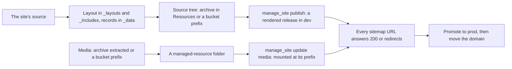

# Bringing a site in from its source

When you hold a site's source (a static generator's project, a CMS export, a
folder of templates and content), bring it in from the source rather than crawling
the running site. A crawl keeps the pages and loses what makes them maintainable:
the shared layout, the records a listing was generated from, and the structure an
agent edits later. The platform has no importer for any one product. You convert
the site, and the platform loads the result without any bulk content passing
through a tool call.



## 1. Read the site before converting it

List, from the source and the running site:

- the content types (articles, products, people) and how many of each;
- the generated listings: indexes, tag and category pages, pagination;
- the dynamic features: forms, search, comments, sign-in, anything that posts;
- the media: where images and downloads live, how many, and their total size;
- every URL the site answers, from its sitemap.

## 2. Extract the layout and the records

- Move the shared shell (header, navigation, footer) into `_layouts/` and the
  repeated fragments into `_includes/`. One change to the layout is then one
  change to every page.
- Move structured content into `_data/<collection>/`: one file per record, JSON,
  YAML, or Markdown with front matter. A listing becomes one page with
  `for_each` and `per_page` over the collection.
- Keep each page's existing body markup as HTML. Rewriting working markup into
  another syntax costs more than it saves and changes what people see.

- A React or other JavaScript application written in TypeScript or JSX keeps its
  source as it is. Add a `_build.json` naming its entry files and mapping each
  library it imports to an exact-version URL, and the platform compiles it at every
  publish. Do not publish a workstation's build output (a bundle with hashed names, or
  `jsx(...)` calls): an agent working in the platform could then only edit generated
  code. A Vite or Next project's `node_modules`, plugins and Tailwind do not come with
  it; map the libraries to URLs and write the CSS.

`mcp:knowledge_page:platform-pages-and-sites` describes layouts, includes, records,
front matter and `_build.json` in full.

## 3. Load the source tree

Pack the source tree into a zip or gzipped tar and put it in Resources. From the
machine the tree is on, ask for an upload link and PUT the archive to it from the
shell; the bytes never pass through a tool call, and no portal, API key or public
object storage is needed:

```
manage_resource action=upload_link filename=site.zip path=sites/marketing
  display_name="Marketing source" description="The marketing site's source tree"
  content_type=application/zip size_bytes=<the archive's size or more>
curl --fail -T site.zip -H 'Content-Type: application/zip' '<upload_url>'
```

The link is good for one upload, expires after 15 minutes (`ttl_seconds`, at most
an hour), takes at most `size_bytes`, and files the archive at that address as you,
with the checks the portal's upload makes. The PUT answers the resource's
reference. A person can upload through the portal's Resources page instead. Then
publish from the archive:

```
manage_site command=publish site=marketing archive=mcp:resource:<id> note="From source"
```

The archive is read where it is stored, by range, and the release is rendered at
publish. A tree already in a bucket publishes from the bucket prefix instead, which
the portal's Publish dialog offers as Bucket prefix. The bucket is read as you:
your persona must hold `s3_list` and `s3_object` and the connection, and the bucket
must be inside the connection's `bucket_prefix`. Either way the release limits
apply (`sites.max_release_files`, `max_release_bytes`, `max_file_bytes`) and a
refusal names the file and the limit. Large publishes run as a job with progress in
the portal.

## 4. Load the media into a mounted folder

Media does not belong in releases. Load it into a managed-resource folder at the
paths the site already uses, then mount the folder at that prefix:

```
manage_resource action=extract reference=mcp:resource:<media archive id> path=sites/marketing/media
manage_site command=update site=marketing
  media=[{"prefix":"/media/","scope":"global","folder":"sites/marketing/media"}]
```

A media archive reaches Resources the way the source tree does: an upload link
and one PUT from the shell. One archive holds up to
`resources.managed.extract.max_members` files (100,000 by default) and
`max_total_bytes` uncompressed (4 GiB by default); split a larger media set over
several archives, or load it from a bucket prefix. Uploading an archive is bounded
by `resources.managed.max_upload_bytes`, which an administrator raises for a large
media archive. Writing into a Global folder takes an administrator, or a person an
administrator granted write on that folder or one above it (Permissions on the
folder in Resources).

## 5. Redirects and dynamic features

- Write `_redirects` for every URL whose address changes: `from to [status]`,
  with `/old/*` and `:splat`.
- Replace each form with a platform form, and each dynamic feature with a script
  endpoint in an application the site is a part of (`mcp:knowledge_page:platform-applications`).

## 6. Prove every URL before cutover

Before a domain moves, request every URL in the original sitemap from the new site
at dev's address, the one `manage_site get` answers in `addresses` (the main address
while dev holds it, else `<site>--dev.<pages domain>`), signed in since `dev` is
private, and confirm each
answers 200 or redirects to the page that replaces it. Fix what does not, publish
again with `base`, and repeat until none is left. Then give the person dev's
address and stop: promoting the release to the environment people use, and moving
the domain, is their decision. An agent's `promote` there asks them, or files a
request they decide in the portal (`APPROVAL_REQUIRED`).

## Moving a Vite or React project in

A React and TypeScript application moves in as its source with a `_build.json`
(`mcp:knowledge_page:platform-pages-and-sites`, TypeScript, TSX and JSX). It is compiled
at publish with no Node; what a workstation build gives it and the platform's compile
does not needs a decision:

1. **Libraries.** Keep `package.json` and the lockfile in the site (they are source,
   never served) and run `manage_site imports site=<site>`: it reads which packages the
   entries import, at the locked versions, with each library's locked peers pinned
   through `?deps=` so that one copy of React loads. Review it and write it into
   `imports`, or set `"imports_from": "package.json"` to generate it at every publish.
   A publish that would load two copies of React is refused, naming the URL.
2. **Path aliases.** Map a `tsconfig` alias to its folder in `imports`:
   `"@/": "/src/"`. The source keeps the imports the team's editor and type checker
   expect.
3. **`import.meta.env` and `define` constants.** Name every value the code reads in
   `define`: `{"import.meta.env.DEV": false, "import.meta.env.VITE_API_BASE_URL": "/api"}`.
   An unset `import.meta.env.X` refuses the publish, naming the file and line. A value
   that differs per environment comes from an application endpoint the page reads when
   it starts, since one release is promoted unchanged.
4. **Tailwind.** Name the version: `"tailwind": "4.1.13"`, with `@import "tailwindcss";`
   in the entry's stylesheet. Move a `tailwind.config.js` into the stylesheet as
   `@theme`, `@custom-variant` and `@utility`; plugins do not load. Tailwind 3 is not
   supported.
5. **Lazy routes.** `React.lazy(() => import("./pages/Reports"))` becomes a chunk under
   `/_chunks/`, loaded when the route is first visited.
6. **Library stylesheets.** `import "lib/style.css"` from a component becomes an
   `@import` in the entry's stylesheet; link that stylesheet (`/app.css`) from the page.
7. **Tooling files.** `tsconfig*.json`, `vite.config.ts`, `.eslintrc*`, `.prettierrc*`
   and `.nvmrc` are kept as source and never served; leave `.npmrc` out (it is refused,
   since it often holds a token). Name anything else to keep unserved in `exclude`:
   `["e2e/**", "docs/**"]`.
8. **Version and errors.** `import.meta.site.release` is the release number; show it as
   the build number. With `"sourcemap": "private"`, maps are served only to the people
   who manage the site, and `manage_site symbolicate site=<site> stack=<trace>` maps a
   minified stack trace to source.

Each publish reports what every entry compiled to, in `builds`: sizes with gzip, the
change from the release before, the largest inputs and the URLs loaded at start.
`"budgets": {"src/main.tsx": {"js_gzip": "300KB"}}` warns in that result when an entry
grows past its budget, and `manage_site build_report` reads a release's report later.

## The site's guide

Write `AGENTS.md` at the site's root before you finish: it is never served, and the next
agent is handed it on its first call on the site (`manage_site get`, the first read,
patch or publish). Keep it current whenever you change how the site is built.

```markdown
# <site>: how it is built

- Build: `_build.json` compiles `src/main.tsx` to `/src/main.js`; `index.html` loads it.
- Imports: local modules by `@/` (mapped to `/src/`); libraries generated from
  package.json (`imports_from`), React 18.3.1 pinned through `deps`.
- Adding a library: add it to package.json and the lockfile, then publish.
- Settings: `src/settings.ts`; per-environment values come from `/endpoints/config`.
- Environments: dev is where changes land; prod moves only by promote.
- Kept as source, not run: `e2e/`, `docs/`.
- Traps: name the stylesheet `styles.css`, not `main.css` (it would collide with the
  entry's output).
```
