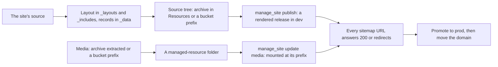

# Bringing a site in from its source

When you hold a site's source (a static generator's project, a CMS export, a
folder of templates and content), bring it in from the source rather than crawling
the running site. A crawl keeps the pages and loses what makes them maintainable:
the shared layout, the records a listing was generated from, and the structure an
agent edits later. The platform has no importer for any one product. You convert
the site, and the platform loads the result without any bulk content passing
through a tool call.



## 1. Read the site before converting it

List, from the source and the running site:

- the content types (articles, products, people) and how many of each;
- the generated listings: indexes, tag and category pages, pagination;
- the dynamic features: forms, search, comments, sign-in, anything that posts;
- the media: where images and downloads live, how many, and their total size;
- every URL the site answers, from its sitemap.

## 2. Extract the layout and the records

- Move the shared shell (header, navigation, footer) into `_layouts/` and the
  repeated fragments into `_includes/`. One change to the layout is then one
  change to every page.
- Move structured content into `_data/<collection>/`: one file per record, JSON,
  YAML, or Markdown with front matter. A listing becomes one page with
  `for_each` and `per_page` over the collection.
- Keep each page's existing body markup as HTML. Rewriting working markup into
  another syntax costs more than it saves and changes what people see.

`mcp:knowledge_page:platform-pages-and-sites` describes layouts, includes, records
and front matter in full.

## 3. Load the source tree

Pack the source tree into a zip or gzipped tar, upload it to Resources (the
portal's upload, or `POST /api/v1/resources`), and publish from it:

```
manage_site command=publish site=marketing archive=mcp:resource:<id> note="From source"
```

The archive is read where it is stored, by range, and the release is rendered at
publish. A tree already in a bucket publishes from the bucket prefix instead, which
the portal's Publish dialog offers as Bucket prefix. The bucket is read as you:
your persona must hold `s3_list` and `s3_object` and the connection, and the bucket
must be inside the connection's `bucket_prefix`. Either way the release limits
apply (`sites.max_release_files`, `max_release_bytes`, `max_file_bytes`) and a
refusal names the file and the limit. Large publishes run as a job with progress in
the portal.

## 4. Load the media into a mounted folder

Media does not belong in releases. Load it into a managed-resource folder at the
paths the site already uses, then mount the folder at that prefix:

```
manage_resource action=extract reference=mcp:resource:<media archive id> path=sites/marketing/media
manage_site command=update site=marketing
  media=[{"prefix":"/media/","scope":"global","folder":"sites/marketing/media"}]
```

One archive holds up to `resources.managed.extract.max_members` files (100,000 by
default) and `max_total_bytes` uncompressed (4 GiB by default); split a larger
media set over several archives, or load it from a bucket prefix. Uploading an
archive is bounded by `resources.managed.max_upload_bytes`, which an administrator
raises for a large media archive.

## 5. Redirects and dynamic features

- Write `_redirects` for every URL whose address changes: `from to [status]`,
  with `/old/*` and `:splat`.
- Replace each form with a platform form, and each dynamic feature with a script
  endpoint in an application the site is a part of (`mcp:knowledge_page:platform-applications`).

## 6. Prove every URL before cutover

Before a domain moves, request every URL in the original sitemap from the new site
at dev's address, the one `manage_site get` answers in `addresses` (the main address
while dev holds it, else `<site>--dev.<pages domain>`), signed in since `dev` is
private, and confirm each
answers 200 or redirects to the page that replaces it. Fix what does not, publish
again with `base`, and repeat until none is left. Then promote the release to the
environment people use and move the domain.
