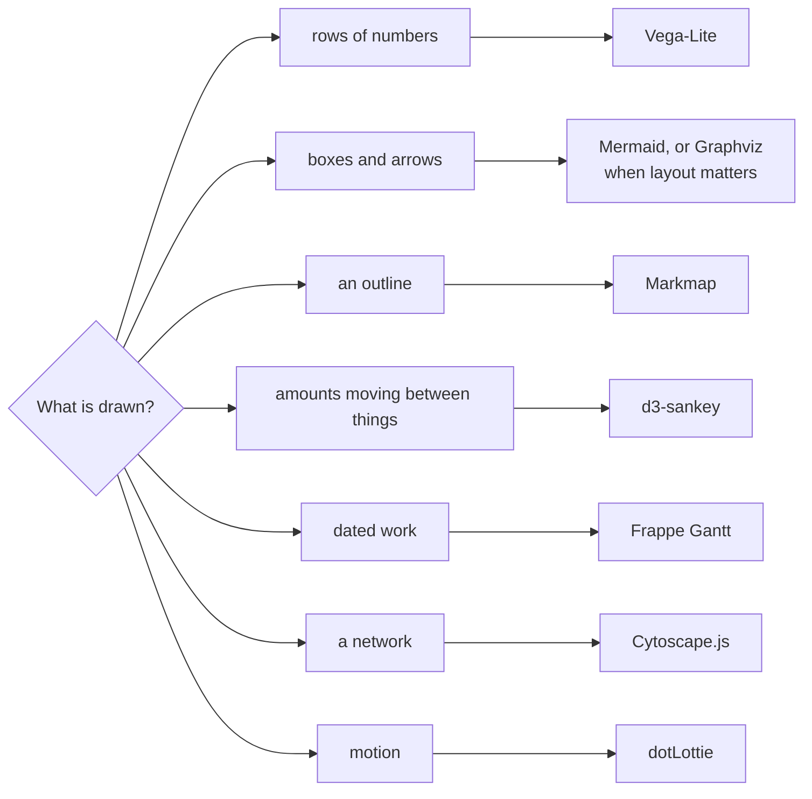

# Charts, diagrams and animation

A chart, a flow, a mind map, a roadmap, a network, a sketch or an animation in
a stored document is drawn by a library loaded from a public CDN, not drawn by
hand in SVG. The libraries below are the ones to reach for. Each is loaded at a
pinned version, so a saved document keeps rendering as it was written, and each
skeleton renders well on the first save: on the asset page, on a share link, in
the thumbnail and in a deck's Export PDF.



| Library | The right tool for | Loads from |
|---|---|---|
| Vega-Lite | charts from rows: bar, line, area, scatter, heatmap, with linked selections | `https://cdn.jsdelivr.net/npm/vega@6.4.0`, `vega-lite@6.5.0`, `vega-embed@7.3.0`, `vega-interpreter@2.3.2` |
| Mermaid | flows, sequences, state, entity-relationship, timelines, quadrants | `https://cdn.jsdelivr.net/npm/mermaid@12.2.0` |
| Markmap | a mind map from a markdown outline | `https://cdn.jsdelivr.net/npm/markmap-autoloader@0.18.12` |
| D3 with d3-sankey | budget, funnel and movement flows from query rows | `https://cdn.jsdelivr.net/npm/d3@7.9.0`, `d3-sankey@0.12.3` |
| Frappe Gantt | roadmaps and plans with dates and dependencies | `https://cdn.jsdelivr.net/npm/frappe-gantt@1.2.2` |
| Cytoscape.js | networks: who calls whom, systems and their links | `https://cdn.jsdelivr.net/npm/cytoscape@3.34.3` |
| Graphviz | graphs where layout matters: dependencies, lineage, state machines | `https://cdn.jsdelivr.net/npm/@hpcc-js/wasm-graphviz@1.29.2` |
| Rough.js | a hand-drawn look for an early design or an explainer | `https://cdn.jsdelivr.net/npm/roughjs@4.6.6` |
| dotLottie | an animated hero, a KPI reveal, a title-slide motion | `https://cdn.jsdelivr.net/npm/@lottiefiles/dotlottie-web@0.81.0` |

Use the version in the table. A different version may render differently, and
a document saved against one keeps working when a newer one ships.

## Rules every skeleton follows

- **Light and dark.** Read `prefers-color-scheme` once and pick the library's
  dark theme or colors from it. The thumbnail is drawn in both, and a reader's
  portal is in either.
- **Size to the frame.** A chart takes the width of its container, not a fixed
  pixel width, and the container has a height. A document's frame is as wide as
  the reader's page area.
- **Reduced motion.** An animation that sees `prefers-reduced-motion: reduce`
  shows its final frame. The thumbnail is drawn that way, so the tile is the
  finished picture.
- **Data inline or by reference.** Rows are written into the document or loaded
  from a file it names by reference, as
  mcp:knowledge_page:platform-asset-references-and-the-refresh-loop describes.
  A script that refreshes the file refreshes the chart.

## Vega-Lite

A chart that IS the asset, with nothing around it, needs no page: save the
spec itself as `application/vnd.vegalite+json` and the portal draws it, with
its tile, on every surface. Its data is inline or a declared reference, and a
script writes one with `platform.export(..., format = "vegalite")`. The
skeleton below is for a chart inside a document or on a slide.

A chart is one JSON object: data, mark, encodings. The interpreter is required:
share links refuse the runtime compiler Vega uses by default, and with
`ast: true` and the interpreter the same chart draws everywhere.

```html
<!DOCTYPE html>
<html lang="en">
<head>
<meta charset="utf-8">
<meta name="viewport" content="width=device-width, initial-scale=1">
<title>Revenue by region</title>
<style>
  body { margin: 0; padding: 16px; font-family: system-ui, sans-serif; }
  @media (prefers-color-scheme: dark) { body { background: #111827; color: #e5e7eb; } }
  #chart { width: 100%; }
</style>
<script src="https://cdn.jsdelivr.net/npm/vega@6.4.0/build/vega.min.js"></script>
<script src="https://cdn.jsdelivr.net/npm/vega-lite@6.5.0/build/vega-lite.min.js"></script>
<script src="https://cdn.jsdelivr.net/npm/vega-embed@7.3.0/build/vega-embed.min.js"></script>
<script src="https://cdn.jsdelivr.net/npm/vega-interpreter@2.3.2/build/vega-interpreter.min.js"></script>
</head>
<body>
<div id="chart"></div>
<script>
  const dark = matchMedia("(prefers-color-scheme: dark)").matches;
  const spec = {
    $schema: "https://vega.github.io/schema/vega-lite/v6.json",
    width: "container", height: 320,
    data: { values: [
      { region: "West", quarter: "Q1", revenue: 38.1 }, { region: "West", quarter: "Q2", revenue: 38.8 },
      { region: "West", quarter: "Q3", revenue: 41.2 }, { region: "Northeast", quarter: "Q1", revenue: 29.4 },
      { region: "Northeast", quarter: "Q2", revenue: 29.6 }, { region: "Northeast", quarter: "Q3", revenue: 29.5 }
    ] },
    params: [{ name: "pick", select: { type: "point", fields: ["region"] }, bind: "legend" }],
    mark: { type: "line", point: true },
    encoding: {
      x: { field: "quarter", type: "ordinal", title: null },
      y: { field: "revenue", type: "quantitative", title: "Revenue ($M)" },
      color: { field: "region", type: "nominal" },
      opacity: { condition: { param: "pick", value: 1 }, value: 0.2 }
    },
    config: { background: null }
  };
  vegaEmbed("#chart", spec, {
    actions: false, ast: true, expr: vega.expressionInterpreter, theme: dark ? "dark" : undefined
  });
</script>
</body>
</html>
```

A selection that filters a second view is a `params` entry on one chart and a
`transform: [{ filter: { param: "pick" } }]` on the other, both inside one
`vconcat` or `hconcat`. Data from a file is `data: { url: "mcp://..." }` with
the reference declared on `save_asset`.

## Mermaid

```html
<!DOCTYPE html>
<html lang="en">
<head>
<meta charset="utf-8">
<meta name="viewport" content="width=device-width, initial-scale=1">
<title>Order flow</title>
<style>
  body { margin: 0; padding: 16px; font-family: system-ui, sans-serif; }
  @media (prefers-color-scheme: dark) { body { background: #111827; color: #e5e7eb; } }
  .mermaid svg { max-width: 100%; height: auto; }
</style>
<script src="https://cdn.jsdelivr.net/npm/mermaid@12.2.0/dist/mermaid.min.js"></script>
</head>
<body>
<pre class="mermaid">
flowchart LR
  A[Order placed] --> B{In stock?}
  B -- yes --> C[Pick and pack]
  B -- no --> D[Back order]
  C --> E[Ship]
  D --> C
</pre>
<script>
  const dark = matchMedia("(prefers-color-scheme: dark)").matches;
  mermaid.initialize({ startOnLoad: true, theme: dark ? "dark" : "default", securityLevel: "strict" });
</script>
</body>
</html>
```

## Markmap

The outline is ordinary markdown headings and bullets; every branch folds.

```html
<!DOCTYPE html>
<html lang="en">
<head>
<meta charset="utf-8">
<meta name="viewport" content="width=device-width, initial-scale=1">
<title>Q4 plan</title>
<style>
  html, body { margin: 0; height: 100%; font-family: system-ui, sans-serif; }
  .markmap { width: 100%; height: 100vh; }
  .markmap > svg { width: 100%; height: 100%; }
  @media (prefers-color-scheme: dark) {
    body { background: #111827; }
    .markmap > svg { --markmap-text-color: #e5e7eb; }
  }
</style>
<script src="https://cdn.jsdelivr.net/npm/markmap-autoloader@0.18.12/dist/index.js"></script>
</head>
<body>
<div class="markmap">
<script type="text/template">
# Q4 plan
## Revenue
- West: hold 6% growth
- Northeast: fix two stores
## Stores
- Two openings
- One refit
## People
- Hire regional lead
</script>
</div>
</body>
</html>
```

## D3 with d3-sankey

Rows of source, target and value become a flow. Query rows map onto `links`
directly; `nodes` is every name that appears in them.

```html
<!DOCTYPE html>
<html lang="en">
<head>
<meta charset="utf-8">
<meta name="viewport" content="width=device-width, initial-scale=1">
<title>Budget flow</title>
<style>
  body { margin: 0; padding: 16px; font-family: system-ui, sans-serif; }
  @media (prefers-color-scheme: dark) { body { background: #111827; color: #e5e7eb; } }
  svg { width: 100%; height: auto; display: block; }
</style>
<script src="https://cdn.jsdelivr.net/npm/d3@7.9.0/dist/d3.min.js"></script>
<script src="https://cdn.jsdelivr.net/npm/d3-sankey@0.12.3/dist/d3-sankey.min.js"></script>
</head>
<body>
<svg id="flow" viewBox="0 0 960 420"></svg>
<script>
  const dark = matchMedia("(prefers-color-scheme: dark)").matches;
  const rows = [
    { source: "Revenue", target: "Payroll", value: 52 }, { source: "Revenue", target: "Stores", value: 28 },
    { source: "Revenue", target: "Marketing", value: 12 }, { source: "Stores", target: "Rent", value: 18 },
    { source: "Stores", target: "Refits", value: 10 }
  ];
  const names = [...new Set(rows.flatMap((r) => [r.source, r.target]))];
  const { nodes, links } = d3.sankey().nodeId((d) => d.name).nodeWidth(14).nodePadding(18)
    .extent([[1, 1], [959, 419]])({ nodes: names.map((name) => ({ name })), links: rows.map((r) => ({ ...r })) });
  const svg = d3.select("#flow"), color = d3.scaleOrdinal(d3.schemeTableau10);
  svg.append("g").attr("fill", "none").selectAll("path").data(links).join("path")
    .attr("d", d3.sankeyLinkHorizontal()).attr("stroke", (d) => color(d.source.name))
    .attr("stroke-opacity", 0.45).attr("stroke-width", (d) => Math.max(1, d.width));
  svg.append("g").selectAll("rect").data(nodes).join("rect")
    .attr("x", (d) => d.x0).attr("y", (d) => d.y0).attr("width", (d) => d.x1 - d.x0)
    .attr("height", (d) => d.y1 - d.y0).attr("fill", (d) => color(d.name));
  svg.append("g").attr("font-size", 13).attr("fill", dark ? "#e5e7eb" : "#111827")
    .selectAll("text").data(nodes).join("text")
    .attr("x", (d) => (d.x0 < 480 ? d.x1 + 6 : d.x0 - 6)).attr("y", (d) => (d.y0 + d.y1) / 2)
    .attr("dy", "0.35em").attr("text-anchor", (d) => (d.x0 < 480 ? "start" : "end"))
    .text((d) => `${d.name} ${d.value}`);
</script>
</body>
</html>
```

## Frappe Gantt

```html
<!DOCTYPE html>
<html lang="en">
<head>
<meta charset="utf-8">
<meta name="viewport" content="width=device-width, initial-scale=1">
<title>Q4 roadmap</title>
<link rel="stylesheet" href="https://cdn.jsdelivr.net/npm/frappe-gantt@1.2.2/dist/frappe-gantt.css">
<style>
  body { margin: 0; padding: 16px; font-family: system-ui, sans-serif; }
  :root { --g-bar-color: #c6d7ea; --g-bar-border: #4e79a7; --g-progress-color: #4e79a7; }
  @media (prefers-color-scheme: dark) { body { background: #111827; color: #e5e7eb; } }
  html[data-theme=dark] { --g-bar-color: #26405c; --g-bar-border: #4e79a7; --g-progress-color: #4e79a7; }
</style>
<script src="https://cdn.jsdelivr.net/npm/frappe-gantt@1.2.2/dist/frappe-gantt.umd.js"></script>
</head>
<body>
<div id="plan"></div>
<script>
  // The stylesheet's dark colors hang off data-theme on the root element.
  if (matchMedia("(prefers-color-scheme: dark)").matches) document.documentElement.dataset.theme = "dark";
  new Gantt("#plan", [
    { id: "hire", name: "Hire regional lead", start: "2026-10-01", end: "2026-10-31", progress: 60 },
    { id: "refit", name: "Northeast refit", start: "2026-10-20", end: "2026-11-25", progress: 10, dependencies: "hire" },
    { id: "open", name: "Two openings", start: "2026-11-15", end: "2026-12-20", progress: 0, dependencies: "refit" }
  ], { view_mode: "Week", readonly: true, today_button: false, view_mode_select: false, scroll_to: "start" });
</script>
</body>
</html>
```

## Cytoscape.js

```html
<!DOCTYPE html>
<html lang="en">
<head>
<meta charset="utf-8">
<meta name="viewport" content="width=device-width, initial-scale=1">
<title>Service map</title>
<style>
  body { margin: 0; padding: 16px; font-family: system-ui, sans-serif; }
  @media (prefers-color-scheme: dark) { body { background: #111827; } }
  #net { width: 100%; height: 420px; }
</style>
<script src="https://cdn.jsdelivr.net/npm/cytoscape@3.34.3/dist/cytoscape.min.js"></script>
</head>
<body>
<div id="net"></div>
<script>
  const dark = matchMedia("(prefers-color-scheme: dark)").matches;
  const fg = dark ? "#e5e7eb" : "#111827";
  cytoscape({
    container: document.getElementById("net"),
    elements: [
      { data: { id: "web", label: "Web" } }, { data: { id: "api", label: "API" } },
      { data: { id: "db", label: "Orders DB" } }, { data: { id: "queue", label: "Queue" } },
      { data: { source: "web", target: "api" } }, { data: { source: "api", target: "db" } },
      { data: { source: "api", target: "queue" } }
    ],
    layout: { name: "breadthfirst", directed: true, padding: 16 },
    style: [
      { selector: "node", style: { label: "data(label)", color: fg, "background-color": "#4e79a7", "text-valign": "bottom", "text-margin-y": 6 } },
      { selector: "edge", style: { width: 2, "line-color": fg, "target-arrow-color": fg, "target-arrow-shape": "triangle", "curve-style": "bezier" } }
    ],
    userZoomingEnabled: false
  });
</script>
</body>
</html>
```

## Graphviz

A graph that IS the asset needs no page: save the DOT source as
`text/vnd.graphviz` and the portal draws it, laid out by the engine its
`layout=` names. A script writes one with `format = "dot"`. The skeleton below
is for a graph inside a document or on a slide.

DOT, laid out by Graphviz compiled to WebAssembly. Choose the engine with
`graphviz.layout(dot, "svg", "neato")`; `dot` is the default.

```html
<!DOCTYPE html>
<html lang="en">
<head>
<meta charset="utf-8">
<meta name="viewport" content="width=device-width, initial-scale=1">
<title>Table lineage</title>
<style>
  body { margin: 0; padding: 16px; font-family: system-ui, sans-serif; }
  @media (prefers-color-scheme: dark) { body { background: #111827; } }
  #graph svg { max-width: 100%; height: auto; }
</style>
</head>
<body>
<div id="graph"></div>
<script type="module">
  import { Graphviz } from "https://cdn.jsdelivr.net/npm/@hpcc-js/wasm-graphviz@1.29.2/dist/index.js";
  const dark = matchMedia("(prefers-color-scheme: dark)").matches;
  const fg = dark ? "#e5e7eb" : "#111827";
  const graphviz = await Graphviz.load();
  document.getElementById("graph").innerHTML = graphviz.dot(`digraph {
    graph [rankdir=LR bgcolor=transparent fontname="Helvetica"]
    node [shape=box style=rounded color="${fg}" fontcolor="${fg}" fontname="Helvetica"]
    edge [color="${fg}"]
    raw_orders -> orders_clean -> daily_revenue
    raw_stores -> orders_clean
    daily_revenue -> regional_dashboard
  }`);
</script>
</body>
</html>
```

## Rough.js

```html
<!DOCTYPE html>
<html lang="en">
<head>
<meta charset="utf-8">
<meta name="viewport" content="width=device-width, initial-scale=1">
<title>Draft: store mix</title>
<style>
  body { margin: 0; padding: 16px; font-family: system-ui, sans-serif; }
  @media (prefers-color-scheme: dark) { body { background: #111827; } }
  svg { width: 100%; height: auto; display: block; }
</style>
<script src="https://cdn.jsdelivr.net/npm/roughjs@4.6.6/bundled/rough.js"></script>
</head>
<body>
<svg id="sketch" viewBox="0 0 600 300"></svg>
<script>
  const dark = matchMedia("(prefers-color-scheme: dark)").matches;
  const fg = dark ? "#e5e7eb" : "#111827";
  const svg = document.getElementById("sketch"), rc = rough.svg(svg);
  const bars = [["West", 41], ["Northeast", 30], ["South", 24]];
  bars.forEach(([name, v], i) => {
    const x = 60 + i * 180, h = v * 5;
    svg.appendChild(rc.rectangle(x, 260 - h, 110, h, { fill: "#4e79a7", stroke: fg, seed: i + 1 }));
    const t = document.createElementNS("http://www.w3.org/2000/svg", "text");
    t.setAttribute("x", x + 55); t.setAttribute("y", 285); t.setAttribute("text-anchor", "middle");
    t.setAttribute("fill", fg); t.textContent = name; svg.appendChild(t);
  });
  svg.appendChild(rc.line(40, 260, 580, 260, { stroke: fg, seed: 9 }));
</script>
</body>
</html>
```

A fixed `seed` keeps the strokes the same on every draw, so the thumbnail and
the page agree.

## dotLottie

An animation made in a design tool is uploaded as a `.lottie` or Lottie JSON
file and named by reference: `src: "mcp://..."` with the reference declared on
`save_asset`. An animation written by hand goes in `data`, as here.

```html
<!DOCTYPE html>
<html lang="en">
<head>
<meta charset="utf-8">
<meta name="viewport" content="width=device-width, initial-scale=1">
<title>Revenue up</title>
<style>
  body { margin: 0; padding: 16px; font-family: system-ui, sans-serif; display: grid; place-items: center; }
  @media (prefers-color-scheme: dark) { body { background: #111827; color: #e5e7eb; } }
  canvas { width: min(100%, 320px); aspect-ratio: 1; }
</style>
</head>
<body>
<canvas id="anim"></canvas>
<script type="module">
  import { DotLottie } from "https://cdn.jsdelivr.net/npm/@lottiefiles/dotlottie-web@0.81.0/dist/index.js";
  const still = matchMedia("(prefers-reduced-motion: reduce)").matches;
  const pulse = {
    v: "5.7.0", fr: 30, ip: 0, op: 60, w: 200, h: 200, layers: [{
      ty: 4, ip: 0, op: 60, st: 0, ks: {
        o: { a: 0, k: 100 }, r: { a: 0, k: 0 }, p: { a: 0, k: [100, 100, 0] }, a: { a: 0, k: [0, 0, 0] },
        s: { a: 1, k: [{ t: 0, s: [40, 40, 100], e: [100, 100, 100] }, { t: 60, s: [100, 100, 100] }] }
      },
      shapes: [{ ty: "gr", it: [
        { ty: "el", p: { a: 0, k: [0, 0] }, s: { a: 0, k: [140, 140] } },
        { ty: "fl", c: { a: 0, k: [0.31, 0.47, 0.65, 1] }, o: { a: 0, k: 100 } },
        { ty: "tr", p: { a: 0, k: [0, 0] }, a: { a: 0, k: [0, 0] }, s: { a: 0, k: [100, 100] }, r: { a: 0, k: 0 }, o: { a: 0, k: 100 } }
      ] }]
    }]
  };
  const player = new DotLottie({ canvas: document.getElementById("anim"), data: pulse, autoplay: !still, loop: !still });
  if (still) player.addEventListener("load", () => player.setFrame(player.totalFrames - 1));
</script>
</body>
</html>
```

## On a slide

Every library above works on a reveal.js slide
(mcp:knowledge_page:platform-presentations): load its script in the deck's
`<head>` beside the runtime and draw into an element on the slide. Two things
differ from a page:

- Give the drawing a fixed size in slide pixels (`width: 860px; height:
  420px` on a 960 by 700 deck). The runtime scales the whole slide, so a fixed
  size is what fits every screen, and a slide not yet shown has no width for a
  `width: "container"` chart to read.
- Draw every slide's figure at load, not when the slide is shown. Export PDF and
  the thumbnail print the slides as they are at load.
- Draw Mermaid with `mermaid.render`, not `startOnLoad`. A diagram laid out in
  place on a slide not yet shown measures its text as zero, prints as an empty
  box and adds a blank page to the PDF; `render` lays it out on its own and
  hands back the drawing:

```html
<section><h2>Order flow</h2><div id="flow" style="width: 860px; height: 420px;"></div></section>
...
<script>
  mermaid.initialize({ startOnLoad: false, securityLevel: "strict" });
  mermaid.render("flow-svg", "flowchart LR\n  A[Order] --> B{In stock?}\n  B -- yes --> C[Ship]")
    .then(({ svg }) => { document.getElementById("flow").innerHTML = svg; });
</script>
```

## In a JSX asset

A JSX asset resolves `react`, `react-dom`, `recharts` and `lucide-react` for
you (mcp:knowledge_page:platform-documents-that-fit-any-screen), and imports any
other library from `https://esm.sh/<name>@<version>`, the only script host its
frame admits. Draw in an effect, into a ref, and set the background from the
reader's scheme on the document's body, which sets none and so is white:

```jsx
import { useEffect, useRef } from "react";
import mermaid from "https://esm.sh/mermaid@12.2.0";

const dark = matchMedia("(prefers-color-scheme: dark)").matches;

export default function Flow() {
  const ref = useRef(null);
  useEffect(() => {
    document.body.style.background = dark ? "#111827" : "#ffffff";
    document.body.style.color = dark ? "#e5e7eb" : "#111827";
    mermaid.initialize({ startOnLoad: false, theme: dark ? "dark" : "default", securityLevel: "strict" });
    mermaid.render("flow", [
      "flowchart LR",
      "  A[Order placed] --> B{In stock?}",
      "  B -- yes --> C[Pick and pack]",
      "  B -- no --> D[Back order]",
      "  C --> E[Ship]",
      "  D --> C",
    ].join("\n")).then(({ svg }) => {
      ref.current.innerHTML = svg;
    });
  }, []);
  return <div ref={ref} style={{ maxWidth: "100%" }} />;
}
```

Graphviz and dotLottie are built on WebAssembly, which a JSX asset's frame does
not compile; use them in an HTML asset.

## Where it does not draw

A CDN library draws wherever the reader's browser and the deployment's
thumbnail renderer can reach the CDN. A deployment on a network that reaches
nothing outside it draws only what it serves itself: the slide runtime and the
map runtime.
